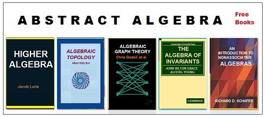

# 📚 Free Abstract Algebra Books & Textbook Repository

Welcome to the **Abstract Algebra Collection** by Free Mathematics Books.

This repository maintains a curated catalogue of freely accessible Abstract Algebra textbooks, lecture notes, and supplementary mathematical resources.

The collection covers fundamental algebraic structures, group theory, rings, fields, modules, Galois theory, quaternion algebras, algebraic topology, and related mathematical subjects.

Resources are organized into subject-based groups to help students, educators, researchers, and independent learners discover relevant mathematical materials.

Each book entry includes its title, author information, and a link to its corresponding resource page.

This repository also welcomes suggestions, corrections, and contributions that help improve the accuracy and usefulness of the collection.

📖 **[Explore the Complete Free Abstract Algebra Collection](https://freemathematicsbooks.com/A.aspx?Id=Abstract-Algebra&utm_source=github&utm_medium=referral&utm_campaign=Abstract-Algebra&utm_content=introduction)**

---

## 📂 Explore Related Algebra & Mathematics Collections

The following collections provide additional resources in closely related mathematical subjects.

| Related Subject | 📚 Online Collection |
| :--- | :--- |
| **Higher Algebra** | [Explore Books](https://freemathematicsbooks.com/A.aspx?Id=Higher-Algebra&utm_source=github&utm_medium=referral&utm_campaign=Higher-Algebra) |
| **Number Theory** | [Explore Books](https://freemathematicsbooks.com/A.aspx?Id=Number-Theory&utm_source=github&utm_medium=referral&utm_campaign=Number-Theory) |
| **Linear Algebra** | [Explore Books](https://freemathematicsbooks.com/A.aspx?Id=Linear-Algebra&utm_source=github&utm_medium=referral&utm_campaign=Linear-Algebra) |
| **Geometry** | [Explore Books](https://freemathematicsbooks.com/A.aspx?Id=Geometry&utm_source=github&utm_medium=referral&utm_campaign=Geometry) |
| **Topology** | [Explore Books](https://freemathematicsbooks.com/A.aspx?Id=Topology&utm_source=github&utm_medium=referral&utm_campaign=Topology) |

---

## 📖 Curated Abstract Algebra Book Catalogue

The following books and supplementary mathematical resources are organized into four groups according to their primary mathematical subject, theoretical focus, and educational purpose.

### 1. 📘 Foundations & Core Abstract Algebra

Foundational textbooks introducing algebraic structures, groups, rings, fields, group actions, and fundamental concepts of abstract algebra.

- 📖 **[Abstract Algebra: Theory and Applications — Thomas W. Judson](https://freemathematicsbooks.com/B.aspx?FileName=Abstract-Algebra-Theory-App--Thomas-Judson&utm_source=github&utm_medium=referral&utm_campaign=Abstract-Algebra&utm_content=book-catalogue)**

Introduces groups, cyclic groups, permutation groups, group actions, rings, fields, Galois theory, and algebraic coding theory.

- 📖 **[Algebra: Abstract and Concrete — Frederick M. Goodman](https://freemathematicsbooks.com/B.aspx?FileName=Algebra-Abstract--Frederick-Goodman&utm_source=github&utm_medium=referral&utm_campaign=Abstract-Algebra&utm_content=book-catalogue)**

Explores groups, homomorphisms, group actions, geometric symmetries, rings, ideals, and algebraic structures.

- 📖 **[Algebra: A Computational Introduction — John Scherk](https://freemathematicsbooks.com/B.aspx?FileName=Algebra-A-Computational-Intro--John-Scherk&utm_source=github&utm_medium=referral&utm_campaign=Abstract-Algebra&utm_content=book-catalogue)**

Introduces computational approaches to group theory, permutation groups, congruences, polynomial rings, Galois groups, and algebraic problem-solving.

---

### 2. 📚 Advanced & Graduate Algebra

Advanced resources covering graduate-level algebra, field extensions, Galois theory, noncommutative structures, and specialized algebraic systems.

- 📖 **[Abstract Algebra: The Basic Graduate Year — Robert B. Ash](https://freemathematicsbooks.com/B.aspx?FileName=Abstract-Algebra-Basic-Graduate--Robert-Ash&utm_source=github&utm_medium=referral&utm_campaign=Abstract-Algebra&utm_content=book-catalogue)**

Covers group theory, ring theory, field theory, module theory, Galois theory, algebraic number theory, and homological algebra.

- 📖 **[Lecture on Galois Theory — Emil Artin & A. N. Milgram](https://freemathematicsbooks.com/B.aspx?FileName=Galois-Theory--Emil-Artin&utm_source=github&utm_medium=referral&utm_campaign=Abstract-Algebra&utm_content=book-catalogue)**

Explores field extensions, polynomial equations, splitting fields, Galois groups, and the relationship between algebraic equations and their symmetries.

- 📖 **[Quaternion Algebras — John Voight](https://freemathematicsbooks.com/B.aspx?FileName=Quaternion-Algebras--John-Voight&utm_source=github&utm_medium=referral&utm_campaign=Abstract-Algebra&utm_content=book-catalogue)**

A specialized treatment of quaternion algebras, quadratic forms, involutions, arithmetic structures, and related algebraic methods.

---

### 3. 🔷 Algebraic, Geometric & Topological Structures

Resources connecting abstract algebra with geometry, topology, number theory, mathematical logic, and advanced algebraic structures.

- 📖 **[Algebraic Topology — Allen Hatcher](https://freemathematicsbooks.com/B.aspx?FileName=Algebraic-Topology--Allen-Hatcher&utm_source=github&utm_medium=referral&utm_campaign=Abstract-Algebra&utm_content=book-catalogue)**

Covers fundamental groups, covering spaces, homology, cohomology, homotopy theory, and fiber bundles.

- 📖 **[Number Theory and Geometry — Alvaro Lozano-Robledo](https://freemathematicsbooks.com/B.aspx?FileName=Number-Theory-Geometry--Alvaro-Lozano-robledo&utm_source=github&utm_medium=referral&utm_campaign=Abstract-Algebra&utm_content=book-catalogue)**

Explores connections between number theory and geometry through integers, polynomial equations, groups, rings, fields, congruences, and Diophantine problems.

- 📖 **[Model Theory, Algebra, and Geometry — Deirdre Haskell](https://freemathematicsbooks.com/B.aspx?FileName=Model-Theory-Algebra-Geometry--Deirdre-Haskell&utm_source=github&utm_medium=referral&utm_campaign=Abstract-Algebra&utm_content=book-catalogue)**

Explores model theory, algebraic structures, fields, real geometry, differential fields, and connections between mathematical logic and algebraic geometry.

- 📖 **[Topological Groups: Yesterday, Today, Tomorrow — Sidney Morris](https://freemathematicsbooks.com/B.aspx?FileName=Topological-Groups--Sidney-Morris&utm_source=github&utm_medium=referral&utm_campaign=Abstract-Algebra&utm_content=book-catalogue)**

Surveys topological groups, Pro-Lie groups, non-Abelian structures, and important developments in algebra and topology.

---

### 4. 💻 Computational, Categorical & Specialized Algebraic Resources

Additional resources covering computational algebra, category theory, abstract mathematical foundations, and specialized algebraic extensions.

- 📖 **[Basic Category Theory — Tom Leinster](https://freemathematicsbooks.com/B.aspx?FileName=Basic-Category-Theory--Tom-Leinster&utm_source=github&utm_medium=referral&utm_campaign=Abstract-Algebra&utm_content=book-catalogue)**

Introduces categories, functors, natural transformations, adjoints, representable functors, and limits.

- 📖 **[Linear Algebra: Introduction to Abstract Math — Isaiah Lankham](https://freemathematicsbooks.com/B.aspx?FileName=Linear-Algebra-Intro-Abstract-Math--Isaiah-Lankham&utm_source=github&utm_medium=referral&utm_campaign=Abstract-Algebra&utm_content=book-catalogue)**

Provides a proof-oriented introduction to vector spaces, linear transformations, eigenvalues, determinants, and abstract mathematical reasoning.

- 📖 **[Super Linear Algebra — Kandasamy & Smarandache](https://freemathematicsbooks.com/B.aspx?FileName=Super-Linear-Algebra--Vasantha-Kandasamy&utm_source=github&utm_medium=referral&utm_campaign=Abstract-Algebra&utm_content=book-catalogue)**

Explores super vector spaces, super inner product superspaces, super linear transformations, and specialized algebraic structures.

---

## 📖 How to Choose a Resource

- **Transition to Proofs & Beginners:** Start with *Linear Algebra: Introduction to Abstract Math* by Isaiah Lankham to build proof-writing fluency before diving into abstract structures.
- **Undergraduate Abstract Algebra:** Use *Abstract Algebra: Theory and Applications* by Thomas W. Judson or *Algebra: Abstract and Concrete* by Frederick M. Goodman for groups, rings, fields, and symmetries.
- **Computational & Algorithmic Algebra:** Explore *Algebra: A Computational Introduction* by John Scherk for concrete polynomial rings, congruences, and Galois computations.
- **Graduate Algebra & Galois Theory:** Study *Abstract Algebra: The Basic Graduate Year* by Robert B. Ash, Emil Artin's *Lecture on Galois Theory*, or *Quaternion Algebras* by John Voight.
- **Algebraic Topology, Category Theory & Interdisciplinary Study:** Turn to *Algebraic Topology* by Allen Hatcher, *Basic Category Theory* by Tom Leinster, or *Number Theory and Geometry* by Alvaro Lozano-Robledo.

---

## 📚 Topics Covered

This collection includes resources covering the following topics:

- Groups, Cyclic Groups, Permutation Groups, and Group Actions
- Homomorphisms, Isomorphism Theorems, and Symmetry Groups
- Rings, Ideals, Polynomial Rings, and Factorization
- Fields, Field Extensions, Splitting Fields, and Galois Theory
- Modules, Homological Algebra, and Noncommutative Quaternion Algebras
- Algebraic Topology, Fundamental Groups, Homology, and Cohomology
- Category Theory, Functors, Natural Transformations, and Adjoints
- Topological Groups, Model Theory, and Algebraic Number Theory

---

## 📋 Book Selection & Verification

Resources in this catalogue are organized according to their primary mathematical subject and educational purpose.

The following considerations guide the organization of this collection:

- **Subject Relevance:** Books are included according to their coverage of abstract algebra or closely related mathematical fields.
- **Bibliographic Information:** Book titles and author details are provided to help readers identify the resources.
- **Resource Accessibility:** Links lead to the corresponding book information pages, where availability and access details can be checked.
- **Subject Classification:** Resources are grouped by their primary mathematical focus to make browsing easier.
- **Link Maintenance:** Broken or outdated links and bibliographic corrections can be reported through GitHub Issues.

---

## 🤝 Contributing to This Repository

Suggestions and contributions are welcome!

You can help improve this collection by:

1. Suggesting freely accessible Abstract Algebra textbooks and academic resources.
2. Reporting broken or outdated book links.
3. Correcting book titles, author names, or bibliographic information.
4. Recommending useful resources covering group theory, ring theory, field theory, and related algebraic subjects.
5. Improving the organization and documentation of the repository.

**How to contribute:**

- Open a GitHub Issue to report a problem or suggest a resource.
- Submit a Pull Request with proposed additions or corrections.
- Include the book title, author, and source link when recommending a resource.

Please ensure that suggested materials are freely accessible and that any shared files comply with applicable copyright and licensing terms.

---

## 🔙 Repository Navigation

- [🏠 Back to Repository Root](../)

---

## 🌐 Explore More Mathematics Resources

**GitHub Collection:** [Free Math Books Repository](https://github.com/FreeMathBooks/free-math-books-collection)

**Substack Publication:** [Free Mathematics Books](https://freemathematicsbooks.substack.com/)

Discover additional free textbooks and educational materials through **[Free Mathematics Books](https://freemathematicsbooks.com/?utm_source=github&utm_medium=referral&utm_campaign=FreeMathematicsBooks&utm_content=repository-footer)**.
