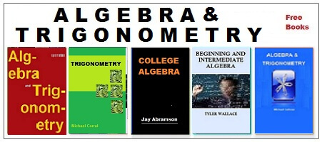

# 📚 Free Algebra and Trigonometry Books & Textbook Repository

Welcome to the **Algebra and Trigonometry Collection** by Free Mathematics Books.

This repository provides a curated selection of free Algebra and Trigonometry textbooks, problem guides, classic treatises, and supplementary resources covering college algebra, integrated algebra and trigonometry, functions and mathematical modeling, trigonometry foundations, practical mathematics, and double algebra.

Resources are organized into subject-based groups to help students, educators, researchers, and independent learners find relevant materials for coursework, problem-solving, and self-study.

Each entry identifies the available book, its author, and a link to its corresponding resource page.

📖 **[Explore the Complete Algebra and Trigonometry Collection](https://freemathematicsbooks.com/A.aspx?Id=Algebra-Trigonometry&utm_source=github&utm_medium=referral&utm_campaign=Algebra-Trigonometry&utm_content=introduction)**

📚 **[Explore the Complete Algebra and Precalculus Collection](https://freemathematicsbooks.com/A.aspx?Id=Algebra-Precalculus&utm_source=github&utm_medium=referral&utm_campaign=Algebra-Precalculus&utm_content=introduction)**

---

## 📖 Curated Algebra and Trigonometry Book Catalogue

The following textbooks and resources are organized into three groups according to their focus on integrated algebra & trigonometry, college algebra & function modeling, and trigonometry & practical/double algebra.

### 1. 📘 Integrated Algebra and Trigonometry

Textbooks combining college algebra, functions, equations, and trigonometry for unified coursework and calculus preparation.

- 📖 **[Algebra and Trigonometry — Jay Abramson](https://freemathematicsbooks.com/B.aspx?FileName=Algebra-Trigonometry--Jay-Abramson&utm_source=github&utm_medium=referral&utm_campaign=Algebra-Trigonometry&utm_content=book-catalogue)**

Integrates core college algebra with right-triangle and unit-circle trigonometry, trigonometric identities, equations, vectors, and applications.

- 📖 **[Algebra and Trigonometry — Michael Sullivan](https://freemathematicsbooks.com/B.aspx?FileName=Algebra-Trigonometry--Michael-Sullivan&utm_source=github&utm_medium=referral&utm_campaign=Algebra-Trigonometry&utm_content=book-catalogue)**

Covers algebraic functions, equations and graphs, exponential and logarithmic functions, trigonometric functions, identities, and analytic trigonometry.

- 📖 **[College Algebra and Trigonometry PDF — Richard Beveridge](https://freemathematicsbooks.com/B.aspx?FileName=College-Algebra-Trig--Richard-Beveridge&utm_source=github&utm_medium=referral&utm_campaign=Algebra-Trigonometry&utm_content=book-catalogue)**

Presents college algebra and trigonometry topics—including functions, equations, graphing, trigonometric ratios, identities, and triangle applications—with exercises.

---

### 2. 📗 College Algebra & Function Modeling

Resources focused on college algebra, equations, inequalities, systems, conic sections, and graphical modeling.

- 📖 **[College Algebra — Jay Abramson](https://freemathematicsbooks.com/B.aspx?FileName=College-Algebra--Jay-Abramson&utm_source=github&utm_medium=referral&utm_campaign=Algebra-Trigonometry&utm_content=book-catalogue)**

A comprehensive college algebra textbook covering equations and inequalities, functions, polynomials, rational/exponential/logarithmic functions, systems, and conic sections.

- 📖 **[Modeling, Functions, and Graphs — Katherine Yoshiwara](https://freemathematicsbooks.com/B.aspx?FileName=Algebra-College-Students--Katherine-Yoshiwara&utm_source=github&utm_medium=referral&utm_campaign=Algebra-Trigonometry&utm_content=book-catalogue)**

Focuses on algebraic functions, graphical interpretation, transformations, and real-world quantitative modeling for college algebra learners.

---

### 3. 📐 Trigonometry, Practical Math & Double Algebra

Texts covering trigonometric functions, practical applied mathematics, and classical double algebra.

- 📖 **[Trigonometry — Ted Sundstrom](https://freemathematicsbooks.com/B.aspx?FileName=Trigonometry--Ted-Sundstrom&utm_source=github&utm_medium=referral&utm_campaign=Algebra-Trigonometry&utm_content=book-catalogue)**

Develops trigonometric functions, radian and degree measure, graphing, trigonometric identities, equations, and triangle applications.

- 📖 **[Mathematics for the Practical Man — George Howe](https://freemathematicsbooks.com/B.aspx?FileName=Mathematics-Practical-Man--George-Howe&utm_source=github&utm_medium=referral&utm_campaign=Algebra-Trigonometry&utm_content=book-catalogue)**

An accessible applied guide covering algebra, geometry, trigonometry, and introductory calculus methods for practical problem solving.

- 📖 **[Trigonometry and Double Algebra — Augustus De Morgan](https://freemathematicsbooks.com/B.aspx?FileName=Trig-Double-Algebra--Augustus-Morgan&utm_source=github&utm_medium=referral&utm_campaign=Algebra-Trigonometry&utm_content=book-catalogue)**

A classic treatise examining trigonometry alongside symbolic and double algebra interpretations.

---

## 📖 How to Choose a Resource

- **Integrated Algebra & Trigonometry:** Start with *Algebra and Trigonometry* by Jay Abramson, *Algebra and Trigonometry* by Michael Sullivan, or *College Algebra and Trigonometry* by Richard Beveridge.
- **College Algebra & Function Modeling:** Use *College Algebra* by Jay Abramson for core college algebra and *Modeling, Functions, and Graphs* by Katherine Yoshiwara for function-based modeling.
- **Trigonometry, Practical & Classical Perspectives:** Choose *Trigonometry* by Ted Sundstrom for dedicated trigonometry, *Mathematics for the Practical Man* by George Howe for applied basics, and *Trigonometry and Double Algebra* by Augustus De Morgan for historical/theoretical depth.

---

## 📚 Topics Covered

This collection includes resources covering the following topics:

- College Algebra, Equations, Inequalities, Systems, and Conic Sections
- Functions, Transformations, Graphs, and Quantitative Modeling
- Right-Triangle and Unit-Circle Trigonometry, Identities, and Equations
- Exponential and Logarithmic Functions, Vectors, and Analytic Trigonometry
- Practical Applied Mathematics and Classical Double Algebra

---

## 📋 Book Selection & Verification

Resources in this catalogue are organized by subject relevance, educational level, and clear bibliographic details. Links direct readers to the corresponding resource pages on Free Mathematics Books, where access details and available formats can be reviewed.

---

## 🤝 Contributing to This Repository

Suggestions and contributions are welcome!

You can help improve this collection by:

1. Suggesting freely accessible Algebra and Trigonometry textbooks and learning materials.
2. Reporting broken or outdated book links.
3. Correcting book titles, author names, or bibliographic details.
4. Recommending relevant supplementary algebra and trigonometry resources.
5. Improving the organization and documentation of the repository.

**How to contribute:**

- Open a GitHub Issue to report a problem or suggest a resource.
- Submit a Pull Request with proposed additions or corrections.
- Include the book title, author, and source link when suggesting a resource.

Please ensure that submitted materials are freely accessible and that any shared files comply with applicable copyright and licensing terms.

---

## 🧭 Repository Navigation

- [⬅️ Back to Main Algebra & Precalculus Category](../)
- [🏠 Back to Home Repository](../../)

---

## 🌐 Explore More Mathematics Resources

- **GitLab:** [Free Mathematics Books Study Guide](https://gitlab.com/mathematics55/FreeMathBooks/-/tree/main) — Subject study guides and topic mirrors.
- **Substack:** [Free Mathematics Books Reading Notes](https://freemathematicsbooks.substack.com/) — Curated reading lists and book highlights.
- **Official Website:** [FreeMathematicsBooks.com](https://freemathematicsbooks.com/?utm_source=github&utm_medium=referral&utm_campaign=FreeMathematicsBooks&utm_content=repository-footer) — Searchable directory of external textbook links.
