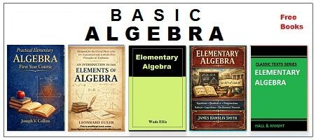

# 📚 Free Basic Algebra Books & Textbook Repository

Welcome to the **Basic Algebra Collection** by Free Mathematics Books.

This repository provides a curated selection of free Basic Algebra textbooks, foundational guides, historical treatises, and supplementary resources covering arithmetic and quantitative readiness, linear equations and inequalities, polynomials and factoring, equations and graphs, and classical algebraic foundations.

Resources are organized into subject-based groups to help students, educators, researchers, and independent learners find relevant materials for coursework, problem-solving, and self-study.

Each entry identifies the available book, its author, and a link to its corresponding resource page.

📖 **[Explore the Complete Basic Algebra Collection](https://freemathematicsbooks.com/A.aspx?Id=Basic-Algebra&utm_source=github&utm_medium=referral&utm_campaign=Basic-Algebra&utm_content=introduction)**

📚 **[Explore the Complete Algebra and Precalculus Collection](https://freemathematicsbooks.com/A.aspx?Id=Algebra-Precalculus&utm_source=github&utm_medium=referral&utm_campaign=Algebra-Precalculus&utm_content=introduction)**

---

## 📖 Curated Basic Algebra Book Catalogue

The following textbooks and resources are organized into three groups according to their focus on foundational/conceptual algebra, equations/graphs/structured courses, and historical algebraic treatises.

### 1. 📘 Foundational & Conceptual Basic Algebra

Textbooks building core arithmetic readiness, intuitive algebraic reasoning, and foundational problem-solving skills.

- 📖 **[Fundamentals of Mathematics — Denny Burzynski](https://freemathematicsbooks.com/B.aspx?FileName=Fundamentals-Math--Denny-Burzynski&utm_source=github&utm_medium=referral&utm_campaign=Basic-Algebra&utm_content=book-catalogue)**

Reviews basic arithmetic, signed numbers, fractions, exponents, and introductory algebraic concepts to establish a strong foundation.

- 📖 **[Understanding Algebra — James W. Brennan](https://freemathematicsbooks.com/B.aspx?FileName=Understanding-Algebra--James-Brennan&utm_source=github&utm_medium=referral&utm_campaign=Basic-Algebra&utm_content=book-catalogue)**

Explains algebraic rules, expressions, equations, and graphs through clear, intuition-focused examples for learners building confidence.

---

### 2. 📗 Elementary Algebra, Equations & Graphs

Structured textbooks covering linear equations and inequalities, polynomials, factoring, rational expressions, radicals, and graphing.

- 📖 **[Elementary Algebra — Denny Burzynski, Wade Ellis](https://freemathematicsbooks.com/B.aspx?FileName=Elementary-Algebra--Denny-Burzynski&utm_source=github&utm_medium=referral&utm_campaign=Basic-Algebra&utm_content=book-catalogue)**

A step-by-step introduction to elementary algebra covering real numbers, linear equations, polynomials, factoring, rational expressions, and radicals.

- 📖 **[Elementary Algebra — H. S. Hall, S. R. Knight](https://freemathematicsbooks.com/B.aspx?FileName=Elementary-Algebra--HS-Hall--SR-Knight&utm_source=github&utm_medium=referral&utm_campaign=Basic-Algebra&utm_content=book-catalogue)**

A classic elementary algebra text featuring clear explanations of algebraic operations, equations, simultaneous systems, and graded exercises.

- 📖 **[Elementary Algebra — John Redden](https://freemathematicsbooks.com/B.aspx?FileName=Elementary-Algebra--John-Redden&utm_source=github&utm_medium=referral&utm_campaign=Basic-Algebra&utm_content=book-catalogue)**

Presents accessible elementary algebra covering linear equations, inequalities, exponents, polynomials, factoring, and quadratic equations.

- 📖 **[Elementary Algebra: Equations and Graphs — Katherine Yoshiwara](https://freemathematicsbooks.com/B.aspx?FileName=Elementary-Algebra--Katherine-Yoshiwara&utm_source=github&utm_medium=referral&utm_campaign=Basic-Algebra&utm_content=book-catalogue)**

Connects algebraic expressions, equations, and inequalities with visual graphs and modeling applications.

---

### 3. 📜 Historical & Classical Algebraic Treatises

Foundational works tracing the development of algebraic methods, equations, and classical analysis.

- 📖 **[Elements of Algebra — Leonhard Euler](https://freemathematicsbooks.com/B.aspx?FileName=Elements-Algebra--Leonhard-Euler&utm_source=github&utm_medium=referral&utm_campaign=Basic-Algebra&utm_content=book-catalogue)**

Leonhard Euler's classic treatise systematically developing arithmetic, algebraic operations, ratios, equations, and indeterminate analysis.

- 📖 **[The Algebra of Khuwarizmi: Translated — Frederic Rosen](https://freemathematicsbooks.com/B.aspx?FileName=Algebra-Khuwarizmi-Translated--Frederic-Rosen&utm_source=github&utm_medium=referral&utm_campaign=Basic-Algebra&utm_content=book-catalogue)**

English translation of al-Khwarizmi's foundational work presenting systematic methods for solving linear and quadratic equations.

---

## 📖 How to Choose a Resource

- **Foundational Readiness & Conceptual Clarity:** Start with *Fundamentals of Mathematics* by Denny Burzynski or *Understanding Algebra* by James W. Brennan.
- **Standard Elementary Algebra & Graphing:** Choose *Elementary Algebra* by Denny Burzynski & Wade Ellis, *Elementary Algebra* by John Redden, *Elementary Algebra: Equations and Graphs* by Katherine Yoshiwara, or *Elementary Algebra* by H. S. Hall & S. R. Knight.
- **Classical & Historical Foundations:** Read *Elements of Algebra* by Leonhard Euler and *The Algebra of Khuwarizmi: Translated* by Frederic Rosen for historical context and classic methods.

---

## 📚 Topics Covered

This collection includes resources covering the following topics:

- Arithmetic Foundations, Signed Numbers, Fractions, and Exponents
- Linear Equations, Inequalities, Systems, and Quadratic Equations
- Polynomials, Factoring, Rational Expressions, and Radicals
- Equations, Coordinate Graphs, and Visual Modeling
- Classical Algebraic Treatises and Historical Equation Methods

---

## 📋 Book Selection & Verification

Resources in this catalogue are organized by subject relevance, educational level, and clear bibliographic details. Links direct readers to the corresponding resource pages on Free Mathematics Books, where access details and available formats can be reviewed.

---

## 🤝 Contributing to This Repository

Suggestions and contributions are welcome!

You can help improve this collection by:

1. Suggesting freely accessible Basic Algebra textbooks and learning materials.
2. Reporting broken or outdated book links.
3. Correcting book titles, author names, or bibliographic details.
4. Recommending relevant supplementary basic algebra resources.
5. Improving the organization and documentation of the repository.

**How to contribute:**

- Open a GitHub Issue to report a problem or suggest a resource.
- Submit a Pull Request with proposed additions or corrections.
- Include the book title, author, and source link when suggesting a resource.

Please ensure that submitted materials are freely accessible and that any shared files comply with applicable copyright and licensing terms.

---

## 🧭 Repository Navigation

- [⬅️ Back to Main Algebra-Precalculus Category](../)
- [🏠 Back to Home Repository](../../../../)

---

## 🌐 Explore More Mathematics Resources

**GitHub Collection:** [Free Math Books Repository](https://github.com/FreeMathBooks/free-math-books-collection)

**Substack Publication:** [Free Mathematics Books](https://freemathematicsbooks.substack.com/)

Discover additional free textbooks and educational materials through **[Free Mathematics Books](https://freemathematicsbooks.com/?utm_source=github&utm_medium=referral&utm_campaign=FreeMathematicsBooks&utm_content=repository-footer)**.
