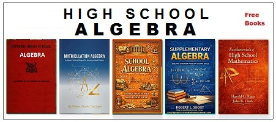

# 📚 Free High School Algebra Books & Textbook Repository

Welcome to the **High School Algebra Collection** by Free Mathematics Books.

This repository provides a curated selection of free High School Algebra textbooks, problem guides, classic treatises, and supplementary resources covering beginning and intermediate algebra, functions and graphing, school and matriculation algebra, advanced high school algebra, and worked algebraic solutions.

Resources are organized into subject-based groups to help students, educators, researchers, and independent learners find relevant materials for coursework, problem-solving, and self-study.

Each entry identifies the available book, its author, and a link to its corresponding resource page.

📖 **[Explore the Complete High School Algebra Collection](https://freemathematicsbooks.com/A.aspx?Id=High-School-Algebra&utm_source=github&utm_medium=referral&utm_campaign=High-School-Algebra&utm_content=introduction)**

📚 **[Explore the Complete Algebra and Precalculus Collection](https://freemathematicsbooks.com/A.aspx?Id=Algebra-Precalculus&utm_source=github&utm_medium=referral&utm_campaign=Algebra-Precalculus&utm_content=introduction)**

---

## 📖 Curated High School Algebra Book Catalogue

The following textbooks and resources are organized into three groups according to their focus on intermediate algebra & functions/modeling, school & matriculation algebra, and advanced high school algebra & worked solutions.

### 1. 📘 Intermediate Algebra, Functions & Modeling

Textbooks developing algebraic operations, equations, inequalities, radicals, quadratics, functions, and graphical modeling.

- 📖 **[Beginning & Intermediate Algebra — Tyler Wallace](https://freemathematicsbooks.com/B.aspx?FileName=Beginning-Int-Algebra--Tyler-Wallace&utm_source=github&utm_medium=referral&utm_campaign=High-School-Algebra&utm_content=book-catalogue)**

Progresses from foundational algebraic rules to linear systems, radicals, quadratics, functions, and exponential/logarithmic equations.

- 📖 **[Intermediate Algebra — Katherine Yoshiwara](https://freemathematicsbooks.com/B.aspx?FileName=Intermediate-Algebra--Katherine-Yoshiwara&utm_source=github&utm_medium=referral&utm_campaign=High-School-Algebra&utm_content=book-catalogue)**

Develops intermediate algebraic methods, function behavior, graphs, systems, and quadratic/exponential models with clear examples.

- 📖 **[Intermediate Algebra: Keeping It Simple — Donna Gaudet](https://freemathematicsbooks.com/B.aspx?FileName=Intermediate-Algebra--Donna-Gaudet&utm_source=github&utm_medium=referral&utm_campaign=High-School-Algebra&utm_content=book-catalogue)**

Presents accessible step-by-step explanations of intermediate algebra topics including polynomials, factoring, rational expressions, radicals, and quadratics.

- 📖 **[Modeling, Functions, and Graphs — Katherine Yoshiwara](https://freemathematicsbooks.com/B.aspx?FileName=Algebra-College-Students--Katherine-Yoshiwara&utm_source=github&utm_medium=referral&utm_campaign=High-School-Algebra&utm_content=book-catalogue)**

Focuses on algebraic functions, graphical interpretation, transformations, and real-world quantitative modeling.

---

### 2. 📗 School & Matriculation Algebra

Structured secondary-level textbooks covering core algebraic techniques, equations, ratios, progressions, and systematic exercises.

- 📖 **[A New Algebra — Samuel Barnard, J. M Child](https://freemathematicsbooks.com/B.aspx?FileName=A-New-Algebra--Samuel-Barnard&utm_source=github&utm_medium=referral&utm_campaign=High-School-Algebra&utm_content=book-catalogue)**

A clear, logically structured algebra text developing algebraic operations, equations, progressions, and analytical reasoning.

- 📖 **[Matriculation Algebra — Nibaran Gupta](https://freemathematicsbooks.com/B.aspx?FileName=Matriculation-Algebra--Nibaran-Gupta&utm_source=github&utm_medium=referral&utm_campaign=High-School-Algebra&utm_content=book-catalogue)**

Covers fundamental algebraic manipulations, factoring, linear and quadratic equations, ratios, and exam-focused problem solving.

- 📖 **[School Algebra — George Wentworth, David E. Smith](https://freemathematicsbooks.com/B.aspx?FileName=School-Algebra--George-Wentworth--David-Smith&utm_source=github&utm_medium=referral&utm_campaign=High-School-Algebra&utm_content=book-catalogue)**

A comprehensive secondary algebra course covering algebraic expressions, equations, graphing, systems, radicals, and progressions.

---

### 3. 📚 Advanced High School Algebra & Worked Solutions

Textbooks and exercise guides extending high school algebra into series, combinatorics, determinants, equations, and worked problems.

- 📖 **[Advanced Algebra — Arthur Schultze](https://freemathematicsbooks.com/B.aspx?FileName=Advanced-Algebra--Arthur-Schultze&utm_source=github&utm_medium=referral&utm_campaign=High-School-Algebra&utm_content=book-catalogue)**

Explores quadratic theory, progressions, permutations and combinations, binomial theorem, logarithms, series, and determinants.

- 📖 **[Advanced Algebra — Herbert E. Hawkes](https://freemathematicsbooks.com/B.aspx?FileName=Advanced-Algebra--Herbert-Hawkes&utm_source=github&utm_medium=referral&utm_campaign=High-School-Algebra&utm_content=book-catalogue)**

Develops higher algebraic topics including complex numbers, theory of equations, permutations, probability, determinants, and infinite series.

- 📖 **[Algebraic Analysis: Solutions and Exercises — George Wentworth](https://freemathematicsbooks.com/B.aspx?FileName=Algebraic-Analysis--George-Wentworth&utm_source=github&utm_medium=referral&utm_campaign=High-School-Algebra&utm_content=book-catalogue)**

Provides worked solutions and practice exercises across algebraic identities, equations, series, and analytical problem solving.

---

## 📖 How to Choose a Resource

- **Intermediate Algebra & Functions:** Start with *Beginning & Intermediate Algebra* by Tyler Wallace, *Intermediate Algebra* by Katherine Yoshiwara, *Intermediate Algebra: Keeping It Simple* by Donna Gaudet, or *Modeling, Functions, and Graphs* by Katherine Yoshiwara.
- **School & Matriculation Courses:** Use *School Algebra* by Wentworth & Smith, *A New Algebra* by Barnard & Child, or *Matriculation Algebra* by Nibaran Gupta.
- **Advanced High School Algebra & Practice:** Read *Advanced Algebra* by Herbert E. Hawkes, *Advanced Algebra* by Arthur Schultze, and *Algebraic Analysis: Solutions and Exercises* by George Wentworth.

---

## 📚 Topics Covered

This collection includes resources covering the following topics:

- Intermediate Algebra, Polynomials, Factoring, Rational Expressions, and Radicals
- Functions, Transformations, Coordinate Graphs, and Quantitative Modeling
- Linear and Quadratic Equations, Systems, Ratios, and Progressions
- Permutations, Combinations, Binomial Theorem, and Determinants
- Complex Numbers, Theory of Equations, Infinite Series, and Worked Solutions

---

## 📋 Book Selection & Verification

Resources in this catalogue are organized by subject relevance, educational level, and clear bibliographic details. Links direct readers to the corresponding resource pages on Free Mathematics Books, where access details and available formats can be reviewed.

---

## 🤝 Contributing to This Repository

Suggestions and contributions are welcome!

You can help improve this collection by:

1. Suggesting freely accessible High School Algebra textbooks and learning materials.
2. Reporting broken or outdated book links.
3. Correcting book titles, author names, or bibliographic details.
4. Recommending relevant supplementary high school algebra resources.
5. Improving the organization and documentation of the repository.

**How to contribute:**

- Open a GitHub Issue to report a problem or suggest a resource.
- Submit a Pull Request with proposed additions or corrections.
- Include the book title, author, and source link when suggesting a resource.

Please ensure that submitted materials are freely accessible and that any shared files comply with applicable copyright and licensing terms.

---

## 🧭 Repository Navigation

- [⬅️ Back to Main Algebra & Precalculus Category](../)
- [🏠 Back to Home Repository](../../)

---

## 🌐 Explore More Mathematics Resources

- **GitLab:** [Free Mathematics Books Study Guide](https://gitlab.com/mathematics55/FreeMathBooks/-/tree/main) — Subject study guides and topic mirrors.
- **Substack:** [Free Mathematics Books Reading Notes](https://freemathematicsbooks.substack.com/) — Curated reading lists and book highlights.
- **Official Website:** [FreeMathematicsBooks.com](https://freemathematicsbooks.com/?utm_source=github&utm_medium=referral&utm_campaign=FreeMathematicsBooks&utm_content=repository-footer) — Searchable directory of external textbook links.
