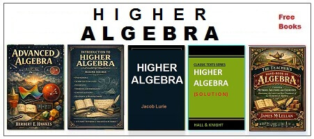

# 📚 Free Higher Algebra Books & Textbook Repository

Welcome to the **Higher Algebra Collection** by Free Mathematics Books.

This repository provides a curated selection of free Higher Algebra textbooks, solution guides, lecture notes, and supplementary resources covering classic higher algebra, worked solutions, theory of equations, mathematical induction, advanced algebra, and higher-categorical/homotopical algebra.

Resources are organized into subject-based groups to help students, educators, researchers, and independent learners find relevant materials for coursework, problem-solving, and self-study.

Each entry identifies the available book, its author, and a link to its corresponding resource page.

📖 **[Explore the Complete Higher Algebra Collection](https://freemathematicsbooks.com/A.aspx?Id=Higher-Algebra&utm_source=github&utm_medium=referral&utm_campaign=Higher-Algebra&utm_content=introduction)**

📚 **[Explore the Complete Algebra and Precalculus Collection](https://freemathematicsbooks.com/A.aspx?Id=Algebra-Precalculus&utm_source=github&utm_medium=referral&utm_campaign=Algebra-Precalculus&utm_content=introduction)**

---

## 📖 Curated Higher Algebra Book Catalogue

The following textbooks and resources are organized into three groups according to their focus on classical higher algebra & worked solutions, theory of equations & mathematical induction, and advanced & higher-categorical algebra.

### 1. 📘 Classical Higher Algebra & Worked Solutions

Foundational texts and solution manuals covering progressions, series, combinatorics, determinants, and algebraic problem solving.

- 📖 **[Higher Algebra — H. S. Hall, S. R. Knight](https://freemathematicsbooks.com/B.aspx?FileName=Higher-Algebra--HS-Hall--SR-Knight&utm_source=github&utm_medium=referral&utm_campaign=Higher-Algebra&utm_content=book-catalogue)**

A classic reference on higher algebra covering progressions, permutations and combinations, binomial theorem, series, inequalities, and continued fractions.

- 📖 **[Higher Algebra Solutions — H. S. Hall, S. R. Knight](https://freemathematicsbooks.com/B.aspx?FileName=Higher-Algebra-Sol--HS-Hall--SR-Knight&utm_source=github&utm_medium=referral&utm_campaign=Higher-Algebra&utm_content=book-catalogue)**

Companion solution guide providing worked solutions to exercises from Hall and Knight's *Higher Algebra*.

---

### 2. 📗 Theory of Equations, Mathematical Induction & Advanced Algebra

Textbooks developing polynomial equation theory, induction proofs, determinants, matrices, and advanced algebraic structures.

- 📖 **[First Course in Theory of Equations — Leonard Dickson](https://freemathematicsbooks.com/B.aspx?FileName=First-Course-Theory-Equations--Leonard-Dickson&utm_source=github&utm_medium=referral&utm_campaign=Higher-Algebra&utm_content=book-catalogue)**

Introduces polynomial equations, roots, synthetic division, symmetric functions, determinants, and algebraic equation theory.

- 📖 **[Introduction To Higher Algebra — Maxime Boucher](https://freemathematicsbooks.com/B.aspx?FileName=Intro-Higher-Algebra--Maxime-Boucher&utm_source=github&utm_medium=referral&utm_campaign=Higher-Algebra&utm_content=book-catalogue)**

Covers determinants, linear equations, linear transformations, quadratic forms, invariants, and algebraic foundations.

- 📖 **[Mathematical Induction — R Horan & M Lavelle](https://freemathematicsbooks.com/B.aspx?FileName=Mathematical-Induction--Horan--Lavelle&utm_source=github&utm_medium=referral&utm_campaign=Higher-Algebra&utm_content=book-catalogue)**

Guides learners through proof by mathematical induction with structured examples, identities, divisibility, and inequalities.

- 📖 **[Advanced Algebra — Arthur Schultze](https://freemathematicsbooks.com/B.aspx?FileName=Advanced-Algebra--Arthur-Schultze&utm_source=github&utm_medium=referral&utm_campaign=Higher-Algebra&utm_content=book-catalogue)**

Explores quadratic theory, progressions, permutations and combinations, binomial theorem, logarithms, series, and determinants.

- 📖 **[Advanced Algebra — Herbert E. Hawkes](https://freemathematicsbooks.com/B.aspx?FileName=Advanced-Algebra--Herbert-Hawkes&utm_source=github&utm_medium=referral&utm_campaign=Higher-Algebra&utm_content=book-catalogue)**

Develops higher algebraic topics including complex numbers, theory of equations, permutations, probability, determinants, and infinite series.

---

### 3. 🔷 Higher-Categorical & Homotopical Algebra

Graduate-level monograph developing higher algebraic structures and monoidal/infinity-categorical methods.

- 📖 **[Higher Algebra — Jacob Lurie](https://freemathematicsbooks.com/B.aspx?FileName=Higher-Algebra--Jacob-Lurie&utm_source=github&utm_medium=referral&utm_campaign=Higher-Algebra&utm_content=book-catalogue)**

A comprehensive graduate reference on higher algebra, symmetric monoidal infinity-categories, associative and commutative algebra objects, and deformation theory.

---

## 📖 How to Choose a Resource

- **Classical Higher Algebra & Practice:** Start with *Higher Algebra* and *Higher Algebra Solutions* by H. S. Hall & S. R. Knight, and practice proof techniques with *Mathematical Induction* by R Horan & M Lavelle.
- **Equations, Determinants & Advanced Algebra:** Use *First Course in Theory of Equations* by Leonard Dickson, *Introduction To Higher Algebra* by Maxime Boucher, and *Advanced Algebra* by Arthur Schultze or Herbert E. Hawkes.
- **Graduate & Higher-Categorical Algebra:** Refer to *Higher Algebra* by Jacob Lurie for advanced infinity-categorical and homotopical algebra.

---

## 📚 Topics Covered

This collection includes resources covering the following topics:

- Progressions, Permutations, Combinations, Binomial Theorem, and Series
- Theory of Equations, Roots, Symmetric Functions, and Inequalities
- Mathematical Induction, Proof Methods, and Algebraic Identities
- Determinants, Linear Transformations, Quadratic Forms, and Complex Numbers
- Higher-Categorical and Monoidal Algebraic Structures

---

## 📋 Book Selection & Verification

Resources in this catalogue are organized by subject relevance, educational level, and clear bibliographic details. Links direct readers to the corresponding resource pages on Free Mathematics Books, where access details and available formats can be reviewed.

---

## 🤝 Contributing to This Repository

Suggestions and contributions are welcome!

You can help improve this collection by:

1. Suggesting freely accessible Higher Algebra textbooks and learning materials.
2. Reporting broken or outdated book links.
3. Correcting book titles, author names, or bibliographic details.
4. Recommending relevant supplementary higher algebra resources.
5. Improving the organization and documentation of the repository.

**How to contribute:**

- Open a GitHub Issue to report a problem or suggest a resource.
- Submit a Pull Request with proposed additions or corrections.
- Include the book title, author, and source link when suggesting a resource.

Please ensure that submitted materials are freely accessible and that any shared files comply with applicable copyright and licensing terms.

---

## 🧭 Repository Navigation

- [⬅️ Back to Main Algebra & Precalculus Category](../)
- [🏠 Back to Home Repository](../../)

---

## 🌐 Explore More Mathematics Resources

- **GitLab:** [Free Mathematics Books Study Guide](https://gitlab.com/mathematics55/FreeMathBooks/-/tree/main) — Subject study guides and topic mirrors.
- **Substack:** [Free Mathematics Books Reading Notes](https://freemathematicsbooks.substack.com/) — Curated reading lists and book highlights.
- **Official Website:** [FreeMathematicsBooks.com](https://freemathematicsbooks.com/?utm_source=github&utm_medium=referral&utm_campaign=FreeMathematicsBooks&utm_content=repository-footer) — Searchable directory of external textbook links.
