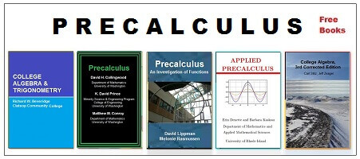

# 📚 Free Precalculus Books & Textbook Repository

Welcome to the **Precalculus Collection** by Free Mathematics Books.

This repository provides a curated selection of free Precalculus textbooks, lecture notes, and supplementary resources covering functions and transformations, college and intermediate algebra foundations, trigonometry, business precalculus, honors precalculus, and calculus preparation.

Resources are organized into subject-based groups to help students, educators, researchers, and independent learners find relevant materials for coursework, calculus readiness, and self-study.

Each entry identifies the available book, its author, and a link to its corresponding resource page.

📖 **[Explore the Complete Precalculus Collection](https://freemathematicsbooks.com/A.aspx?Id=Precalculus&utm_source=github&utm_medium=referral&utm_campaign=Precalculus&utm_content=introduction)**

📚 **[Explore the Complete Algebra and Precalculus Collection](https://freemathematicsbooks.com/A.aspx?Id=Algebra-Precalculus&utm_source=github&utm_medium=referral&utm_campaign=Algebra-Precalculus&utm_content=introduction)**

---

## 📖 Curated Precalculus Book Catalogue

The following textbooks and resources are organized into three groups according to their focus on core & honors precalculus, intermediate & college algebra foundations, and trigonometry & integrated algebra-trigonometry.

### 1. 📘 Core, Applied & Honors Precalculus

Textbooks preparing learners for calculus through function analysis, modeling, business applications, and rigorous problem solving.

- 📖 **[Precalculus 2e — Jay Abramson](https://freemathematicsbooks.com/B.aspx?FileName=Precalculus-2E--Jay-Abramson&utm_source=github&utm_medium=referral&utm_campaign=Precalculus&utm_content=book-catalogue)**

Covers functions, polynomial and rational models, exponential and logarithmic functions, trigonometry, polar coordinates, vectors, sequences, and an introduction to calculus.

- 📖 **[Precalculus: An Investigation of Functions — David Lippman](https://freemathematicsbooks.com/B.aspx?FileName=Precalculus--David-Lippman&utm_source=github&utm_medium=referral&utm_campaign=Precalculus&utm_content=book-catalogue)**

An open-source precalculus textbook emphasizing function behavior, transformations, rates of change, trigonometry, and quantitative modeling.

- 📖 **[Business Precalculus — David Lippman](https://freemathematicsbooks.com/B.aspx?FileName=Business-Precalculus--David-Lippman&utm_source=github&utm_medium=referral&utm_campaign=Precalculus&utm_content=book-catalogue)**

Tailors algebraic functions, exponentials, logarithms, and financial/economic modeling to prepare students for business calculus.

- 📖 **[Precalculus, An Honours Course — David A. Santos](https://freemathematicsbooks.com/B.aspx?FileName=Precalculus--David-Santos&utm_source=github&utm_medium=referral&utm_campaign=Precalculus&utm_content=book-catalogue)**

A rigorous, proof-oriented honors precalculus text covering inequalities, functions, polynomials, trigonometry, complex numbers, and sequences.

---

### 2. 📗 Intermediate & College Algebra Foundations

Textbooks building algebraic fluency with equations, inequalities, functions, graphs, and conic sections.

- 📖 **[Intermediate Algebra — Katherine Yoshiwara](https://freemathematicsbooks.com/B.aspx?FileName=Intermediate-Algebra--Katherine-Yoshiwara&utm_source=github&utm_medium=referral&utm_campaign=Precalculus&utm_content=book-catalogue)**

Develops intermediate algebraic methods, graphing, linear systems, quadratics, radicals, and exponential relationships.

- 📖 **[College Algebra — Jay Abramson](https://freemathematicsbooks.com/B.aspx?FileName=College-Algebra--Jay-Abramson&utm_source=github&utm_medium=referral&utm_campaign=Precalculus&utm_content=book-catalogue)**

Covers equations and inequalities, functions, polynomials, rational/exponential/logarithmic functions, systems, matrices, and conic sections.

---

### 3. 📐 Trigonometry & Integrated Algebra-Trigonometry

Resources focusing on right-triangle and unit-circle trigonometry, identities, trigonometric equations, and integrated algebra-trigonometry courses.

- 📖 **[Algebra and Trigonometry — Jay Abramson](https://freemathematicsbooks.com/B.aspx?FileName=Algebra-Trigonometry--Jay-Abramson&utm_source=github&utm_medium=referral&utm_campaign=Precalculus&utm_content=book-catalogue)**

Combines core college algebra with right-triangle and circular trigonometry, trigonometric identities, equations, vectors, and applications.

- 📖 **[College Trigonometry — Carl Stitz, Jeff Zeager](https://freemathematicsbooks.com/B.aspx?FileName=College-Trigonometry--Carl-Stitz&utm_source=github&utm_medium=referral&utm_campaign=Precalculus&utm_content=book-catalogue)**

A thorough college trigonometry text covering angles, circular functions, identities, trigonometric equations, triangle laws, and polar coordinates.

- 📖 **[Trigonometry — Michael Corral](https://freemathematicsbooks.com/B.aspx?FileName=Trig--Michael-Corral&utm_source=github&utm_medium=referral&utm_campaign=Precalculus&utm_content=book-catalogue)**

A clear, concise reference covering trigonometric functions, identities, solving triangles, vectors, complex numbers, and applications.

---

## 📖 How to Choose a Resource

- **Comprehensive & Honors Precalculus:** Start with *Precalculus 2e* by Jay Abramson or *Precalculus: An Investigation of Functions* by David Lippman; choose *Precalculus, An Honours Course* by David A. Santos for greater rigor and *Business Precalculus* by David Lippman for business/economics tracks.
- **Algebra Readiness & College Algebra:** Review *Intermediate Algebra* by Katherine Yoshiwara and *College Algebra* by Jay Abramson before advancing to calculus.
- **Trigonometry Focus:** Use *Algebra and Trigonometry* by Jay Abramson, *College Trigonometry* by Carl Stitz & Jeff Zeager, or *Trigonometry* by Michael Corral to master trigonometric functions and identities.

---

## 📚 Topics Covered

This collection includes resources covering the following topics:

- Functions, Domain/Range, Transformations, and Quantitative Modeling
- Polynomial, Rational, Exponential, and Logarithmic Functions
- Intermediate and College Algebra, Systems, and Conic Sections
- Right-Triangle and Unit-Circle Trigonometry, Identities, and Equations
- Polar Coordinates, Vectors, Complex Numbers, Sequences, and Calculus Readiness

---

## 📋 Book Selection & Verification

Resources in this catalogue are organized by subject relevance, educational level, and clear bibliographic details. Links direct readers to the corresponding resource pages on Free Mathematics Books, where access details and available formats can be reviewed.

---

## 🤝 Contributing to This Repository

Suggestions and contributions are welcome!

You can help improve this collection by:

1. Suggesting freely accessible Precalculus textbooks and learning materials.
2. Reporting broken or outdated book links.
3. Correcting book titles, author names, or bibliographic details.
4. Recommending relevant supplementary precalculus resources.
5. Improving the organization and documentation of the repository.

**How to contribute:**

- Open a GitHub Issue to report a problem or suggest a resource.
- Submit a Pull Request with proposed additions or corrections.
- Include the book title, author, and source link when suggesting a resource.

Please ensure that submitted materials are freely accessible and that any shared files comply with applicable copyright and licensing terms.

---

## 🧭 Repository Navigation

- [⬅️ Back to Main Algebra-Precalculus Category](../)
- [🏠 Back to Home Repository](../../../../)

---

## 🌐 Explore More Mathematics Resources

**GitHub Collection:** [Free Math Books Repository](https://github.com/FreeMathBooks/free-math-books-collection)

**Substack Publication:** [Free Mathematics Books](https://freemathematicsbooks.substack.com/)

Discover additional free textbooks and educational materials through **[Free Mathematics Books](https://freemathematicsbooks.com/?utm_source=github&utm_medium=referral&utm_campaign=FreeMathematicsBooks&utm_content=repository-footer)**.
