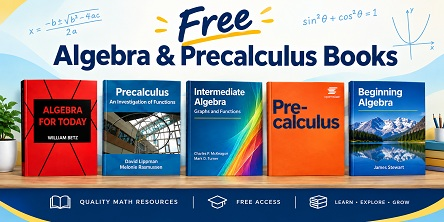

# 📚 Free Algebra & Precalculus Books & Textbook Repository

Welcome to the **Algebra and Precalculus Collection** by Free Mathematics Books.

This repository maintains a curated catalogue of freely accessible Algebra and Precalculus textbooks, solution guides, lecture notes, and supplementary mathematical resources.

Resources are organized by subject, allowing students, educators, and independent learners to explore Algebra and Precalculus materials ranging from elementary and intermediate algebra to college algebra, trigonometry, precalculus, higher algebra, and theory of equations.

Each entry identifies the available book, its author, and a link to its corresponding resource page.

This repository also welcomes suggestions, corrections, and contributions that help improve the accuracy and usefulness of the collection.

📖 **[Explore the Complete Free Algebra & Precalculus Collection](https://freemathematicsbooks.com/A.aspx?Id=Algebra-Precalculus&utm_source=github&utm_medium=referral&utm_campaign=Algebra-Precalculus&utm_content=introduction)**

---

## 📂 Browse Algebra & Precalculus Collections

The following directories organize resources by their primary mathematical subject.

| Subcategory | 📚 Online Collection | 📁 GitHub Folder |
| :--- | :--- | :--- |
| **Basic Algebra** | [View Books](https://freemathematicsbooks.com/A.aspx?Id=Basic-Algebra&utm_source=github&utm_medium=referral&utm_campaign=Basic-Algebra) | [Explore Folder](https://github.com/FreeMathBooks/free-math-books-collection/tree/main/Algebra-Precalculus/Basic-Algebra) |
| **High-School Algebra** | [View Books](https://freemathematicsbooks.com/A.aspx?Id=High-School-Algebra&utm_source=github&utm_medium=referral&utm_campaign=High-School-Algebra) | [Explore Folder](https://github.com/FreeMathBooks/free-math-books-collection/tree/main/Algebra-Precalculus/High-School-Algebra) |
| **Higher Algebra** | [View Books](https://freemathematicsbooks.com/A.aspx?Id=Higher-Algebra&utm_source=github&utm_medium=referral&utm_campaign=Higher-Algebra) | [Explore Folder](https://github.com/FreeMathBooks/free-math-books-collection/tree/main/Algebra-Precalculus/Higher-Algebra) |
| **Precalculus** | [View Books](https://freemathematicsbooks.com/A.aspx?Id=Precalculus&utm_source=github&utm_medium=referral&utm_campaign=Precalculus) | [Explore Folder](https://github.com/FreeMathBooks/free-math-books-collection/tree/main/Algebra-Precalculus/Precalculus) |
| **Trigonometry** | [View Books](https://freemathematicsbooks.com/A.aspx?Id=Trigonometry&utm_source=github&utm_medium=referral&utm_campaign=Trigonometry) | [Explore Folder](https://github.com/FreeMathBooks/free-math-books-collection/tree/main/Algebra-Precalculus/Trigonometry) |
| **Algebra & Trigonometry** | [View Books](https://freemathematicsbooks.com/A.aspx?Id=Algebra-Trigonometry&utm_source=github&utm_medium=referral&utm_campaign=Algebra-Trigonometry) | [Explore Folder](https://github.com/FreeMathBooks/free-math-books-collection/tree/main/Algebra-Precalculus/Algebra-Trigonometry) |

---

## 📖 Curated Algebra & Precalculus Book Catalogue

The following books are organized into three groups according to their primary subject, educational focus, and intended use.

### 1. 📘 Foundational, Intermediate & College Algebra

Core algebra textbooks covering algebraic expressions, equations, inequalities, functions, and college-level algebra.

- 📖 **[Beginning & Intermediate Algebra — Tyler Wallace](https://freemathematicsbooks.com/B.aspx?FileName=Beginning-Int-Algebra--Tyler-Wallace&utm_source=github&utm_medium=referral&utm_campaign=Algebra-Precalculus&utm_content=book-catalogue)**

A structured textbook progressing from foundational algebra to linear systems, radicals, quadratics, functions, and exponential/logarithmic expressions.

- 📖 **[College Algebra — Jay Abramson](https://freemathematicsbooks.com/B.aspx?FileName=College-Algebra--Jay-Abramson&utm_source=github&utm_medium=referral&utm_campaign=Algebra-Precalculus&utm_content=book-catalogue)**

A comprehensive college algebra textbook covering equations and inequalities, functions, polynomials, rational/exponential/logarithmic functions, systems, and conic sections.

- 📖 **[A New Algebra — Samuel Barnard & J. M. Child](https://freemathematicsbooks.com/B.aspx?FileName=A-New-Algebra--Samuel-Barnard&utm_source=github&utm_medium=referral&utm_campaign=Algebra-Precalculus&utm_content=book-catalogue)**

A clear, systematic algebra text developing algebraic operations, equations, ratios, progressions, and analytical reasoning.

---

### 2. 📈 Precalculus & Trigonometry Foundations

Textbooks preparing learners for calculus through functions, graphs, trigonometry, sequences, and analytic foundations.

- 📖 **[Precalculus 2e — Jay Abramson](https://freemathematicsbooks.com/B.aspx?FileName=Precalculus-2E--Jay-Abramson&utm_source=github&utm_medium=referral&utm_campaign=Algebra-Precalculus&utm_content=book-catalogue)**

Covers functions, linear and polynomial/rational models, exponential and logarithmic functions, trigonometry, polar coordinates, vectors, sequences, and introductory calculus concepts.

- 📖 **[Precalculus: An Investigation of Functions — David Lippman & Melonie Rasmussen](https://freemathematicsbooks.com/B.aspx?FileName=Precalculus--David-Lippman&utm_source=github&utm_medium=referral&utm_campaign=Algebra-Precalculus&utm_content=book-catalogue)**

An open-source precalculus text emphasizing function behavior, transformations, trigonometry, rates of change, and modeling for calculus readiness.

- 📖 **[Algebra and Trigonometry — Jay Abramson](https://freemathematicsbooks.com/B.aspx?FileName=Algebra-Trigonometry--Jay-Abramson&utm_source=github&utm_medium=referral&utm_campaign=Algebra-Precalculus&utm_content=book-catalogue)**

Integrates core college algebra with right-triangle and unit-circle trigonometry, trigonometric identities, equations, and applications.

---

### 3. 📚 Higher Algebra & Theory of Equations

Advanced algebraic treatises, solution manuals, and equation theory for deeper mathematical study.

- 📖 **[Higher Algebra — H. S. Hall & S. R. Knight](https://freemathematicsbooks.com/B.aspx?FileName=Higher-Algebra--HS-Hall--SR-Knight&utm_source=github&utm_medium=referral&utm_campaign=Algebra-Precalculus&utm_content=book-catalogue)**

A classic reference on higher algebra covering progressions, permutations and combinations, binomial theorem, infinite series, inequalities, and continued fractions.

- 📖 **[Higher Algebra Solutions — Hall & Knight](https://freemathematicsbooks.com/B.aspx?FileName=Higher-Algebra-Sol--HS-Hall--SR-Knight&utm_source=github&utm_medium=referral&utm_campaign=Algebra-Precalculus&utm_content=book-catalogue)**

Companion solution guide providing worked solutions to exercises from Hall and Knight's *Higher Algebra*.

- 📖 **[First Course in Theory of Equations — Leonard E. Dickson](https://freemathematicsbooks.com/B.aspx?FileName=First-Course-Theory-Equations--Leonard-Dickson&utm_source=github&utm_medium=referral&utm_campaign=Algebra-Precalculus&utm_content=book-catalogue)**

Introduces polynomial equations, roots, synthetic division, symmetric functions, determinants, and algebraic equation theory.

---

## 📖 How to Choose a Resource

- **Beginning to College Algebra:** Start with *Beginning & Intermediate Algebra* by Tyler Wallace or *A New Algebra* by Samuel Barnard & J. M. Child, and use *College Algebra* by Jay Abramson for college-level topics.
- **Calculus Preparation & Trigonometry:** Choose *Precalculus 2e* by Jay Abramson, *Precalculus: An Investigation of Functions* by David Lippman & Melonie Rasmussen, or *Algebra and Trigonometry* by Jay Abramson.
- **Higher Algebra & Theory of Equations:** Explore *Higher Algebra* and *Higher Algebra Solutions* by Hall & Knight along with *First Course in Theory of Equations* by Leonard E. Dickson.

---

## 📚 Topics Covered

This collection includes resources covering the following topics:

- Elementary, Intermediate, and College Algebra
- Linear Equations, Inequalities, Systems, and Conic Sections
- Functions, Transformations, Exponentials, and Logarithms
- Trigonometry, Trigonometric Identities, Polar Coordinates, and Vectors
- Progressions, Combinatorics, Binomial Theorem, and Inequalities
- Higher Algebra, Worked Solutions, and Theory of Equations

---

## 📋 Book Selection & Verification

Resources in this catalogue are organized according to their main subject and educational purpose.

The following considerations guide the organization of this collection:

- **Subject Relevance:** Books are included according to their coverage of Algebra and Precalculus or closely related mathematical subjects.
- **Bibliographic Information:** Book titles and author details are provided to help readers identify the resources.
- **Resource Accessibility:** Links lead to the corresponding book information pages, where availability and access details can be checked.
- **Subject Classification:** Resources are grouped by their primary educational focus to make browsing easier.
- **Link Maintenance:** Broken links and bibliographic corrections can be reported through GitHub Issues.

---

## 🤝 Contributing to This Repository

Suggestions and contributions are welcome!

You can help improve this collection by:

1. Suggesting freely accessible Algebra and Precalculus textbooks and learning materials.
2. Reporting broken or outdated book links.
3. Correcting book titles, author names, or bibliographic details.
4. Recommending relevant supplementary mathematical resources.
5. Improving the organization and documentation of the repository.

**How to contribute:**

- Open a GitHub Issue to report a problem or suggest a resource.
- Submit a Pull Request with proposed additions or corrections.
- Include the book title, author, and source link when suggesting a resource.

Please ensure that submitted materials are freely accessible and that any shared files comply with applicable copyright and licensing terms.

---

## 🧭 Repository Navigation

- [🏠 Back to Repository Root](../)

---

## 🌐 Explore More Mathematics Resources

- **GitLab:** [Free Mathematics Books Study Guide](https://gitlab.com/mathematics55/FreeMathBooks/-/tree/main) — Subject study guides and topic mirrors.
- **Substack:** [Free Mathematics Books Reading Notes](https://freemathematicsbooks.substack.com/) — Curated reading lists and book highlights.
- **Official Website:** [FreeMathematicsBooks.com](https://freemathematicsbooks.com/?utm_source=github&utm_medium=referral&utm_campaign=FreeMathematicsBooks&utm_content=repository-footer) — Searchable directory of external textbook links.

