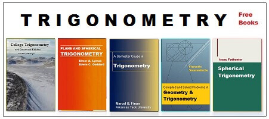

# 📚 Free Trigonometry Books & Textbook Repository

Welcome to the **Trigonometry Collection** by Free Mathematics Books.

This repository provides a curated selection of free Trigonometry textbooks, short courses, problem collections, and supplementary resources covering right-triangle and unit-circle trigonometry, trigonometric identities and equations, solved geometry and trigonometry problems, and spherical trigonometry.

Resources are organized into subject-based groups to help students, educators, researchers, and independent learners find relevant materials for coursework, problem-solving, and self-study.

Each entry identifies the available book, its author, and a link to its corresponding resource page.

📖 **[Explore the Complete Trigonometry Collection](https://freemathematicsbooks.com/A.aspx?Id=Trigonometry&utm_source=github&utm_medium=referral&utm_campaign=Trigonometry&utm_content=introduction)**

📚 **[Explore the Complete Algebra and Precalculus Collection](https://freemathematicsbooks.com/A.aspx?Id=Algebra-Precalculus&utm_source=github&utm_medium=referral&utm_campaign=Algebra-Precalculus&utm_content=introduction)**

---

## 📖 Curated Trigonometry Book Catalogue

The following textbooks and resources are organized into three groups according to their focus on core/comprehensive trigonometry, concise courses & problem-solving, and spherical trigonometry.

### 1. 📘 Core & Comprehensive Trigonometry

Textbooks developing trigonometric functions, radian/degree measure, identities, graphs, inverse functions, and trigonometric equations.

- 📖 **[College Trigonometry — Carl Stitz, Jeff Zeager](https://freemathematicsbooks.com/B.aspx?FileName=College-Trigonometry--Carl-Stitz&utm_source=github&utm_medium=referral&utm_campaign=Trigonometry&utm_content=book-catalogue)**

A thorough college-level trigonometry text covering angles, circular functions, identities, equations, triangle applications, and polar coordinates with exercises.

- 📖 **[Open Trigonometry: Basic to Advanced — WikiBooks](https://freemathematicsbooks.com/B.aspx?FileName=Open-Trig-Basic-Advanced--WikiBooks&utm_source=github&utm_medium=referral&utm_campaign=Trigonometry&utm_content=book-catalogue)**

Progresses from foundational right-triangle and unit-circle concepts to identities, laws of sines and cosines, complex numbers, and advanced trigonometric topics.

- 📖 **[Trigonometry — Michael Corral](https://freemathematicsbooks.com/B.aspx?FileName=Trig--Michael-Corral&utm_source=github&utm_medium=referral&utm_campaign=Trigonometry&utm_content=book-catalogue)**

A clear, concise reference covering trigonometric functions, identities, solving triangles, vectors, complex numbers, and applications in science and engineering.

- 📖 **[Trigonometry — Richard Beveridge](https://freemathematicsbooks.com/B.aspx?FileName=Trigonometry--Richard-Beveridge&utm_source=github&utm_medium=referral&utm_campaign=Trigonometry&utm_content=book-catalogue)**

Covers trigonometric ratios, unit-circle definitions, graphing, identities, inverse trigonometric functions, and oblique triangle problem solving.

---

### 2. 🧩 Short Courses & Solved Problems

Accessible guides and worked problem sets reinforcing geometric intuition and trigonometric problem-solving skills.

- 📖 **[Dave's Short Course in Trigonometry — David Joyce](https://freemathematicsbooks.com/B.aspx?FileName=Dave-Short-Course-Trigo--David-Joyce&utm_source=github&utm_medium=referral&utm_campaign=Trigonometry&utm_content=book-catalogue)**

An intuitive, well-illustrated short course introducing angles, trigonometric functions, identities, and triangle laws for quick conceptual mastery.

- 📖 **[255 Solved Geometry & Trigonometry Problems — Florentin Smarandache](https://freemathematicsbooks.com/B.aspx?FileName=Geometry-Trig--Florentin-Smarandache&utm_source=github&utm_medium=referral&utm_campaign=Trigonometry&utm_content=book-catalogue)**

Provides worked solutions to 255 geometry and trigonometry problems illustrating trigonometric relationships, triangle properties, and problem-solving strategies.

---

### 3. 🌐 Spherical Trigonometry

Specialized classic treatise extending trigonometry to spherical triangles and celestial/navigational geometry.

- 📖 **[Spherical Trigonometry — Isaac Todhunter](https://freemathematicsbooks.com/B.aspx?FileName=Spherical-Trig--Isaac-Todhunter&utm_source=github&utm_medium=referral&utm_campaign=Trigonometry&utm_content=book-catalogue)**

A classic treatise on spherical triangles, Napier's rules, spherical excess, and applications to astronomy and navigation.

---

## 📖 How to Choose a Resource

- **Core Coursework & Reference:** Start with *College Trigonometry* by Carl Stitz & Jeff Zeager, *Trigonometry* by Michael Corral, *Trigonometry* by Richard Beveridge, or *Open Trigonometry: Basic to Advanced* by WikiBooks.
- **Quick Overview & Worked Practice:** Use *Dave's Short Course in Trigonometry* by David Joyce for a concise conceptual overview and *255 Solved Geometry & Trigonometry Problems* by Florentin Smarandache for worked problem practice.
- **Spherical Geometry & Astronomy Applications:** Read *Spherical Trigonometry* by Isaac Todhunter for spherical triangles and classical spherical methods.

---

## 📚 Topics Covered

This collection includes resources covering the following topics:

- Angles, Radian Measure, Right Triangles, and Unit-Circle Functions
- Trigonometric Identities, Inverse Functions, Equations, and Graphs
- Laws of Sines and Cosines, Polar Coordinates, Vectors, and Complex Numbers
- Worked Geometry and Trigonometry Problems
- Spherical Trigonometry and Navigational/Astronomical Applications

---

## 📋 Book Selection & Verification

Resources in this catalogue are organized by subject relevance, educational level, and clear bibliographic details. Links direct readers to the corresponding resource pages on Free Mathematics Books, where access details and available formats can be reviewed.

---

## 🤝 Contributing to This Repository

Suggestions and contributions are welcome!

You can help improve this collection by:

1. Suggesting freely accessible Trigonometry textbooks and learning materials.
2. Reporting broken or outdated book links.
3. Correcting book titles, author names, or bibliographic details.
4. Recommending relevant supplementary trigonometry resources.
5. Improving the organization and documentation of the repository.

**How to contribute:**

- Open a GitHub Issue to report a problem or suggest a resource.
- Submit a Pull Request with proposed additions or corrections.
- Include the book title, author, and source link when suggesting a resource.

Please ensure that submitted materials are freely accessible and that any shared files comply with applicable copyright and licensing terms.

---

## 🧭 Repository Navigation

- [⬅️ Back to Main Algebra & Precalculus Category](../)
- [🏠 Back to Home Repository](../../)

---

## 🌐 Explore More Mathematics Resources

- **GitLab:** [Free Mathematics Books Study Guide](https://gitlab.com/mathematics55/FreeMathBooks/-/tree/main) — Subject study guides and topic mirrors.
- **Substack:** [Free Mathematics Books Reading Notes](https://freemathematicsbooks.substack.com/) — Curated reading lists and book highlights.
- **Official Website:** [FreeMathematicsBooks.com](https://freemathematicsbooks.com/?utm_source=github&utm_medium=referral&utm_campaign=FreeMathematicsBooks&utm_content=repository-footer) — Searchable directory of external textbook links.
