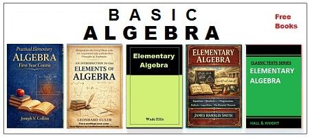

# 📚 Free Elementary Algebra Books & Textbook Repository

Welcome to the **Elementary Algebra Collection** by Free Mathematics Books.

This repository provides a curated selection of free Elementary Algebra textbooks, problem guides, historical classics, and supplementary resources covering arithmetic and primary math foundations, linear and quadratic equations, inequalities and functions, intermediate and college algebra, higher algebra and theory of equations, and classical algebraic treatises.

Resources are organized into subject-based groups to help students, educators, researchers, and independent learners find relevant materials for coursework, problem-solving, and self-study.

Each entry identifies the available book, its author, and a link to its corresponding resource page.

📖 **[Explore the Complete Elementary Algebra Collection](https://freemathematicsbooks.com/A.aspx?Id=Basic-Algebra&utm_source=github&utm_medium=referral&utm_campaign=Basic-Algebra&utm_content=introduction)**

📚 **[Explore the Complete Algebra and Trigonometry Collection](https://freemathematicsbooks.com/A.aspx?Id=Algebra-Trigonometry&utm_source=github&utm_medium=referral&utm_campaign=Algebra-Trigonometry&utm_content=introduction)**

---

## 📖 Curated Elementary Algebra Book Catalogue

The following textbooks and resources are organized into four groups according to their focus on arithmetic/foundations, elementary/understanding algebra, intermediate/college algebra, and higher algebra/classical treatises.

### 1. 📘 Arithmetic & Foundational Mathematics

Foundational resources covering core arithmetic, early mathematical reasoning, and basic quantitative skills leading into algebra.

- 📖 **[A Practical Arithmetic — Frank Lincoln Stevens](https://freemathematicsbooks.com/B.aspx?FileName=Practical-Arithmetic--Frank-Stevens&utm_source=github&utm_medium=referral&utm_campaign=Basic-Algebra&utm_content=book-catalogue)**

Covers fundamental arithmetic operations, fractions, decimals, percentage, ratio and proportion, and everyday calculation methods.

- 📖 **[Fundamentals of Mathematics — Denny Burzynski](https://freemathematicsbooks.com/B.aspx?FileName=Fundamentals-Math--Denny-Burzynski&utm_source=github&utm_medium=referral&utm_campaign=Basic-Algebra&utm_content=book-catalogue)**

Reviews basic arithmetic, signed numbers, fractions, exponents, and introductory algebraic concepts for foundational readiness.

- 📖 **[Primary Mathematics — Wikibooks](https://freemathematicsbooks.com/B.aspx?FileName=Primary-Math--Wikibooks&utm_source=github&utm_medium=referral&utm_campaign=Basic-Algebra&utm_content=book-catalogue)**

Introduces primary-level numbers, basic operations, measurement, and early problem-solving concepts.

- 📖 **[First Year Mathematics — George W. Evans, John A. Marsh](https://freemathematicsbooks.com/B.aspx?FileName=First-Year-Math--George-Evans&utm_source=github&utm_medium=referral&utm_campaign=Basic-Algebra&utm_content=book-catalogue)**

Integrates foundational algebra, geometry, and problem-solving for first-year mathematics learners.

---

### 2. 📗 Elementary & Conceptual Algebra

Textbooks introducing algebraic expressions, linear equations and inequalities, factoring, polynomials, and graphing.

- 📖 **[Elementary Algebra — Denny Burzynski, Wade Ellis](https://freemathematicsbooks.com/B.aspx?FileName=Elementary-Algebra--Denny-Burzynski&utm_source=github&utm_medium=referral&utm_campaign=Basic-Algebra&utm_content=book-catalogue)**

A structured introduction to elementary algebra covering real numbers, linear equations, polynomials, factoring, rational expressions, and radicals.

- 📖 **[Elementary Algebra — H. S. Hall, S. R. Knight, F. L. Sevenoak](https://freemathematicsbooks.com/B.aspx?FileName=Elementary-Algebra--HS-Hall--SR-Knight&utm_source=github&utm_medium=referral&utm_campaign=Basic-Algebra&utm_content=book-catalogue)**

A classic elementary algebra text featuring clear explanations of algebraic manipulation, equations, simultaneous systems, and graded exercises.

- 📖 **[Elementary Algebra — John Redden](https://freemathematicsbooks.com/B.aspx?FileName=Elementary-Algebra--John-Redden&utm_source=github&utm_medium=referral&utm_campaign=Basic-Algebra&utm_content=book-catalogue)**

Presents step-by-step elementary algebra covering linear equations, inequalities, exponents, polynomials, factoring, and quadratic equations.

- 📖 **[Understanding Algebra — James W. Brennan](https://freemathematicsbooks.com/B.aspx?FileName=Understanding-Algebra--James-Brennan&utm_source=github&utm_medium=referral&utm_campaign=Basic-Algebra&utm_content=book-catalogue)**

Explains algebraic principles, equations, functions, and graphs with intuitive examples aimed at building conceptual clarity.

---

### 3. 📙 Intermediate & College Algebra

Textbooks bridging elementary algebra with functions, systems, exponentials, logarithms, sequences, and college-level topics.

- 📖 **[Beginning and Intermediate Algebra — Tyler Wallace](https://freemathematicsbooks.com/B.aspx?FileName=Beginning-Int-Algebra--Tyler-Wallace&utm_source=github&utm_medium=referral&utm_campaign=Basic-Algebra&utm_content=book-catalogue)**

Covers foundational through intermediate algebra—including linear systems, radicals, quadratics, functions, and exponential/logarithmic expressions.

- 📖 **[College Algebra — Jay Abramson](https://freemathematicsbooks.com/B.aspx?FileName=College-Algebra--Jay-Abramson&utm_source=github&utm_medium=referral&utm_campaign=Basic-Algebra&utm_content=book-catalogue)**

A comprehensive college algebra textbook covering functions, equations and inequalities, polynomials, rational/exponential/logarithmic functions, conic sections, and systems.

- 📖 **[Intermediate Algebra — Katherine Yoshiwara](https://freemathematicsbooks.com/B.aspx?FileName=Intermediate-Algebra--Katherine-Yoshiwara&utm_source=github&utm_medium=referral&utm_campaign=Basic-Algebra&utm_content=book-catalogue)**

Develops intermediate algebraic techniques, modeling with functions, equations, radicals, and quadratic/exponential relationships.

- 📖 **[Intermediate Algebra — Donna Gaudet, William Meacham](https://freemathematicsbooks.com/B.aspx?FileName=Intermediate-Algebra--Donna-Gaudet&utm_source=github&utm_medium=referral&utm_campaign=Basic-Algebra&utm_content=book-catalogue)**

Covers algebraic expressions, linear and quadratic equations, inequalities, functions, polynomials, and rational/radical expressions.

---

### 4. 📜 Higher Algebra, Theory of Equations & Historical Classics

Advanced algebraic treatises, solution guides, and foundational historical works on algebra.

- 📖 **[Algebraic Analysis: Solutions and Exercises — George Wentworth](https://freemathematicsbooks.com/B.aspx?FileName=Algebraic-Analysis--George-Wentworth&utm_source=github&utm_medium=referral&utm_campaign=Basic-Algebra&utm_content=book-catalogue)**

Provides worked solutions and practice exercises across algebraic identities, equations, series, and analytical problem solving.

- 📖 **[Elements of Algebra — Leonhard Euler](https://freemathematicsbooks.com/B.aspx?FileName=Elements-Algebra--Leonhard-Euler&utm_source=github&utm_medium=referral&utm_campaign=Basic-Algebra&utm_content=book-catalogue)**

Leonhard Euler's classic treatise systematically developing arithmetic, algebraic operations, ratios, equations, and indeterminate analysis.

- 📖 **[First Course in Theory of Equations — Leonard Dickson](https://freemathematicsbooks.com/B.aspx?FileName=First-Course-Theory-Equations--Leonard-Dickson&utm_source=github&utm_medium=referral&utm_campaign=Basic-Algebra&utm_content=book-catalogue)**

Introduces polynomial equations, roots, synthetic division, symmetric functions, determinants, and algebraic equation theory.

- 📖 **[Higher Algebra — H. S. Hall, S. R. Knight](https://freemathematicsbooks.com/B.aspx?FileName=Higher-Algebra--HS-Hall--SR-Knight&utm_source=github&utm_medium=referral&utm_campaign=Basic-Algebra&utm_content=book-catalogue)**

A classic reference on higher algebra covering progressions, permutations and combinations, binomial theorem, series, inequalities, and continued fractions.

- 📖 **[Solutions of the Examples in Higher algebra — H. S. Hall, S. R. Knight](https://freemathematicsbooks.com/B.aspx?FileName=Higher-Algebra-Sol--HS-Hall--SR-Knight&utm_source=github&utm_medium=referral&utm_campaign=Basic-Algebra&utm_content=book-catalogue)**

Companion solution manual providing worked answers to exercises from Hall and Knight's *Higher Algebra*.

- 📖 **[The Algebra of Khuwarizmi: Translated — Frederic Rosen](https://freemathematicsbooks.com/B.aspx?FileName=Algebra-Khuwarizmi-Translated--Frederic-Rosen&utm_source=github&utm_medium=referral&utm_campaign=Basic-Algebra&utm_content=book-catalogue)**

English translation of al-Khwarizmi's foundational work on algebraic equations and systematic solution methods.

---

## 📖 How to Choose a Resource

- **Arithmetic & First Steps in Algebra:** Start with *Fundamentals of Mathematics* by Denny Burzynski, *A Practical Arithmetic* by Frank Lincoln Stevens, or *Primary Mathematics* by Wikibooks, then move to *Elementary Algebra* by Burzynski & Ellis, John Redden, or Hall, Knight & Sevenoak.
- **Intermediate & College Algebra:** Choose *Beginning and Intermediate Algebra* by Tyler Wallace, *Intermediate Algebra* by Yoshiwara or Gaudet & Meacham, and *College Algebra* by Jay Abramson.
- **Higher Algebra, Theory of Equations & Classics:** Explore *Higher Algebra* and its *Solutions of the Examples in Higher algebra* by Hall & Knight, *First Course in Theory of Equations* by Leonard Dickson, and historical classics by Leonhard Euler and al-Khwarizmi.

---

## 📚 Topics Covered

This collection includes resources covering the following topics:

- Arithmetic Operations, Fractions, Ratios, Proportions, and Foundational Readiness
- Linear Equations, Inequalities, Polynomials, Factoring, and Radicals
- Functions, Quadratic Equations, Exponentials, Logarithms, and College Algebra
- Progressions, Combinatorics, Binomial Theorem, Inequalities, and Theory of Equations
- Classical Algebraic Treatises and Worked Problem Solutions

---

## 📋 Book Selection & Verification

Resources in this catalogue are organized by subject relevance, educational level, and clear bibliographic details. Links direct readers to the corresponding resource pages on Free Mathematics Books, where access details and available formats can be reviewed.

---

## 🤝 Contributing to This Repository

Suggestions and contributions are welcome!

You can help improve this collection by:

1. Suggesting freely accessible Elementary Algebra textbooks and learning materials.
2. Reporting broken or outdated book links.
3. Correcting book titles, author names, or bibliographic details.
4. Recommending relevant supplementary elementary algebra resources.
5. Improving the organization and documentation of the repository.

**How to contribute:**

- Open a GitHub Issue to report a problem or suggest a resource.
- Submit a Pull Request with proposed additions or corrections.
- Include the book title, author, and source link when suggesting a resource.

Please ensure that submitted materials are freely accessible and that any shared files comply with applicable copyright and licensing terms.

---

## 🧭 Repository Navigation

- [⬅️ Back to Main Algebra and Trigonometry Category](../)
- [🏠 Back to Home Repository](../../../../)

---

## 🌐 Explore More Mathematics Resources

**GitHub Collection:** [Free Math Books Repository](https://github.com/FreeMathBooks/free-math-books-collection)

**Substack Publication:** [Free Mathematics Books](https://freemathematicsbooks.substack.com/)

Discover additional free textbooks and educational materials through **[Free Mathematics Books](https://freemathematicsbooks.com/?utm_source=github&utm_medium=referral&utm_campaign=FreeMathematicsBooks&utm_content=repository-footer)**.
