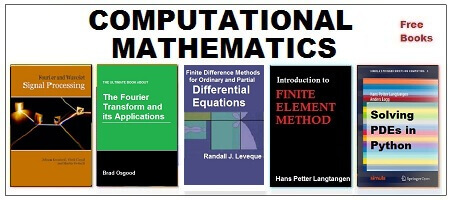

# 📚 Free Computational Mathematics Books & Textbook Repository

Welcome to the **Computational Mathematics Collection** by Free Mathematics Books.

This repository provides a curated selection of free Computational Mathematics textbooks, lecture notes, and supplementary resources covering computational linear algebra, matrix computations, numerical differential equations, finite difference and finite element methods, boundary elements, wavelets, computational algebra and number theory, and neural networks.

Resources are organized into subject-based groups to help students, educators, researchers, and independent learners find relevant computational references for coursework, scientific computing, and self-study.

Each entry identifies the available book, its author, and a link to its corresponding resource page.

📖 **[Explore the Complete Computational Mathematics Collection](https://freemathematicsbooks.com/A.aspx?Id=Computational-Mathematics&utm_source=github&utm_medium=referral&utm_campaign=Computational-Mathematics&utm_content=introduction)**

📚 **[Explore the Complete Applied Mathematics Collection](https://freemathematicsbooks.com/A.aspx?Id=Applied-Mathematics&utm_source=github&utm_medium=referral&utm_campaign=Applied-Mathematics&utm_content=introduction)**

---

## 📖 Curated Computational Mathematics Book Catalogue

The following textbooks and resources are organized into four groups according to their computational methods, mathematical structures, and applications.

### 1. 📐 Computational Linear Algebra & Matrix Computations

Algorithms, matrix factorizations, Python implementations, and computational foundations of linear and matrix algebra.

- 📖 **[A First Course in Linear Algebra — Robert Beezer](https://freemathematicsbooks.com/B.aspx?FileName=First-Course-Linear-Algebra--Robert-Beezer&utm_source=github&utm_medium=referral&utm_campaign=Computational-Mathematics&utm_content=book-catalogue)**

An open-source introduction to linear algebra covering systems of linear equations, vectors, matrices, determinants, eigenvalues, and computational techniques.

- 📖 **[Advanced Linear Algebra: Foundations to Frontiers — Robert Geijn](https://freemathematicsbooks.com/B.aspx?FileName=Advanced-Linear-Algebra--Robert-Geijn&utm_source=github&utm_medium=referral&utm_campaign=Computational-Mathematics&utm_content=book-catalogue)**

Connects theoretical linear algebra with high-performance matrix decompositions, singular value decomposition, and algorithmic design.

- 📖 **[Applied & Computational Linear Algebra — Charles Byrne](https://freemathematicsbooks.com/B.aspx?FileName=Applied-Computational-Linear-Algebra--Charles-Byrne&utm_source=github&utm_medium=referral&utm_campaign=Computational-Mathematics&utm_content=book-catalogue)**

Explores matrix factorizations, iterative methods, least-squares approximations, and computational linear algebra applications.

- 📖 **[Computational & Algorithmic Linear Algebra — Katta Murty](https://freemathematicsbooks.com/B.aspx?FileName=Computational-Algorithmic-Linear-Algebra--Katta-Murty&utm_source=github&utm_medium=referral&utm_campaign=Computational-Mathematics&utm_content=book-catalogue)**

Presents algorithmic procedures for matrix operations, linear systems, and computational problem-solving in applied mathematics.

- 📖 **[Computational Methods of Linear Algebra — V. N. Faddeeva](https://freemathematicsbooks.com/B.aspx?FileName=Computational-Methods-Linear-Algebra--V-Faddeeva&utm_source=github&utm_medium=referral&utm_campaign=Computational-Mathematics&utm_content=book-catalogue)**

A classic reference detailing numerical algorithms for solving linear systems, inverting matrices, and computing eigenvalues.

- 📖 **[Fundamentals of Matrix Algebra — Gregory Hartman](https://freemathematicsbooks.com/B.aspx?FileName=Fundamentals-Matrix-Algebra--Gregory-Hartman&utm_source=github&utm_medium=referral&utm_campaign=Computational-Mathematics&utm_content=book-catalogue)**

Introduces matrix arithmetic, row reduction, determinants, eigenvalues, and computational matrix methods for students.

- 📖 **[Lecture Notes of Matrix Computations — Wen Wei Lin](https://freemathematicsbooks.com/B.aspx?FileName=Lecture-Notes-Matrix-Computations--Wen-Wei-Lin&utm_source=github&utm_medium=referral&utm_campaign=Computational-Mathematics&utm_content=book-catalogue)**

Covers numerical matrix computations, decompositions, linear least squares, and eigenvalue algorithms in depth.

- 📖 **[Linear Algebra — Jim Hefferon](https://freemathematicsbooks.com/B.aspx?FileName=Linear-Algebra-Jim-Hefferon&utm_source=github&utm_medium=referral&utm_campaign=Computational-Mathematics&utm_content=book-catalogue)**

A clear, proof-friendly linear algebra textbook with examples and applications suited to mathematical and computational study.

- 📖 **[Linear Algebra with Python — Sean Fitzpatrick](https://freemathematicsbooks.com/B.aspx?FileName=Linear-Algebra-Python--Sean-Fitzpatrick&utm_source=github&utm_medium=referral&utm_campaign=Computational-Mathematics&utm_content=book-catalogue)**

Integrates linear algebra concepts with Python programming and computational experimentation for vectors, matrices, and linear systems.

- 📖 **[Matrix Algebra with Computational Applications — Dirk Colbry](https://freemathematicsbooks.com/B.aspx?FileName=Matrix-Algebra-Computational-App--Dirk-Colbry&utm_source=github&utm_medium=referral&utm_campaign=Computational-Mathematics&utm_content=book-catalogue)**

Focuses on hands-on matrix computation, linear equations, and computational workflows for scientific and engineering data.

---

### 2. 🌊 Numerical ODEs, PDEs, Finite Elements & Boundary Elements

Discretization schemes, finite differences, finite elements, boundary element methods, and Python ODE solvers.

- 📖 **[Boundary Element Methods in Engineering — M. H. Aliabadi](https://freemathematicsbooks.com/B.aspx?FileName=Boundary-Element-Methods--Eng-Sci--MH-Aliabadi&utm_source=github&utm_medium=referral&utm_campaign=Computational-Mathematics&utm_content=book-catalogue)**

Presents boundary integral equations and boundary element methods for solving engineering and physical boundary problems.

- 📖 **[Finite Difference Computing with PDEs — Hans Petter Langtangen](https://freemathematicsbooks.com/B.aspx?FileName=Finite-Difference-PDEs--Hans-Langtangen&utm_source=github&utm_medium=referral&utm_campaign=Computational-Mathematics&utm_content=book-catalogue)**

Teaches finite difference discretization, stability analysis, and scientific programming for partial differential equations.

- 📖 **[Finite Difference Methods for Differential — Randall LeVeque](https://freemathematicsbooks.com/B.aspx?FileName=Finite-Difference-Methods-DE--Randall-LeVeque&utm_source=github&utm_medium=referral&utm_campaign=Computational-Mathematics&utm_content=book-catalogue)**

Covers finite difference schemes, convergence, stability, and numerical methods for ordinary and partial differential equations.

- 📖 **[Finite Element Analysis - From Biomedical to Industrial — David Moratal](https://freemathematicsbooks.com/B.aspx?FileName=Finite-Element-Analysis--David-Moratal&utm_source=github&utm_medium=referral&utm_campaign=Computational-Mathematics&utm_content=book-catalogue)**

Introduces finite element modeling and numerical simulation across biomedical engineering and industrial applications.

- 📖 **[Finite Element Methods for Electromagnetics — Stanley Humphries Jr](https://freemathematicsbooks.com/B.aspx?FileName=Finite-Element-Methods--Stanley-Humphries&utm_source=github&utm_medium=referral&utm_campaign=Computational-Mathematics&utm_content=book-catalogue)**

Applies finite element numerical techniques to electrostatic, magnetostatic, and wave electromagnetic problems.

- 📖 **[Solving Ordinary Differential Equations in Python — Joakim Sundnes](https://freemathematicsbooks.com/B.aspx?FileName=Solving-ODE-Python--Joakim-Sundnes&utm_source=github&utm_medium=referral&utm_campaign=Computational-Mathematics&utm_content=book-catalogue)**

Demonstrates numerical ODE integration methods, solver selection, and scientific modeling workflows implemented in Python.

---

### 3. 🔢 Computational Algebra, Number Theory & Real Algebraic Geometry

Algorithmic methods in number theory, finite fields, polynomials, and real algebraic geometry.

- 📖 **[A Computational Number Theory & Algebra — Victor Shoup](https://freemathematicsbooks.com/B.aspx?FileName=Comp-Number-Theory-Algebra--Victor-Shoup&utm_source=github&utm_medium=referral&utm_campaign=Computational-Mathematics&utm_content=book-catalogue)**

A comprehensive computational textbook covering integer arithmetic, modular arithmetic, primality testing, discrete logarithms, finite fields, and polynomial algebra.

- 📖 **[Algorithms in Real Algebraic Geometry — Saugata Basu](https://freemathematicsbooks.com/B.aspx?FileName=Algorithms-Real-Algebraic-Geometry--Saugata-Basu&utm_source=github&utm_medium=referral&utm_campaign=Computational-Mathematics&utm_content=book-catalogue)**

Explores algorithmic methods and complexity in real algebraic geometry, semialgebraic sets, and polynomial systems.

---

### 4. 📊 Wavelets, Fourier Analysis & Neural Networks

Harmonic transforms, wavelet representations, and computational neural network models.

- 📖 **[From Fourier Analysis to Wavelets — Jonas Gomes, et al.](https://freemathematicsbooks.com/B.aspx?FileName=From-Fourier-Analysis-Wavelets--Jonas-Gomes&utm_source=github&utm_medium=referral&utm_campaign=Computational-Mathematics&utm_content=book-catalogue)**

Covers Fourier series and transforms, time-frequency localization, multiresolution analysis, and wavelet transforms.

- 📖 **[Neural Networks and Deep Learning — Michael Nielsen](https://freemathematicsbooks.com/B.aspx?FileName=Neural-Networks-Deep-Learning--Michael-Nielsen&utm_source=github&utm_medium=referral&utm_campaign=Computational-Mathematics&utm_content=book-catalogue)**

Explains the mathematical foundations, backpropagation, gradient descent, and computational mechanics of neural networks.

---

## 📖 How to Choose a Resource

- **Matrix Computations & Python Linear Algebra:** Start with Robert Beezer, Jim Hefferon, Gregory Hartman, or Sean Fitzpatrick for foundational and Python-assisted linear algebra, and explore Robert Geijn, Yousef Saad/Faddeeva/Wen Wei Lin for advanced matrix algorithms.
- **Numerical ODEs, PDEs, FEM & BEM:** Choose Randall LeVeque, Hans Petter Langtangen, David Moratal, Stanley Humphries Jr, M. H. Aliabadi, or Joakim Sundnes.
- **Computational Number Theory & Real Algebraic Geometry:** Use Victor Shoup for algorithmic number theory and finite fields, and Saugata Basu for real algebraic geometry algorithms.
- **Wavelets & Neural Networks:** Read *From Fourier Analysis to Wavelets* by Jonas Gomes et al. for multiscale transforms and *Neural Networks and Deep Learning* by Michael Nielsen for machine learning foundations.

---

## 📚 Topics Covered

This collection includes resources covering the following topics:

- Matrix Computations, Factorizations, Eigenvalues, and Linear Algebra in Python
- Finite Difference Methods (FDM), Finite Element Methods (FEM), and Boundary Element Methods (BEM)
- Numerical ODEs and PDEs (including Electromagnetics and Biomedical/Industrial FEM)
- Computational Number Theory, Finite Fields, and Real Algebraic Geometry Algorithms
- Fourier Analysis, Wavelets, and Neural Networks / Deep Learning

---

## 📋 Book Selection & Verification

Resources in this catalogue are organized by subject relevance, educational level, and clear bibliographic details. Links direct readers to the corresponding resource pages on Free Mathematics Books, where access details and available formats can be reviewed.

---

## 🤝 Contributing to This Repository

Suggestions and contributions are welcome!

You can help improve this collection by:

1. Suggesting freely accessible Computational Mathematics textbooks and learning materials.
2. Reporting broken or outdated book links.
3. Correcting book titles, author names, or bibliographic details.
4. Recommending relevant supplementary mathematical resources.
5. Improving the organization and documentation of the repository.

**How to contribute:**

- Open a GitHub Issue to report a problem or suggest a resource.
- Submit a Pull Request with proposed additions or corrections.
- Include the book title, author, and source link when suggesting a resource.

Please ensure that submitted materials are freely accessible and that any shared files comply with applicable copyright and licensing terms.

---

## 🧭 Repository Navigation

- [⬅️ Back to Main Applied Mathematics Category](../)
- [🏠 Back to Home Repository](../../../../)

---

## 🌐 Explore More Mathematics Resources

**GitHub Collection:** [Free Math Books Repository](https://github.com/FreeMathBooks/free-math-books-collection)

**Substack Publication:** [Free Mathematics Books](https://freemathematicsbooks.substack.com/)

Discover additional free textbooks and educational materials through **[Free Mathematics Books](https://freemathematicsbooks.com/?utm_source=github&utm_medium=referral&utm_campaign=FreeMathematicsBooks&utm_content=repository-footer)**.
