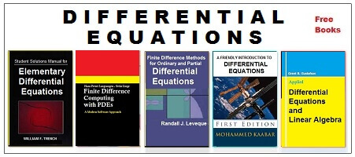

# 📚 Free Differential Equations Books & Textbook Repository

Welcome to the **Differential Equations Collection** by Free Mathematics Books.

This repository provides a curated selection of free Differential Equations textbooks, lecture notes, and supplementary resources covering ordinary differential equations (ODEs), partial differential equations (PDEs), boundary value problems, numerical methods, scaling, and dynamical systems.

Resources are organized into subject-based groups to help students, educators, researchers, and independent learners find relevant materials for coursework, engineering, and self-study.

Each entry identifies the available book, its author, and a link to its corresponding resource page.

📖 **[Explore the Complete Differential Equations Collection](https://freemathematicsbooks.com/A.aspx?Id=Differential-Equations&utm_source=github&utm_medium=referral&utm_campaign=Differential-Equations&utm_content=introduction)**

📚 **[Explore the Complete Applied Mathematics Collection](https://freemathematicsbooks.com/A.aspx?Id=Applied-Mathematics&utm_source=github&utm_medium=referral&utm_campaign=Applied-Mathematics&utm_content=introduction)**

---

## 📖 Curated Differential Equations Book Catalogue

The following textbooks and resources are organized into four groups according to their focus, mathematical level, and applications.

### 1. 📘 Introductory & Core Differential Equations

Foundational textbooks introducing first- and higher-order ODEs, systems of equations, Laplace transforms, and standard analytical methods.

- 📖 **[Differential Equations — Jeffrey R. Chasnov](https://freemathematicsbooks.com/B.aspx?FileName=Diff-Eqs-Eng--Jeffrey-Chasnov&utm_source=github&utm_medium=referral&utm_campaign=Differential-Equations&utm_content=book-catalogue)**

An accessible introduction to differential equations for science and engineering students, covering first-order ODEs, second-order linear equations, systems, and Laplace transforms.

- 📖 **[Differential Equations — Paul Dawkins](https://freemathematicsbooks.com/B.aspx?FileName=Diff-Eqs--Paul-Dawkins&utm_source=github&utm_medium=referral&utm_campaign=Differential-Equations&utm_content=book-catalogue)**

Clear, self-study-friendly notes covering first-order ODEs, linear second-order equations, series solutions, systems of differential equations, and Laplace transforms.

- 📖 **[Differential Equations & Boundary Value Problems — William Trench](https://freemathematicsbooks.com/B.aspx?FileName=Elementary-DE-Boundary-Value--William-Trench&utm_source=github&utm_medium=referral&utm_campaign=Differential-Equations&utm_content=book-catalogue)**

A comprehensive undergraduate text covering ordinary differential equations alongside Sturm–Liouville theory, Fourier series, and boundary value problems.

- 📖 **[Elementary Differential Equations — William F. Trench](https://freemathematicsbooks.com/B.aspx?FileName=Elementary-DE--William-Trench&utm_source=github&utm_medium=referral&utm_campaign=Differential-Equations&utm_content=book-catalogue)**

A clear, structured textbook presenting core methods for solving first-order, second-order, and higher-order ordinary differential equations and linear systems.

- 📖 **[Introduction to Differential Equations — Mohammed Kaabar](https://freemathematicsbooks.com/B.aspx?FileName=Intro-DE--Mohammed-Kaabar&utm_source=github&utm_medium=referral&utm_campaign=Differential-Equations&utm_content=book-catalogue)**

An approachable introduction covering foundational ODE concepts, analytical solution techniques, and real-world modeling applications.

- 📖 **[Notes on Diffy Qs: Differential Equations for Engineers — Jiri Lebl](https://freemathematicsbooks.com/B.aspx?FileName=Notes-DE-Engineers--Jiri-Lebl&utm_source=github&utm_medium=referral&utm_campaign=Differential-Equations&utm_content=book-catalogue)**

A practical, engineering-focused textbook covering first-order ODEs, linear systems, Fourier series, Laplace transforms, and introductory PDEs.

---

### 2. 📚 Theoretical & Classical ODEs

Deeper and classical treatments of ordinary differential equations, qualitative behavior, existence/uniqueness, and analytical theory.

- 📖 **[Ordinary Differential Equations — Gabriel Nagy](https://freemathematicsbooks.com/B.aspx?FileName=ODE--Gabriel-Nagy&utm_source=github&utm_medium=referral&utm_campaign=Differential-Equations&utm_content=book-catalogue)**

Covers fundamental ODE theory, linear systems, flows, stability, and qualitative methods in differential equations.

- 📖 **[Ordinary Differential Equations — Edward L. Ince](https://freemathematicsbooks.com/B.aspx?FileName=ODEs--Edward-Ince&utm_source=github&utm_medium=referral&utm_campaign=Differential-Equations&utm_content=book-catalogue)**

A classic comprehensive treatise exploring real and complex differential equations, existence theorems, Sturmian theory, and special functions.

- 📖 **[Theory of Differential Equations — A. R. Forsyth](https://freemathematicsbooks.com/B.aspx?FileName=Theory-DE--Andrew-Forsyth&utm_source=github&utm_medium=referral&utm_campaign=Differential-Equations&utm_content=book-catalogue)**

An extensive historical and theoretical work examining ordinary and partial differential equations and classical analytical methods.

---

### 3. 🌊 Partial Differential Equations & Fourier Theory

Resources focusing on linear partial differential equations, Cauchy problems, Fourier analysis, and wave/heat/Laplace models.

- 📖 **[Lectures on Cauchy's Problem in Linear PDEs — Jacques Hadamard](https://freemathematicsbooks.com/B.aspx?FileName=Lectures-Cauchy-Problem-LPDEs--Jacques-Hadamard&utm_source=github&utm_medium=referral&utm_campaign=Differential-Equations&utm_content=book-catalogue)**

A foundational lecture series on well-posedness, Cauchy problems, hyperbolic equations, and fundamental solutions for linear PDEs.

- 📖 **[Linear PDEs and Fourier Theory — Marcus Pivato](https://freemathematicsbooks.com/B.aspx?FileName=LPDEs-Fourier-Theory--Marcus-Pivato&utm_source=github&utm_medium=referral&utm_campaign=Differential-Equations&utm_content=book-catalogue)**

Covers Fourier series and transforms, separation of variables, and analytical solutions to heat, wave, and Laplace equations.

---

### 4. 💻 Numerical Methods, Scaling & Chaos

Computational techniques, finite differences, dimensional scaling, and nonlinear dynamical behavior in differential models.

- 📖 **[Finite Difference Computing with PDEs — Hans Petter Langtangen](https://freemathematicsbooks.com/B.aspx?FileName=Finite-Difference-PDEs--Hans-Langtangen&utm_source=github&utm_medium=referral&utm_campaign=Differential-Equations&utm_content=book-catalogue)**

Teaches finite difference discretization, stability, accuracy, and scientific programming for partial differential equations.

- 📖 **[Finite Difference Methods for Differential — Randall LeVeque](https://freemathematicsbooks.com/B.aspx?FileName=Finite-Difference-Methods-DE--Randall-LeVeque&utm_source=github&utm_medium=referral&utm_campaign=Differential-Equations&utm_content=book-catalogue)**

Covers finite difference schemes, consistency, stability, convergence, and numerical solutions for ordinary and partial differential equations.

- 📖 **[Numerical Methods for ODEs — Kees Vuik and Fred Vermolen](https://freemathematicsbooks.com/B.aspx?FileName=Numerical-Methods-ODEs--Kees-Vuik&utm_source=github&utm_medium=referral&utm_campaign=Differential-Equations&utm_content=book-catalogue)**

Presents explicit and implicit numerical solvers, Runge–Kutta methods, stability regions, and step-size control for ODEs.

- 📖 **[Scaling of Differential Equations — Hans Petter Langtangen](https://freemathematicsbooks.com/B.aspx?FileName=Scaling-DE--Hans-Langtangen&utm_source=github&utm_medium=referral&utm_campaign=Differential-Equations&utm_content=book-catalogue)**

Focuses on non-dimensionalization and scaling of ODEs and PDEs to simplify physical models and identify key dimensionless parameters.

- 📖 **[Strange Attractors: Creating Patterns in Chaos — Julien Sprott](https://freemathematicsbooks.com/B.aspx?FileName=Creating-Patterns-Chaos--Julien-Sprott&utm_source=github&utm_medium=referral&utm_campaign=Differential-Equations&utm_content=book-catalogue)**

Explores nonlinear differential and iterative systems, chaotic dynamics, fractals, and strange attractors.

---

## 📖 How to Choose a Resource

- **Self-Study & Core ODEs:** Start with *Differential Equations* by Paul Dawkins, *Elementary Differential Equations* by William F. Trench, or *Introduction to Differential Equations* by Mohammed Kaabar.
- **Engineering & Boundary Value Problems:** Use *Notes on Diffy Qs* by Jiri Lebl, *Differential Equations* by Jeffrey R. Chasnov, or *Differential Equations & Boundary Value Problems* by William Trench.
- **Partial Differential Equations & Fourier Methods:** Explore *Linear PDEs and Fourier Theory* by Marcus Pivato or *Lectures on Cauchy's Problem in Linear PDEs* by Jacques Hadamard.
- **Numerical Solvers & Scaling:** Turn to *Numerical Methods for ODEs* by Vuik & Vermolen, *Finite Difference Methods* by Randall LeVeque, *Finite Difference Computing with PDEs*, or *Scaling of Differential Equations* by Hans Petter Langtangen.
- **Advanced Theory & Chaos:** Read Gabriel Nagy, Edward L. Ince, A. R. Forsyth, or Julien Sprott for deeper theory and chaotic dynamics.

---

## 📚 Topics Covered

This collection includes resources covering the following topics:

- First-Order, Second-Order, and Higher-Order Ordinary Differential Equations (ODEs)
- Linear Systems of Differential Equations and Laplace Transforms
- Series Solutions, Sturm–Liouville Theory, and Boundary Value Problems
- Linear Partial Differential Equations (Heat, Wave, and Laplace Equations)
- Cauchy Problems, Well-Posedness, and Fourier Series/Transforms
- Numerical Methods for ODEs and Finite Difference Methods for PDEs
- Non-Dimensionalization, Scaling of Differential Equations, and Chaos Theory

---

## 📋 Book Selection & Verification

Resources in this catalogue are organized by subject relevance, educational level, and clear bibliographic details. Links direct readers to the corresponding resource pages on Free Mathematics Books, where access details and available formats can be reviewed.

---

## 🤝 Contributing to This Repository

Suggestions and contributions are welcome!

You can help improve this collection by:

1. Suggesting freely accessible Differential Equations textbooks and learning materials.
2. Reporting broken or outdated book links.
3. Correcting book titles, author names, or bibliographic details.
4. Recommending relevant supplementary mathematical resources.
5. Improving the organization and documentation of the repository.

**How to contribute:**

- Open a GitHub Issue to report a problem or suggest a resource.
- Submit a Pull Request with proposed additions or corrections.
- Include the book title, author, and source link when suggesting a resource.

Please ensure that submitted materials are freely accessible and that any shared files comply with applicable copyright and licensing terms.

---

## 🧭 Repository Navigation

- [⬅️ Back to Main Applied Mathematics Category](../)
- [🏠 Back to Home Repository](../../)

---

## 🌐 Explore More Mathematics Resources

- **GitLab:** [Free Mathematics Books Study Guide](https://gitlab.com/mathematics55/FreeMathBooks/-/tree/main) — Subject study guides and topic mirrors.
- **Substack:** [Free Mathematics Books Reading Notes](https://freemathematicsbooks.substack.com/) — Curated reading lists and book highlights.
- **Official Website:** [FreeMathematicsBooks.com](https://freemathematicsbooks.com/?utm_source=github&utm_medium=referral&utm_campaign=FreeMathematicsBooks&utm_content=repository-footer) — Searchable directory of external textbook links.
