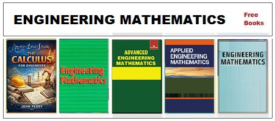

# 📚 Free Engineering Mathematics Books & Textbook Repository

Welcome to the **Engineering Mathematics Collection** by Free Mathematics Books.

This repository provides a curated selection of free Engineering Mathematics textbooks, lecture notes, and supplementary resources covering calculus for engineers, linear and matrix algebra, differential equations, boundary value problems, boundary element methods, and applied mathematical techniques.

Resources are organized into subject-based groups to help engineering students, instructors, researchers, and independent learners find practical mathematical references.

Each entry identifies the available book, its author, and a link to its corresponding resource page.

📖 **[Explore the Complete Engineering Mathematics Collection](https://freemathematicsbooks.com/A.aspx?Id=Engineering-Mathematics&utm_source=github&utm_medium=referral&utm_campaign=Engineering-Mathematics&utm_content=introduction)**

📚 **[Explore the Complete Applied Mathematics Collection](https://freemathematicsbooks.com/A.aspx?Id=Applied-Mathematics&utm_source=github&utm_medium=referral&utm_campaign=Applied-Mathematics&utm_content=introduction)**

---

## 📖 Curated Engineering Mathematics Book Catalogue

The following textbooks and resources are organized into four groups according to their mathematical focus and engineering applications.

### 1. 📘 Calculus for Engineers & Physicists

Foundational and practical calculus texts tailored to engineering, mechanics, and physical problem-solving.

- 📖 **[The Calculus for Engineers — John Perry](https://freemathematicsbooks.com/B.aspx?FileName=The-Calculus-Engineers--John-Perry&utm_source=github&utm_medium=referral&utm_campaign=Engineering-Mathematics&utm_content=book-catalogue)**

A practical, application-focused guide introducing differentiation and integration through physical, mechanical, and engineering problems.

- 📖 **[The Calculus for Engineers and Physicists — Robert H. Smith](https://freemathematicsbooks.com/B.aspx?FileName=Calculus-for-Eng-Phy--Robert-Smith&utm_source=github&utm_medium=referral&utm_campaign=Engineering-Mathematics&utm_content=book-catalogue)**

Covers calculus techniques and analytical methods designed around engineering and physical applications.

---

### 2. 📐 Linear Algebra, Matrix Methods & Computational Algebra

Resources covering matrices, linear systems, vector spaces, and computational matrix techniques used in engineering.

- 📖 **[Applied & Computational Linear Algebra — Charles Byrne](https://freemathematicsbooks.com/B.aspx?FileName=Applied-Computational-Linear-Algebra--Charles-Byrne&utm_source=github&utm_medium=referral&utm_campaign=Engineering-Mathematics&utm_content=book-catalogue)**

Explores matrix decompositions, iterative solvers, least squares, and applied computational linear algebra.

- 📖 **[Linear Algebra for Physicists & Engineers — Arak Mathai](https://freemathematicsbooks.com/B.aspx?FileName=Linear-Algebra-Physicists-Engineers--Arak-Mathai&utm_source=github&utm_medium=referral&utm_campaign=Engineering-Mathematics&utm_content=book-catalogue)**

Develops vector spaces, quadratic forms, spectral decompositions, and matrix methods for engineering and physics.

- 📖 **[Matrix Algebra with Computational Applications — Dirk Colbry](https://freemathematicsbooks.com/B.aspx?FileName=Matrix-Algebra-Computational-App--Dirk-Colbry&utm_source=github&utm_medium=referral&utm_campaign=Engineering-Mathematics&utm_content=book-catalogue)**

Focuses on hands-on matrix computation, linear systems, and computational workflows for technical problem-solving.

---

### 3. 🌊 Differential Equations & Boundary Value Problems

Textbooks covering ordinary differential equations, coupled linear systems, and boundary value problems for engineering models.

- 📖 **[Elementary Differential Equations — William F. Trench](https://freemathematicsbooks.com/B.aspx?FileName=Elementary-DE--William-Trench&utm_source=github&utm_medium=referral&utm_campaign=Engineering-Mathematics&utm_content=book-catalogue)**

A clear, structured textbook presenting core methods for solving first-order, second-order, and higher-order ordinary differential equations.

- 📖 **[Differential Equations & Boundary Value Problems — William Trench](https://freemathematicsbooks.com/B.aspx?FileName=Elementary-DE-Boundary-Value--William-Trench&utm_source=github&utm_medium=referral&utm_campaign=Engineering-Mathematics&utm_content=book-catalogue)**

Covers ordinary differential equations alongside Sturm–Liouville theory, Fourier series, and boundary value problems.

- 📖 **[Differential Equations & Linear Algebra — G. B. Gustafson](https://freemathematicsbooks.com/B.aspx?FileName=DE--LA--Grant-Gustafson&utm_source=github&utm_medium=referral&utm_campaign=Engineering-Mathematics&utm_content=book-catalogue)**

Integrates first- and higher-order differential equations with matrix algebra and linear systems for modeling continuous processes.

---

### 4. ⚙️ Boundary Elements & Applied Mathematical Techniques

Specialized resources for boundary element modeling, continuum mechanics, and asymptotic/applied engineering methods.

- 📖 **[Boundary Element Methods in Engineering — M. H. Aliabadi](https://freemathematicsbooks.com/B.aspx?FileName=Boundary-Element-Methods--Eng-Sci--MH-Aliabadi&utm_source=github&utm_medium=referral&utm_campaign=Engineering-Mathematics&utm_content=book-catalogue)**

Presents boundary integral equations and boundary element methods for solving engineering and mechanics problems.

- 📖 **[Techniques of Applied Mathematics — Andrew Fowler](https://freemathematicsbooks.com/B.aspx?FileName=Techniques-Applied-Math--Andrew-Fowler&utm_source=github&utm_medium=referral&utm_campaign=Engineering-Mathematics&utm_content=book-catalogue)**

Focuses on asymptotic analysis, perturbation methods, scaling, and continuum modeling in applied engineering mathematics.

---

## 📖 How to Choose a Resource

- **Engineering Calculus:** Start with *The Calculus for Engineers* by John Perry or *The Calculus for Engineers and Physicists* by Robert H. Smith for applied differentiation and integration.
- **Matrices & Computational Linear Algebra:** Choose *Matrix Algebra with Computational Applications* by Dirk Colbry, *Applied & Computational Linear Algebra* by Charles Byrne, or *Linear Algebra for Physicists & Engineers* by Arak Mathai.
- **Differential Equations & Boundary Value Problems:** Use *Elementary Differential Equations* or *Differential Equations & Boundary Value Problems* by William Trench, or *Differential Equations & Linear Algebra* by G. B. Gustafson.
- **Boundary Elements & Continuum Modeling:** Explore *Boundary Element Methods in Engineering* by M. H. Aliabadi and *Techniques of Applied Mathematics* by Andrew Fowler.

---

## 📚 Topics Covered

This collection includes resources covering the following topics:

- Applied Calculus for Engineers and Physicists
- Matrix Algebra, Linear Systems, and Computational Linear Algebra
- Ordinary Differential Equations (ODEs) and Linear Differential Systems
- Boundary Value Problems, Sturm–Liouville Theory, and Fourier Series
- Boundary Element Methods (BEM) and Integral Formulations
- Scaling, Perturbation Methods, and Applied Engineering Techniques

---

## 📋 Book Selection & Verification

Resources in this catalogue are organized by subject relevance, educational level, and clear bibliographic details. Links direct readers to the corresponding resource pages on Free Mathematics Books, where access details and available formats can be reviewed.

---

## 🤝 Contributing to This Repository

Suggestions and contributions are welcome!

You can help improve this collection by:

1. Suggesting freely accessible Engineering Mathematics textbooks and learning materials.
2. Reporting broken or outdated book links.
3. Correcting book titles, author names, or bibliographic details.
4. Recommending relevant supplementary mathematical resources.
5. Improving the organization and documentation of the repository.

**How to contribute:**

- Open a GitHub Issue to report a problem or suggest a resource.
- Submit a Pull Request with proposed additions or corrections.
- Include the book title, author, and source link when suggesting a resource.

Please ensure that submitted materials are freely accessible and that any shared files comply with applicable copyright and licensing terms.

---

## 🧭 Repository Navigation

- [⬅️ Back to Main Applied Mathematics Category](../)
- [🏠 Back to Home Repository](../../../../)

---

## 🌐 Explore More Mathematics Resources

**GitHub Collection:** [Free Math Books Repository](https://github.com/FreeMathBooks/free-math-books-collection)

**Substack Publication:** [Free Mathematics Books](https://freemathematicsbooks.substack.com/)

Discover additional free textbooks and educational materials through **[Free Mathematics Books](https://freemathematicsbooks.com/?utm_source=github&utm_medium=referral&utm_campaign=FreeMathematicsBooks&utm_content=repository-footer)**.
