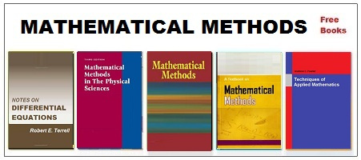

# 📚 Free Mathematical Methods Books & Textbook Repository

Welcome to the **Mathematical Methods Collection** by Free Mathematics Books.

This repository provides a curated selection of free Mathematical Methods textbooks, lecture notes, and supplementary resources covering pure analysis foundations, calculus, linear algebra for physicists and engineers, differential equations, and applied mathematical techniques.

Resources are organized into subject-based groups to help students, educators, researchers, and independent learners find relevant materials for coursework, problem-solving, and self-study.

Each entry identifies the available book, its author, and a link to its corresponding resource page.

📖 **[Explore the Complete Mathematical Methods Collection](https://freemathematicsbooks.com/A.aspx?Id=Mathematical-Methods&utm_source=github&utm_medium=referral&utm_campaign=Mathematical-Methods&utm_content=introduction)**

📚 **[Explore the Complete Applied Mathematics Collection](https://freemathematicsbooks.com/A.aspx?Id=Applied-Mathematics&utm_source=github&utm_medium=referral&utm_campaign=Applied-Mathematics&utm_content=introduction)**

---

## 📖 Curated Mathematical Methods Book Catalogue

The following textbooks and resources are organized into three groups according to their mathematical focus and applications.

### 1. 📘 Core Analysis & Calculus Methods

Foundational texts developing rigorous mathematical reasoning, limits, series, differentiation, and integration.

- 📖 **[A Course of Pure Mathematics — G.H. Hardy](https://freemathematicsbooks.com/B.aspx?FileName=Course-Pure-Mathematics--GH-Hardy&utm_source=github&utm_medium=referral&utm_campaign=Mathematical-Methods&utm_content=book-catalogue)**

A classic introduction to rigorous pure mathematics covering real and complex variables, limits, continuity, differentiation, integration, and infinite series.

- 📖 **[Calculus — Gilbert Strang](https://freemathematicsbooks.com/B.aspx?FileName=Calculus--Gilbert-Strang&utm_source=github&utm_medium=referral&utm_campaign=Mathematical-Methods&utm_content=book-catalogue)**

An accessible, intuition-driven textbook covering single-variable and multivariable calculus with practical applications and clear visual explanations.

---

### 2. 📐 Linear Algebra & Differential Equations

Essential mathematical tools for vector spaces, matrices, and differential equations used across science and engineering.

- 📖 **[Linear Algebra for Physicists & Engineers — Arak Mathai](https://freemathematicsbooks.com/B.aspx?FileName=Linear-Algebra-Physicists-Engineers--Arak-Mathai&utm_source=github&utm_medium=referral&utm_campaign=Mathematical-Methods&utm_content=book-catalogue)**

Develops vector spaces, quadratic forms, spectral decompositions, and matrix methods tailored for engineering and physics problems.

- 📖 **[Notes on Differential Equation — Bob Terrell](https://freemathematicsbooks.com/B.aspx?FileName=Notes-Diff--Robert-Terrell&utm_source=github&utm_medium=referral&utm_campaign=Mathematical-Methods&utm_content=book-catalogue)**

Concise lecture notes introducing ordinary differential equations, solution techniques, and core analytical methods for modeling change.

---

### 3. ⚙️ Applied & Asymptotic Techniques

Specialized methods for scaling, perturbation, asymptotic approximations, and applied problem-solving.

- 📖 **[Techniques of Applied Mathematics — Andrew Fowler](https://freemathematicsbooks.com/B.aspx?FileName=Techniques-Applied-Math--Andrew-Fowler&utm_source=github&utm_medium=referral&utm_campaign=Mathematical-Methods&utm_content=book-catalogue)**

Focuses on asymptotic analysis, perturbation methods, dimensional scaling, and continuum modeling in applied mathematics.

---

## 📖 How to Choose a Resource

- **Calculus & Core Foundations:** Start with *Calculus* by Gilbert Strang for intuition and applied calculus, or *A Course of Pure Mathematics* by G. H. Hardy for rigorous analysis.
- **Matrix & Linear Methods:** Use *Linear Algebra for Physicists & Engineers* by Arak Mathai for vector spaces, matrices, and physical applications.
- **Differential Equations & Modeling:** Read *Notes on Differential Equation* by Bob Terrell for introductory differential equation techniques.
- **Perturbation, Scaling & Asymptotics:** Explore *Techniques of Applied Mathematics* by Andrew Fowler for advanced applied and asymptotic methods.

---

## 📚 Topics Covered

This collection includes resources covering the following topics:

- Real and Complex Numbers, Limits, Continuity, and Infinite Series
- Single-Variable and Multivariable Differentiation and Integration
- Vector Spaces, Matrices, Quadratic Forms, and Spectral Methods
- Ordinary Differential Equations and Analytical Solution Techniques
- Asymptotic Analysis, Perturbation Methods, and Dimensional Scaling

---

## 📋 Book Selection & Verification

Resources in this catalogue are organized by subject relevance, educational level, and clear bibliographic details. Links direct readers to the corresponding resource pages on Free Mathematics Books, where access details and available formats can be reviewed.

---

## 🤝 Contributing to This Repository

Suggestions and contributions are welcome!

You can help improve this collection by:

1. Suggesting freely accessible Mathematical Methods textbooks and learning materials.
2. Reporting broken or outdated book links.
3. Correcting book titles, author names, or bibliographic details.
4. Recommending relevant supplementary mathematical resources.
5. Improving the organization and documentation of the repository.

**How to contribute:**

- Open a GitHub Issue to report a problem or suggest a resource.
- Submit a Pull Request with proposed additions or corrections.
- Include the book title, author, and source link when suggesting a resource.

Please ensure that submitted materials are freely accessible and that any shared files comply with applicable copyright and licensing terms.

---

## 🧭 Repository Navigation

- [⬅️ Back to Main Applied Mathematics Category](../)
- [🏠 Back to Home Repository](../../../../)

---

## 🌐 Explore More Mathematics Resources

**GitHub Collection:** [Free Math Books Repository](https://github.com/FreeMathBooks/free-math-books-collection)

**Substack Publication:** [Free Mathematics Books](https://freemathematicsbooks.substack.com/)

Discover additional free textbooks and educational materials through **[Free Mathematics Books](https://freemathematicsbooks.com/?utm_source=github&utm_medium=referral&utm_campaign=FreeMathematicsBooks&utm_content=repository-footer)**.
