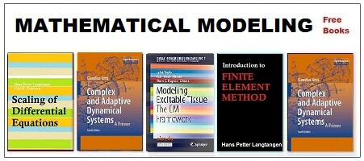

# 📚 Free Mathematical Modeling Books & Textbook Repository

Welcome to the **Mathematical Modeling Collection** by Free Mathematics Books.

This repository provides a curated selection of free Mathematical Modeling textbooks, lecture notes, and supplementary resources covering differential equations models, dimensional scaling, finite element methods, complex adaptive systems, and applied mathematical techniques.

Resources are organized into subject-based groups to help students, educators, researchers, and independent learners translate real-world systems into mathematical models.

Each entry identifies the available book, its author, and a link to its corresponding resource page.

📖 **[Explore the Complete Mathematical Modeling Collection](https://freemathematicsbooks.com/A.aspx?Id=Mathematical-Modeling&utm_source=github&utm_medium=referral&utm_campaign=Mathematical-Modeling&utm_content=introduction)**

📚 **[Explore the Complete Applied Mathematics Collection](https://freemathematicsbooks.com/A.aspx?Id=Applied-Mathematics&utm_source=github&utm_medium=referral&utm_campaign=Applied-Mathematics&utm_content=introduction)**

---

## 📖 Curated Mathematical Modeling Book Catalogue

The following textbooks and resources are organized into three groups according to their modeling focus and mathematical methods.

### 1. 📘 Differential Equations & Dimensional Scaling

Foundational models built around ordinary differential equations and scaling analysis to simplify physical and biological systems.

- 📖 **[Differential Equations by Paul Dawkins — Paul Dawkins](https://freemathematicsbooks.com/B.aspx?FileName=Diff-Eqs--Paul-Dawkins&utm_source=github&utm_medium=referral&utm_campaign=Mathematical-Modeling&utm_content=book-catalogue)**

Covers first-order ODEs, linear second-order equations, systems of differential equations, series solutions, and Laplace transforms used in continuous modeling.

- 📖 **[Scaling of Differential Equations by Hans Petter Langtangen — Hans Petter Langtangen](https://freemathematicsbooks.com/B.aspx?FileName=Scaling-DE--Hans-Langtangen&utm_source=github&utm_medium=referral&utm_campaign=Mathematical-Modeling&utm_content=book-catalogue)**

Focuses on non-dimensionalization and scaling of ODEs and PDEs to reduce parameters, reveal dominant balances, and streamline scientific models.

---

### 2. 💻 Numerical & Finite Element Modeling

Computational modeling approaches for solving spatial, structural, and continuum problems numerically.

- 📖 **[Introduction to Finite Elements Methods — Hans Langtangen](https://freemathematicsbooks.com/B.aspx?FileName=Intro-Finite-Elements-Methods--Hans-Langtangen&utm_source=github&utm_medium=referral&utm_campaign=Mathematical-Modeling&utm_content=book-catalogue)**

Introduces variational formulations, basis functions, and finite element discretization for modeling physical fields and partial differential equations.

---

### 3. 🌐 Complex Systems & Applied Techniques

Nonlinear, adaptive, and asymptotic methods for modeling complex dynamics and real-world processes.

- 📖 **[Complex and Adaptive Dynamical Systems: A Primer — Claudius Gros](https://freemathematicsbooks.com/B.aspx?FileName=Complex-Adaptive-Dynamical-Systems--Claudius-Gros&utm_source=github&utm_medium=referral&utm_campaign=Mathematical-Modeling&utm_content=book-catalogue)**

Explores nonlinear dynamics, chaos, self-organization, criticality, and adaptive systems across physics, biology, and computing.

- 📖 **[Techniques of Applied Mathematics — Andrew Fowler](https://freemathematicsbooks.com/B.aspx?FileName=Techniques-Applied-Math--Andrew-Fowler&utm_source=github&utm_medium=referral&utm_campaign=Mathematical-Modeling&utm_content=book-catalogue)**

Covers asymptotic approximations, perturbation methods, scaling, and continuum modeling for applied mathematical problems.

---

## 📖 How to Choose a Resource

- **ODE Modeling Foundations:** Start with *Differential Equations* by Paul Dawkins to build core skills in differential equation formulation and solution.
- **Model Simplification & Scaling:** Use *Scaling of Differential Equations* by Hans Petter Langtangen and *Techniques of Applied Mathematics* by Andrew Fowler to identify key parameters and asymptotic behavior.
- **Spatial & Continuum Simulation:** Explore *Introduction to Finite Elements Methods* by Hans Langtangen for numerical modeling of continuous systems.
- **Complex & Adaptive Dynamics:** Read *Complex and Adaptive Dynamical Systems: A Primer* by Claudius Gros for nonlinear, self-organizing, and adaptive models.

---

## 📚 Topics Covered

This collection includes resources covering the following topics:

- Ordinary Differential Equations (ODEs) and Coupled Systems in Modeling
- Non-Dimensionalization, Scaling, and Dominant Balance Analysis
- Finite Element Methods (FEM) and Variational Discretization
- Complex Systems, Nonlinear Dynamics, Chaos, and Self-Organization
- Asymptotic Analysis, Perturbation Methods, and Continuum Models

---

## 📋 Book Selection & Verification

Resources in this catalogue are organized by subject relevance, educational level, and clear bibliographic details. Links direct readers to the corresponding resource pages on Free Mathematics Books, where access details and available formats can be reviewed.

---

## 🤝 Contributing to This Repository

Suggestions and contributions are welcome!

You can help improve this collection by:

1. Suggesting freely accessible Mathematical Modeling textbooks and learning materials.
2. Reporting broken or outdated book links.
3. Correcting book titles, author names, or bibliographic details.
4. Recommending relevant supplementary mathematical resources.
5. Improving the organization and documentation of the repository.

**How to contribute:**

- Open a GitHub Issue to report a problem or suggest a resource.
- Submit a Pull Request with proposed additions or corrections.
- Include the book title, author, and source link when suggesting a resource.

Please ensure that submitted materials are freely accessible and that any shared files comply with applicable copyright and licensing terms.

---

## 🧭 Repository Navigation

- [⬅️ Back to Main Applied Mathematics Category](../)
- [🏠 Back to Home Repository](../../)

---

## 🌐 Explore More Mathematics Resources

- **GitLab:** [Free Mathematics Books Study Guide](https://gitlab.com/mathematics55/FreeMathBooks/-/tree/main) — Subject study guides and topic mirrors.
- **Substack:** [Free Mathematics Books Reading Notes](https://freemathematicsbooks.substack.com/) — Curated reading lists and book highlights.
- **Official Website:** [FreeMathematicsBooks.com](https://freemathematicsbooks.com/?utm_source=github&utm_medium=referral&utm_campaign=FreeMathematicsBooks&utm_content=repository-footer) — Searchable directory of external textbook links.
