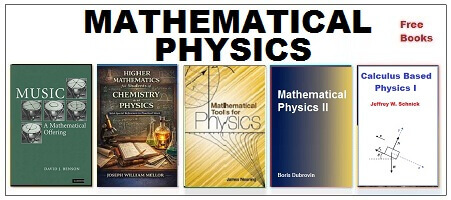

# 📚 Free Mathematical Physics Books & Textbook Repository

Welcome to the **Mathematical Physics Collection** by Free Mathematics Books.

This repository provides a curated selection of free Mathematical Physics textbooks, lecture notes, and supplementary resources covering Fourier series and harmonic analysis, vector analysis, calculus-based physics, evolutionary differential equations, group theory in particle physics, and rigorous analytical foundations.

Resources are organized into subject-based groups to help physics and mathematics students, educators, researchers, and independent learners find relevant references for coursework and self-study.

Each entry identifies the available book, its author, and a link to its corresponding resource page.

📖 **[Explore the Complete Mathematical Physics Collection](https://freemathematicsbooks.com/A.aspx?Id=Mathematical-Physics&utm_source=github&utm_medium=referral&utm_campaign=Mathematical-Physics&utm_content=introduction)**

📚 **[Explore the Complete Applied Mathematics Collection](https://freemathematicsbooks.com/A.aspx?Id=Applied-Mathematics&utm_source=github&utm_medium=referral&utm_campaign=Applied-Mathematics&utm_content=introduction)**

---

## 📖 Curated Mathematical Physics Book Catalogue

The following textbooks and resources are organized into four groups according to their physical applications and mathematical methods.

### 1. 🌊 Fourier Series, Harmonics & Integral Transforms

Classical and foundational texts on Fourier series, Fourier integrals, spherical/cylindrical harmonics, and wave/heat expansions in physics.

- 📖 **[Fourier's Series & Harmonics in Mathematical Physics — William Byerly](https://freemathematicsbooks.com/B.aspx?FileName=Fourier-Series-Harmonics-Mathematical-Physics--Byerly-Elwood&utm_source=github&utm_medium=referral&utm_campaign=Mathematical-Physics&utm_content=book-catalogue)**

Covers trigonometric series, Bessel functions, spherical and cylindrical harmonics, and applications to heat conduction, vibration, and potential problems.

- 📖 **[Fourier's Series And Integrals — Horatio Carslaw](https://freemathematicsbooks.com/B.aspx?FileName=Fourier-Series-Integrals--Horatio-Carslaw&utm_source=github&utm_medium=referral&utm_campaign=Mathematical-Physics&utm_content=book-catalogue)**

A thorough classical treatment of Fourier series, convergence properties, Fourier integrals, and boundary value problems in mathematical physics.

---

### 2. 📐 Vector Analysis & Calculus-Based Physics

Vector methods and calculus foundations supporting electromagnetism, mechanics, and physical field theory.

- 📖 **[Calculus-Based Physics II — Jeffrey Schnick](https://freemathematicsbooks.com/B.aspx?FileName=Calculus-Based-Physics-II--Jeffrey-Schnick&utm_source=github&utm_medium=referral&utm_campaign=Mathematical-Physics&utm_content=book-catalogue)**

Introduces electricity, magnetism, circuits, optics, and physical laws using calculus and vector concepts for science and engineering students.

- 📖 **[Vector Analysis — Josiah Gibbs and Edwin Wilson](https://freemathematicsbooks.com/B.aspx?FileName=Vector-Analysis--Josiah-Gibbs--Edwin-Wilson&utm_source=github&utm_medium=referral&utm_campaign=Mathematical-Physics&utm_content=book-catalogue)**

A classic text developing vector algebra, differential and integral vector calculus, potential functions, and applications to mechanics and geometry.

---

### 3. ⚛️ Evolutionary Equations & Group Theory in Physics

Operator/evolutionary equations and symmetry/group methods in theoretical and particle physics.

- 📖 **[Evolutionary Equations and Picard’s Theorem — Christian Seifert](https://freemathematicsbooks.com/B.aspx?FileName=Evolutionary-Equations--Christian-Seifert&utm_source=github&utm_medium=referral&utm_campaign=Mathematical-Physics&utm_content=book-catalogue)**

Focuses on evolutionary differential equations, operator semigroups, and Picard's existence and uniqueness theorem for time-dependent physical models.

- 📖 **[Group Theory Beyond the Standard Model — Ken J. Barnes](https://freemathematicsbooks.com/B.aspx?FileName=Group-Theory-Particle-Physics-Beyond--Ken-Barnes&utm_source=github&utm_medium=referral&utm_campaign=Mathematical-Physics&utm_content=book-catalogue)**

Explores Lie groups, representations, gauge symmetries, and group-theoretic frameworks extending beyond the Standard Model of particle physics.

---

### 4. 📘 Pure Mathematical Foundations

Rigorous analysis foundations supporting advanced mathematical modeling and theoretical physics.

- 📖 **[A Course of Pure Mathematics — G.H. Hardy](https://freemathematicsbooks.com/B.aspx?FileName=Course-Pure-Mathematics--GH-Hardy&utm_source=github&utm_medium=referral&utm_campaign=Mathematical-Physics&utm_content=book-catalogue)**

A classic introduction to rigorous analysis covering real and complex variables, limits, continuity, sequences, series, and calculus foundations.

---

## 📖 How to Choose a Resource

- **Fourier Series, Harmonics & Boundary Value Problems:** Start with *Fourier's Series & Harmonics in Mathematical Physics* by William Byerly or *Fourier's Series And Integrals* by Horatio Carslaw.
- **Vector Calculus & Physics II:** Use *Vector Analysis* by Gibbs & Wilson for vector field calculus and *Calculus-Based Physics II* by Jeffrey Schnick for electromagnetism and optics.
- **Time-Dependent Equations & Symmetry Groups:** Read *Evolutionary Equations and Picard’s Theorem* by Christian Seifert for evolutionary equations and *Group Theory Beyond the Standard Model* by Ken J. Barnes for particle physics symmetries.
- **Rigorous Analysis Foundations:** Turn to *A Course of Pure Mathematics* by G. H. Hardy to strengthen proof and analytical rigor.

---

## 📚 Topics Covered

This collection includes resources covering the following topics:

- Fourier Series, Fourier Integrals, and Harmonic Analysis
- Bessel Functions, Spherical Harmonics, and Boundary Value Problems
- Vector Algebra, Vector Fields, and Calculus-Based Physics II (Electromagnetism & Optics)
- Evolutionary Equations, Operator Methods, and Picard's Theorem
- Group Theory, Symmetry, and Particle Physics Beyond the Standard Model
- Real/Complex Variables, Limits, Series, and Rigorous Analysis

---

## 📋 Book Selection & Verification

Resources in this catalogue are organized by subject relevance, educational level, and clear bibliographic details. Links direct readers to the corresponding resource pages on Free Mathematics Books, where access details and available formats can be reviewed.

---

## 🤝 Contributing to This Repository

Suggestions and contributions are welcome!

You can help improve this collection by:

1. Suggesting freely accessible Mathematical Physics textbooks and learning materials.
2. Reporting broken or outdated book links.
3. Correcting book titles, author names, or bibliographic details.
4. Recommending relevant supplementary mathematical physics resources.
5. Improving the organization and documentation of the repository.

**How to contribute:**

- Open a GitHub Issue to report a problem or suggest a resource.
- Submit a Pull Request with proposed additions or corrections.
- Include the book title, author, and source link when suggesting a resource.

Please ensure that submitted materials are freely accessible and that any shared files comply with applicable copyright and licensing terms.

---

## 🧭 Repository Navigation

- [⬅️ Back to Main Applied Mathematics Category](../)
- [🏠 Back to Home Repository](../../../../)

---

## 🌐 Explore More Mathematics Resources

**GitHub Collection:** [Free Math Books Repository](https://github.com/FreeMathBooks/free-math-books-collection)

**Substack Publication:** [Free Mathematics Books](https://freemathematicsbooks.substack.com/)

Discover additional free textbooks and educational materials through **[Free Mathematics Books](https://freemathematicsbooks.com/?utm_source=github&utm_medium=referral&utm_campaign=FreeMathematicsBooks&utm_content=repository-footer)**.
