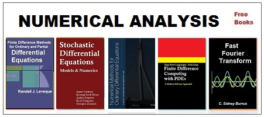

# 📚 Free Numerical Analysis Books & Textbook Repository

Welcome to the **Numerical Analysis Collection** by Free Mathematics Books.

This repository provides a curated selection of free Numerical Analysis textbooks, lecture notes, and supplementary resources covering numerical linear algebra, sparse and iterative solvers, eigenvalue algorithms, finite difference and finite element methods, spectral/Fourier methods, interpolation, and numerical differential equations.

Resources are organized into subject-based groups to help students, educators, researchers, and independent learners find relevant computational and numerical references.

Each entry identifies the available book, its author, and a link to its corresponding resource page.

📖 **[Explore the Complete Numerical Analysis Collection](https://freemathematicsbooks.com/A.aspx?Id=Numerical-Analysis&utm_source=github&utm_medium=referral&utm_campaign=Numerical-Analysis&utm_content=introduction)**

📚 **[Explore the Complete Applied Mathematics Collection](https://freemathematicsbooks.com/A.aspx?Id=Applied-Mathematics&utm_source=github&utm_medium=referral&utm_campaign=Applied-Mathematics&utm_content=introduction)**

---

## 📖 Curated Numerical Analysis Book Catalogue

The following textbooks and resources are organized into four groups according to their numerical focus, algorithms, and scientific applications.

### 1. 📐 Numerical Linear Algebra, Sparse Systems & Eigenvalues

Algorithms and numerical methods for large linear systems, sparse matrices, iterative solvers, and eigenvalue computations.

- 📖 **[Algorithms for Sparse Linear Systems — Jennifer Scott](https://freemathematicsbooks.com/B.aspx?FileName=Algorithms-Sparse-Linear-Systems--Jennifer-Scott&utm_source=github&utm_medium=referral&utm_campaign=Numerical-Analysis&utm_content=book-catalogue)**

Covers direct and sparse matrix techniques, ordering, factorization, and algorithmic methods for solving large sparse linear systems.

- 📖 **[Computational & Algorithmic Linear Algebra — Katta Murty](https://freemathematicsbooks.com/B.aspx?FileName=Computational-Algorithmic-Linear-Algebra--Katta-Murty&utm_source=github&utm_medium=referral&utm_campaign=Numerical-Analysis&utm_content=book-catalogue)**

Presents algorithmic linear algebra, matrix operations, linear systems, and computational procedures for applied and optimization problems.

- 📖 **[Iterative Methods for Sparse Linear Systems — Yousef Saad](https://freemathematicsbooks.com/B.aspx?FileName=Iterative-Methods-Sparse-Linear-Systems--Yousef-Saad&utm_source=github&utm_medium=referral&utm_campaign=Numerical-Analysis&utm_content=book-catalogue)**

A comprehensive reference on Krylov subspace methods, preconditioning, and iterative solvers for large sparse linear systems.

- 📖 **[Notes for Computational Linear Algebra — Jessy Grizzle](https://freemathematicsbooks.com/B.aspx?FileName=Notes-Computational-Linear-Algebra--Jessy-Grizzle&utm_source=github&utm_medium=referral&utm_campaign=Numerical-Analysis&utm_content=book-catalogue)**

Structured lecture notes on numerical matrix computations, QR factorization, least squares, and algorithmic stability.

- 📖 **[Numerical Methods for Large Eigenvalue Problems — Yousef Saad](https://freemathematicsbooks.com/B.aspx?FileName=Numerical-Methods-Large-Eigenvalue--Yousef-Saad&utm_source=github&utm_medium=referral&utm_campaign=Numerical-Analysis&utm_content=book-catalogue)**

Explores subspace projection, Lanczos and Arnoldi methods, and numerical algorithms for large-scale eigenvalue problems.

- 📖 **[Templates for the Solution of Linear Systems — Richard Barrett](https://freemathematicsbooks.com/B.aspx?FileName=Templates-Sol-Linear-Systems--Richard-Barrett&utm_source=github&utm_medium=referral&utm_campaign=Numerical-Analysis&utm_content=book-catalogue)**

Provides practical guidelines and algorithmic templates for selecting and implementing iterative solvers and preconditioners.

---

### 2. 🌊 Numerical ODEs, PDEs & Finite Elements

Discretization schemes, finite differences, finite elements, fluid dynamics, and stochastic differential equations.

- 📖 **[Computational Incompressible Flow — Johan Hoffman, Claes Johnson](https://freemathematicsbooks.com/B.aspx?FileName=Computational-Incompressible-Flow--Johan-Hoffman&utm_source=github&utm_medium=referral&utm_campaign=Numerical-Analysis&utm_content=book-catalogue)**

Explores finite element methods, adaptive discretization, and numerical simulation of incompressible fluid flow.

- 📖 **[Finite Difference Methods for Differential — Randall LeVeque](https://freemathematicsbooks.com/B.aspx?FileName=Finite-Difference-Methods-DE--Randall-LeVeque&utm_source=github&utm_medium=referral&utm_campaign=Numerical-Analysis&utm_content=book-catalogue)**

Covers finite difference approximations, stability, convergence, and numerical methods for ordinary and partial differential equations.

- 📖 **[Finite Difference Computing with PDEs — Hans Petter Langtangen](https://freemathematicsbooks.com/B.aspx?FileName=Finite-Difference-PDEs--Hans-Langtangen&utm_source=github&utm_medium=referral&utm_campaign=Numerical-Analysis&utm_content=book-catalogue)**

Teaches practical finite difference discretization, error analysis, and scientific programming for partial differential equations.

- 📖 **[Finite Element Analysis - From Biomedical to Industrial — David Moratal](https://freemathematicsbooks.com/B.aspx?FileName=Finite-Element-Analysis--David-Moratal&utm_source=github&utm_medium=referral&utm_campaign=Numerical-Analysis&utm_content=book-catalogue)**

Introduces finite element modeling and numerical simulation across biomedical and industrial engineering applications.

- 📖 **[Introduction to Finite Elements Methods — Hans Langtangen](https://freemathematicsbooks.com/B.aspx?FileName=Intro-Finite-Elements-Methods--Hans-Langtangen&utm_source=github&utm_medium=referral&utm_campaign=Numerical-Analysis&utm_content=book-catalogue)**

Presents variational formulations, finite element basis functions, and numerical discretization for differential models.

- 📖 **[Stochastic Differential Equations — Jesper Carlsson](https://freemathematicsbooks.com/B.aspx?FileName=Stochastic-DE-Models-Numerics--Jesper-Carlsson&utm_source=github&utm_medium=referral&utm_campaign=Numerical-Analysis&utm_content=book-catalogue)**

Covers stochastic differential equations, numerical integration schemes, Monte Carlo simulation, and applied stochastic modeling.

---

### 3. 💻 Scientific Computing in Python

Hands-on Python tutorials and numerical workflows for solving differential equations.

- 📖 **[Solving Ordinary Differential Equations in Python — Joakim Sundnes](https://freemathematicsbooks.com/B.aspx?FileName=Solving-ODE-Python--Joakim-Sundnes&utm_source=github&utm_medium=referral&utm_campaign=Numerical-Analysis&utm_content=book-catalogue)**

Demonstrates numerical ODE solvers, stability considerations, and scientific simulation workflows implemented in Python.

- 📖 **[Solving PDEs in Python: The Fenics Tutorial I — Hans Langtangen](https://freemathematicsbooks.com/B.aspx?FileName=Solving-PDEs-Python--Hans-Langtangen&utm_source=github&utm_medium=referral&utm_campaign=Numerical-Analysis&utm_content=book-catalogue)**

Provides a practical tutorial on solving partial differential equations with finite element methods in Python using FEniCS.

---

### 4. 📊 Interpolation, Fourier & Spectral Transforms

Approximation techniques, polynomial interpolation, Fourier analysis, and fast transform algorithms.

- 📖 **[Fast Fourier Transforms — C. Sidney Burrus](https://freemathematicsbooks.com/B.aspx?FileName=Fast-Fourier-Transforms--Sidney-Burrus&utm_source=github&utm_medium=referral&utm_campaign=Numerical-Analysis&utm_content=book-catalogue)**

Covers discrete Fourier transform algorithms, fast Fourier transform (FFT) structures, and computational signal processing.

- 📖 **[Fourier Analysis for Beginners — Larry N. Thibos](https://freemathematicsbooks.com/B.aspx?FileName=Fourier-Analysis-Beginners--Larry-Thibos&utm_source=github&utm_medium=referral&utm_campaign=Numerical-Analysis&utm_content=book-catalogue)**

An accessible introduction to Fourier series, transforms, frequency representation, and practical harmonic analysis.

- 📖 **[The Art of Polynomial Interpolation — Stuart Murphy](https://freemathematicsbooks.com/B.aspx?FileName=Polynomial-Interpolation--Stuart-Murphy&utm_source=github&utm_medium=referral&utm_campaign=Numerical-Analysis&utm_content=book-catalogue)**

Explores polynomial interpolation methods, Lagrange and Newton forms, error behavior, and numerical approximation.

---

## 📖 How to Choose a Resource

- **Sparse Linear Systems & Eigenvalues:** Start with Yousef Saad's texts on iterative methods and large eigenvalue problems, Jennifer Scott, or Richard Barrett.
- **Finite Differences, Finite Elements & Fluid Flow:** Choose Randall LeVeque, Hans Langtangen, David Moratal, or Johan Hoffman & Claes Johnson.
- **Python Implementation for ODEs & PDEs:** Use Joakim Sundnes for ODEs in Python and Hans Langtangen's FEniCS tutorial for PDEs.
- **Interpolation, Fourier Transforms & Stochastic Models:** Explore Stuart Murphy for polynomial interpolation, C. Sidney Burrus or Larry N. Thibos for Fourier analysis, and Jesper Carlsson for stochastic differential equations.

---

## 📚 Topics Covered

This collection includes resources covering the following topics:

- Sparse Linear Systems, Iterative Solvers, and Preconditioning
- Large Eigenvalue Problems, QR Factorization, and Algorithmic Linear Algebra
- Finite Difference Methods (FDM) and Finite Element Methods (FEM)
- Computational Incompressible Fluid Dynamics and Stochastic Differential Equations
- Solving ODEs and PDEs in Python (including FEniCS)
- Polynomial Interpolation, Fourier Analysis, and Fast Fourier Transforms (FFT)

---

## 📋 Book Selection & Verification

Resources in this catalogue are organized by subject relevance, educational level, and clear bibliographic details. Links direct readers to the corresponding resource pages on Free Mathematics Books, where access details and available formats can be reviewed.

---

## 🤝 Contributing to This Repository

Suggestions and contributions are welcome!

You can help improve this collection by:

1. Suggesting freely accessible Numerical Analysis textbooks and learning materials.
2. Reporting broken or outdated book links.
3. Correcting book titles, author names, or bibliographic details.
4. Recommending relevant supplementary mathematical resources.
5. Improving the organization and documentation of the repository.

**How to contribute:**

- Open a GitHub Issue to report a problem or suggest a resource.
- Submit a Pull Request with proposed additions or corrections.
- Include the book title, author, and source link when suggesting a resource.

Please ensure that submitted materials are freely accessible and that any shared files comply with applicable copyright and licensing terms.

---

## 🧭 Repository Navigation

- [⬅️ Back to Main Applied Mathematics Category](../)
- [🏠 Back to Home Repository](../../)

---

## 🌐 Explore More Mathematics Resources

- **GitLab:** [Free Mathematics Books Study Guide](https://gitlab.com/mathematics55/FreeMathBooks/-/tree/main) — Subject study guides and topic mirrors.
- **Substack:** [Free Mathematics Books Reading Notes](https://freemathematicsbooks.substack.com/) — Curated reading lists and book highlights.
- **Official Website:** [FreeMathematicsBooks.com](https://freemathematicsbooks.com/?utm_source=github&utm_medium=referral&utm_campaign=FreeMathematicsBooks&utm_content=repository-footer) — Searchable directory of external textbook links.
