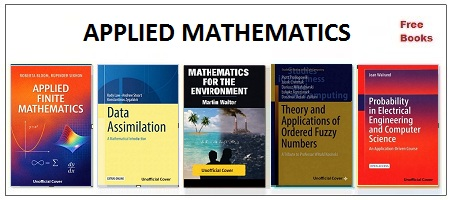

# 📚 Free Applied Mathematics Books & Textbook Repository

Welcome to the **Applied Mathematics Collection** by Free Mathematics Books.

This repository maintains a curated catalogue of freely accessible Applied Mathematics textbooks, lecture notes, and supplementary academic resources.

The collection covers mathematical foundations, differential equations, mathematical modeling, numerical methods, computational mathematics, engineering mathematics, mathematical physics, and interdisciplinary applications.

Resources are organized into subject-based groups to help students, educators, researchers, and independent learners discover relevant mathematical materials.

Each entry includes its book title, author information, and a link to its corresponding resource page.

This repository also welcomes suggestions, corrections, and contributions that help improve the accuracy and usefulness of the collection.

📖 **[Explore the Complete Free Applied Mathematics Collection](https://freemathematicsbooks.com/A.aspx?Id=Applied-Mathematics&utm_source=github&utm_medium=referral&utm_campaign=Applied-Mathematics&utm_content=introduction)**

---

## 📂 Browse Applied Mathematics Collections

The following directories organize resources by their primary mathematical subject.

| Subcategory | 📚 Online Collection | 📁 GitHub Folder |
| :--- | :--- | :--- |
| **Differential Equations** | [View Books](https://freemathematicsbooks.com/A.aspx?Id=Differential-Equations&utm_source=github&utm_medium=referral&utm_campaign=Differential-Equations) | [Explore Folder](./Differential-Equations) |
| **Mathematical Methods** | [View Books](https://freemathematicsbooks.com/A.aspx?Id=Mathematical-Methods&utm_source=github&utm_medium=referral&utm_campaign=Mathematical-Methods) | [Explore Folder](./Mathematical-Methods) |
| **Mathematical Physics** | [View Books](https://freemathematicsbooks.com/A.aspx?Id=Mathematical-Physics&utm_source=github&utm_medium=referral&utm_campaign=Mathematical-Physics) | [Explore Folder](./Mathematical-Physics) |
| **Computational Mathematics** | [View Books](https://freemathematicsbooks.com/A.aspx?Id=Computational-Mathematics&utm_source=github&utm_medium=referral&utm_campaign=Computational-Mathematics) | [Explore Folder](./Computational-Mathematics) |
| **Numerical Analysis** | [View Books](https://freemathematicsbooks.com/A.aspx?Id=Numerical-Analysis&utm_source=github&utm_medium=referral&utm_campaign=Numerical-Analysis) | [Explore Folder](./Numerical-Analysis) |
| **Mathematical Modeling** | [View Books](https://freemathematicsbooks.com/A.aspx?Id=Mathematical-Modeling&utm_source=github&utm_medium=referral&utm_campaign=Mathematical-Modeling) | [Explore Folder](./Mathematical-Modeling) |
| **Engineering Mathematics** | [View Books](https://freemathematicsbooks.com/A.aspx?Id=Engineering-Mathematics&utm_source=github&utm_medium=referral&utm_campaign=Engineering-Mathematics) | [Explore Folder](./Engineering-Mathematics) |

---

## 📖 Curated Applied Mathematics Book Catalogue

The following textbooks and supplementary mathematical resources are organized into four groups according to their primary subject, educational focus, and practical applications.

### 1. 📘 Mathematical Foundations & Core Methods

Resources covering mathematical foundations, applied analysis, linear algebra, finite mathematics, and fundamental mathematical methods.

- 📖 **[A Theory Revolutionizing Technology and Science — Avi Wigderson](https://freemathematicsbooks.com/B.aspx?FileName=Mathematics-Computation--Avi-Wigderson&utm_source=github&utm_medium=referral&utm_campaign=Applied-Mathematics&utm_content=book-catalogue)**

Explores the role of computational theory and algorithmic thinking in shaping modern mathematics, science, and technology.

- 📖 **[Applied Analysis — John K. Hunter & Bruno Nachtergaele](https://freemathematicsbooks.com/B.aspx?FileName=Applied-Analysis--John-Hunter&utm_source=github&utm_medium=referral&utm_campaign=Applied-Mathematics&utm_content=book-catalogue)**

Covers metric and normed spaces, operators, Fourier analysis, distributions, and analytical methods used in applied mathematics and physics.

- 📖 **[Applied Finite Mathematics — Roberta Bloom & Rupinder Sekhon](https://freemathematicsbooks.com/B.aspx?FileName=Applied-Finite-Mathematics--Roberta-Bloom&utm_source=github&utm_medium=referral&utm_campaign=Applied-Mathematics&utm_content=book-catalogue)**

Introduces linear models, matrices, linear programming, probability, and finance mathematics for practical decision-making.

- 📖 **[Calculus of Finite Differences (Fourth Edition) — George Boole](https://freemathematicsbooks.com/B.aspx?FileName=Calculus-Finite-Differences--George-Boole&utm_source=github&utm_medium=referral&utm_campaign=Applied-Mathematics&utm_content=book-catalogue)**

A classic treatise on finite differences, interpolation, difference equations, and discrete analytical methods.

- 📖 **[Fuzzy Mathematics — Etienne Kerre & John Mordeson](https://freemathematicsbooks.com/B.aspx?FileName=Fuzzy-Mathematics--Etienne-Kerre&utm_source=github&utm_medium=referral&utm_campaign=Applied-Mathematics&utm_content=book-catalogue)**

Presents fuzzy sets, fuzzy logic, approximate reasoning, and mathematical frameworks for handling uncertainty.

- 📖 **[Linear Algebra — David Cherney, Denton & Waldron](https://freemathematicsbooks.com/B.aspx?FileName=Linear-Algebra--David-Cherney&utm_source=github&utm_medium=referral&utm_campaign=Applied-Mathematics&utm_content=book-catalogue)**

An accessible introduction to vector spaces, linear transformations, matrices, determinants, and eigenvalues.

- 📖 **[Linear Algebra: Theory and Applications — Kenneth Kuttler](https://freemathematicsbooks.com/B.aspx?FileName=Linear-Algebra-Theory-App--Kenneth-Kuttler&utm_source=github&utm_medium=referral&utm_campaign=Applied-Mathematics&utm_content=book-catalogue)**

Combines theoretical linear algebra with numerical methods, orthogonal projections, and applied problem-solving.

- 📖 **[Mathematics for Algorithm and System Analysis — Edward Bender](https://freemathematicsbooks.com/B.aspx?FileName=Math-Algorithm-System-Analysis--Edward-Bender&utm_source=github&utm_medium=referral&utm_campaign=Applied-Mathematics&utm_content=book-catalogue)**

Focuses on discrete structures, asymptotics, recurrences, and mathematical tools for analyzing algorithms and systems.

- 📖 **[Mathematics for Computer Scientists — Gareth J. Janacek & Mark Lemmon Close](https://freemathematicsbooks.com/B.aspx?FileName=Math-Computer-Scientists--Gareth-Janacek&utm_source=github&utm_medium=referral&utm_campaign=Applied-Mathematics&utm_content=book-catalogue)**

Covers logic, sets, functions, linear algebra, calculus, and probability tailored to computing and software problem-solving.

---

### 2. 📐 Differential Equations, Modeling & Dynamical Systems

Resources covering ordinary and partial differential equations, dynamical systems, mathematical modeling, control theory, and related analytical methods.

- 📖 **[Applied DE & Linear Algebra — Grant B. Gustafson](https://freemathematicsbooks.com/B.aspx?FileName=Applied-DE-LA--Grant-Gustafson&utm_source=github&utm_medium=referral&utm_campaign=Applied-Mathematics&utm_content=book-catalogue)**

Integrates differential equations with matrix algebra and linear systems for modeling continuous dynamical processes.

- 📖 **[Complex and Adaptive Dynamical Systems: A Primer — Claudius Gros](https://freemathematicsbooks.com/B.aspx?FileName=Complex-Adaptive-Dynamical-Systems--Claudius-Gros&utm_source=github&utm_medium=referral&utm_campaign=Applied-Mathematics&utm_content=book-catalogue)**

Introduces nonlinear dynamics, chaos, self-organization, and adaptation across physical, biological, and social systems.

- 📖 **[Differential Equations & Linear Algebra — G. B. Gustafson](https://freemathematicsbooks.com/B.aspx?FileName=DE--LA--Grant-Gustafson&utm_source=github&utm_medium=referral&utm_campaign=Applied-Mathematics&utm_content=book-catalogue)**

Covers first- and higher-order differential equations, linear systems, Laplace transforms, and modeling applications.

- 📖 **[Evolutionary Equations and Picard’s Theorem — Christian Seifert](https://freemathematicsbooks.com/B.aspx?FileName=Evolutionary-Equations--Christian-Seifert&utm_source=github&utm_medium=referral&utm_campaign=Applied-Mathematics&utm_content=book-catalogue)**

Examines existence, uniqueness, and analytical methods for evolutionary differential equations and functional spaces.

- 📖 **[Feedback Control Theory — John Doyle, Bruce Francis & Allen Tannenbaum](https://freemathematicsbooks.com/B.aspx?FileName=Feedback-Control-Theory--John-Doyle&utm_source=github&utm_medium=referral&utm_campaign=Applied-Mathematics&utm_content=book-catalogue)**

Presents system stability, frequency-domain analysis, and feedback control design for engineering systems.

- 📖 **[Linear PDEs and Fourier Theory — Marcus Pivato](https://freemathematicsbooks.com/B.aspx?FileName=LPDEs-Fourier-Theory--Marcus-Pivato&utm_source=github&utm_medium=referral&utm_campaign=Applied-Mathematics&utm_content=book-catalogue)**

Covers Fourier series, transforms, separation of variables, and solution methods for heat, wave, and Laplace equations.

- 📖 **[Mathematical Control Theory — Eduardo D. Sontag](https://freemathematicsbooks.com/B.aspx?FileName=Mathematical-Control-Theory--Eduardo-Sontag&utm_source=github&utm_medium=referral&utm_campaign=Applied-Mathematics&utm_content=book-catalogue)**

Provides a rigorous foundation in deterministic and state-space control systems, observability, and stability.

- 📖 **[Solved Problems in Nonlinear Oscillations — Zeng He, Wen Jiang & Lin Wang](https://freemathematicsbooks.com/B.aspx?FileName=Solved-Problems-Nonlinear-Oscillations--Zeng-He&utm_source=github&utm_medium=referral&utm_campaign=Applied-Mathematics&utm_content=book-catalogue)**

Offers worked problems and analytical techniques for studying nonlinear oscillators, limit cycles, and bifurcations.

- 📖 **[Techniques of Applied Mathematics — Andrew Fowler](https://freemathematicsbooks.com/B.aspx?FileName=Techniques-Applied-Math--Andrew-Fowler&utm_source=github&utm_medium=referral&utm_campaign=Applied-Mathematics&utm_content=book-catalogue)**

Focuses on asymptotic analysis, perturbation methods, scaling, and continuum modeling in applied mathematics.

---

### 3. 💻 Computational, Numerical & Scientific Computing

Practical and computational resources covering numerical analysis, scientific computing, computational linear algebra, numerical differential equations, and mathematical algorithms.

- 📖 **[Applied & Computational Linear Algebra — Charles Byrne](https://freemathematicsbooks.com/B.aspx?FileName=Applied-Computational-Linear-Algebra--Charles-Byrne&utm_source=github&utm_medium=referral&utm_campaign=Applied-Mathematics&utm_content=book-catalogue)**

Covers matrix decompositions, iterative solvers, least squares, and computational linear algebra applications.

- 📖 **[Computational Incompressible Flow — Johan Hoffman & Claes Johnson](https://freemathematicsbooks.com/B.aspx?FileName=Computational-Incompressible-Flow--Johan-Hoffman&utm_source=github&utm_medium=referral&utm_campaign=Applied-Mathematics&utm_content=book-catalogue)**

Explores finite element methods, turbulence modeling, and numerical simulation of incompressible fluid dynamics.

- 📖 **[Finite Difference Computing with PDEs — Hans Petter Langtangen](https://freemathematicsbooks.com/B.aspx?FileName=Finite-Difference-PDEs--Hans-Langtangen&utm_source=github&utm_medium=referral&utm_campaign=Applied-Mathematics&utm_content=book-catalogue)**

Teaches practical finite difference discretization and scientific programming for partial differential equations.

- 📖 **[Finite Element Analysis: From Biomedical to Industrial — David Moratal](https://freemathematicsbooks.com/B.aspx?FileName=Finite-Element-Analysis--David-Moratal&utm_source=github&utm_medium=referral&utm_campaign=Applied-Mathematics&utm_content=book-catalogue)**

Introduces finite element modeling and simulation across biomedical engineering and industrial applications.

- 📖 **[Finite Element Methods for Electromagnetics — Stanley Humphries Jr.](https://freemathematicsbooks.com/B.aspx?FileName=Finite-Element-Methods--Stanley-Humphries&utm_source=github&utm_medium=referral&utm_campaign=Applied-Mathematics&utm_content=book-catalogue)**

Applies finite element numerical techniques to electrostatic, magnetostatic, and wave electromagnetic problems.

- 📖 **[Foundations of Signal Processing — Martin Vetterli et al.](https://freemathematicsbooks.com/B.aspx?FileName=Foundations-Signal-Processing--Martin-Vetterli&utm_source=github&utm_medium=referral&utm_campaign=Applied-Mathematics&utm_content=book-catalogue)**

Covers discrete-time signals, sampling, filtering, transforms, and mathematical signal processing foundations.

- 📖 **[Linear Algebra for Computer Vision & Machine Learning — Jean Gallier](https://freemathematicsbooks.com/B.aspx?FileName=Linear-Algebra-Computer-Machine-Learning--Jean-Gallier&utm_source=github&utm_medium=referral&utm_campaign=Applied-Mathematics&utm_content=book-catalogue)**

Connects matrix factorizations, singular value decomposition, and optimization with computer vision and machine learning.

- 📖 **[Making Presentation Math Computable — Greiner-Petter](https://freemathematicsbooks.com/B.aspx?FileName=Making-Presentation-Math-Computable--Greiner-Petter&utm_source=github&utm_medium=referral&utm_campaign=Applied-Mathematics&utm_content=book-catalogue)**

Examines bridging human-readable mathematical notation with computer algebra systems and symbolic computation.

- 📖 **[Matrix Algebra with Computational Applications — Dirk Colbry](https://freemathematicsbooks.com/B.aspx?FileName=Matrix-Algebra-Computational-App--Dirk-Colbry&utm_source=github&utm_medium=referral&utm_campaign=Applied-Mathematics&utm_content=book-catalogue)**

Focuses on hands-on matrix computation, linear systems, and computational workflows for data and science.

- 📖 **[Modeling with Data — Ben Klemens](https://freemathematicsbooks.com/B.aspx?FileName=Modeling-Data--Ben-Klemen&utm_source=github&utm_medium=referral&utm_campaign=Applied-Mathematics&utm_content=book-catalogue)**

Covers statistical modeling, numerical estimation, and mathematical data analysis using scientific software.

- 📖 **[Numerical Methods for ODEs — Kees Vuik & Fred Vermolen](https://freemathematicsbooks.com/B.aspx?FileName=Numerical-Methods-ODEs--Kees-Vuik&utm_source=github&utm_medium=referral&utm_campaign=Applied-Mathematics&utm_content=book-catalogue)**

Presents Runge-Kutta methods, stability, step-size control, and numerical integration of ordinary differential equations.

- 📖 **[Solving Ordinary Differential Equations in Python — Joakim Sundnes](https://freemathematicsbooks.com/B.aspx?FileName=Solving-ODE-Python--Joakim-Sundnes&utm_source=github&utm_medium=referral&utm_campaign=Applied-Mathematics&utm_content=book-catalogue)**

Demonstrates numerical ODE solvers and scientific modeling workflows implemented in Python.

- 📖 **[Solving PDEs in Python: The FEniCS Tutorial I — Hans Petter Langtangen](https://freemathematicsbooks.com/B.aspx?FileName=Solving-PDEs-Python--Hans-Langtangen&utm_source=github&utm_medium=referral&utm_campaign=Applied-Mathematics&utm_content=book-catalogue)**

Provides a practical introduction to solving partial differential equations with finite elements in Python and FEniCS.

---

### 4. ⚙️ Engineering, Physical Sciences & Interdisciplinary Applications

Resources connecting mathematical methods with engineering, physics, finance, economics, computer science, music, linguistics, and other applied disciplines.

- 📖 **[Applied Mathematics in Ferroelectricity and Piezoelectricity — Kenji Uchino](https://freemathematicsbooks.com/B.aspx?FileName=Applied-Math-Ferroelectricity-Piezoelectricity--Kenji-Uchino&utm_source=github&utm_medium=referral&utm_campaign=Applied-Mathematics&utm_content=book-catalogue)**

Applies tensor analysis, constitutive equations, and electromechanical modeling to ferroelectric and piezoelectric materials.

- 📖 **[Essential Engineering Mathematics — Michael Batty](https://freemathematicsbooks.com/B.aspx?FileName=Essential-Eng-Math--Michael-Batty&utm_source=github&utm_medium=referral&utm_campaign=Applied-Mathematics&utm_content=book-catalogue)**

Covers core calculus, differential equations, linear algebra, and vector methods for engineering students.

- 📖 **[Games, Fixed Points and Mathematical Economics — Christian Ewald & Andrew McLennan](https://freemathematicsbooks.com/B.aspx?FileName=Games-Fixed-Points--Christian-Ewald&utm_source=github&utm_medium=referral&utm_campaign=Applied-Mathematics&utm_content=book-catalogue)**

Explores game theory, fixed-point theorems, and equilibrium analysis in mathematical economics.

- 📖 **[Interest and Derivatives Markets — Marcel B. Finan](https://freemathematicsbooks.com/B.aspx?FileName=Interest-Derivatives-Markets--Marcel-Finan&utm_source=github&utm_medium=referral&utm_campaign=Applied-Mathematics&utm_content=book-catalogue)**

Introduces interest theory, bond pricing, options, and financial mathematics with worked examples.

- 📖 **[Introduction to Mathematical Finance — Kaisa Taipale](https://freemathematicsbooks.com/B.aspx?FileName=Intro-Mathematical-Finance--Kaisa-Taipale&utm_source=github&utm_medium=referral&utm_campaign=Applied-Mathematics&utm_content=book-catalogue)**

Covers discrete- and continuous-time financial models, arbitrage pricing, and stochastic valuation basics.

- 📖 **[Linear Algebra for Physicists & Engineers — Arak Mathai](https://freemathematicsbooks.com/B.aspx?FileName=Linear-Algebra-Physicists-Engineers--Arak-Mathai&utm_source=github&utm_medium=referral&utm_campaign=Applied-Mathematics&utm_content=book-catalogue)**

Develops vector spaces, matrix theory, and spectral methods tailored to physics and engineering problems.

- 📖 **[Math Alive — Ingrid Daubechies & Shannon Hughes](https://freemathematicsbooks.com/B.aspx?FileName=Math-Alive--Ingrid-Daubechies&utm_source=github&utm_medium=referral&utm_campaign=Applied-Mathematics&utm_content=book-catalogue)**

Showcases how mathematical ideas connect with real-world science, technology, art, and everyday life.

- 📖 **[Mathematics for the Physical Sciences — Herbert S. Wilf](https://freemathematicsbooks.com/B.aspx?FileName=Math-Physical-Sciences--Herbert-Wilf&utm_source=github&utm_medium=referral&utm_campaign=Applied-Mathematics&utm_content=book-catalogue)**

Covers vector spaces, matrices, determinants, and analytical methods for physical science applications.

- 📖 **[Mathematical Linguistics — András Kornai](https://freemathematicsbooks.com/B.aspx?FileName=Mathematical-Linguistics--Andras-Kornai&utm_source=github&utm_medium=referral&utm_campaign=Applied-Mathematics&utm_content=book-catalogue)**

Applies formal language theory, automata, logic, and mathematical structures to human language.

- 📖 **[Mathematical Methods in Quantum Mechanics — Gerald Teschl](https://freemathematicsbooks.com/B.aspx?FileName=Mathematical-Methods-Quantum-Mechanics--Gerald-Teschl&utm_source=github&utm_medium=referral&utm_campaign=Applied-Mathematics&utm_content=book-catalogue)**

Presents Hilbert spaces, self-adjoint operators, and spectral theory for non-relativistic quantum mechanics.

- 📖 **[Mathematical Tools for Physics — James Nearing](https://freemathematicsbooks.com/B.aspx?FileName=Mathematical-Tools-Physics--James-Nearing&utm_source=github&utm_medium=referral&utm_campaign=Applied-Mathematics&utm_content=book-catalogue)**

Provides a practical toolkit of calculus, differential equations, Fourier series, and complex analysis for physicists.

- 📖 **[Mathematics for Game Developers — Denny Burzynski](https://freemathematicsbooks.com/B.aspx?FileName=Mathematics-Game-Developers--Denny-Burzynski&utm_source=github&utm_medium=referral&utm_campaign=Applied-Mathematics&utm_content=book-catalogue)**

Covers vectors, matrices, transformations, trigonometry, and geometry used in game development and graphics.

- 📖 **[Mathematics and Music — David Wright](https://freemathematicsbooks.com/B.aspx?FileName=Mathematics-Music--David-Wright&utm_source=github&utm_medium=referral&utm_campaign=Applied-Mathematics&utm_content=book-catalogue)**

Explores acoustics, scales, tuning systems, symmetry, and group theory in musical composition.

- 📖 **[Music: A Mathematical Offering — David J. Benson](https://freemathematicsbooks.com/B.aspx?FileName=Music-A-Mathematical-Offering--David-Benson&utm_source=github&utm_medium=referral&utm_campaign=Applied-Mathematics&utm_content=book-catalogue)**

Examines sound waves, Fourier analysis, harmony, and mathematical structures underlying music.

- 📖 **[Networks, Crowds, and Markets — David Easley & Jon Kleinberg](https://freemathematicsbooks.com/B.aspx?FileName=Networks-Crowds-Markets--David-Easley&utm_source=github&utm_medium=referral&utm_campaign=Applied-Mathematics&utm_content=book-catalogue)**

Studies graph theory, social networks, information cascades, game theory, and online market dynamics.

- 📖 **[Probability in Electrical Engineering and Computer Science — Jean Walrand](https://freemathematicsbooks.com/B.aspx?FileName=Probability-Electrical-Eng-Computer-Science--Jean-Walrand&utm_source=github&utm_medium=referral&utm_campaign=Applied-Mathematics&utm_content=book-catalogue)**

Covers probability models, random variables, Markov chains, and stochastic processes for engineering and computing.

- 📖 **[The Calculus for Engineers — John Perry](https://freemathematicsbooks.com/B.aspx?FileName=The-Calculus-Engineers--John-Perry&utm_source=github&utm_medium=referral&utm_campaign=Applied-Mathematics&utm_content=book-catalogue)**

Emphasizes practical differentiation, integration, and differential equations for engineering problem-solving.

- 📖 **[The Fractional Calculus: Theory and Applications — Keith Oldham & Jerome Spanier](https://freemathematicsbooks.com/B.aspx?FileName=Fractional-Calculus--Keith-Oldham&utm_source=github&utm_medium=referral&utm_campaign=Applied-Mathematics&utm_content=book-catalogue)**

Introduces fractional derivatives and integrals along with applications to diffusion and applied science.

- 📖 **[Theory and Applications of Ordered Fuzzy Numbers — Piotr Prokopowicz](https://freemathematicsbooks.com/B.aspx?FileName=Theory-App-Ordered-Fuzzy-Numbers--Piotr-Prokopowicz&utm_source=github&utm_medium=referral&utm_campaign=Applied-Mathematics&utm_content=book-catalogue)**

Explores ordered fuzzy numbers, aggregation operators, and applied decision-making models.

---

## 📖 How to Choose a Resource

- **Core Foundations & Applied Linear Algebra:** Start with *Linear Algebra* (Cherney et al. or Kuttler), *Applied Analysis* by Hunter & Nachtergaele, or *Applied Finite Mathematics* for foundational tools.
- **Differential Equations, Control & Dynamical Systems:** Choose Grant B. Gustafson, Marcus Pivato, Eduardo D. Sontag, or Claudius Gros for ODEs, PDEs, control theory, and dynamical systems.
- **Numerical & Scientific Computing (Python / FEM / ODEs):** Explore Hans Petter Langtangen, Joakim Sundnes, Kees Vuik & Fred Vermolen, or finite element texts for computational methods and simulations.
- **Engineering, Physics, Finance & Interdisciplinary Fields:** Pick domain-specific guides such as James Nearing, Gerald Teschl, Kaisa Taipale, Jean Walrand, or David Easley & Jon Kleinberg.

---

## 📚 Topics Covered

This collection includes resources covering the following topics:

- Applied Analysis, Linear Algebra, and Finite Mathematics
- Ordinary and Partial Differential Equations (ODEs & PDEs)
- Dynamical Systems, Control Theory, and Mathematical Modeling
- Numerical Methods, Finite Differences, and Finite Element Analysis (FEA)
- Scientific Computing in Python and Signal Processing
- Engineering Mathematics, Electromagnetics, and Fluid Dynamics
- Quantum Mechanics and Mathematical Physics
- Mathematical Finance, Economics, Networks, and Interdisciplinary Applications

---

## 📋 Book Selection & Verification

Resources in this repository are organized according to their primary mathematical subject and educational purpose.

The following considerations guide the organization of this collection:

- **Subject Relevance:** Books are included according to their connection to applied mathematics, mathematical modeling, scientific computation, or interdisciplinary mathematical applications.
- **Bibliographic Information:** Book titles and author details are provided to help readers identify the resources.
- **Resource Accessibility:** Links lead to the corresponding book information pages, where availability and access details can be checked.
- **Subject Classification:** Books are grouped by their primary mathematical focus to make browsing easier.
- **Link Maintenance:** Broken or outdated links and bibliographic corrections can be reported through GitHub Issues.

---

## 📁 Repository Organization

The repository contains subject-specific directories for further exploration:

- Differential Equations
- Mathematical Methods
- Mathematical Physics
- Computational Mathematics
- Numerical Analysis
- Mathematical Modeling
- Engineering Mathematics

Each directory contains additional book listings and related resources for its respective subject.

---

## 🤝 Contributing to This Repository

Suggestions and contributions are welcome!

You can help improve this collection by:

1. Suggesting freely accessible Applied Mathematics textbooks and learning materials.
2. Reporting broken or outdated book links.
3. Correcting book titles, author names, or bibliographic information.
4. Recommending useful resources covering mathematical modeling, numerical methods, and applied mathematical techniques.
5. Improving the organization and documentation of the repository.

**How to contribute:**

- Open a GitHub Issue to report a problem or suggest a resource.
- Submit a Pull Request with proposed additions or corrections.
- Include the book title, author, and source link when recommending a resource.

Please ensure that suggested materials are freely accessible and that any shared files comply with applicable copyright and licensing terms.

---

## 🧭 Repository Navigation

- [🏠 Back to Repository Root](../../)

---

## 🌐 Explore More Mathematics Resources

- **GitLab:** [Free Mathematics Books Study Guide](https://gitlab.com/mathematics55/FreeMathBooks/-/tree/main) — Subject study guides and topic mirrors.
- **Substack:** [Free Mathematics Books Reading Notes](https://freemathematicsbooks.substack.com/) — Curated reading lists and book highlights.
- **Official Website:** [FreeMathematicsBooks.com](https://freemathematicsbooks.com/?utm_source=github&utm_medium=referral&utm_campaign=FreeMathematicsBooks&utm_content=repository-footer) — Searchable directory of external textbook links.
