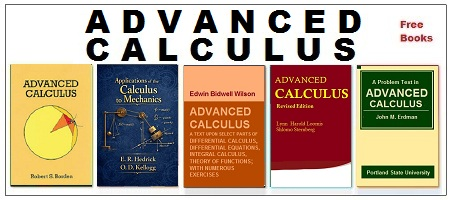

# 📘 Free Advanced Calculus Books & Textbook Repository

Welcome to the **Advanced Calculus Collection** by Free Mathematics Books.

This repository provides a curated selection of free advanced calculus textbooks and educational resources for undergraduate students, graduate students, independent learners, instructors, and researchers.

The collection covers rigorous mathematical analysis, multivariable calculus, vector analysis, fractional calculus, calculus of variations, and advanced applications of differentiation and integration.

🌐 **Explore the complete online collection:**

📚 **[Explore the Complete Free Advanced Calculus Collection](https://freemathematicsbooks.com/A.aspx?Id=Advanced-Calculus&utm_source=github&utm_medium=referral&utm_campaign=Advanced-Calculus&utm_content=introduction)**

📚 **[Explore the Complete Free Calculus Collection](https://freemathematicsbooks.com/A.aspx?Id=Calculus&utm_source=github&utm_medium=referral&utm_campaign=Calculus&utm_content=introduction)**

---

## 📚 Collection Overview

The selected books are organized into four groups to help readers find resources according to their academic background and interests.

| Group | Subject Area | Books |
|---|---|---:|
| 1 | Rigorous Foundations & Advanced Analysis | 4 |
| 2 | Multivariable, Vector & Applied Calculus | 4 |
| 3 | Specialized Calculus: Variational & Fractional Methods | 2 |
| 4 | Calculus Education & Teaching | 1 |
| **Total** | | **11** |

---

## 📂 Explore Other Calculus Collections

Advanced Calculus is connected with several other branches of calculus. Explore the related collections below for additional textbooks and learning resources.

| Calculus Collection | GitHub Repository | Online Library |
|---|---|---|
| **Calculus & Analytical Geometry** | [Browse Books](../Calculus-Analytical-Geometry/) | [View Books](https://freemathematicsbooks.com/A.aspx?Id=Calculus-Analytical-Geometry&utm_source=github&utm_medium=referral&utm_campaign=Advanced-Calculus&utm_content=related-collections) |
| **Calculus of Variations** | [Browse Books](../Calculus-Variation/) | [View Books](https://freemathematicsbooks.com/A.aspx?Id=Calculus-Variation&utm_source=github&utm_medium=referral&utm_campaign=Advanced-Calculus&utm_content=related-collections) |
| **Differential Calculus** | [Browse Books](../Differential-Calculus/) | [View Books](https://freemathematicsbooks.com/A.aspx?Id=Differential-Calculus&utm_source=github&utm_medium=referral&utm_campaign=Advanced-Calculus&utm_content=related-collections) |
| **Integral Calculus** | [Browse Books](../Integral-Calculus/) | [View Books](https://freemathematicsbooks.com/A.aspx?Id=Integral-Calculus&utm_source=github&utm_medium=referral&utm_campaign=Advanced-Calculus&utm_content=related-collections) |
| **Multivariable Calculus** | [Browse Books](../Multivariable-Calculus/) | [View Books](https://freemathematicsbooks.com/A.aspx?Id=Multivariable-Calculus&utm_source=github&utm_medium=referral&utm_campaign=Advanced-Calculus&utm_content=related-collections) |
| **Single Variable Calculus** | [Browse Books](../Single-Variable-Calculus/) | [View Books](https://freemathematicsbooks.com/A.aspx?Id=Single-Variable-Calculus&utm_source=github&utm_medium=referral&utm_campaign=Advanced-Calculus&utm_content=related-collections) |

---

## 📖 Curated Advanced Calculus Books

### 1. Rigorous Foundations & Advanced Analysis

These textbooks develop the theoretical foundations of advanced calculus, including limits, continuity, real and complex variables, differentiation, integration, and rigorous mathematical proofs.

**1. [A Course of Pure Mathematics — G. H. Hardy](https://freemathematicsbooks.com/B.aspx?FileName=Course-Pure-Mathematics--GH-Hardy&utm_source=github&utm_medium=referral&utm_campaign=Advanced-Calculus&utm_content=book-catalogue)**

A classic introduction to rigorous pure mathematics covering real and complex variables, functions, limits, continuity, differentiation, integration, infinite series, and logarithmic, exponential, and trigonometric functions.

**2. [Advanced Calculus — Edwin Bidwell Wilson](https://freemathematicsbooks.com/B.aspx?FileName=Advanced-Calculus--Edwin-Wilson&utm_source=github&utm_medium=referral&utm_campaign=Advanced-Calculus&utm_content=book-catalogue)**

A comprehensive textbook covering Taylor's formulas, partial differentiation, vectors, ordinary differential equations, multiple and infinite integrals, infinite series, complex variables, and the calculus of variations.

**3. [Advanced Calculus — Lynn H. Loomis & Shlomo Sternberg](https://freemathematicsbooks.com/B.aspx?FileName=Advanced-Calculus--Lynn-Loomis&utm_source=github&utm_medium=referral&utm_campaign=Advanced-Calculus&utm_content=book-catalogue)**

A rigorous honors-level textbook exploring vector spaces, linear maps, differential calculus, integration theory, differentiable manifolds, exterior calculus, potential theory, and classical mechanics.

**4. [Introduction to Mathematical Analysis — Beatriz Lafferriere](https://freemathematicsbooks.com/B.aspx?FileName=Mathematical-Analysis--Lafferriere&utm_source=github&utm_medium=referral&utm_campaign=Advanced-Calculus&utm_content=book-catalogue)**

An introductory bridge from computational calculus to rigorous mathematical analysis. Topics include mathematical tools, real sequences, limits, continuity, differentiation, and foundational analytical proofs.

---

### 2. Multivariable, Vector & Applied Calculus

This group focuses on calculus of several variables, vector-valued functions, partial derivatives, multiple integrals, and connections with linear algebra and scientific applications.

**5. [Active Calculus Multivariable — Steve Schlicker](https://freemathematicsbooks.com/B.aspx?FileName=Active-Calculus-Multivariable--Steve-Schlicker&utm_source=github&utm_medium=referral&utm_campaign=Advanced-Calculus&utm_content=book-catalogue)**

A student-focused textbook using active-learning techniques to explore multivariable and vector functions, vectors, dot and cross products, partial derivatives, gradients, optimization, and related topics.

**6. [Calculus and Linear Algebra Vol. 2 — Wilfred Kaplan & Donald J. Lewis](https://freemathematicsbooks.com/B.aspx?FileName=Calculus-Linear-Algebra-2--Wilfred-Kaplan&utm_source=github&utm_medium=referral&utm_campaign=Advanced-Calculus&utm_content=book-catalogue)**

An advanced textbook connecting linear algebra with multivariable calculus. It covers vector spaces, matrices, determinants, differential and integral calculus of functions of several variables, and ordinary differential equations.

**7. [Multivariable Calculus — Joel Feldman](https://freemathematicsbooks.com/B.aspx?FileName=Multivariable-Calculus--Joel-Feldman&utm_source=github&utm_medium=referral&utm_campaign=Advanced-Calculus&utm_content=book-catalogue)**

A structured introduction to multivariable calculus covering vectors and three-dimensional geometry, partial derivatives, multiple integrals, gradients, divergence, curl, and applications.

**8. [Vector Analysis — Josiah Willard Gibbs & Edwin Bidwell Wilson](https://freemathematicsbooks.com/B.aspx?FileName=Vector-Analysis--Josiah-Gibbs--Edwin-Wilson&utm_source=github&utm_medium=referral&utm_campaign=Advanced-Calculus&utm_content=book-catalogue)**

A classic mathematical text covering vector addition, scalar multiplication, direct and skew products, differential and integral calculus of vectors, linear vector functions, and applications to geometry and physics.

---

### 3. Specialized Calculus: Variational & Fractional Methods

These specialized textbooks explore extensions of ordinary calculus, including optimization of functions and functionals and differentiation and integration of non-integer orders.

**9. [Lectures on the Calculus of Variations — Harris Hancock](https://freemathematicsbooks.com/B.aspx?FileName=Lectures-Calculus-Variations--Harris-Hancock&utm_source=github&utm_medium=referral&utm_campaign=Advanced-Calculus&utm_content=book-catalogue)**

A classical treatment of variational problems covering variations of curves, the catenary, first and second variations, Jacobi conjugate points, extremal curves, isoperimetric problems, and sufficient conditions for extrema.

**10. [The Fractional Calculus: Theory and Applications — Keith B. Oldham & Jerome Spanier](https://freemathematicsbooks.com/B.aspx?FileName=Fractional-Calculus--Keith-Oldham&utm_source=github&utm_medium=referral&utm_campaign=Advanced-Calculus&utm_content=book-catalogue)**

A specialized textbook introducing differentiation and integration of arbitrary, non-integer orders. Topics include fractional derivatives, semi-derivatives, semi-integrals, differintegration techniques, transcendental functions, and applications to diffusion problems.

---

### 4. Calculus Education & Teaching

This resource explores how calculus is taught and learned, with attention to conceptual understanding, curriculum design, and instructional practice.

**11. [Teaching and Learning of Calculus — David Bressoud](https://freemathematicsbooks.com/B.aspx?FileName=Teaching-Learning-Calculus--David-Bressoud&utm_source=github&utm_medium=referral&utm_campaign=Advanced-Calculus&utm_content=book-catalogue)**

A resource focused on calculus education and conceptual understanding. It addresses teaching and learning of derivatives, integrals, limits, analytic geometry, infinite sequences, and series, as well as instructional approaches and curriculum challenges.

---

## 🎯 Suggested Reading Paths

Choose a reading path according to your mathematical background and learning goals.

| Learning Goal | Recommended Starting Point |
|---|---|
| **Rigorous Mathematical Foundations** | Hardy, Wilson, and Loomis & Sternberg |
| **Transition to Mathematical Analysis** | Beatriz Lafferriere |
| **Multivariable Calculus** | Active Calculus Multivariable and Joel Feldman |
| **Vector Calculus & Applications** | Gibbs & Wilson |
| **Calculus and Linear Algebra** | Kaplan & Lewis |
| **Calculus of Variations** | Harris Hancock |
| **Fractional Calculus** | Oldham & Spanier |
| **Teaching & Learning of Calculus** | David Bressoud |

---

## ✅ Collection Organization

This repository brings together selected resources covering the major theoretical and specialized areas of advanced calculus.

The collection includes:

- Rigorous treatments of real and complex variables.
- Mathematical analysis and advanced differential calculus.
- Multivariable and vector calculus.
- Multiple integration and mathematical applications.
- Calculus of variations and optimization.
- Fractional differentiation and integration.
- Calculus education and teaching methods.

Book descriptions are provided to help readers identify relevant resources. Visit each book's detail page for available reading or download options and applicable access or licensing information.

---

## 🤝 Contributions

Contributions that improve this collection are welcome.

You can help by:

- Suggesting additional free advanced calculus textbooks.
- Reporting broken or outdated links.
- Correcting book titles, author details, or descriptions.
- Improving the organization and documentation.
- Submitting a pull request with relevant updates.

Please ensure that suggested resources are freely accessible or clearly identify their access and licensing conditions.

---

## 🧭 Repository Navigation

- [🏠 Main Repository](../../)
- [📉 Main Calculus Collection](../)
- [📐 Calculus & Analytical Geometry](../Calculus-Analytical-Geometry/)
- [📘 Calculus of Variations](../Calculus-Variation/)
- [∂ Differential Calculus](../Differential-Calculus/)
- [∫ Integral Calculus](../Integral-Calculus/)
- [🔷 Multivariable Calculus](../Multivariable-Calculus/)
- [📊 Single Variable Calculus](../Single-Variable-Calculus/)

---

## 🌐 Explore More Free Mathematics Resources

Discover additional freely accessible mathematics textbooks, lecture notes, and educational resources.

**[Free Mathematics Books](https://freemathematicsbooks.com/?utm_source=github&utm_medium=referral&utm_campaign=FreeMathematicsBooks&utm_content=repository-footer)**

**GitHub Collection:** [Free Math Books Repository](https://github.com/FreeMathBooks/free-math-books-collection)

**Substack Publication:** [Free Mathematics Books](https://freemathematicsbooks.substack.com/)

---

*Free Mathematics Books — Making mathematics textbooks and educational resources easier to discover.*
