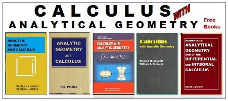

# 📚 Free Calculus with Analytical Geometry Books & Textbook Repository

Welcome to the **Free Calculus with Analytical Geometry Books Repository**!

This repository maintains a curated catalogue of freely accessible textbooks and educational resources combining calculus with analytical and coordinate geometry.

The collection brings together classical and modern mathematical approaches, covering topics such as limits, differentiation, integration, coordinate systems, conic sections, curves, multivariable calculus, and geometric applications.

These resources are intended for undergraduate students, educators, independent learners, and anyone interested in the mathematical relationship between calculus and analytical geometry.

📖 **[Explore the Complete Free Calculus with Analytical Geometry Collection](https://freemathematicsbooks.com/A.aspx?Id=Calculus-Analytical-Geometry&utm_source=github&utm_medium=referral&utm_campaign=Calculus-Analytical-Geometry&utm_content=introduction)**

📚 **[Explore the Complete Free Calculus Collection](https://freemathematicsbooks.com/A.aspx?Id=Calculus&utm_source=github&utm_medium=referral&utm_campaign=Calculus&utm_content=introduction)**

---

## 📚 Curated Calculus with Analytical Geometry Book Catalogue

The following books are organized into four groups to help readers explore different approaches to calculus and analytical geometry.

### 1. Rigorous & Problem-Based Advanced Calculus

This group introduces a rigorous, proof-oriented approach to advanced calculus through mathematical problems and theoretical foundations.

- 📖 **[A Problem Text in Advanced Calculus](https://freemathematicsbooks.com/B.aspx?FileName=Problem-Text-Advanced-Calculus--John-Erdman&utm_source=github&utm_medium=referral&utm_campaign=Calculus-Analytical-Geometry&utm_content=book-catalogue)** — *by John M. Erdman*

  A rigorous, problem-based textbook covering real numbers, sequences, limits, continuity, differentiation, metric spaces, compactness, connectedness, vector spaces, partial derivatives, iterated integrals, infinite series, and the implicit function theorem.

---

### 2. Classical & Infinitesimal Calculus

This group explores the foundations of classical calculus, including infinitesimals, coordinate geometry, differentiation, integration, and applications to curves.

- 📖 **[An Introduction to the Infinitesimal Calculus](https://freemathematicsbooks.com/B.aspx?FileName=Infinitesimal-Calculus--Horatio-Carslaw&utm_source=github&utm_medium=referral&utm_campaign=Calculus-Analytical-Geometry&utm_content=book-catalogue)** — *by Horatio Carslaw*

  A classical textbook covering coordinate geometry, the meaning of differentiation, algebraic and trigonometric functions, exponential and logarithmic functions, maxima and minima, partial differentiation, conic sections, and integral calculus.

---

### 3. Calculus & Analytical Geometry Textbooks

These textbooks combine differential and integral calculus with coordinate geometry, curves, conic sections, and mathematical applications.

- 📖 **[Calculus with Analytic Geometry](https://freemathematicsbooks.com/B.aspx?FileName=Calculus-Analytic-Geometry--Richard-Crowell&utm_source=github&utm_medium=referral&utm_campaign=Calculus-Analytical-Geometry&utm_content=book-catalogue)** — *by Richard H. Crowell & William E. Slesnick*

  A comprehensive textbook integrating calculus with analytic geometry. Topics include limits, derivatives, integrals, infinite series, multivariable calculus, curves, tangents, normals, areas, and volumes.

- 📖 **[Calculus and Analytical Geometry, with Mathematical Tables](https://freemathematicsbooks.com/B.aspx?FileName=Calculus-Analytical-Geometry--Edwin-Seaver&utm_source=github&utm_medium=referral&utm_campaign=Calculus-Analytical-Geometry&utm_content=book-catalogue)** — *by Edwin P. Seaver*

  A classical mathematics textbook covering algebraic formulas, circular and hyperbolic functions, trigonometry, differential and integral calculus, and analytical geometry. It provides a historical perspective on the development and teaching of classical calculus.

---

### 4. Classical Geometry & Differential and Integral Calculus

This group contains historical textbooks that connect coordinate geometry, conic sections, spatial geometry, and the principles of differential and integral calculus.

- 📖 **[Elements of Analytical Geometry & Differential and Integral Calculus](https://freemathematicsbooks.com/B.aspx?FileName=Analytical-Geometry-Diff-Int-Calculus--Horatio-Robinson&utm_source=github&utm_medium=referral&utm_campaign=Calculus-Analytical-Geometry&utm_content=book-catalogue)** — *by Horatio N. Robinson*

  A nineteenth-century textbook combining analytical geometry with differential and integral calculus. It covers points, lines, conic sections, surfaces, derivatives, maxima and minima, curve tracing, integration, areas, and volumes.

- 📖 **[Elements of Analytical Geometry & Differential and Integral Calculus](https://freemathematicsbooks.com/B.aspx?FileName=Elements-Analytical-Geometry-Calculus--Charles-Davies&utm_source=github&utm_medium=referral&utm_campaign=Calculus-Analytical-Geometry&utm_content=book-catalogue)** — *by Charles Davies*

  A classical textbook exploring plane and spatial analytical geometry alongside differential and integral calculus. Topics include points, lines, circles, ellipses, parabolas, hyperbolas, algebraic curves, surfaces, derivatives, and integration.

---

## 🎯 Suggested Reading Paths

Choose a reading path according to your mathematical background and learning goals.

| Learning Goal | Recommended Starting Point |
|---|---|
| **Rigorous Advanced Calculus** | John M. Erdman |
| **Classical Calculus Foundations** | Horatio Carslaw |
| **Calculus with Analytic Geometry** | Crowell & Slesnick |
| **Classical Calculus & Mathematical Tables** | Edwin P. Seaver |
| **Historical Analytical Geometry** | Horatio N. Robinson and Charles Davies |

---

## 📋 Book Selection & Verification

This collection brings together selected textbooks and educational resources related to calculus and analytical geometry.

- Book titles and author information are provided with their corresponding resource links.
- Descriptions help readers identify the mathematical subjects covered by each resource.
- Readers should consult individual book pages for available reading or download options and applicable access or licensing information.

---

## 📁 Repository Organization

The main Calculus repository contains specialized collections covering different areas of calculus.

| Calculus Collection | Description |
|---|---|
| [Advanced Calculus](../Advanced-Calculus/) | Advanced topics and theoretical foundations |
| [Calculus with Analytical Geometry](../Calculus-Analytical-Geometry/) | Calculus combined with coordinate and analytical geometry |
| [Calculus of Variations](../Calculus-Variation/) | Variational methods and optimization |
| [Differential Calculus](../Differential-Calculus/) | Derivatives, differentiation, and applications |
| [Integral Calculus](../Integral-Calculus/) | Integration methods, techniques, and applications |
| [Multivariable Calculus](../Multivariable-Calculus/) | Functions of several variables and multiple integration |
| [Single Variable Calculus](../Single-Variable-Calculus/) | Foundations of one-variable calculus |

---

## 🤝 Contributing to This Repository

Contributions that improve this collection are welcome.

You can help by:

- Suggesting additional free calculus and analytical geometry textbooks.
- Reporting broken or outdated links.
- Correcting book titles, author details, or descriptions.
- Improving the organization and documentation.
- Submitting a pull request with relevant updates.

Please ensure that suggested resources are freely accessible or clearly identify their access and licensing conditions.

---

## 🔙 Repository Navigation

- [⬅️ Back to Main Calculus Collection](../)
- [🏠 Back to Repository Root](../../)

---

## 🌐 Explore More Mathematics Resources

**GitHub Collection:** [Free Math Books Repository](https://github.com/FreeMathBooks/free-math-books-collection)

**Substack Publication:** [Free Mathematics Books](https://freemathematicsbooks.substack.com/)

Discover additional free textbooks and educational materials through **[Free Mathematics Books](https://freemathematicsbooks.com/?utm_source=github&utm_medium=referral&utm_campaign=FreeMathematicsBooks&utm_content=repository-footer)**.

