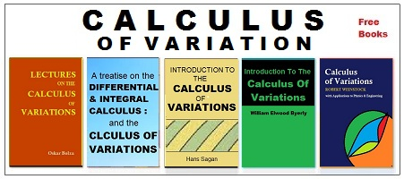

# 📚 Free Calculus of Variations Books & Textbook Repository

Welcome to the Free Calculus of Variations Books Repository!

This repository maintains a curated catalogue of freely accessible textbooks, lecture notes, and supplementary mathematical resources on **Calculus of Variations**.

Explore resources covering classical variational principles, functionals, Euler–Lagrange equations, optimization of functionals, and applications in mathematics, physics, and engineering.

This collection is designed for undergraduate students, graduate students, researchers, educators, and independent learners.

Each entry identifies the available book, its author, and a link to its corresponding resource page.

📖 **[Explore the Complete Free Calculus of Variations Collection](https://freemathematicsbooks.com/A.aspx?Id=Calculus-Variation&utm_source=github&utm_medium=referral&utm_campaign=Calculus-Variation&utm_content=introduction)**

📚 **[Explore the Complete Free Calculus Collection](https://freemathematicsbooks.com/A.aspx?Id=Calculus&utm_source=github&utm_medium=referral&utm_campaign=Calculus&utm_content=introduction)**

---

## 📚 Curated Calculus of Variations Book Catalogue

The following books are organized into three groups according to their primary subject, educational focus, and intended use.

### 1. 📘 Introductory & Core Resources

*Classical textbooks and foundational materials covering the fundamental principles and methods of Calculus of Variations.*

- 📖 **[Lectures on the Calculus of Variations](https://freemathematicsbooks.com/B.aspx?FileName=Lectures-Calculus-Variations--Oskar-Bolza&utm_source=github&utm_medium=referral&utm_campaign=calculus-variation&utm_content=book-catalogue)** — *by Oskar Bolza*
- 📖 **[Calculus of Variation](https://freemathematicsbooks.com/B.aspx?FileName=Calculus-Variation--Gilbert-Bliss&utm_source=github&utm_medium=referral&utm_campaign=calculus-variation&utm_content=book-catalogue)** — *by Gilbert Ames Bliss*
- 📖 **[A History of the Progress of the Calculus of Variations](https://freemathematicsbooks.com/B.aspx?FileName=Hisotry-Calculus-Variations--Todhunter&utm_source=github&utm_medium=referral&utm_campaign=calculus-variation&utm_content=book-catalogue)** — *by Isaac Todhunter*

### 2. ⚙️ Applied & Interdisciplinary Resources

*Resources exploring applications of variational methods in engineering, differential equations, mechanics, mathematical modeling, and applied mathematics.*

- 📖 **[Applied Calculus: Principles and Applications](https://freemathematicsbooks.com/B.aspx?FileName=Applied-Calculus-Principles-App--Robert-Thomas&utm_source=github&utm_medium=referral&utm_campaign=calculus-variation&utm_content=book-catalogue)** — *by Robert Thomas*
- 📖 **[Introductory Mathematics for Engineers](https://freemathematicsbooks.com/B.aspx?FileName=Intro-Math-Eng-Lectures--Anatoliy-Myskis&utm_source=github&utm_medium=referral&utm_campaign=calculus-variation&utm_content=book-catalogue)** — *by A. D. Myskis*
- 📖 **[Differential Equations and the Calculus of Variations](https://freemathematicsbooks.com/B.aspx?FileName=DE-Calculus-Variations--Lev-Elsgolts&utm_source=github&utm_medium=referral&utm_campaign=calculus-variation&utm_content=book-catalogue)** — *by L. Elsgolts*

### 3. 📚 Advanced & Specialized Resources

*Advanced materials covering theoretical foundations, variational methods, optimization, and specialized mathematical techniques.*

- 📖 **[Selected Chapters: Calculus of Variations](https://freemathematicsbooks.com/B.aspx?FileName=Calculus-Variations--Jurgen-Moser&utm_source=github&utm_medium=referral&utm_campaign=calculus-variation&utm_content=book-catalogue)** — *by Jürgen Moser*

---

## 📋 Book Selection & Verification

Resources in this catalogue are organized according to their main subject and educational purpose.

The following considerations guide the organization of this collection:

- **Subject Relevance:** Books are included according to their coverage of Calculus of Variations or closely related mathematical subjects.
- **Bibliographic Information:** Book titles and author details are provided to help readers identify the resources.
- **Resource Accessibility:** Links lead to the corresponding book information pages, where availability and access details can be checked.
- **Subject Classification:** Resources are grouped by their primary educational focus to make browsing easier.
- **Link Maintenance:** Broken links and bibliographic corrections can be reported through GitHub Issues.

---

## 📖 How to Choose a Resource

- **Beginners:** Start with introductory materials covering functionals, variations, and the Euler–Lagrange equation.
- **Undergraduate Students:** Study classical variational problems, stationary paths, and boundary conditions.
- **Graduate Students:** Explore advanced variational methods, direct methods, and functional analysis.
- **Engineering Students:** Focus on applications in differential equations, mechanics, and mathematical modeling.
- **Historical Mathematics Enthusiasts:** Explore the historical development of Calculus of Variations through Isaac Todhunter's work.

---

## 📚 Topics Covered

This collection includes resources covering the following topics:

- Introduction to Calculus of Variations
- Functionals and Variations
- First and Second Variations
- Euler–Lagrange Equations
- Variational Principles
- Stationary Paths and Extremals
- Boundary Conditions
- Isoperimetric Problems
- Brachistochrone Problem
- Hamilton–Jacobi Theory
- Differential Equations and Variational Methods
- Direct Methods in the Calculus of Variations
- Sobolev Spaces
- Constrained Variational Problems
- Optimization of Functionals
- Applications in Physics and Engineering
- Mathematical Modeling and Applied Variational Methods

---

## 🤝 Contributing to This Repository

Suggestions and contributions are welcome!

You can help improve this collection by:

1. Suggesting freely accessible Calculus of Variations textbooks and learning materials.
2. Reporting broken or outdated book links.
3. Correcting book titles, author names, or bibliographic details.
4. Recommending relevant supplementary mathematical resources.
5. Improving the organization and documentation of the repository.

**How to contribute:**

- Open a GitHub Issue to report a problem or suggest a resource.
- Submit a Pull Request with proposed additions or corrections.
- Include the book title, author, and source link when suggesting a resource.

Please ensure that submitted materials are freely accessible and that any shared files comply with applicable copyright and licensing terms.

---

## 🔙 Repository Navigation

- [📂 Back to Calculus Collection](../)
- [🏠 Back to Repository Root](../../)

---

## 🌐 Explore More Mathematics Resources

Discover additional free textbooks and educational materials through **[Free Mathematics Books](https://freemathematicsbooks.com/?utm_source=github&utm_medium=referral&utm_campaign=FreeMathematicsBooks&utm_content=repository-footer)**.
