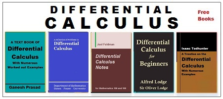

# 📚 Free Differential Calculus Books & Textbook Repository

Welcome to the Free Differential Calculus Books Repository!

This repository maintains a curated catalogue of freely accessible Differential Calculus textbooks, lecture notes, problem books, and supplementary mathematical resources.

Explore resources covering limits, continuity, derivatives, differentiation techniques, applications of derivatives, and related mathematical concepts.

This collection is designed for undergraduate students, educators, and independent learners.

Each entry identifies the available book, its author, and a link to its corresponding resource page.

📖 **[Explore the Complete Free Differential Calculus Collection](https://freemathematicsbooks.com/A.aspx?Id=Differential-Calculus&utm_source=github&utm_medium=referral&utm_campaign=Differential-Calculus&utm_content=introduction)**

📖 **[Explore the Complete Free Calculus Collection](https://freemathematicsbooks.com/A.aspx?Id=Calculus&utm_source=github&utm_medium=referral&utm_campaign=Calculus&utm_content=introduction)**

---

## 📚 Curated Differential Calculus Book Catalogue

The following books are organized into three groups according to their primary subject, educational focus, and intended use.

### 1. 📘 Introductory & Core Differential Calculus

*Foundational textbooks covering the essential concepts, principles, and techniques of Differential Calculus.*

- 📖 **[Differential Calculus for Beginners](https://freemathematicsbooks.com/B.aspx?FileName=Diff-Calculus-Beginners--Joseph-Edwards&utm_source=github&utm_medium=referral&utm_campaign=Differential-Calculus&utm_content=book-catalogue)** — *by Joseph Edwards*
- 📖 **[Differential Calculus](https://freemathematicsbooks.com/B.aspx?FileName=Diff-Calculus--Henry-Phillips&utm_source=github&utm_medium=referral&utm_campaign=Differential-Calculus&utm_content=book-catalogue)** — *by Henry Bayard Phillips*
- 📖 **[Differential Calculus](https://freemathematicsbooks.com/B.aspx?FileName=Diff-Calculus--John-Spare&utm_source=github&utm_medium=referral&utm_campaign=Differential-Calculus&utm_content=book-catalogue)** — *by John Spare*
- 📖 **[Differential Calculus](https://freemathematicsbooks.com/B.aspx?FileName=Diff-Calculus--Joel-Feldman&utm_source=github&utm_medium=referral&utm_campaign=Differential-Calculus&utm_content=book-catalogue)** — *by Joel Feldman*

### 2. ⚙️ Differential & Integral Calculus Resources

*Combined calculus textbooks and lecture notes covering differentiation, integration, and related mathematical techniques.*

- 📖 **[Differential and Integral Calculus](https://freemathematicsbooks.com/B.aspx?FileName=Diff-Int-Calculus--CE-Love--ED-Rainville&utm_source=github&utm_medium=referral&utm_campaign=Differential-Calculus&utm_content=book-catalogue)** — *by Clyde E. Love & E. D. Rainville*
- 📖 **[Differential & Integral Calculus Notes in Brief](https://freemathematicsbooks.com/B.aspx?FileName=Diff-Int-Calculus-Notes--Matthew-Scroggs&utm_source=github&utm_medium=referral&utm_campaign=Differential-Calculus&utm_content=book-catalogue)** — *by Matthew Scroggs*

### 3. 📚 Advanced & Specialized Resources

*Problem-solving materials and advanced resources for developing a deeper understanding of calculus concepts and techniques.*

- 📖 **[A Problem Text in Advanced Calculus](https://freemathematicsbooks.com/B.aspx?FileName=Problem-Text-Advanced-Calculus--John-Erdman&utm_source=github&utm_medium=referral&utm_campaign=Differential-Calculus&utm_content=book-catalogue)** — *by John M. Erdman*
- 📖 **[Examples and Solutions of the Differential Calculus](https://freemathematicsbooks.com/B.aspx?FileName=Examples-Solutions-Diff-Calculus--James-Haddon&utm_source=github&utm_medium=referral&utm_campaign=Differential-Calculus&utm_content=book-catalogue)** — *by James Haddon*

---

## 📋 Book Selection & Verification

Resources in this catalogue are organized according to their main subject and educational purpose.

The following considerations guide the organization of this collection:

- **Subject Relevance:** Books are included according to their coverage of Differential Calculus or closely related calculus subjects.
- **Bibliographic Information:** Book titles and author details are provided to help readers identify the resources.
- **Resource Accessibility:** Links lead to the corresponding book information pages, where availability and access details can be checked.
- **Subject Classification:** Resources are grouped by their primary educational focus to make browsing easier.
- **Link Maintenance:** Broken links and bibliographic corrections can be reported through GitHub Issues.

---

## 📖 How to Choose a Resource

- **Beginners:** Start with *Differential Calculus for Beginners* by Joseph Edwards to explore foundational concepts.
- **Undergraduate Students:** Study the core Differential Calculus textbooks to develop a strong understanding of differentiation and its applications.
- **Problem-Solving Practice:** Explore problem books and worked examples to strengthen mathematical skills.
- **Broader Calculus Study:** Use combined Differential and Integral Calculus textbooks for a wider understanding of calculus.

---

## 📚 Topics Covered

This collection includes resources covering the following topics:

- Introduction to Differential Calculus
- Limits and Continuity
- Functions and Their Properties
- Derivatives and Differentiation
- Rules of Differentiation
- Chain Rule
- Implicit Differentiation
- Higher-Order Derivatives
- Differentiation of Trigonometric Functions
- Differentiation of Exponential and Logarithmic Functions
- Applications of Derivatives
- Tangents and Normals
- Maxima and Minima
- Related Rates
- Curve Sketching
- Differential and Integral Calculus
- Calculus Problems and Worked Examples

---

## 🤝 Contributing to This Repository

Suggestions and contributions are welcome!

You can help improve this collection by:

1. Suggesting freely accessible Differential Calculus textbooks and learning materials.
2. Reporting broken or outdated book links.
3. Correcting book titles, author names, or bibliographic details.
4. Recommending relevant supplementary mathematical resources.
5. Improving the organization and documentation of the repository.

**How to contribute:**

- Open a GitHub Issue to report a problem or suggest a resource.
- Submit a Pull Request with proposed additions or corrections.
- Include the book title, author, and source link when suggesting a resource.

Please ensure that submitted materials are freely accessible and that any shared files comply with applicable copyright and licensing terms.

---

## 🔙 Repository Navigation

- [📂 Back to Main Calculus Collection](../)
- [🏠 Back to Repository Root](../../)

---

## 🌐 Explore More Mathematics Resources

**GitHub Collection:** [Free Math Books Repository](https://github.com/FreeMathBooks/free-math-books-collection)

**Substack Publication:** [Free Mathematics Books](https://freemathematicsbooks.substack.com/)

Discover additional free textbooks and educational materials through **[Free Mathematics Books](https://freemathematicsbooks.com/?utm_source=github&utm_medium=referral&utm_campaign=FreeMathematicsBooks&utm_content=repository-footer)**.
