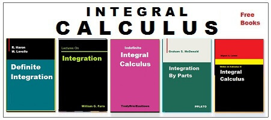

# Free Integral Calculus Books

A curated collection of free Integral Calculus textbooks, lecture notes, and educational resources. Explore antiderivatives, definite and indefinite integrals, integration techniques, applications of integration, and numerical methods.

This collection is designed for undergraduate students, instructors, engineering students, and independent learners.

## Table of Contents

- [Introductory & Core Resources](#1-introductory--core-resources)
- [Integration Techniques & Applications](#2-integration-techniques--applications)
- [Advanced & Specialized Resources](#3-advanced--specialized-resources)
- [Online Courses & Supplementary Resources](#4-online-courses--supplementary-resources)
- [How to Choose a Resource](#how-to-choose-a-resource)
- [Topics Covered](#topics-covered)
- [Other Calculus Collections](#other-calculus-collections)
- [Contributing](#contributing)

---

## 1. Introductory & Core Resources

Start learning integral calculus with introductory textbooks covering antiderivatives, definite and indefinite integrals, Riemann sums, and the Fundamental Theorem of Calculus.

| Resource | Author | Level |
|---|---|---|
| [CLP-2: Integral Calculus](https://personal.math.ubc.ca/~CLP/CLP2/) | Joel Feldman, Andrew Rechnitzer, Elyse Yeager | Introductory |
| [Calculus Volume 2](https://openstax.org/details/books/calculus-volume-2) | Gilbert Strang, Edwin Herman | Introductory |
| [Contemporary Calculus – Integral Calculus](https://www.contemporarycalculus.com/) | Dale Hoffman | Introductory |
| [MIT Calculus Open Textbook](https://ocw.mit.edu/courses/res-18-001-calculus-fall-2023/pages/open-textbook/) | Gilbert Strang | Introductory |
| [Calculus Made Easy](https://www.gutenberg.org/ebooks/33283) | Silvanus P. Thompson | Beginner |

## 2. Integration Techniques & Applications

Explore different integration methods and their applications in geometry, physics, engineering, and mathematical problem-solving.

| Resource | Author / Institution | Level |
|---|---|---|
| [Paul's Online Math Notes – Calculus II](https://tutorial.math.lamar.edu/Classes/CalcII/CalcII.aspx) | Paul Dawkins | Intermediate |
| [MIT OpenCourseWare – Single Variable Calculus](https://ocw.mit.edu/courses/18-01sc-single-variable-calculus-fall-2010/) | MIT OpenCourseWare | Intermediate |
| [CLP-2 Integral Calculus Problem Book](https://personal.math.ubc.ca/~CLP/CLP2/) | Joel Feldman, Andrew Rechnitzer, Elyse Yeager | Intermediate |
| [APEX Calculus](https://www.apexcalculus.com/) | Gregory Hartman and collaborators | Intermediate |
| [Active Calculus](https://activecalculus.org/) | Matthew Boelkins | Intermediate |

## 3. Advanced & Specialized Resources

Additional materials for students interested in advanced integration methods, theoretical foundations, and specialized topics.

| Resource | Author / Institution | Level |
|---|---|---|
| [MIT Calculus – Techniques of Integration](https://ocw.mit.edu/courses/res-18-001-calculus-fall-2023/pages/open-textbook/) | Gilbert Strang | Advanced |
| [CLP-2 Integral Calculus](https://personal.math.ubc.ca/~CLP/CLP2/) | University of British Columbia | Advanced |
| [Calculus Volume 2](https://openstax.org/details/books/calculus-volume-2) | OpenStax | Advanced |

## 4. Online Courses & Supplementary Resources

Additional online courses, problem books, and learning materials to strengthen your understanding of integral calculus.

| Resource | Institution / Author | Type |
|---|---|---|
| [MIT OpenCourseWare – Single Variable Calculus](https://ocw.mit.edu/courses/18-01sc-single-variable-calculus-fall-2010/) | MIT | Online Course |
| [CLP-2 Integral Calculus](https://personal.math.ubc.ca/~CLP/CLP2/) | University of British Columbia | Textbook & Exercises |
| [Paul's Online Math Notes](https://tutorial.math.lamar.edu/) | Paul Dawkins | Study Notes |
| [OpenStax Calculus Volume 2](https://openstax.org/details/books/calculus-volume-2) | OpenStax | Textbook |
| [Contemporary Calculus](https://www.contemporarycalculus.com/) | Dale Hoffman | Online Textbook |

---

## How to Choose a Resource

- **Beginners:** Start with CLP-2 or OpenStax Calculus Volume 2 to understand integration fundamentals.
- **Undergraduate Students:** Study integration techniques, definite integrals, and applications using MIT or APEX Calculus.
- **Engineering Students:** Focus on applications involving areas, volumes, work, fluid pressure, and center of mass.
- **Advanced Students:** Explore improper integrals, infinite series, numerical integration, and connections with mathematical analysis.

## Topics Covered

This collection includes resources covering the following topics:

- Introduction to Integral Calculus
- Antiderivatives and Indefinite Integrals
- Definite Integrals
- Riemann Sums
- Fundamental Theorem of Calculus
- Properties of Integrals
- Substitution Method
- Integration by Parts
- Trigonometric Integrals
- Trigonometric Substitution
- Partial Fraction Decomposition
- Improper Integrals
- Numerical Integration
- Areas Between Curves
- Volumes of Solids
- Arc Length
- Surface Area
- Work and Fluid Pressure
- Center of Mass and Moments
- Average Value of a Function
- Applications in Physics and Engineering

## Other Calculus Collections

Explore more free mathematics textbooks and educational resources:

- [Complete Calculus Collection](../)
- [Free Differential Calculus Books](../Differential-Calculus/)
- [Free Single Variable Calculus Books](../Single-Variable-Calculus/)
- [Free Multivariable Calculus Books](../Multivariable-Calculus/)
- [Free Advanced Calculus Books](../Advanced-Calculus/)
- [Free Calculus of Variations Books](../Calculus-Variation/)
- [Free Differential Equations Books](../../Differential-Equations/)
- [Free Mathematical Analysis Books](../../Mathematical-Analysis/)

## Contributing

Contributions are welcome! If you know of a freely accessible integral calculus textbook, lecture note, problem book, or educational resource, feel free to suggest it.

Please ensure that submitted resources are:

- Freely and legally accessible.
- Relevant to integral calculus and its applications.
- Academically useful and educationally valuable.
- Linked to their original source whenever possible.

---

**Explore more free mathematics textbooks and educational resources at [Free Mathematics Books](https://freemathematicsbooks.com/).**
