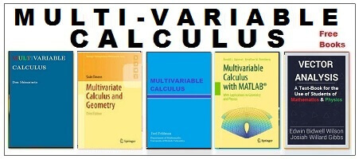

# 📚 Free Multivariable Calculus Books & Textbook Repository

Welcome to the **Multivariable Calculus Collection** by Free Mathematics Books.

This repository maintains a curated catalogue of freely accessible Multivariable Calculus textbooks, lecture notes, and supplementary mathematical resources.

Resources cover the mathematics of functions of several variables, including limits, continuity, partial derivatives, multiple integrals, vector-valued functions, and vector calculus. The collection is intended for students, educators, and independent learners exploring multivariable mathematical methods.

Each entry identifies the available book, its author, and a link to its corresponding resource page.

📖 **[Explore the Complete Free Multivariable Calculus Collection](https://freemathematicsbooks.com/A.aspx?Id=Multivariable-Calculus&utm_source=github&utm_medium=referral&utm_campaign=Multivariable-Calculus&utm_content=introduction)**

📚 **[Explore the Complete Free Calculus Collection](https://freemathematicsbooks.com/A.aspx?Id=Calculus&utm_source=github&utm_medium=referral&utm_campaign=Calculus&utm_content=introduction)**

---

## 📖 Curated Multivariable Calculus Book Catalogue

The following books are organized into three groups according to their primary subject, educational focus, and mathematical content.

### 1. 📘 Introductory & Core Multivariable Calculus

Textbooks and learning materials covering the fundamental concepts and techniques of multivariable calculus.

- 📖 **[Active Calculus Multivariable — Steve Schlicker](https://freemathematicsbooks.com/B.aspx?FileName=Active-Calculus-Multivariable--Steve-Schlicker&utm_source=github&utm_medium=referral&utm_campaign=Multivariable-Calculus&utm_content=book-catalogue)**

A student-centered textbook using active learning to explore functions of several variables, vectors, partial derivatives, gradients, multiple integrals, and vector fields.

- 📖 **[Multivariable Calculus — Don Shimamoto](https://freemathematicsbooks.com/B.aspx?FileName=Multivariable-Calculus--Don-Shimamoto&utm_source=github&utm_medium=referral&utm_campaign=Multivariable-Calculus&utm_content=book-catalogue)**

A structured introduction to multivariable calculus covering three-dimensional geometry, partial differentiation, optimization, multiple integration, and vector calculus.

- 📖 **[Multivariable Calculus — Joel Feldman](https://freemathematicsbooks.com/B.aspx?FileName=Multivariable-Calculus--Joel-Feldman&utm_source=github&utm_medium=referral&utm_campaign=Multivariable-Calculus&utm_content=book-catalogue)**

A clear, comprehensive guide to higher-dimensional calculus covering vectors, quadric surfaces, partial derivatives, multiple integrals, divergence, and curl.

- 📖 **[Calculus — WikiBooks](https://freemathematicsbooks.com/B.aspx?FileName=Calculus--WikiBooks&utm_source=github&utm_medium=referral&utm_campaign=Multivariable-Calculus&utm_content=book-catalogue)**

An open-content textbook covering single and multivariable calculus concepts, differentiation, integration, and analytical applications for independent learners.

---

### 2. 📚 Advanced Calculus & Mathematical Foundations

Advanced mathematical treatments and foundational resources related to calculus and its theoretical development.

- 📖 **[A Course of Pure Mathematics — G. H. Hardy](https://freemathematicsbooks.com/B.aspx?FileName=Course-Pure-Mathematics--GH-Hardy&utm_source=github&utm_medium=referral&utm_campaign=Multivariable-Calculus&utm_content=book-catalogue)**

A classic introduction to rigorous pure mathematics covering real and complex variables, functions, limits, continuity, differentiation, integration, and infinite series.

- 📖 **[Advanced Calculus — Edwin Bidwell Wilson](https://freemathematicsbooks.com/B.aspx?FileName=Advanced-Calculus--Edwin-Wilson&utm_source=github&utm_medium=referral&utm_campaign=Multivariable-Calculus&utm_content=book-catalogue)**

A thorough advanced text covering partial differentiation, vectors, multiple and infinite integrals, infinite series, differential equations, and variational methods.

---

### 3. 📐 Vector Calculus & Analysis

Resources focused on vector methods, vector fields, and mathematical techniques used in higher-dimensional calculus.

- 📖 **[Vector Analysis — Josiah Gibbs & Edwin Wilson](https://freemathematicsbooks.com/B.aspx?FileName=Vector-Analysis--Josiah-Gibbs--Edwin-Wilson&utm_source=github&utm_medium=referral&utm_campaign=Multivariable-Calculus&utm_content=book-catalogue)**

A landmark text developing vector algebra, differential and integral vector calculus, linear vector functions, and applications to geometry and physics.

- 📖 **[Vector Calculus — Michael Corral](https://freemathematicsbooks.com/B.aspx?FileName=Vector-Calculus--Michael-Corral&utm_source=github&utm_medium=referral&utm_campaign=Multivariable-Calculus&utm_content=book-catalogue)**

An accessible, open-source textbook covering vectors in Euclidean space, functions of several variables, multiple integrals, line and surface integrals, and vector theorems.

---

## 📖 How to Choose a Resource

- **Beginners & Core Multivariable Learners:** Start with *Active Calculus Multivariable* by Steve Schlicker, *Multivariable Calculus* by Don Shimamoto or Joel Feldman, or *WikiBooks Calculus* to build strong multivariable foundations.
- **Vector Calculus & Physics/Engineering Applications:** Explore *Vector Calculus* by Michael Corral and *Vector Analysis* by Josiah Gibbs & Edwin Wilson for vector fields, multiple integrals, and spatial applications.
- **Rigorous & Theoretical Foundations:** Turn to *A Course of Pure Mathematics* by G. H. Hardy and *Advanced Calculus* by Edwin Bidwell Wilson for deeper analytical rigor.

---

## 📚 Topics Covered

This collection includes resources covering the following topics:

- Functions of Several Variables, Limits, and Continuity
- Vectors, Dot and Cross Products, and Three-Dimensional Geometry
- Partial Derivatives, Gradients, and Directional Derivatives
- Multivariable Optimization and Tangent Planes
- Double, Triple, and Iterated Integrals
- Cylindrical and Spherical Coordinates
- Vector Fields, Line Integrals, and Surface Integrals
- Divergence, Curl, Green's Theorem, Stokes' Theorem, and Divergence Theorem
- Advanced Calculus and Analytical Foundations

---

## 📋 Book Selection & Verification

Resources in this catalogue are organized according to their main subject and educational purpose.

The following considerations guide the organization of this collection:

- **Subject Relevance:** Books are included according to their coverage of Multivariable Calculus and closely related mathematical subjects.
- **Bibliographic Information:** Book titles and author details are provided to help readers identify the resources.
- **Resource Accessibility:** Links lead to the corresponding book information pages, where availability and access details can be checked.
- **Subject Classification:** Resources are grouped by their primary educational focus to make browsing easier.
- **Link Maintenance:** Broken links and bibliographic corrections can be reported through GitHub Issues.

---

## 🤝 Contributing to This Repository

Suggestions and contributions are welcome!

You can help improve this collection by:

1. Suggesting freely accessible Multivariable Calculus textbooks and learning materials.
2. Reporting broken or outdated book links.
3. Correcting book titles, author names, or bibliographic details.
4. Recommending relevant supplementary mathematical resources.
5. Improving the organization and documentation of the repository.

**How to contribute:**

- Open a GitHub Issue to report a problem or suggest a resource.
- Submit a Pull Request with proposed additions or corrections.
- Include the book title, author, and source link when suggesting a resource.

Please ensure that submitted materials are freely accessible and that any shared files comply with applicable copyright and licensing terms.

---

## 📂 Calculus Subcategories

- [∂ Differential Calculus](../Differential-Calculus/)
- [∫ Integral Calculus](../Integral-Calculus/)
- [📊 Single Variable Calculus](../Single-Variable-Calculus/)
- [🔷 Multivariable Calculus](../Multivariable-Calculus/)
- [🔷 Advance Calculus](../Advance-Calculus/)
- [📐 Calculus & Analytical Geometry](../Calculus-Analytical-Geometry/)
- [📘 Calculus of Variations](../Calculus-Variation/)
---

## 🧭 Repository Navigation

- [⬅️ Back to Main Calculus Category](../)
- [🏠 Back to Home Repository](../../)

---

## 🌐 Explore More Mathematics Resources

- **GitLab:** [Free Mathematics Books Study Guide](https://gitlab.com/mathematics55/FreeMathBooks/-/tree/main) — Subject study guides and topic mirrors.
- **Substack:** [Free Mathematics Books Reading Notes](https://freemathematicsbooks.substack.com/) — Curated reading lists and book highlights.
- **Official Website:** [FreeMathematicsBooks.com](https://freemathematicsbooks.com/?utm_source=github&utm_medium=referral&utm_campaign=FreeMathematicsBooks&utm_content=repository-footer) — Searchable directory of external textbook links.
