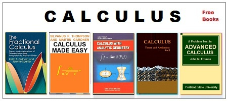

# 📚 Free Calculus Books & Textbook Repository

Welcome to the **Calculus Collection** by Free Mathematics Books.

This repository maintains a curated catalogue of freely accessible Calculus textbooks, lecture notes, and supplementary mathematical resources.

Resources are organized by subject, allowing students, educators, and independent learners to explore Calculus materials ranging from introductory concepts to advanced mathematical topics.

Each entry identifies the available book, its author, and a link to its corresponding resource page.

This repository also welcomes suggestions, corrections, and contributions that help improve the accuracy and usefulness of the collection.

📖 **[Explore the Complete Free Calculus Collection](https://freemathematicsbooks.com/A.aspx?Id=Calculus&utm_source=github&utm_medium=referral&utm_campaign=Calculus&utm_content=introduction)**

---

## 📂 Browse Calculus Collections

The following directories organize resources by their primary mathematical subject.

| Subcategory | 📚 Online Collection | 📁 GitHub Folder |
| :--- | :--- | :--- |
| **Advanced Calculus** | [View Books](https://freemathematicsbooks.com/A.aspx?Id=Advanced-Calculus&utm_source=github&utm_medium=referral&utm_campaign=Advanced-Calculus) | [Explore Folder](./Advanced-Calculus) |
| **Calculus & Analytical Geometry** | [View Books](https://freemathematicsbooks.com/A.aspx?Id=Calculus-Analytical-Geometry&utm_source=github&utm_medium=referral&utm_campaign=Calculus-Analytical-Geometry) | [Explore Folder](./Calculus-Analytical-Geometry) |
| **Calculus of Variations** | [View Books](https://freemathematicsbooks.com/A.aspx?Id=Calculus-Variation&utm_source=github&utm_medium=referral&utm_campaign=Calculus-Variation) | [Explore Folder](./Calculus-Variation) |
| **Differential Calculus** | [View Books](https://freemathematicsbooks.com/A.aspx?Id=Differential-Calculus&utm_source=github&utm_medium=referral&utm_campaign=Differential-Calculus) | [Explore Folder](./Differential-Calculus) |
| **Integral Calculus** | [View Books](https://freemathematicsbooks.com/A.aspx?Id=Integral-Calculus&utm_source=github&utm_medium=referral&utm_campaign=Integral-Calculus) | [Explore Folder](./Integral-Calculus) |
| **Multivariable Calculus** | [View Books](https://freemathematicsbooks.com/A.aspx?Id=Multivariable-Calculus&utm_source=github&utm_medium=referral&utm_campaign=Multivariable-Calculus) | [Explore Folder](./Multivariable-Calculus) |
| **Single-Variable Calculus** | [View Books](https://freemathematicsbooks.com/A.aspx?Id=Single-Variable-Calculus&utm_source=github&utm_medium=referral&utm_campaign=Single-Variable-Calculus) | [Explore Folder](./Single-Variable-Calculus) |

---

## 🧭 Suggested Calculus Study Path

Students can use the following sequence as a general guide for exploring Calculus:

1. 🌱 **Foundational & Introductory Calculus:** Build intuition around rates of change, limits, basic derivatives, and integrals.
2. 📈 **Single-Variable Calculus:** Study functions, limits, continuity, differentiation rules, and integration techniques.
3. 📐 **Differential Calculus:** Focus on derivatives, curve analysis, optimization, and physical/engineering applications.
4. ∫ **Integral Calculus:** Master antiderivatives, definite integrals, series, and accumulation problems.
5. 🌐 **Multivariable Calculus:** Move to functions of several variables, partial derivatives, multiple integrals, and vector fields.
6. 🔬 **Advanced Calculus & Specialized Topics:** Explore rigorous analysis, calculus of variations, finite differences, and fractional calculus.

---

## 📖 Curated Calculus Book Catalogue

The following books are organized into four groups according to their primary subject, educational focus, and intended use.

### 1. 📘 Introductory & Core Calculus

Foundational and general Calculus textbooks for beginners and undergraduate students.

- 📖 **[APEX Calculus — Gregory Hartman](https://freemathematicsbooks.com/B.aspx?FileName=APEX-Calculus--Gregory-Hartman&utm_source=github&utm_medium=referral&utm_campaign=Calculus&utm_content=book-catalogue)**

An accessible, open-source textbook covering limits, derivatives, applications of differentiation, integration, techniques of integration, and infinite series.

- 📖 **[Calculus — Gilbert Strang](https://freemathematicsbooks.com/B.aspx?FileName=Calculus--Gilbert-Strang&utm_source=github&utm_medium=referral&utm_campaign=Calculus&utm_content=book-catalogue)**

A clear, intuition-driven textbook presenting single-variable and multivariable calculus with practical applications and modern examples.

- 📖 **[Calculus — WikiBooks](https://freemathematicsbooks.com/B.aspx?FileName=Calculus--WikiBooks&utm_source=github&utm_medium=referral&utm_campaign=Calculus&utm_content=book-catalogue)**

An open-content calculus reference covering limits, derivatives, integrals, and multivariable topics for self-directed learners.

- 📖 **[Calculus for the Practical Man — J. E. Thompson](https://freemathematicsbooks.com/B.aspx?FileName=Calculus-Practical-Man--James-Thompson&utm_source=github&utm_medium=referral&utm_campaign=Calculus&utm_content=book-catalogue)**

A straightforward, practical introduction designed for independent learners focusing on clear step-by-step methods and real-world applications.

- 📖 **[Calculus Based on Graphical Methods — George Gibson](https://freemathematicsbooks.com/B.aspx?FileName=An-Intro-Calculus-Graphical-Methods--George-Gibson&utm_source=github&utm_medium=referral&utm_campaign=Calculus&utm_content=book-catalogue)**

An elementary introduction emphasizing graphs, geometric intuition, and visual understanding of rates of change and accumulation.

- 📖 **[Calculus and Linear Algebra Vol. 1 — Wilfred Kaplan & Donald J. Lewis](https://freemathematicsbooks.com/B.aspx?FileName=Calculus-Linear-Algebra-1--Kaplan&utm_source=github&utm_medium=referral&utm_campaign=Calculus&utm_content=book-catalogue)**

A foundational text integrating single-variable calculus with vectors, matrices, and linear algebra concepts.

- 📖 **[Calculus Made Easy — Silvanus P. Thompson](https://freemathematicsbooks.com/B.aspx?FileName=Calculus-Made-Easy--Silvanus-Thompson&utm_source=github&utm_medium=referral&utm_campaign=Calculus&utm_content=book-catalogue)**

A classic, approachable guide demystifying differentiation and integration with plain language and intuitive explanations.

- 📖 **[Elementary Calculus — Frederick S. Woods & Frederick H. Bailey](https://freemathematicsbooks.com/B.aspx?FileName=Elementary-Calculus--Frederick-Woods--Frederick-Bailey&utm_source=github&utm_medium=referral&utm_campaign=Calculus&utm_content=book-catalogue)**

A structured introductory course covering differentiation, integration, elementary differential equations, and geometric applications.

- 📖 **[Introduction to Calculus I — J. H. Heinbockel](https://freemathematicsbooks.com/B.aspx?FileName=Intro-Calculus-I--JH-Heinbockel&utm_source=github&utm_medium=referral&utm_campaign=Calculus&utm_content=book-catalogue)**

A clear undergraduate introduction to single-variable calculus covering functions, limits, derivatives, and integrals.

---

### 2. ⚙️ Applied & Interdisciplinary Calculus

Calculus resources for engineering, business, physics, biology, and other applications.

- 📖 **[Applied Calculus: An Introductory Textbook — Frederick Bisacre](https://freemathematicsbooks.com/B.aspx?FileName=Applied-Calculus-An-Intro-Textbook--Frederick-Bisacre&utm_source=github&utm_medium=referral&utm_campaign=Calculus&utm_content=book-catalogue)**

An applied introduction connecting calculus principles with physical, engineering, and practical problem-solving.

- 📖 **[Business Calculus with Excel — Mike May & Anneke Bart](https://freemathematicsbooks.com/B.aspx?FileName=Business-Calculus-Excel--Mike-May&utm_source=github&utm_medium=referral&utm_campaign=Calculus&utm_content=book-catalogue)**

A practical business and economics calculus resource integrating spreadsheet modeling and quantitative decision-making.

- 📖 **[Calculus-Based Physics II — Jeffrey Schnick](https://freemathematicsbooks.com/B.aspx?FileName=Calculus-Based-Physics-II--Jeffrey-Schnick&utm_source=github&utm_medium=referral&utm_campaign=Calculus&utm_content=book-catalogue)**

A physics-focused resource applying calculus methods to electromagnetism, optics, and wave phenomena.

- 📖 **[Calculus and Probability for Actuarial Students — Alfred Henry](https://freemathematicsbooks.com/B.aspx?FileName=Calculus-Probability-Actuarial-Students--Alfred-Henry&utm_source=github&utm_medium=referral&utm_campaign=Calculus&utm_content=book-catalogue)**

A specialized text connecting calculus techniques with probability theory and actuarial applications.

- 📖 **[Calculus for the Life Sciences 1 — James Cornette & Ralph Ackerman](https://freemathematicsbooks.com/B.aspx?FileName=Calculus-Life-Sciences-1--Cornette--Ackerman&utm_source=github&utm_medium=referral&utm_campaign=Calculus&utm_content=book-catalogue)**

An introductory biology-oriented calculus text modeling population dynamics, growth rates, and biological processes.

- 📖 **[Calculus for the Life Sciences 2 — James Cornette & Ralph Ackerman](https://freemathematicsbooks.com/B.aspx?FileName=Calculus-Life-Sciences-2--Cornette--Ackerman&utm_source=github&utm_medium=referral&utm_campaign=Calculus&utm_content=book-catalogue)**

A continuation exploring multivariable methods, differential models, and quantitative applications in the life sciences.

- 📖 **[Calculus for Engineering Students — John Graham](https://freemathematicsbooks.com/B.aspx?FileName=Calculus-Eng-Students--John-Graham&utm_source=github&utm_medium=referral&utm_campaign=Calculus&utm_content=book-catalogue)**

An engineering-oriented calculus text focused on analytical methods, mechanics, and technical applications.

- 📖 **[Higher Math for Students of Chemistry & Physics — Joseph Mellor](https://freemathematicsbooks.com/B.aspx?FileName=Higher-Math-Students-Chemistry-Physics--Joseph-Mellor&utm_source=github&utm_medium=referral&utm_campaign=Calculus&utm_content=book-catalogue)**

A classic resource tailored for chemistry and physics students covering calculus, series, and differential methods.

- 📖 **[Informal Calculus: Bio & Environmental Sciences — Tyler Seacrest](https://freemathematicsbooks.com/B.aspx?FileName=Informal-Calculus-Bio-Eco-Sciences--Tyler-Seacrest&utm_source=github&utm_medium=referral&utm_campaign=Calculus&utm_content=book-catalogue)**

An intuitive calculus text designed for biology and environmental science students using real-world ecological examples.

- 📖 **[Mathematics for Engineering Students: Analytical Geometry & Calculus — Keller & Knox](https://freemathematicsbooks.com/B.aspx?FileName=Mathematics-Eng-Students--Samuel-Keller&utm_source=github&utm_medium=referral&utm_campaign=Calculus&utm_content=book-catalogue)**

A structured text combining analytical geometry and calculus for engineering students.

- 📖 **[The Calculus for Engineers and Physicists — Robert H. Smith](https://freemathematicsbooks.com/B.aspx?FileName=Calculus-for-Eng-Phy--Robert-Smith&utm_source=github&utm_medium=referral&utm_campaign=Calculus&utm_content=book-catalogue)**

A practical guide emphasizing engineering and physical applications of differentiation and integration.

---

### 3. 📚 Advanced & Specialized Calculus

Advanced, multivariable, vector, fractional, and other specialized areas of Calculus.

- 📖 **[A Problem Text in Advanced Calculus — John M. Erdman](https://freemathematicsbooks.com/B.aspx?FileName=Problem-Text-Advanced-Calculus--John-Erdman&utm_source=github&utm_medium=referral&utm_campaign=Calculus&utm_content=book-catalogue)**

A rigorous, problem-based text covering real sequences, limits, continuity, differentiation, and multivariable analysis.

- 📖 **[Advanced Calculus — Edwin Bidwell Wilson](https://freemathematicsbooks.com/B.aspx?FileName=Advanced-Calculus--Edwin-Wilson&utm_source=github&utm_medium=referral&utm_campaign=Calculus&utm_content=book-catalogue)**

A comprehensive advanced textbook covering partial differentiation, vectors, multiple integrals, infinite series, and variational methods.

- 📖 **[Advanced Calculus — Lynn H. Loomis & Shlomo Sternberg](https://freemathematicsbooks.com/B.aspx?FileName=Advanced-Calculus--Lynn-Loomis&utm_source=github&utm_medium=referral&utm_campaign=Calculus&utm_content=book-catalogue)**

An honors-level text exploring linear maps, differential calculus, differentiable manifolds, exterior calculus, and mechanics.

- 📖 **[Calculus: Theory and Applications — Kenneth Kuttler](https://freemathematicsbooks.com/B.aspx?FileName=Calculus-Theory-App--Kenneth-Kuttler&utm_source=github&utm_medium=referral&utm_campaign=Calculus&utm_content=book-catalogue)**

A thorough treatment combining theoretical foundations of calculus with analytical and applied problem-solving.

- 📖 **[Calculus and Linear Algebra Vol. 2 — Wilfred Kaplan & Donald J. Lewis](https://freemathematicsbooks.com/B.aspx?FileName=Calculus-Linear-Algebra-2--Wilfred-Kaplan&utm_source=github&utm_medium=referral&utm_campaign=Calculus&utm_content=book-catalogue)**

An advanced volume linking vector spaces and linear algebra with multivariable calculus and differential equations.

- 📖 **[Calculus of Finite Differences (Fourth Edition) — George Boole](https://freemathematicsbooks.com/B.aspx?FileName=Calculus-Finite-Differences--George-Boole&utm_source=github&utm_medium=referral&utm_campaign=Calculus&utm_content=book-catalogue)**

A classic treatise on finite differences, interpolation, and discrete calculus methods.

- 📖 **[Multivariable Calculus — Don Shimamoto](https://freemathematicsbooks.com/B.aspx?FileName=Multivariable-Calculus--Don-Shimamoto&utm_source=github&utm_medium=referral&utm_campaign=Calculus&utm_content=book-catalogue)**

A structured guide to functions of several variables, partial derivatives, multiple integrals, and vector calculus.

- 📖 **[Multivariable Calculus — Joel Feldman](https://freemathematicsbooks.com/B.aspx?FileName=Multivariable-Calculus--Joel-Feldman&utm_source=github&utm_medium=referral&utm_campaign=Calculus&utm_content=book-catalogue)**

A clear introduction to three-dimensional geometry, partial differentiation, multiple integration, and vector fields.

- 📖 **[The Fractional Calculus: Theory and Applications — Oldham & Spanier](https://freemathematicsbooks.com/B.aspx?FileName=Fractional-Calculus--Keith-Oldham&utm_source=github&utm_medium=referral&utm_campaign=Calculus&utm_content=book-catalogue)**

A specialized text covering differentiation and integration of non-integer orders and applications in science and engineering.

- 📖 **[Vector Analysis — Josiah Gibbs & Edwin Wilson](https://freemathematicsbooks.com/B.aspx?FileName=Vector-Analysis--Josiah-Gibbs--Edwin-Wilson&utm_source=github&utm_medium=referral&utm_campaign=Calculus&utm_content=book-catalogue)**

A classic text on vector algebra, differential and integral vector calculus, and applications in geometry and physics.

- 📖 **[Vector Calculus — Michael Corral](https://freemathematicsbooks.com/B.aspx?FileName=Vector-Calculus--Michael-Corral&utm_source=github&utm_medium=referral&utm_campaign=Calculus&utm_content=book-catalogue)**

An open-source textbook covering vectors in Euclidean space, multiple integrals, line and surface integrals, and vector theorems.

---

### 4. 📖 Related & Supplementary Mathematics Resources

Course materials, practice problems, teaching resources, and related mathematical subjects.

#### 📝 Course Materials, Practice & Teaching

- 📖 **[Integral Calculus Course Materials — Miguel A. Lerma](https://freemathematicsbooks.com/B.aspx?FileName=Integral-Calculus--Miguel-Lerma&utm_source=github&utm_medium=referral&utm_campaign=Calculus&utm_content=book-catalogue)**

Lecture notes and course materials covering antiderivatives, integration methods, definite integrals, and applications.

- 📖 **[Problems in the Calculus, with Formulas & Suggestions — David Leib](https://freemathematicsbooks.com/B.aspx?FileName=Problems-Calculus-Formulas-Suggestions--David-Leib&utm_source=github&utm_medium=referral&utm_campaign=Calculus&utm_content=book-catalogue)**

A collection of calculus problems, formulas, and helpful hints for strengthening computational practice.

- 📖 **[Teaching and Learning of Calculus — David Bressoud](https://freemathematicsbooks.com/B.aspx?FileName=Teaching-Learning-Calculus--David-Bressoud&utm_source=github&utm_medium=referral&utm_campaign=Calculus&utm_content=book-catalogue)**

A resource examining conceptual understanding, curriculum design, and effective calculus instruction.

#### 📐 Related Differential Equations Resources

- 📖 **[Introduction to Differential Equations — Mohammed Kaabar](https://freemathematicsbooks.com/B.aspx?FileName=Intro-DE--Mohammed-Kaabar&utm_source=github&utm_medium=referral&utm_campaign=Calculus&utm_content=book-catalogue)**

An accessible introduction to ordinary differential equations, solution techniques, and modeling applications.

- 📖 **[Difference Equations to Differential Equations — Dan Sloughter](https://freemathematicsbooks.com/B.aspx?FileName=Difference-Eqs-Diff-Eqs--Dan-Sloughter&utm_source=github&utm_medium=referral&utm_campaign=Calculus&utm_content=book-catalogue)**

A bridge connecting discrete difference equations with continuous differential equations and modeling.

---

## 📖 How to Choose a Resource

- 🌱 **Beginners & Self-Learners:** Start with *Calculus Made Easy* by Silvanus P. Thompson, *Calculus for the Practical Man* by J. E. Thompson, or *APEX Calculus* by Gregory Hartman for clear, approachable foundations.
- 🎓 **Core Undergraduate Calculus:** Use *Calculus* by Gilbert Strang, *Introduction to Calculus I* by J. H. Heinbockel, or *Calculus and Linear Algebra Vol. 1* by Kaplan & Lewis.
- ⚙️ **Engineering, Physics, Business & Life Sciences:** Explore applied textbooks tailored to your discipline, such as *Calculus for Engineering Students*, *Calculus-Based Physics II*, *Business Calculus with Excel*, or *Calculus for the Life Sciences*.
- 🔬 **Advanced, Multivariable & Vector Study:** Move on to *Multivariable Calculus*, *Vector Calculus*, *Advanced Calculus* (Wilson or Loomis & Sternberg), or *The Fractional Calculus* for deeper theory and higher dimensions.
- 📝 **Practice, Teaching & Differential Equations:** Use *Problems in the Calculus*, *Integral Calculus Course Materials*, *Teaching and Learning of Calculus*, or introductory differential equations texts to reinforce mastery.

---

## 📚 Topics Covered

This collection includes resources covering the following topics:

- Limits, Continuity, and Functions
- Derivatives, Differentiation Rules, and Applications
- Indefinite and Definite Integrals and Integration Techniques
- Sequences, Infinite Series, and Taylor Expansions
- Analytical Geometry, Curves, and Coordinate Systems
- Multivariable Calculus, Partial Derivatives, and Multiple Integrals
- Vector Calculus, Vector Fields, and Integral Theorems
- Advanced Calculus, Analysis, and Calculus of Variations
- Fractional Calculus and Finite Differences
- Applied Calculus for Engineering, Physics, Business, and Life Sciences
- Introductory Differential Equations and Problem-Solving

---

## 📋 Book Selection & Verification

Resources in this catalogue are organized according to their main subject and educational purpose.

The following considerations guide the organization of this collection:

- ✅ **Subject Relevance:** Books are included according to their coverage of Calculus or closely related mathematical subjects.
- ✅ **Bibliographic Information:** Book titles and author details are provided to help readers identify the resources.
- ✅ **Resource Accessibility:** Links lead to the corresponding book information pages, where availability and access details can be checked.
- ✅ **Subject Classification:** Resources are grouped by their primary educational focus to make browsing easier.
- ✅ **Link Maintenance:** Broken links and bibliographic corrections can be reported through GitHub Issues.

---

## 🤝 Contributing to This Repository

Suggestions and contributions are welcome!

You can help improve this collection by:

1. Suggesting freely accessible Calculus textbooks and learning materials.
2. Reporting broken or outdated book links.
3. Correcting book titles, author names, or bibliographic details.
4. Recommending relevant supplementary mathematical resources.
5. Improving the organization and documentation of the repository.

**How to contribute:**

- 🐛 Open a GitHub Issue to report a problem or suggest a resource.
- 🔀 Submit a Pull Request with proposed additions or corrections.
- 📌 Include the book title, author, and source link when suggesting a resource.

Please ensure that submitted materials are freely accessible and that any shared files comply with applicable copyright and licensing terms.

---

## 🔙 Repository Navigation

- 🏠 **[Back to Repository Root](../)**

---

## 🌐 Explore More Mathematics Resources

**GitLab Collection:** [Free Mathematics Books Study Guide](https://gitlab.com/mathematics55/FreeMathBooks/-/tree/main)

**Substack Publication:** [Free Mathematics Books](https://freemathematicsbooks.substack.com/)

Discover additional free textbooks and educational materials through **[Free Mathematics Books](https://freemathematicsbooks.com/?utm_source=github&utm_medium=referral&utm_campaign=FreeMathematicsBooks&utm_content=repository-footer)**.
