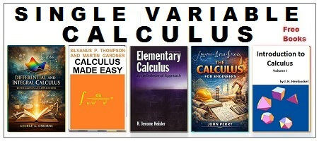

# 📚 Free Single Variable Calculus Books & Textbook Repository

Welcome to the **Free Single Variable Calculus Books Repository!**

This repository maintains a curated catalogue of freely accessible Single Variable Calculus textbooks, lecture notes, and supplementary mathematical resources.

Resources cover the fundamental concepts and applications of calculus, including limits, continuity, differentiation, integration, sequences, and series. The collection is intended for students, educators, and independent learners exploring single-variable mathematical methods.

Each entry identifies the available book, its author, and a link to its corresponding resource page.

This repository also welcomes suggestions, corrections, and contributions that help improve the accuracy and usefulness of the collection.

📖 **[Explore the Complete Single Variable Calculus Collection](https://freemathematicsbooks.com/A.aspx?Id=Single-Variable-Calculus&utm_source=github&utm_medium=referral&utm_campaign=Single-Variable-Calculus&utm_content=introduction)**

📚 **[Explore the Complete Free Calculus Collection](https://freemathematicsbooks.com/A.aspx?Id=Calculus&utm_source=github&utm_medium=referral&utm_campaign=Calculus&utm_content=introduction)**

---

## 📚 Curated Single Variable Calculus Book Catalogue

The following books are organized into four groups according to their primary subject, educational focus, and intended use.

### 1. 📘 Introductory & Elementary Calculus

*Foundational calculus textbooks for beginners and students developing their understanding of core calculus concepts.*

- 📖 **[APEX Calculus](https://freemathematicsbooks.com/B.aspx?FileName=APEX-Calculus--Gregory-Hartman&utm_source=github&utm_medium=referral&utm_campaign=Single-Variable-Calculus&utm_content=book-catalogue)** — *by Gregory Hartman*
- 📖 **[Calculus One](https://freemathematicsbooks.com/B.aspx?FileName=Calculus-One--Roman-Holowinsky&utm_source=github&utm_medium=referral&utm_campaign=Single-Variable-Calculus&utm_content=book-catalogue)** — *by Roman Holowinsky, Johann Thiel, David Lindberg*
- 📖 **[Elementary Calculus](https://freemathematicsbooks.com/B.aspx?FileName=Elementary-Calculus--Jerome-Keisler&utm_source=github&utm_medium=referral&utm_campaign=Single-Variable-Calculus&utm_content=book-catalogue)** — *by H. Jerome Keisler*
- 📖 **[Understanding Basic Calculus](https://freemathematicsbooks.com/B.aspx?FileName=Understanding-Basic-Calculus--SK-Chung&utm_source=github&utm_medium=referral&utm_campaign=Single-Variable-Calculus&utm_content=book-catalogue)** — *by S. K. Chung*
- 📖 **[First Year Calculus](https://freemathematicsbooks.com/B.aspx?FileName=First-Year-Calculus--Willam-Chen&utm_source=github&utm_medium=referral&utm_campaign=Single-Variable-Calculus&utm_content=book-catalogue)** — *by William L. Chen*

### 2. 📚 Core Single Variable Calculus Textbooks

*General calculus textbooks covering the fundamental principles and standard techniques of single-variable calculus.*

- 📖 **[Community Calculus](https://freemathematicsbooks.com/B.aspx?FileName=Community-Calculus--David-Guichard&utm_source=github&utm_medium=referral&utm_campaign=Single-Variable-Calculus&utm_content=book-catalogue)** — *by David Guichard, Neal Koblitz*
- 📖 **[Single Variable Calculus](https://freemathematicsbooks.com/B.aspx?FileName=Single-Variable-Calculus--David-Guichard&utm_source=github&utm_medium=referral&utm_campaign=Single-Variable-Calculus&utm_content=book-catalogue)** — *by David Guichard*
- 📖 **[Differential & Integral Calculus](https://freemathematicsbooks.com/B.aspx?FileName=Differential-Integral-Calculus--Daniel-Murray&utm_source=github&utm_medium=referral&utm_campaign=Single-Variable-Calculus&utm_content=book-catalogue)** — *by Daniel Murray*
- 📖 **[Elementary Textbook on the Calculus](https://freemathematicsbooks.com/B.aspx?FileName=Elementary-Textbook-Calculus--Virgil-Snyder&utm_source=github&utm_medium=referral&utm_campaign=Single-Variable-Calculus&utm_content=book-catalogue)** — *by Virgil Snyder*

### 3. ⚙️ Applications, Engineering & Problem-Solving

*Calculus resources emphasizing practical applications, engineering contexts, and exercises for developing problem-solving skills.*

- 📖 **[Exercises and Problems in Calculus](https://freemathematicsbooks.com/B.aspx?FileName=Exercises-Problems-Calculus--John-Erdman&utm_source=github&utm_medium=referral&utm_campaign=Single-Variable-Calculus&utm_content=book-catalogue)** — *by John M. Erdman*
- 📖 **[The Calculus for Engineers](https://freemathematicsbooks.com/B.aspx?FileName=The-Calculus-Engineers--John-Perry&utm_source=github&utm_medium=referral&utm_campaign=Single-Variable-Calculus&utm_content=book-catalogue)** — *by John Perry*

### 4. 📖 Alternative Approaches & Specialized Resources

*An alternative approach to calculus using infinitesimals and related mathematical foundations.*

- 📖 **[Yet Another Calculus Text: A Short Introduction with Infinitesimals](https://freemathematicsbooks.com/B.aspx?FileName=Calculus-Text-Intro-Infinitesimals--Dan-Sloughter&utm_source=github&utm_medium=referral&utm_campaign=Single-Variable-Calculus&utm_content=book-catalogue)** — *by Dan Sloughter*

---

## 📋 Book Selection & Verification

Resources in this catalogue are organized according to their main subject and educational purpose.

The following considerations guide the organization of this collection:

- **Subject Relevance:** Books are included according to their coverage of Single Variable Calculus and closely related topics.
- **Bibliographic Information:** Book titles and author details are provided to help readers identify the resources.
- **Resource Accessibility:** Links lead to the corresponding book information pages, where availability and access details can be checked.
- **Subject Classification:** Resources are grouped by their primary educational focus to make browsing easier.
- **Link Maintenance:** Broken links and bibliographic corrections can be reported through GitHub Issues.

---

## 📁 Repository Organization

This directory focuses on Single Variable Calculus and provides a dedicated collection of textbooks and supplementary learning materials.

The collection complements the broader Calculus repository, which includes additional subject-specific directories:

- Advanced Calculus
- Calculus & Analytical Geometry
- Calculus of Variations
- Differential Calculus
- Integral Calculus
- Multivariable Calculus
- Single-Variable Calculus

Each subject directory contains additional book listings and related resources for further exploration.

---

## 🤝 Contributing to This Repository

Suggestions and contributions are welcome!

You can help improve this collection by:

1. Suggesting freely accessible Single Variable Calculus textbooks and learning materials.
2. Reporting broken or outdated book links.
3. Correcting book titles, author names, or bibliographic details.
4. Recommending relevant supplementary mathematical resources.
5. Improving the organization and documentation of the repository.

**How to contribute:**

- Open a GitHub Issue to report a problem or suggest a resource.
- Submit a Pull Request with proposed additions or corrections.
- Include the book title, author, and source link when suggesting a resource.

Please ensure that submitted materials are freely accessible and that any shared files comply with applicable copyright and licensing terms.

---

## 🔙 Repository Navigation

- [⬅️ Back to Main Calculus Collection](../)
- [🏠 Back to Repository Root](../../)

---

## 🌐 Explore More Mathematics Resources

Discover additional free textbooks and educational materials through **[Free Mathematics Books](https://freemathematicsbooks.com/?utm_source=github&utm_medium=referral&utm_campaign=FreeMathematicsBooks&utm_content=repository-footer)**.
