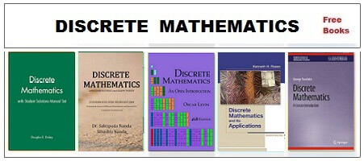

# 📚 Free Discrete Mathematics Books & Textbook Repository

Welcome to the **Discrete Mathematics Collection** by Free Mathematics Books.

This repository maintains a curated catalogue of freely accessible Discrete Mathematics textbooks, lecture notes, and supplementary educational resources for students, independent learners, instructors, and researchers.

The collection explores important areas of discrete mathematics, including number theory, combinatorics, graph theory, algebraic structures, computational mathematics, and formal language theory.

Resources are organized into subject-based groups to help readers discover relevant mathematical and computer science references.

Each book entry includes its title, author information, and a link to its corresponding resource page.

This repository also welcomes suggestions, corrections, and contributions that help improve the accuracy and usefulness of the collection.

📖 **[Explore the Complete Free Discrete Mathematics Collection](https://freemathematicsbooks.com/A.aspx?Id=Discrete-Mathematics&utm_source=github&utm_medium=referral&utm_campaign=Discrete-Mathematics&utm_content=introduction)**

---

## 📂 Explore Related Mathematics Collections

Discrete Mathematics connects with several other areas of mathematics and computer science. Explore these related collections for additional textbooks and learning resources.

| Related Subject | 📚 Online Collection | 📁 GitHub Folder |
| :--- | :--- | :--- |
| **Number Theory** | [Explore Books](https://freemathematicsbooks.com/A.aspx?Id=Number-Theory&utm_source=github&utm_medium=referral&utm_campaign=Discrete-Mathematics&utm_content=related-collections) | [Browse Folder](../Number-Theory/) |
| **Abstract Algebra** | [Explore Books](https://freemathematicsbooks.com/A.aspx?Id=Abstract-Algebra&utm_source=github&utm_medium=referral&utm_campaign=Discrete-Mathematics&utm_content=related-collections) | [Browse Folder](../Abstract-Algebra/) |
| **Geometry & Topology** | [Explore Books](https://freemathematicsbooks.com/A.aspx?Id=Geometry&utm_source=github&utm_medium=referral&utm_campaign=Discrete-Mathematics&utm_content=related-collections) | [Browse Folder](../Geometry-Topology/) |
| **Applied Mathematics** | [Explore Books](https://freemathematicsbooks.com/A.aspx?Id=Applied-Mathematics&utm_source=github&utm_medium=referral&utm_campaign=Discrete-Mathematics&utm_content=related-collections) | [Browse Folder](../Applied-Mathematics/) |
| **Probability & Statistics** | [Explore Books](https://freemathematicsbooks.com/A.aspx?Id=Probability-Statistics&utm_source=github&utm_medium=referral&utm_campaign=Discrete-Mathematics&utm_content=related-collections) | [Browse Folder](../Probability-Statistics/) |

---

## 📖 Curated Discrete Mathematics Book Catalogue

The following textbooks and supplementary resources are organized into four groups according to their primary mathematical subject, theoretical focus, and educational purpose.

### 1. 📘 Foundations & Introductory Number Theory

These textbooks introduce fundamental number-theoretic concepts, including divisibility, prime numbers, congruences, Diophantine equations, and arithmetic functions.

- 📖 **[An Introduction to Number Theory — J. J. P. Veerman](https://freemathematicsbooks.com/B.aspx?FileName=An-Intro-Number-Theory--JJP-Veerman&utm_source=github&utm_medium=referral&utm_campaign=Discrete-Mathematics&utm_content=book-catalogue)**

An undergraduate introduction to number theory covering divisibility, greatest common divisors, prime numbers, modular arithmetic, Diophantine equations, continued fractions, and selected advanced topics.

- 📖 **[An Introduction to the Theory of Numbers — Leo Moser](https://freemathematicsbooks.com/B.aspx?FileName=An-Intro-Theory-Numbers--Leo-Moser&utm_source=github&utm_medium=referral&utm_campaign=Discrete-Mathematics&utm_content=book-catalogue)**

A concise introduction to classical number theory, exploring arithmetic functions, prime distribution, congruences, Diophantine equations, combinatorial number theory, and the geometry of numbers.

---

### 2. 💻 Computational Number Theory & Algorithms

This group focuses on algorithmic methods, mathematical computation, modular arithmetic, prime testing, and the foundations of computational algebra and cryptography.

- 📖 **[A Computational Number Theory & Algebra — Victor Shoup](https://freemathematicsbooks.com/B.aspx?FileName=Comp-Number-Theory-Algebra--Victor-Shoup&utm_source=github&utm_medium=referral&utm_campaign=Discrete-Mathematics&utm_content=book-catalogue)**

A comprehensive computational textbook covering integer arithmetic, Euclid's algorithm, prime distribution, probabilistic algorithms, primality testing, discrete logarithms, finite fields, polynomial arithmetic, and algebraic structures.

---

### 3. 🔷 Graph Theory & Algebraic Structures

These resources connect graph theory with algebra, exploring graph symmetries, group representations, Cayley graphs, and algebraic structures.

- 📖 **[Explorations in Algebraic Graph Theory — Chris Godsil & Rob Beezer](https://freemathematicsbooks.com/B.aspx?FileName=Explorations-Algebraic-Graph-Theory--Chris-Godsil&utm_source=github&utm_medium=referral&utm_campaign=Discrete-Mathematics&utm_content=book-catalogue)**

A computational introduction to algebraic graph theory using SageMath. Topics include graph symmetries, Cayley graphs, distance-regular graphs, adjacency matrices, graph spectra, and graph polynomials.

- 📖 **[Groups as Graphs — W. B. Vasantha Kandasamy & Florentin Smarandache](https://freemathematicsbooks.com/B.aspx?FileName=Groups-Graphs--Vasantha-Kandasamy&utm_source=github&utm_medium=referral&utm_campaign=Discrete-Mathematics&utm_content=book-catalogue)**

Explores graph-theoretic representations of algebraic structures, including rooted trees, groups, semigroups, loops, and identity graphs of algebraic systems.

---

### 4. 🧩 Combinatorics & Formal Languages

This group explores the algebraic and combinatorial properties of sequences, words, patterns, and formal language structures.

- 📖 **[Algebraic Combinatorics on Words — M. Lothaire](https://freemathematicsbooks.com/B.aspx?FileName=Algebraic-Combinatorics-Words--M-Lothaire&utm_source=github&utm_medium=referral&utm_campaign=Discrete-Mathematics&utm_content=book-catalogue)**

An advanced reference covering finite and infinite words, Sturmian sequences, unavoidable patterns, plactic monoids, variable-length codes, numeration systems, automata, permutation statistics, and word equations.

---

## 📖 How to Choose a Resource

- **Introductory Number Theory & Foundations:** Start with *An Introduction to Number Theory* by J. J. P. Veerman or *An Introduction to the Theory of Numbers* by Leo Moser for prime numbers, congruences, and classical discrete foundations.
- **Computational Mathematics & Cryptography:** Choose *A Computational Number Theory & Algebra* by Victor Shoup for algorithmic number theory, finite fields, and computational algebra.
- **Graph Theory & Spectral Methods:** Use *Explorations in Algebraic Graph Theory* by Chris Godsil & Rob Beezer for Cayley graphs, graph spectra, and SageMath-based exploration.
- **Algebraic Structures & Graph Representations:** Explore *Groups as Graphs* by Kandasamy & Smarandache for graph representations of groups and semigroups.
- **Combinatorics & Formal Language Theory:** Turn to *Algebraic Combinatorics on Words* by M. Lothaire for sequences, automata, codes, and combinatorial word structures.

---

## 📚 Topics Covered

This collection includes resources covering the following topics:

- Divisibility, Prime Numbers, Modular Arithmetic, and Diophantine Equations
- Arithmetic Functions, Continued Fractions, and Geometry of Numbers
- Computational Number Theory, Primality Testing, and Finite Fields
- Algebraic Graph Theory, Cayley Graphs, and Graph Spectra
- Graph-Theoretic Representations of Groups and Semigroups
- Algebraic Combinatorics, Sturmian Sequences, and Word Equations
- Formal Languages, Automata, Codes, and Discrete Algorithms

---

## 📋 Book Selection & Verification

Resources in this catalogue are organized according to their primary mathematical subject and educational purpose.

The following considerations guide the organization of this collection:

- **Subject Relevance:** Books are included according to their coverage of discrete mathematics, number theory, combinatorics, graph theory, or closely related mathematical fields.
- **Bibliographic Information:** Book titles and author details are provided to help readers identify the resources.
- **Resource Accessibility:** Links lead to the corresponding book information pages, where availability and access details can be checked.
- **Subject Classification:** Resources are grouped by their primary mathematical focus to make browsing easier.
- **Link Maintenance:** Broken or outdated links and bibliographic corrections can be reported through GitHub Issues.

---

## 🤝 Contributing to This Repository

Suggestions and contributions are welcome!

You can help improve this collection by:

1. Suggesting freely accessible Discrete Mathematics textbooks and learning materials.
2. Reporting broken or outdated book links.
3. Correcting book titles, author names, or bibliographic information.
4. Recommending useful resources covering combinatorics, graph theory, logic, and computational discrete structures.
5. Improving the organization and documentation of the repository.

**How to contribute:**

- Open a GitHub Issue to report a problem or suggest a resource.
- Submit a Pull Request with proposed additions or corrections.
- Include the book title, author, and source link when recommending a resource.

Please ensure that suggested materials are freely accessible and that any shared files comply with applicable copyright and licensing terms.

---

## 🔙 Repository Navigation

- [🏠 Back to Repository Root](../)

---

## 🌐 Explore More Mathematics Resources

**GitHub Collection:** [Free Math Books Repository](https://github.com/FreeMathBooks/free-math-books-collection)

**Substack Publication:** [Free Mathematics Books](https://freemathematicsbooks.substack.com/)

Discover additional free textbooks and educational materials through **[Free Mathematics Books](https://freemathematicsbooks.com/?utm_source=github&utm_medium=referral&utm_campaign=FreeMathematicsBooks&utm_content=repository-footer)**.
