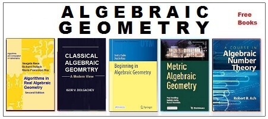

# 📚 Free Algebraic Geometry Books & Textbook Repository

Welcome to the **Algebraic Geometry Collection** by Free Mathematics Books.

This repository provides a curated selection of free Algebraic Geometry textbooks, monographs, lecture notes, and supplementary resources covering introductory algebraic geometry, classical curves and surfaces, real and metric algebraic geometry, toric/convex methods, and moduli spaces.

Resources are organized into subject-based groups to help students, educators, researchers, and independent learners find relevant materials for coursework, theoretical research, and self-study.

Each entry identifies the available book, its author, and a link to its corresponding resource page.

📖 **[Explore the Complete Algebraic Geometry Collection](https://freemathematicsbooks.com/A.aspx?Id=Algebraic-Geometry&utm_source=github&utm_medium=referral&utm_campaign=Algebraic-Geometry&utm_content=introduction)**

📚 **[Explore the Complete Geometry & Topology Collection](https://freemathematicsbooks.com/A.aspx?Id=Geometry&utm_source=github&utm_medium=referral&utm_campaign=Geometry&utm_content=introduction)**

---

## 📖 Curated Algebraic Geometry Book Catalogue

The following textbooks and resources are organized into three groups according to their geometric scope, theoretical depth, and computational/convex viewpoints.

### 1. 📘 Introductory & Classical Algebraic Geometry

Foundational textbooks and modern expositions covering affine and projective varieties, plane curves, surfaces, and classical geometry.

- 📖 **[Beginning in Algebraic Geometry — Emily Clader, Dustin Ross](https://freemathematicsbooks.com/B.aspx?FileName=Beginning-Algebraic-Geometry--Clader--Ross&utm_source=github&utm_medium=referral&utm_campaign=Algebraic-Geometry&utm_content=book-catalogue)**

An accessible introduction to algebraic geometry using concrete examples, plane curves, ideals, and varieties to build intuition before heavy abstract machinery.

- 📖 **[Classical Algebraic Geometry A Modern View — Igor Dolgachev](https://freemathematicsbooks.com/B.aspx?FileName=Classical-Algebraic-Geometry--Igor-Dolgachev&utm_source=github&utm_medium=referral&utm_campaign=Algebraic-Geometry&utm_content=book-catalogue)**

Presents classical algebraic geometry—conics, cubics, quadrics, Cremona transformations, and surfaces—from a modern geometric and algebraic perspective.

---

### 2. 📐 Real, Metric & Convex/Toric Algebraic Geometry

Resources exploring real algebraic geometry, distance/metric structures on varieties, and connections with convex polytopes and toric geometry.

- 📖 **[Algorithms in Real Algebraic Geometry — Saugata Basu](https://freemathematicsbooks.com/B.aspx?FileName=Algorithms-Real-Algebraic-Geometry--Saugata-Basu&utm_source=github&utm_medium=referral&utm_campaign=Algebraic-Geometry&utm_content=book-catalogue)**

Covers algorithmic methods, quantifier elimination, topological complexity, and computational techniques for semialgebraic sets and real varieties.

- 📖 **[Convex Bodies and Algebraic Geometry — Tadao Oda](https://freemathematicsbooks.com/B.aspx?FileName=Convex-Bodies-Algebraic-Geometry--Tadao-Oda&utm_source=github&utm_medium=referral&utm_campaign=Algebraic-Geometry&utm_content=book-catalogue)**

Explores the interplay between convex polytopes, fans, and toric varieties in algebraic geometry.

- 📖 **[Metric Algebraic Geometry — Breiding, Kohn, Sturmfels](https://freemathematicsbooks.com/B.aspx?FileName=Metric-Algebraic-Geometry--Paul-Breiding&utm_source=github&utm_medium=referral&utm_campaign=Algebraic-Geometry&utm_content=book-catalogue)**

Investigates Euclidean distance degrees, offsets, singular locus geometry, and metric properties of real and complex algebraic varieties.

---

### 3. 🏛️ Moduli Spaces & Polarized Manifolds

Advanced research-level treatment of moduli problems and quasi-projective moduli constructions.

- 📖 **[Quasi-projective Moduli for Polarized Manifolds — Eckart Viehweg](https://freemathematicsbooks.com/B.aspx?FileName=Quasi-projective-Moduli-Polarized-Manifolds--Eckart-Viehweg&utm_source=github&utm_medium=referral&utm_campaign=Algebraic-Geometry&utm_content=book-catalogue)**

Develops techniques for constructing quasi-projective moduli spaces of polarized manifolds and studying geometric invariant/moduli theory.

---

## 📖 How to Choose a Resource

- **Starting Out & Classical Curves/Surfaces:** Begin with *Beginning in Algebraic Geometry* by Emily Clader & Dustin Ross for an approachable entry, and explore *Classical Algebraic Geometry A Modern View* by Igor Dolgachev for classical curves, surfaces, and transformations.
- **Real, Metric & Convex/Toric Connections:** Use *Algorithms in Real Algebraic Geometry* by Saugata Basu for real and semialgebraic algorithms, *Convex Bodies and Algebraic Geometry* by Tadao Oda for toric/polyhedral methods, and *Metric Algebraic Geometry* by Breiding, Kohn & Sturmfels for metric/distance geometry.
- **Advanced Moduli Theory:** Turn to *Quasi-projective Moduli for Polarized Manifolds* by Eckart Viehweg for graduate and research-level moduli constructions.

---

## 📚 Topics Covered

This collection includes resources covering the following topics:

- Affine and Projective Varieties, Ideals, Plane Curves, and Surfaces
- Classical Algebraic Geometry, Transformations, and Modern Perspectives
- Real Algebraic Geometry, Semialgebraic Sets, and Algorithmic Methods
- Convex Polytopes, Fans, and Toric Varieties
- Metric Algebraic Geometry and Euclidean Distance Degrees
- Quasi-Projective Moduli Spaces for Polarized Manifolds

---

## 📋 Book Selection & Verification

Resources in this catalogue are organized by subject relevance, educational level, and clear bibliographic details. Links direct readers to the corresponding resource pages on Free Mathematics Books, where access details and available formats can be reviewed.

---

## 🤝 Contributing to This Repository

Suggestions and contributions are welcome!

You can help improve this collection by:

1. Suggesting freely accessible Algebraic Geometry textbooks and learning materials.
2. Reporting broken or outdated book links.
3. Correcting book titles, author names, or bibliographic details.
4. Recommending relevant supplementary algebraic geometry resources.
5. Improving the organization and documentation of the repository.

**How to contribute:**

- Open a GitHub Issue to report a problem or suggest a resource.
- Submit a Pull Request with proposed additions or corrections.
- Include the book title, author, and source link when suggesting a resource.

Please ensure that submitted materials are freely accessible and that any shared files comply with applicable copyright and licensing terms.

---

## 🧭 Repository Navigation

- [⬅️ Back to Main Geometry & Topology Category](../)
- [🏠 Back to Home Repository](../../)

---

## 🌐 Explore More Mathematics Resources

- **GitLab:** [Free Mathematics Books Study Guide](https://gitlab.com/mathematics55/FreeMathBooks/-/tree/main) — Subject study guides and topic mirrors.
- **Substack:** [Free Mathematics Books Reading Notes](https://freemathematicsbooks.substack.com/) — Curated reading lists and book highlights.
- **Official Website:** [FreeMathematicsBooks.com](https://freemathematicsbooks.com/?utm_source=github&utm_medium=referral&utm_campaign=FreeMathematicsBooks&utm_content=repository-footer) — Searchable directory of external textbook links.
