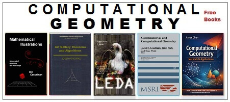

# 📚 Free Computational Geometry Books & Textbook Repository

Welcome to the **Computational Geometry Collection** by Free Mathematics Books.

This repository provides a curated selection of free Computational Geometry textbooks, algorithmic references, and supplementary resources covering art gallery theorems and visibility algorithms, combinatorial and geometric computing platforms, computational algebraic geometry, and mathematical visualization.

Resources are organized into subject-based groups to help students, educators, researchers, and independent learners find relevant references for algorithms, graphics, and mathematical computation.

Each entry identifies the available book, its author, and a link to its corresponding resource page.

📖 **[Explore the Complete Computational Geometry Collection](https://freemathematicsbooks.com/A.aspx?Id=Computational-Geometry&utm_source=github&utm_medium=referral&utm_campaign=Computational-Geometry&utm_content=introduction)**

📚 **[Explore the Complete Geometry & Topology Collection](https://freemathematicsbooks.com/A.aspx?Id=Geometry&utm_source=github&utm_medium=referral&utm_campaign=Geometry&utm_content=introduction)**

---

## 📖 Curated Computational Geometry Book Catalogue

The following textbooks and resources are organized into three groups according to their algorithmic focus, computational tools, and geometric applications.

### 1. 📐 Geometric Algorithms & Computing Platforms

Foundational texts and software/algorithmic platforms for polygons, visibility, and geometric data structures.

- 📖 **[Art Gallery Theorems and Algorithms — Joseph O'Rourke](https://freemathematicsbooks.com/B.aspx?FileName=Art-Gallery-Theorems-Algorithms--Joseph-ORourke&utm_source=github&utm_medium=referral&utm_campaign=Computational-Geometry&utm_content=book-catalogue)**

Covers art gallery guard placement bounds, polygon decompositions, visibility problems, and combinatorial/algorithmic proofs in computational geometry.

- 📖 **[LEDA: Platform for Combinatorial & Geometric Computing — Mehlhorn & Naher](https://freemathematicsbooks.com/B.aspx?FileName=LEDA-Platform-Geometric-Computing--Mehlhorn--Naher&utm_source=github&utm_medium=referral&utm_campaign=Computational-Geometry&utm_content=book-catalogue)**

Presents data types, algorithms, and software design principles for combinatorial and geometric computing with attention to exactness and implementation.

---

### 2. 💻 Computational Algebraic Geometry

Symbolic and computational approaches to polynomial ideals, varieties, and algebraic geometry software.

- 📖 **[Computations in Algebraic Geometry (Macaulay2) — David Eisenbud](https://freemathematicsbooks.com/B.aspx?FileName=Computations-Algebraic-Geometry-Macaulay2--David-Eisenbud&utm_source=github&utm_medium=referral&utm_campaign=Computational-Geometry&utm_content=book-catalogue)**

Demonstrates computational techniques in algebraic geometry—including Gröbner bases, ideals, and varieties—using the Macaulay2 computer algebra system.

---

### 3. 🎨 Mathematical Graphics & Geometric Illustration

Practical guides to rendering curves, surfaces, and geometric diagrams programmatically.

- 📖 **[Mathematical Illustrations: A Manual of Geometry and PostScript — Bill Casselman](https://freemathematicsbooks.com/B.aspx?FileName=Mathematical-Illustrations-Geometry-PostScript--Bill-Casselman&utm_source=github&utm_medium=referral&utm_campaign=Computational-Geometry&utm_content=book-catalogue)**

Explains how to generate precise mathematical figures, curves, and geometric illustrations using PostScript programming.

---

## 📖 How to Choose a Resource

- **Visibility, Polygons & Geometric Algorithms:** Start with *Art Gallery Theorems and Algorithms* by Joseph O'Rourke.
- **Combinatorial & Geometric Data Structures:** Explore *LEDA: Platform for Combinatorial & Geometric Computing* by Mehlhorn & Naher for algorithmic design and implementation.
- **Symbolic & Algebraic Geometry Computation:** Use *Computations in Algebraic Geometry (Macaulay2)* by David Eisenbud for computer-assisted algebraic geometry.
- **Programmatic Mathematical Drawing:** Read *Mathematical Illustrations: A Manual of Geometry and PostScript* by Bill Casselman for creating high-precision geometric graphics.

---

## 📚 Topics Covered

This collection includes resources covering the following topics:

- Art Gallery Theorems, Guard Bounds, and Polygon Triangulation/Decomposition
- Visibility Algorithms and Combinatorial Geometry
- Combinatorial and Geometric Computing Data Types (LEDA)
- Gröbner Bases and Computational Algebraic Geometry with Macaulay2
- PostScript Programming and Mathematical Geometric Illustration

---

## 📋 Book Selection & Verification

Resources in this catalogue are organized by subject relevance, educational level, and clear bibliographic details. Links direct readers to the corresponding resource pages on Free Mathematics Books, where access details and available formats can be reviewed.

---

## 🤝 Contributing to This Repository

Suggestions and contributions are welcome!

You can help improve this collection by:

1. Suggesting freely accessible Computational Geometry textbooks and learning materials.
2. Reporting broken or outdated book links.
3. Correcting book titles, author names, or bibliographic details.
4. Recommending relevant supplementary computational geometry resources.
5. Improving the organization and documentation of the repository.

**How to contribute:**

- Open a GitHub Issue to report a problem or suggest a resource.
- Submit a Pull Request with proposed additions or corrections.
- Include the book title, author, and source link when suggesting a resource.

Please ensure that submitted materials are freely accessible and that any shared files comply with applicable copyright and licensing terms.

---

## 🧭 Repository Navigation

- [⬅️ Back to Main Geometry & Topology Category](../)
- [🏠 Back to Home Repository](../../)

---

## 🌐 Explore More Mathematics Resources

- **GitLab:** [Free Mathematics Books Study Guide](https://gitlab.com/mathematics55/FreeMathBooks/-/tree/main) — Subject study guides and topic mirrors.
- **Substack:** [Free Mathematics Books Reading Notes](https://freemathematicsbooks.substack.com/) — Curated reading lists and book highlights.
- **Official Website:** [FreeMathematicsBooks.com](https://freemathematicsbooks.com/?utm_source=github&utm_medium=referral&utm_campaign=FreeMathematicsBooks&utm_content=repository-footer) — Searchable directory of external textbook links.
