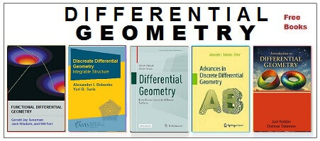

# 📚 Free Differential Geometry Books & Textbook Repository

Welcome to the **Differential Geometry Collection** by Free Mathematics Books.

This repository provides a curated selection of free Differential Geometry textbooks, lecture notes, and supplementary resources covering curves and surfaces, smooth manifolds, functional differential geometry, transversality, de Rham cohomology, and geometric structures.

Resources are organized into subject-based groups to help students, educators, researchers, and independent learners find relevant materials for coursework, theoretical study, and self-learning.

Each entry identifies the available book, its author, and a link to its corresponding resource page.

📖 **[Explore the Complete Differential Geometry Collection](https://freemathematicsbooks.com/A.aspx?Id=Differential-Geometry&utm_source=github&utm_medium=referral&utm_campaign=Differential-Geometry&utm_content=introduction)**

📚 **[Explore the Complete Geometry & Topology Collection](https://freemathematicsbooks.com/A.aspx?Id=Geometry&utm_source=github&utm_medium=referral&utm_campaign=Geometry&utm_content=introduction)**

---

## 📖 Curated Differential Geometry Book Catalogue

The following textbooks and resources are organized into three groups according to their geometric focus, mathematical level, and methods.

### 1. 📘 Foundations & Classical/Functional Differential Geometry

Textbooks introducing curves, surfaces, geometric intuition, and functional/computational perspectives on differential geometry.

- 📖 **[Differential Geometry — Ulrich Pinkall, Oliver Gross](https://freemathematicsbooks.com/B.aspx?FileName=Diff-Geometry--Pinkall--Gross&utm_source=github&utm_medium=referral&utm_campaign=Differential-Geometry&utm_content=book-catalogue)**

Covers curves, surfaces, curvature, geodesics, and geometric structures with clear mathematical exposition and visual insight.

- 📖 **[Functional Differential Geometry — Sussman, Wisdom & Farr](https://freemathematicsbooks.com/B.aspx?FileName=Functional-Diff-Geometry--Gerald-Sussman&utm_source=github&utm_medium=referral&utm_campaign=Differential-Geometry&utm_content=book-catalogue)**

Presents differential geometry through functional programming and coordinate-free mathematical expressions for manifolds, tangent vectors, and curvature.

- 📖 **[Introduction to Differential Geometry — Joel Robbin, Dietmar Salamon](https://freemathematicsbooks.com/B.aspx?FileName=Intro-Diff-Geometry--Robbin--Salamon&utm_source=github&utm_medium=referral&utm_campaign=Differential-Geometry&utm_content=book-catalogue)**

Provides a structured introduction to differential geometry, smooth maps, submanifolds, differential forms, and geometric calculus.

---

### 2. 🔷 Smooth Manifolds, Transversality & Cohomology

Advanced texts focusing on differentiable manifolds, transversality, differential forms, and de Rham cohomology.

- 📖 **[Lectures on the Geometry of Manifolds — Liviu Nicolaescu](https://freemathematicsbooks.com/B.aspx?FileName=Lectures-Geometry-Manifolds--Liviu-Nicolaescu&utm_source=github&utm_medium=referral&utm_campaign=Differential-Geometry&utm_content=book-catalogue)**

Explores smooth manifolds, tangent and cotangent bundles, differential forms, integration on manifolds, and geometric topology.

- 📖 **[Manifolds, Transversality & de Rham Cohomology — Peter Petersen](https://freemathematicsbooks.com/B.aspx?FileName=Manifold-Theory--Peter-Petersen&utm_source=github&utm_medium=referral&utm_campaign=Differential-Geometry&utm_content=book-catalogue)**

Covers smooth manifold theory, Sard's theorem, transversality, vector bundles, and de Rham cohomology in detail.

---

## 📖 How to Choose a Resource

- **Foundational & Visual Differential Geometry:** Start with *Differential Geometry* by Ulrich Pinkall & Oliver Gross or *Introduction to Differential Geometry* by Joel Robbin & Dietmar Salamon.
- **Functional & Computational Approach:** Explore *Functional Differential Geometry* by Sussman, Wisdom & Farr for coordinate-free formulations and executable abstractions.
- **Manifolds, Transversality & Cohomology:** Study *Lectures on the Geometry of Manifolds* by Liviu Nicolaescu and *Manifolds, Transversality & de Rham Cohomology* by Peter Petersen for graduate-level manifold theory.

---

## 📚 Topics Covered

This collection includes resources covering the following topics:

- Curves, Surfaces, Curvature, and Geodesics
- Smooth Manifolds, Submanifolds, and Tangent/Cotangent Bundles
- Functional and Coordinate-Free Differential Geometry
- Differential Forms, Integration on Manifolds, and Stokes' Theorem
- Transversality and de Rham Cohomology

---

## 📋 Book Selection & Verification

Resources in this catalogue are organized by subject relevance, educational level, and clear bibliographic details. Links direct readers to the corresponding resource pages on Free Mathematics Books, where access details and available formats can be reviewed.

---

## 🤝 Contributing to This Repository

Suggestions and contributions are welcome!

You can help improve this collection by:

1. Suggesting freely accessible Differential Geometry textbooks and learning materials.
2. Reporting broken or outdated book links.
3. Correcting book titles, author names, or bibliographic details.
4. Recommending relevant supplementary geometry resources.
5. Improving the organization and documentation of the repository.

**How to contribute:**

- Open a GitHub Issue to report a problem or suggest a resource.
- Submit a Pull Request with proposed additions or corrections.
- Include the book title, author, and source link when suggesting a resource.

Please ensure that submitted materials are freely accessible and that any shared files comply with applicable copyright and licensing terms.

---

## 🧭 Repository Navigation

- [⬅️ Back to Main Geometry & Topology Category](../)
- [🏠 Back to Home Repository](../../)

---

## 🌐 Explore More Mathematics Resources

- **GitLab:** [Free Mathematics Books Study Guide](https://gitlab.com/mathematics55/FreeMathBooks/-/tree/main) — Subject study guides and topic mirrors.
- **Substack:** [Free Mathematics Books Reading Notes](https://freemathematicsbooks.substack.com/) — Curated reading lists and book highlights.
- **Official Website:** [FreeMathematicsBooks.com](https://freemathematicsbooks.com/?utm_source=github&utm_medium=referral&utm_campaign=FreeMathematicsBooks&utm_content=repository-footer) — Searchable directory of external textbook links.
