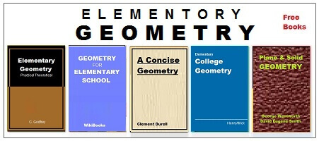

# 📚 Free Elementary Geometry Books & Textbook Repository

Welcome to the **Elementary Geometry Collection** by Free Mathematics Books.

This repository provides a curated selection of free Elementary Geometry textbooks, problem books, and supplementary resources covering basic shapes, plane geometry, geometric proofs, practical and theoretical geometry, and solid three-dimensional geometry.

Resources are organized into subject-based groups to help school students, college learners, educators, and self-learners build a strong foundation in geometry.

Each entry identifies the available book, its author, and a link to its corresponding resource page.

📖 **[Explore the Complete Elementary Geometry Collection](https://freemathematicsbooks.com/A.aspx?Id=Elementary-Geometry&utm_source=github&utm_medium=referral&utm_campaign=Elementary-Geometry&utm_content=introduction)**

📚 **[Explore the Complete Geometry & Topology Collection](https://freemathematicsbooks.com/A.aspx?Id=Geometry&utm_source=github&utm_medium=referral&utm_campaign=Geometry&utm_content=introduction)**

---

## 📖 Curated Elementary Geometry Book Catalogue

The following textbooks and resources are organized into three groups according to their educational level and geometric focus.

### 1. 📘 Foundational & Plane Geometry

Introductory texts covering basic shapes, angles, triangles, polygons, circles, and classical plane geometry.

- 📖 **[Geometry for Elementary School — Wikibooks](https://freemathematicsbooks.com/B.aspx?FileName=Geometry-Elementary-School--Wikibooks&utm_source=github&utm_medium=referral&utm_campaign=Elementary-Geometry&utm_content=book-catalogue)**

An accessible introductory guide covering points, lines, angles, basic polygons, perimeter, area, and elementary geometric shapes.

- 📖 **[Plane Geometry — George Wentworth, David E. Smith](https://freemathematicsbooks.com/B.aspx?FileName=Plane-Geometry--George-Wentworth&utm_source=github&utm_medium=referral&utm_campaign=Elementary-Geometry&utm_content=book-catalogue)**

A structured classical textbook covering rectilinear figures, circles, proportion, similar polygons, areas, and geometric construction exercises.

---

### 2. 📐 Proof-Oriented & Practical Elementary Geometry

Textbooks combining logical geometric proof, practical construction, and college-level foundational geometry.

- 📖 **[A Concise Geometry — Clement V. Durell](https://freemathematicsbooks.com/B.aspx?FileName=A-Concise-Geometry--Clement-Durell&utm_source=github&utm_medium=referral&utm_campaign=Elementary-Geometry&utm_content=book-catalogue)**

A compact, well-organized presentation of plane and solid geometry theorems, riders, loci, and deductive proof techniques.

- 📖 **[Elementary College Geometry — Henry Africk](https://freemathematicsbooks.com/B.aspx?FileName=Elementary-College-Geometry--Henry-Africk&utm_source=github&utm_medium=referral&utm_campaign=Elementary-Geometry&utm_content=book-catalogue)**

A clear undergraduate-level text covering deductive reasoning, congruent and similar triangles, parallel lines, circles, polygons, and areas.

- 📖 **[Elementary Geometry: Practical and Theoretical — Godfrey & Siddons](https://freemathematicsbooks.com/B.aspx?FileName=Elementary-Geometry-Practical-Theoretical--C-Godfrey&utm_source=github&utm_medium=referral&utm_campaign=Elementary-Geometry&utm_content=book-catalogue)**

Balances hands-on geometric drawing and measurement with systematic theoretical propositions and problem sets.

---

### 3. 🧊 Solid Geometry

Resources focusing on three-dimensional spatial figures, polyhedra, surfaces, volumes, and spatial reasoning.

- 📖 **[Solid Geometry: with Problems and Applications — Herbert Slaught](https://freemathematicsbooks.com/B.aspx?FileName=Solid-Geometry-Prob-App--Herbert-Slaught&utm_source=github&utm_medium=referral&utm_campaign=Elementary-Geometry&utm_content=book-catalogue)**

Covers lines and planes in space, polyhedra, cylinders, cones, spheres, mensuration, and applied solid geometry problems.

- 📖 **[The Elements of Solid Geometry — William C. Bartol](https://freemathematicsbooks.com/B.aspx?FileName=The-Elements-Solid-Geometry--William-Bartol&utm_source=github&utm_medium=referral&utm_campaign=Elementary-Geometry&utm_content=book-catalogue)**

A systematic introduction to three-dimensional geometry, dihedral and polyhedral angles, prisms, pyramids, cones, and spheres.

---

## 📖 How to Choose a Resource

- **Early & Basic Concepts:** Start with *Geometry for Elementary School* by Wikibooks for foundational definitions, shapes, and basic measurements.
- **Plane Geometry & Deductive Proofs:** Use *Plane Geometry* by Wentworth & Smith, *Elementary College Geometry* by Henry Africk, or *A Concise Geometry* by Clement V. Durell.
- **Practical & Theoretical Balance:** Choose *Elementary Geometry: Practical and Theoretical* by Godfrey & Siddons for combined construction and proof work.
- **Three-Dimensional & Solid Geometry:** Read *Solid Geometry: with Problems and Applications* by Slaught & Lennes or *The Elements of Solid Geometry* by William C. Bartol.

---

## 📚 Topics Covered

This collection includes resources covering the following topics:

- Points, Lines, Angles, Triangles, Polygons, and Circles
- Deductive Geometric Proofs, Congruence, Similarity, and Loci
- Practical Constructions, Area, and Perimeter
- Planes in Space, Polyhedra, Prisms, Pyramids, Cylinders, Cones, and Spheres
- Surface Area, Volume, and Applied Spatial Problems

---

## 📋 Book Selection & Verification

Resources in this catalogue are organized by subject relevance, educational level, and clear bibliographic details. Links direct readers to the corresponding resource pages on Free Mathematics Books, where access details and available formats can be reviewed.

---

## 🤝 Contributing to This Repository

Suggestions and contributions are welcome!

You can help improve this collection by:

1. Suggesting freely accessible Elementary Geometry textbooks and learning materials.
2. Reporting broken or outdated book links.
3. Correcting book titles, author names, or bibliographic details.
4. Recommending relevant supplementary geometry resources.
5. Improving the organization and documentation of the repository.

**How to contribute:**

- Open a GitHub Issue to report a problem or suggest a resource.
- Submit a Pull Request with proposed additions or corrections.
- Include the book title, author, and source link when suggesting a resource.

Please ensure that submitted materials are freely accessible and that any shared files comply with applicable copyright and licensing terms.

---

## 🧭 Repository Navigation

- [⬅️ Back to Main Geometry & Topology Category](../)
- [🏠 Back to Home Repository](../../../../)

---

## 🌐 Explore More Mathematics Resources

**GitHub Collection:** [Free Math Books Repository](https://github.com/FreeMathBooks/free-math-books-collection)

**Substack Publication:** [Free Mathematics Books](https://freemathematicsbooks.substack.com/)

Discover additional free textbooks and educational materials through **[Free Mathematics Books](https://freemathematicsbooks.com/?utm_source=github&utm_medium=referral&utm_campaign=FreeMathematicsBooks&utm_content=repository-footer)**.
