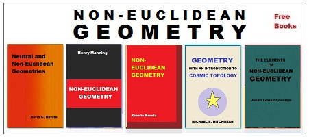

# 📚 Free Non-Euclidean Geometry Books & Textbook Repository

Welcome to the **Non-Euclidean Geometry Collection** by Free Mathematics Books.

This repository provides a curated selection of free Non-Euclidean Geometry textbooks, historical works, and supplementary resources covering Euclid's parallel postulate, hyperbolic and elliptic geometries, geometric models, cosmic topology, and foundations of non-Euclidean systems.

Resources are organized into subject-based groups to help students, educators, researchers, and independent learners find relevant materials for coursework and self-study.

Each entry identifies the available book, its author, and a link to its corresponding resource page.

📖 **[Explore the Complete Non-Euclidean Geometry Collection](https://freemathematicsbooks.com/A.aspx?Id=Non-Euclidean-Geometry&utm_source=github&utm_medium=referral&utm_campaign=Non-Euclidean-Geometry&utm_content=introduction)**

📚 **[Explore the Complete Geometry & Topology Collection](https://freemathematicsbooks.com/A.aspx?Id=Geometry&utm_source=github&utm_medium=referral&utm_campaign=Geometry&utm_content=introduction)**

---

## 📖 Curated Non-Euclidean Geometry Book Catalogue

The following textbooks and resources are organized into two groups according to their historical foundations, geometric structures, and topological connections.

### 1. 📘 Parallel Postulate & Historical Foundations

Foundational and historical texts examining Euclid's fifth postulate, attempts to prove it, and the emergence of non-Euclidean geometries.

- 📖 **[Euclid's Parallel Postulate: Its Nature, Validity and Place in Geometrical Systems — John William Withers](https://freemathematicsbooks.com/B.aspx?FileName=Euclid-Parallel-Postulate--John-Withers&utm_source=github&utm_medium=referral&utm_campaign=Non-Euclidean-Geometry&utm_content=book-catalogue)**

Examines the nature, independence, and logical role of Euclid's parallel postulate within axiomatic geometry and philosophical foundations.

- 📖 **[Non-Euclidean Geometry — Roberto Bonola](https://freemathematicsbooks.com/B.aspx?FileName=Non-Euclidean-Geometry--Roberto-Bonola&utm_source=github&utm_medium=referral&utm_campaign=Non-Euclidean-Geometry&utm_content=book-catalogue)**

A classic historical and critical survey tracing the development of hyperbolic and elliptic geometries from pre-Euclidean attempts to Bolyai, Lobachevsky, and Riemann.

---

### 2. 📐 Non-Euclidean Systems, Models & Cosmic Topology

Treatments of non-Euclidean metrics, synthetic and analytic constructions, and geometric/topological spaces.

- 📖 **[Geometry with an Introduction to Cosmic Topology — Mike Hitchman](https://freemathematicsbooks.com/B.aspx?FileName=Geometry-Intro-Cosmic-Topology--Mike-Hitchman&utm_source=github&utm_medium=referral&utm_campaign=Non-Euclidean-Geometry&utm_content=book-catalogue)**

An accessible, visual introduction to Euclidean, spherical, and hyperbolic geometries alongside flat and curved cosmic topology models.

- 📖 **[The Elements Of Non-Euclidean Geometry — Julian Coolidge](https://freemathematicsbooks.com/B.aspx?FileName=Elements-Non-Euclidean-Geometry--Julian-Coolidge&utm_source=github&utm_medium=referral&utm_campaign=Non-Euclidean-Geometry&utm_content=book-catalogue)**

A structured treatise covering hyperbolic and elliptic geometry, trigonometry in curved spaces, distance/angle measures, and geometric transformations.

---

## 📖 How to Choose a Resource

- **Visual & Modern Introduction:** Start with *Geometry with an Introduction to Cosmic Topology* by Mike Hitchman for intuition across spherical, hyperbolic, and flat geometries.
- **Historical & Axiomatic Context:** Read *Non-Euclidean Geometry* by Roberto Bonola and *Euclid's Parallel Postulate* by John William Withers to understand how the parallel postulate shaped modern geometry.
- **Detailed Geometric & Trigonometric Theory:** Use *The Elements Of Non-Euclidean Geometry* by Julian Coolidge for systematic development of hyperbolic and elliptic spaces.

---

## 📚 Topics Covered

This collection includes resources covering the following topics:

- Euclid's Fifth (Parallel) Postulate and Axiomatic Independence
- History of Hyperbolic, Elliptic, and Spherical Geometries
- Non-Euclidean Distance, Angle, and Trigonometric Relations
- Geometric Transformations and Curved Space Models
- Flat and Curved Cosmic Topology

---

## 📋 Book Selection & Verification

Resources in this catalogue are organized by subject relevance, educational level, and clear bibliographic details. Links direct readers to the corresponding resource pages on Free Mathematics Books, where access details and available formats can be reviewed.

---

## 🤝 Contributing to This Repository

Suggestions and contributions are welcome!

You can help improve this collection by:

1. Suggesting freely accessible Non-Euclidean Geometry textbooks and learning materials.
2. Reporting broken or outdated book links.
3. Correcting book titles, author names, or bibliographic details.
4. Recommending relevant supplementary geometry resources.
5. Improving the organization and documentation of the repository.

**How to contribute:**

- Open a GitHub Issue to report a problem or suggest a resource.
- Submit a Pull Request with proposed additions or corrections.
- Include the book title, author, and source link when suggesting a resource.

Please ensure that submitted materials are freely accessible and that any shared files comply with applicable copyright and licensing terms.

---

## 🧭 Repository Navigation

- [⬅️ Back to Main Geometry & Topology Category](../)
- [🏠 Back to Home Repository](../../)

---

## 🌐 Explore More Mathematics Resources

- **GitLab:** [Free Mathematics Books Study Guide](https://gitlab.com/mathematics55/FreeMathBooks/-/tree/main) — Subject study guides and topic mirrors.
- **Substack:** [Free Mathematics Books Reading Notes](https://freemathematicsbooks.substack.com/) — Curated reading lists and book highlights.
- **Official Website:** [FreeMathematicsBooks.com](https://freemathematicsbooks.com/?utm_source=github&utm_medium=referral&utm_campaign=FreeMathematicsBooks&utm_content=repository-footer) — Searchable directory of external textbook links.
