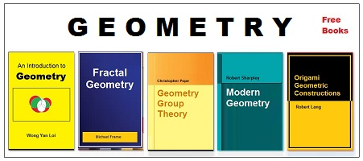

# 📚 Free Geometry & Topology Books Repository

Welcome to the Free Geometry & Topology Books Repository!

This repository maintains a curated catalogue of freely accessible geometry textbooks, lecture notes, and supplementary mathematical resources covering classical geometry, geometric modeling, symplectic geometry, fractal geometry, and related mathematical subjects.

Resources are organized into subject-based categories to help students, educators, researchers, and independent learners discover relevant mathematical materials.

Each book entry includes its title, author information, and a link to its corresponding resource page.

This repository also welcomes suggestions, corrections, and contributions that help improve the accuracy and usefulness of the collection.

📖 **[Explore the Complete Free Geometry & Topology Collection](https://freemathematicsbooks.com/A.aspx?Id=Geometry&utm_source=github&utm_medium=referral&utm_campaign=Geometry-Topology&utm_content=introduction)**

---

## 📂 Browse Geometry & Topology Collections

The following directories organize resources by their primary mathematical subject.

| Subcategory | 📚 Online Collection | 📁 GitHub Folder |
| :--- | :--- | :--- |
| **Elementary Geometry** | [View Books](https://freemathematicsbooks.com/A.aspx?Id=Elementary-Geometry&utm_source=github&utm_medium=referral&utm_campaign=Elementary-Geometry) | [Explore Folder](./Elementary-Geometry) |
| **Analytic Geometry** | [View Books](https://freemathematicsbooks.com/A.aspx?Id=Analytic-Geometry&utm_source=github&utm_medium=referral&utm_campaign=Analytic-Geometry) | [Explore Folder](./Analytic-Geometry) |
| **Differential Geometry** | [View Books](https://freemathematicsbooks.com/A.aspx?Id=Differential-Geometry&utm_source=github&utm_medium=referral&utm_campaign=Differential-Geometry) | [Explore Folder](./Differential-Geometry) |
| **Algebraic Geometry** | [View Books](https://freemathematicsbooks.com/A.aspx?Id=Algebraic-Geometry&utm_source=github&utm_medium=referral&utm_campaign=Algebraic-Geometry) | [Explore Folder](./Algebraic-Geometry) |
| **Non-Euclidean Geometry** | [View Books](https://freemathematicsbooks.com/A.aspx?Id=Non-Euclidean-Geometry&utm_source=github&utm_medium=referral&utm_campaign=Non-Euclidean-Geometry) | [Explore Folder](./Non-Euclidean-Geometry) |
| **Computational Geometry** | [View Books](https://freemathematicsbooks.com/A.aspx?Id=Computational-Geometry&utm_source=github&utm_medium=referral&utm_campaign=Computational-Geometry) | [Explore Folder](./Computational-Geometry) |
| **Topology** | [View Books](https://freemathematicsbooks.com/A.aspx?Id=Topology&utm_source=github&utm_medium=referral&utm_campaign=Topology) | [Explore Folder](./Topology) |

---

## 📚 Curated Geometry & Topology Book Catalogue

The following books and supplementary resources are organized into four groups according to their primary mathematical subject and educational focus.

### 1. 📘 Foundations & Classical Geometry

*Resources covering geometric foundations, axiomatic systems, descriptive geometry, and higher-dimensional spaces.*

- 📖 **[The Axioms of Descriptive Geometry](https://freemathematicsbooks.com/B.aspx?FileName=The-Axioms-Descriptive-Geometry--Alfred-Whitehead&utm_source=github&utm_medium=referral&utm_campaign=Geometry-Topology&utm_content=book-catalogue)** — *by Alfred North Whitehead*

  A study of geometric axioms, projective spaces, harmonic homology, and the foundations of descriptive geometry.

- 📖 **[The Fourth Dimension](https://freemathematicsbooks.com/B.aspx?FileName=The-Fourth-Dimension--Charles-Hinton&utm_source=github&utm_medium=referral&utm_campaign=Geometry-Topology&utm_content=book-catalogue)** — *by Charles Howard Hinton*

  Explores four-dimensional space, higher-dimensional figures, and geometric interpretations beyond three-dimensional space.

### 2. 📐 Differential, Symplectic & Geometric Modeling

*Specialized resources covering symplectic structures, geometric modeling, polynomial curves, and mathematical surfaces.*

- 📖 **[Lectures on Symplectic Geometry](https://freemathematicsbooks.com/B.aspx?FileName=Lectures-Symplectic-Geometry--Cannas-da-Silva&utm_source=github&utm_medium=referral&utm_campaign=Geometry-Topology&utm_content=book-catalogue)** — *by Ana Cannas da Silva*

  Covers symplectic manifolds, symplectic forms, Lagrangian submanifolds, contact manifolds, and Kähler geometry.

- 📖 **[Curves and Surfaces in Geometric Modeling](https://freemathematicsbooks.com/B.aspx?FileName=Curves-Surfaces-Geometric-Modeling--Jean-Gallier&utm_source=github&utm_medium=referral&utm_campaign=Geometry-Topology&utm_content=book-catalogue)** — *by Jean Gallier*

  Explores affine geometry, polynomial curves, Bézier curves, B-splines, and geometric surface modeling.

### 3. 🌿 Fractal & Applied Geometry

*Resources exploring fractal structures, geometric dimensions, self-similarity, and mathematical applications of fractal geometry.*

- 📖 **[Fractal Geometry: Mathematical Foundations and Applications](https://freemathematicsbooks.com/B.aspx?FileName=Fractal-Geometry--Kenneth-Falconer&utm_source=github&utm_medium=referral&utm_campaign=Geometry-Topology&utm_content=book-catalogue)** — *by Kenneth Falconer*

  Covers Hausdorff measure, fractal dimensions, self-similar sets, iterated function systems, and applications of fractal geometry.

- 📖 **[The Fractal Geometry of Nature](https://freemathematicsbooks.com/B.aspx?FileName=The-Fractal-Geometry-Nature--Benoit-Mandelbrot&utm_source=github&utm_medium=referral&utm_campaign=Geometry-Topology&utm_content=book-catalogue)** — *by Benoit Mandelbrot*

  Introduces the mathematical foundations of fractal geometry, fractal computation, natural forms, and applications in computer graphics.

- 📖 **[The Geometry of Fractal Sets](https://freemathematicsbooks.com/B.aspx?FileName=The-Geometry-Fractal-Sets--Kenneth-Falconer&utm_source=github&utm_medium=referral&utm_campaign=Geometry-Topology&utm_content=book-catalogue)** — *by Kenneth Falconer*

  Explores Hausdorff dimension, fractal measures, projections, intersections, self-similar sets, and geometric properties of fractals.

### 4. 📖 Related & Supplementary Mathematics Resources

*Additional resources covering mathematical history, geometry education, and broader mathematical perspectives.*

**Mathematical History & Education**

- 📖 **[The Legacy of Felix Klein](https://freemathematicsbooks.com/B.aspx?FileName=The-Legacy-Felix-Klein--Hans-Georg-Weigand&utm_source=github&utm_medium=referral&utm_campaign=Geometry-Topology&utm_content=book-catalogue)** — *by Hans-Georg Weigand, Neil McCallum & Menghini*

  Explores Felix Klein's mathematical legacy, functional thinking, mathematics education, and the development of mathematical ideas.

---

## 📋 Book Selection & Verification

Resources in this repository are organized according to their primary mathematical subject and educational purpose.

The following considerations guide the organization of this collection:

- **Subject Relevance:** Books are included according to their coverage of geometry, topology-related subjects, or closely related mathematical fields.
- **Bibliographic Information:** Book titles and author details are provided to help readers identify the resources.
- **Resource Accessibility:** Links lead to the corresponding book information pages, where availability and access details can be checked.
- **Subject Classification:** Resources are grouped by their primary mathematical focus to make browsing easier.
- **Link Maintenance:** Broken or outdated links and bibliographic corrections can be reported through GitHub Issues.

---

## 📁 Repository Organization

The repository contains subject-specific directories for further exploration:

- Elementary Geometry
- Analytic Geometry
- Differential Geometry
- Algebraic Geometry
- Non-Euclidean Geometry
- Computational Geometry
- Topology

Each directory contains additional book listings and related resources for its respective subject.

---

## 🤝 Contributing to This Repository

Suggestions and contributions are welcome!

You can help improve this collection by:

1. Suggesting freely accessible Geometry and Topology textbooks and learning materials.
2. Reporting broken or outdated book links.
3. Correcting book titles, author names, or bibliographic information.
4. Recommending useful resources covering geometric methods and related mathematical subjects.
5. Improving the organization and documentation of the repository.

**How to contribute:**

- Open a GitHub Issue to report a problem or suggest a resource.
- Submit a Pull Request with proposed additions or corrections.
- Include the book title, author, and source link when recommending a resource.

Please ensure that suggested materials are freely accessible and that any shared files comply with applicable copyright and licensing terms.

---

## 🔙 Repository Navigation

- [🏠 Back to Repository Root](../)

---

## 🌐 Explore More Mathematics Resources

Discover additional free textbooks and educational materials through **[Free Mathematics Books](https://freemathematicsbooks.com/?utm_source=github&utm_medium=referral&utm_campaign=FreeMathematicsBooks&utm_content=repository-footer)**.
