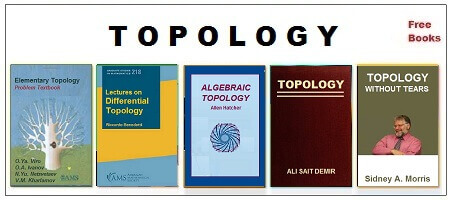

# 📚 Free Topology Books & Textbook Repository

Welcome to the **Topology Collection** by Free Mathematics Books.

This repository provides a curated selection of free Topology textbooks, problem books, lecture notes, and supplementary resources covering general and point-set topology, problem-solving, 3-manifolds and foliations, homotopy theory, and categorical topology.

Resources are organized into subject-based groups to help students, educators, researchers, and independent learners find relevant materials for coursework and self-study.

Each entry identifies the available book, its author, and a link to its corresponding resource page.

📖 **[Explore the Complete Topology Collection](https://freemathematicsbooks.com/A.aspx?Id=Topology&utm_source=github&utm_medium=referral&utm_campaign=Topology&utm_content=introduction)**

📚 **[Explore the Complete Geometry & Topology Collection](https://freemathematicsbooks.com/A.aspx?Id=Geometry&utm_source=github&utm_medium=referral&utm_campaign=Geometry&utm_content=introduction)**

---

## 📖 Curated Topology Book Catalogue

The following textbooks and resources are organized into three groups according to their topological focus, mathematical level, and methods.

### 1. 📘 Introductory & Problem-Based Topology

Accessible textbooks and problem collections introducing topological spaces, continuity, compactness, connectedness, and core point-set topology.

- 📖 **[Elementary Topology Problem Textbook — O.Ya.Viro, et al.](https://freemathematicsbooks.com/B.aspx?FileName=Elementary-Topology-Problem-Textbook--O.Ya.Viro&utm_source=github&utm_medium=referral&utm_campaign=Topology&utm_content=book-catalogue)**

A problem-driven textbook guiding learners through topological spaces, metric spaces, connectedness, compactness, and fundamental topological constructions via structured exercises.

- 📖 **[Topology Without Tears — Sidney A. Morris](https://freemathematicsbooks.com/B.aspx?FileName=Topology-Without-Tears--Sidney-Morris&utm_source=github&utm_medium=referral&utm_campaign=Topology&utm_content=book-catalogue)**

A clear, self-contained introduction to topological spaces, open and closed sets, continuous maps, separation axioms, compactness, and connectedness.

---

### 2. 🔷 Manifolds, Foliations & Homotopy Theory

Advanced resources exploring 3-manifolds, foliations, simplicial/dendroidal sets, and modern homotopy theory.

- 📖 **[Foliations and the Geometry of 3-Manifolds — Danny Calegari](https://freemathematicsbooks.com/B.aspx?FileName=Foliations-Geometry-3-Manifolds--Danny-Calegari&utm_source=github&utm_medium=referral&utm_campaign=Topology&utm_content=book-catalogue)**

Examines foliations, geometric structures, laminations, and topological properties of 3-dimensional manifolds.

- 📖 **[Simplicial and Dendroidal Homotopy Theory — Heuts & Moerdijk](https://freemathematicsbooks.com/B.aspx?FileName=Simplicial-Dendroidal-Homotopy-Theory--Heuts--Moerdijk&utm_source=github&utm_medium=referral&utm_campaign=Topology&utm_content=book-catalogue)**

Develops homotopy theory using simplicial sets, dendroidal structures, model categories, and higher algebraic/topological methods.

---

### 3. 🧩 Categorical Topology

Resources connecting topological structures with category theory, functors, and universal constructions.

- 📖 **[Topology: A Categorical Approach — Tai-Danae Bradley, et al](https://freemathematicsbooks.com/B.aspx?FileName=Topology-A-Categorical-Approach--Tai-Danae-Bradley&utm_source=github&utm_medium=referral&utm_campaign=Topology&utm_content=book-catalogue)**

Explores topological concepts and constructions through the lens of category theory, functors, adjunctions, and categorical perspectives.

---

## 📖 How to Choose a Resource

- **Beginners & Self-Study:** Start with *Topology Without Tears* by Sidney A. Morris for step-by-step explanations or *Elementary Topology Problem Textbook* by O.Ya.Viro et al. for hands-on problem solving.
- **3-Manifolds & Foliations:** Choose *Foliations and the Geometry of 3-Manifolds* by Danny Calegari for geometric and foliated manifold theory.
- **Homotopy & Dendroidal Methods:** Use *Simplicial and Dendroidal Homotopy Theory* by Heuts & Moerdijk for advanced homotopical frameworks.
- **Category-Theoretic Viewpoint:** Read *Topology: A Categorical Approach* by Tai-Danae Bradley et al. to connect topology with category theory.

---

## 📚 Topics Covered

This collection includes resources covering the following topics:

- Topological Spaces, Open/Closed Sets, and Continuous Functions
- Compactness, Connectedness, Metric Spaces, and Separation Axioms
- Problem-Driven Topological Proofs and Constructions
- Foliations and the Geometry/Topology of 3-Manifolds
- Simplicial and Dendroidal Homotopy Theory
- Categorical Topology, Functors, and Structural Relationships

---

## 📋 Book Selection & Verification

Resources in this catalogue are organized by subject relevance, educational level, and clear bibliographic details. Links direct readers to the corresponding resource pages on Free Mathematics Books, where access details and available formats can be reviewed.

---

## 🤝 Contributing to This Repository

Suggestions and contributions are welcome!

You can help improve this collection by:

1. Suggesting freely accessible Topology textbooks and learning materials.
2. Reporting broken or outdated book links.
3. Correcting book titles, author names, or bibliographic details.
4. Recommending relevant supplementary topology resources.
5. Improving the organization and documentation of the repository.

**How to contribute:**

- Open a GitHub Issue to report a problem or suggest a resource.
- Submit a Pull Request with proposed additions or corrections.
- Include the book title, author, and source link when suggesting a resource.

Please ensure that submitted materials are freely accessible and that any shared files comply with applicable copyright and licensing terms.

---

## 🧭 Repository Navigation

- [⬅️ Back to Main Geometry & Topology Category](../)
- [🏠 Back to Home Repository](../../)

---

## 🌐 Explore More Mathematics Resources

- **GitLab:** [Free Mathematics Books Study Guide](https://gitlab.com/mathematics55/FreeMathBooks/-/tree/main) — Subject study guides and topic mirrors.
- **Substack:** [Free Mathematics Books Reading Notes](https://freemathematicsbooks.substack.com/) — Curated reading lists and book highlights.
- **Official Website:** [FreeMathematicsBooks.com](https://freemathematicsbooks.com/?utm_source=github&utm_medium=referral&utm_campaign=FreeMathematicsBooks&utm_content=repository-footer) — Searchable directory of external textbook links.
