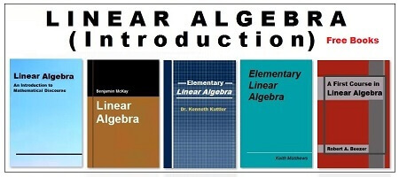

# 📚 Free Linear Algebra (Introduction) Books & Textbook Repository

Welcome to the **Linear Algebra (Introduction) Collection** by Free Mathematics Books.

This repository provides a curated selection of free introductory Linear Algebra textbooks, interactive guides, and supplementary resources covering systems of linear equations, vectors, matrices, vector spaces, linear transformations, eigenvalues, applied matrix methods, and Python/interactive exploration.

Resources are organized into subject-based groups to help beginners, undergraduate students, educators, and self-learners build a strong foundation in linear algebra.

Each entry identifies the available book, its author, and a link to its corresponding resource page.

📖 **[Explore the Complete Linear Algebra (Introduction) Collection](https://freemathematicsbooks.com/A.aspx?Id=Linear-Algebra-Intro&utm_source=github&utm_medium=referral&utm_campaign=Linear-Algebra-Intro&utm_content=introduction)**

📚 **[Explore the Complete Linear Algebra Collection](https://freemathematicsbooks.com/A.aspx?Id=Linear-Algebra&utm_source=github&utm_medium=referral&utm_campaign=Linear-Algebra&utm_content=introduction)**

---

## 📖 Curated Linear Algebra (Introduction) Book Catalogue

The following textbooks and resources are organized into three groups according to their pedagogical style, applications, and programming/interactive support.

### 1. 📘 Core & Conceptual Introductory Textbooks

Accessible undergraduate texts developing linear systems, vectors, matrices, subspaces, determinants, and eigenvalues with clear explanations and exercises.

- 📖 **[A First Course in Linear Algebra — Robert Beezer](https://freemathematicsbooks.com/B.aspx?FileName=First-Course-Linear-Algebra--Robert-Beezer&utm_source=github&utm_medium=referral&utm_campaign=Linear-Algebra-Intro&utm_content=book-catalogue)**

A comprehensive open-source introduction covering systems of linear equations, vectors, matrices, eigenvalues, and linear transformations with structured exercises.

- 📖 **[Linear Algebra — Jim Hefferon](https://freemathematicsbooks.com/B.aspx?FileName=Linear-Algebra-Jim-Hefferon&utm_source=github&utm_medium=referral&utm_campaign=Linear-Algebra-Intro&utm_content=book-catalogue)**

A clear, proof-friendly introductory textbook guiding learners through vector spaces, linear maps, determinants, and canonical forms with full solutions.

- 📖 **[Understanding Linear Algebra — David Austin](https://freemathematicsbooks.com/B.aspx?FileName=Understanding-Linear-Algebra--David-Austin&utm_source=github&utm_medium=referral&utm_campaign=Linear-Algebra-Intro&utm_content=book-catalogue)**

Emphasizes geometric intuition, visual interpretation, and conceptual understanding of linear transformations, subspaces, eigenvalues, and decompositions.

---

### 2. 💡 Interactive, Applied & Python-Based Introductions

Resources combining geometric interaction, practical engineering/data applications, and Python code for hands-on learning.

- 📖 **[Interactive Linear Algebra — Dan Margalit, Joseph Rabinoff](https://freemathematicsbooks.com/B.aspx?FileName=Interactive-Linear-Algebra--Dan-Margalit&utm_source=github&utm_medium=referral&utm_campaign=Linear-Algebra-Intro&utm_content=book-catalogue)**

Features interactive visual explorations and geometric intuition for linear transformations, projections, orthogonality, and eigenvalues.

- 📖 **[Introduction to Applied Linear Algebra — Boyd & Vandenberghe](https://freemathematicsbooks.com/B.aspx?FileName=Intro-Applied-Linear-Algebra--Stephen-Boyd&utm_source=github&utm_medium=referral&utm_campaign=Linear-Algebra-Intro&utm_content=book-catalogue)**

Focuses on vectors, matrices, least squares, and practical applications in data science, engineering, signal processing, and optimization.

- 📖 **[Linear Algebra with Python — Sean Fitzpatrick](https://freemathematicsbooks.com/B.aspx?FileName=Linear-Algebra-Python--Sean-Fitzpatrick&utm_source=github&utm_medium=referral&utm_campaign=Linear-Algebra-Intro&utm_content=book-catalogue)**

Pairs foundational linear algebra theory with Python programming and computational examples for solving linear systems and working with matrices.

---

## 📖 How to Choose a Resource

- **Visual Intuition & Interactive Learning:** Start with *Interactive Linear Algebra* by Margalit & Rabinoff or *Understanding Linear Algebra* by David Austin.
- **Structured Coursework & Proof Foundations:** Use *A First Course in Linear Algebra* by Robert Beezer or *Linear Algebra* by Jim Hefferon.
- **Data, Engineering & Applied Context:** Choose *Introduction to Applied Linear Algebra* by Boyd & Vandenberghe for practical matrix and least-squares applications.
- **Coding & Computational Practice:** Read *Linear Algebra with Python* by Sean Fitzpatrick to reinforce concepts using Python.

---

## 📚 Topics Covered

This collection includes resources covering the following topics:

- Systems of Linear Equations, Row Reduction, Vectors, and Matrices
- Vector Spaces, Subspaces, Basis, Dimension, and Linear Transformations
- Orthogonality, Projections, Least Squares, and Inner Products
- Determinants, Eigenvalues, Eigenvectors, and Matrix Decompositions
- Applied Linear Algebra, Interactive Visualization, and Linear Algebra in Python

---

## 📋 Book Selection & Verification

Resources in this catalogue are organized by subject relevance, educational level, and clear bibliographic details. Links direct readers to the corresponding resource pages on Free Mathematics Books, where access details and available formats can be reviewed.

---

## 🤝 Contributing to This Repository

Suggestions and contributions are welcome!

You can help improve this collection by:

1. Suggesting freely accessible introductory Linear Algebra textbooks and learning materials.
2. Reporting broken or outdated book links.
3. Correcting book titles, author names, or bibliographic details.
4. Recommending relevant supplementary linear algebra resources.
5. Improving the organization and documentation of the repository.

**How to contribute:**

- Open a GitHub Issue to report a problem or suggest a resource.
- Submit a Pull Request with proposed additions or corrections.
- Include the book title, author, and source link when suggesting a resource.

Please ensure that submitted materials are freely accessible and that any shared files comply with applicable copyright and licensing terms.

---

## 🧭 Repository Navigation

- [⬅️ Back to Main Linear Algebra Category](../)
- [🏠 Back to Home Repository](../../../../)

---

## 🌐 Explore More Mathematics Resources

**GitHub Collection:** [Free Math Books Repository](https://github.com/FreeMathBooks/free-math-books-collection)

**Substack Publication:** [Free Mathematics Books](https://freemathematicsbooks.substack.com/)

Discover additional free textbooks and educational materials through **[Free Mathematics Books](https://freemathematicsbooks.com/?utm_source=github&utm_medium=referral&utm_campaign=FreeMathematicsBooks&utm_content=repository-footer)**.
