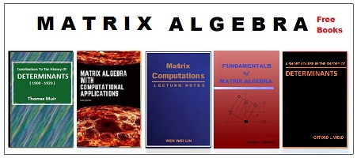

# 📚 Free Matrix Algebra Books & Textbook Repository

Welcome to the **Matrix Algebra Collection** by Free Mathematics Books.

This repository provides a curated selection of free Matrix Algebra textbooks, treatises, lecture notes, and supplementary resources covering matrix fundamentals, computational matrix methods, linear transformations on vector spaces, determinants and determinoids, historical determinant theory, and transition from determinants to tensors.

Resources are organized into subject-based groups to help students, educators, researchers, and independent learners find relevant materials for coursework, computation, and historical/theoretical study.

Each entry identifies the available book, its author, and a link to its corresponding resource page.

📖 **[Explore the Complete Matrix Algebra Collection](https://freemathematicsbooks.com/A.aspx?Id=Matrix-Algebra&utm_source=github&utm_medium=referral&utm_campaign=Matrix-Algebra&utm_content=introduction)**

📚 **[Explore the Complete Linear Algebra Collection](https://freemathematicsbooks.com/A.aspx?Id=Linear-Algebra&utm_source=github&utm_medium=referral&utm_campaign=Linear-Algebra&utm_content=introduction)**

---

## 📖 Curated Matrix Algebra Book Catalogue

The following textbooks and resources are organized into four groups according to their focus on matrix computation, linear transformations, determinants/determinoids, and historical/tensor foundations.

### 1. 📘 Matrix Fundamentals & Computational Applications

Foundational and applied textbooks covering matrix operations, linear systems, eigenvalues, and computational matrix workflows.

- 📖 **[Fundamentals of Matrix Algebra — Gregory Hartman](https://freemathematicsbooks.com/B.aspx?FileName=Fundamentals-Matrix-Algebra--Gregory-Hartman&utm_source=github&utm_medium=referral&utm_campaign=Matrix-Algebra&utm_content=book-catalogue)**

Introduces matrices, row operations, linear systems, determinants, eigenvalues, and eigenvectors in an accessible student-friendly format.

- 📖 **[Lecture Notes of Matrix Computations — Wen Wei Lin](https://freemathematicsbooks.com/B.aspx?FileName=Lecture-Notes-Matrix-Computations--Wen-Wei-Lin&utm_source=github&utm_medium=referral&utm_campaign=Matrix-Algebra&utm_content=book-catalogue)**

Covers numerical and algebraic matrix computations, matrix decompositions, least squares, and eigenvalue methods.

- 📖 **[Matrix Algebra with Computational Applications — Dirk Colbry](https://freemathematicsbooks.com/B.aspx?FileName=Matrix-Algebra-Computational-App--Dirk-Colbry&utm_source=github&utm_medium=referral&utm_campaign=Matrix-Algebra&utm_content=book-catalogue)**

Focuses on practical matrix computation, solving linear systems, and applying matrix methods to computational problems.

---

### 2. 📐 Vector Spaces, Linear Transformations & Tensors

Resources connecting matrices with linear mappings on vector spaces and higher-order tensor structures.

- 📖 **[From Determinant To Tensor — William Sheppard](https://freemathematicsbooks.com/B.aspx?FileName=From-Determinant-To-Tensor--William-Sheppard&utm_source=github&utm_medium=referral&utm_campaign=Matrix-Algebra&utm_content=book-catalogue)**

Traces how determinant theory and multilinear forms lead to tensor algebra and tensorial formulations.

- 📖 **[Linear Transformations on Vector Spaces — Scott Kaschner, Amber Russell](https://freemathematicsbooks.com/B.aspx?FileName=Linear-Transformations-Vector-Spaces--Scott-Kaschner&utm_source=github&utm_medium=referral&utm_campaign=Matrix-Algebra&utm_content=book-catalogue)**

Explores vector spaces, basis changes, matrix representations of linear transformations, and structural linear operators.

---

### 3. 🔢 Determinants, Determinoids & Graduated Exercises

Treatises and multi-volume works examining determinants, generalized determinoids, and structured problem sets.

- 📖 **[An Elementary Treatise on Determinants — Lewis Carroll](https://freemathematicsbooks.com/B.aspx?FileName=An-Elementary-Treatise-Determinants--Lewis-Carroll&utm_source=github&utm_medium=referral&utm_campaign=Matrix-Algebra&utm_content=book-catalogue)**

Presents an elementary, systematic exposition of determinants, their properties, expansions, and applications to linear equations.

- 📖 **[Matrices and Determinoids 1 — Cuthbert Edmund Cullis](https://freemathematicsbooks.com/B.aspx?FileName=Matrices-Determinoids-1--Cuthbert-Cullis&utm_source=github&utm_medium=referral&utm_campaign=Matrix-Algebra&utm_content=book-catalogue)**

Volume 1 of Cullis's comprehensive treatise introducing matrix theory, rectangular matrices, and generalized determinoids.

- 📖 **[Matrices and Determinoids 2 — Cuthbert Edmund Cullis](https://freemathematicsbooks.com/B.aspx?FileName=Matrices-Determinoids-2--Cuthbert-Cullis&utm_source=github&utm_medium=referral&utm_campaign=Matrix-Algebra&utm_content=book-catalogue)**

Volume 2 expanding on matrix operations, compound matrices, ranks, and determinoidal theory.

- 📖 **[Matrices and Determinoids 3 — Cuthbert Edmund Cullis](https://freemathematicsbooks.com/B.aspx?FileName=Matrices-Determinoids-3--Cuthbert-Cullis&utm_source=github&utm_medium=referral&utm_campaign=Matrix-Algebra&utm_content=book-catalogue)**

Volume 3 continuing advanced developments in matrices, determinoids, and algebraic matrix structures.

- 📖 **[Theory of Determinants with Graduated Sets of Exercises — Thomas Muir](https://freemathematicsbooks.com/B.aspx?FileName=Theory-Determinants-Colleges--Thomas-Muir&utm_source=github&utm_medium=referral&utm_campaign=Matrix-Algebra&utm_content=book-catalogue)**

A college-level text combining determinant theory with progressive, graduated sets of practice problems and exercises.

---

### 4. 📜 Historical Development of Determinants

Historical studies documenting the evolution of determinant theory across centuries.

- 📖 **[Contributions To The History Of Determinants 1900 1920 — Thomas Muir](https://freemathematicsbooks.com/B.aspx?FileName=Contributions-History-Determinants--Thomas-Munir&utm_source=github&utm_medium=referral&utm_campaign=Matrix-Algebra&utm_content=book-catalogue)**

Documents advances, memoirs, and theoretical contributions to determinant theory during the period from 1900 to 1920.

- 📖 **[Theory of Determinants in the Historical Order of Development — Thomas Muir](https://freemathematicsbooks.com/B.aspx?FileName=Theory-Determinants-Historical-Order--Thomas-Muir&utm_source=github&utm_medium=referral&utm_campaign=Matrix-Algebra&utm_content=book-catalogue)**

Chronicles the historical progression of determinant concepts, notation, and theorems from their origins onward.

---

## 📖 How to Choose a Resource

- **Core Matrix Algebra & Computation:** Start with *Fundamentals of Matrix Algebra* by Gregory Hartman or *Matrix Algebra with Computational Applications* by Dirk Colbry, and explore *Lecture Notes of Matrix Computations* by Wen Wei Lin for decompositions and numerical methods.
- **Linear Transformations & Tensors:** Use *Linear Transformations on Vector Spaces* by Kaschner & Russell for linear operators and *From Determinant To Tensor* by William Sheppard for multilinear/tensor foundations.
- **Determinants, Determinoids & Practice Problems:** Choose *An Elementary Treatise on Determinants* by Lewis Carroll, *Theory of Determinants with Graduated Sets of Exercises* by Thomas Muir, or the *Matrices and Determinoids* series by Cuthbert Edmund Cullis.
- **History of Determinant Theory:** Read Thomas Muir's historical works to trace the chronological development of determinants and 1900–1920 contributions.

---

## 📚 Topics Covered

This collection includes resources covering the following topics:

- Matrix Operations, Linear Systems, Eigenvalues, and Decompositions
- Computational Matrix Algebra and Applied Matrix Methods
- Vector Spaces, Basis Changes, and Linear Transformations
- Determinants, Compound Matrices, and Generalized Determinoids
- Graduated Determinant Exercises and Historical Development (Including 1900–1920)
- Transition from Determinants to Tensor Algebra

---

## 📋 Book Selection & Verification

Resources in this catalogue are organized by subject relevance, educational level, and clear bibliographic details. Links direct readers to the corresponding resource pages on Free Mathematics Books, where access details and available formats can be reviewed.

---

## 🤝 Contributing to This Repository

Suggestions and contributions are welcome!

You can help improve this collection by:

1. Suggesting freely accessible Matrix Algebra textbooks and learning materials.
2. Reporting broken or outdated book links.
3. Correcting book titles, author names, or bibliographic details.
4. Recommending relevant supplementary matrix algebra resources.
5. Improving the organization and documentation of the repository.

**How to contribute:**

- Open a GitHub Issue to report a problem or suggest a resource.
- Submit a Pull Request with proposed additions or corrections.
- Include the book title, author, and source link when suggesting a resource.

Please ensure that submitted materials are freely accessible and that any shared files comply with applicable copyright and licensing terms.

---

## 🧭 Repository Navigation

- [⬅️ Back to Main Linear Algebra Category](../)
- [🏠 Back to Home Repository](../../../../)

---

## 🌐 Explore More Mathematics Resources

**GitHub Collection:** [Free Math Books Repository](https://github.com/FreeMathBooks/free-math-books-collection)

**Substack Publication:** [Free Mathematics Books](https://freemathematicsbooks.substack.com/)

Discover additional free textbooks and educational materials through **[Free Mathematics Books](https://freemathematicsbooks.com/?utm_source=github&utm_medium=referral&utm_campaign=FreeMathematicsBooks&utm_content=repository-footer)**.
