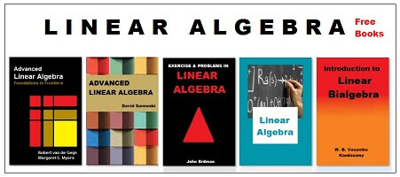

# 📚 Free Linear Algebra Books & Textbook Repository

Welcome to the Free Linear Algebra Books Repository!

This repository maintains a curated catalogue of freely accessible Linear Algebra textbooks, lecture notes, and supplementary mathematical resources.

The collection covers introductory linear algebra, vector spaces, matrix theory, abstract and theoretical methods, computational linear algebra, numerical methods, and applications in engineering, physics, computer science, and other disciplines.

Resources are organized into subject-based groups to help students, educators, researchers, and independent learners discover relevant mathematical materials.

Each book entry includes its title, author information, and a link to its corresponding resource page.

This repository also welcomes suggestions, corrections, and contributions that help improve the accuracy and usefulness of the collection.

📖 **[Explore the Complete Free Linear Algebra Collection](https://freemathematicsbooks.com/A.aspx?Id=Linear-Algebra&utm_source=github&utm_medium=referral&utm_campaign=Linear-Algebra&utm_content=introduction)**

---

## 📂 Browse Linear Algebra Collections

The following directories organize resources by their primary mathematical subject.

| Subcategory | 📚 Online Collection | 📁 GitHub Folder |
| :--- | :--- | :--- |
| **Introductory Linear Algebra** | [View Books](https://freemathematicsbooks.com/A.aspx?Id=Linear-Algebra-Intro&utm_source=github&utm_medium=referral&utm_campaign=Linear-Algebra-Intro) | [Explore Folder](./Linear-Algebra-Introduction) |
| **Matrix Algebra** | [View Books](https://freemathematicsbooks.com/A.aspx?Id=Matrix-Algebra&utm_source=github&utm_medium=referral&utm_campaign=Matrix-Algebra) | [Explore Folder](./Matrix-Algebra) |

---

## 📚 Curated Linear Algebra Book Catalogue

The following textbooks and supplementary mathematical resources are organized into four groups according to their primary mathematical subject, theoretical focus, and practical applications.

### 1. 📘 Introductory & Core Linear Algebra

*Foundational textbooks introducing vectors, matrices, linear equations, vector spaces, and fundamental concepts of linear algebra.*

- 📖 **[A Quick Steep Climb Up Linear Algebra](https://freemathematicsbooks.com/B.aspx?FileName=A-Quick-Linear-Algebra--Stephen-Davies&utm_source=github&utm_medium=referral&utm_campaign=Linear-Algebra&utm_content=book-catalogue)** — *by Stephen Davies*
- 📖 **[Linear Algebra](https://freemathematicsbooks.com/B.aspx?FileName=Linear-Algebra--David-Cherney&utm_source=github&utm_medium=referral&utm_campaign=Linear-Algebra&utm_content=book-catalogue)** — *by David Cherney, Denton & Waldron*
- 📖 **[Linear Algebra](https://freemathematicsbooks.com/B.aspx?FileName=Linear-Algebra--Wikibooks&utm_source=github&utm_medium=referral&utm_campaign=Linear-Algebra&utm_content=book-catalogue)** — *by Wikibooks*
- 📖 **[Tea Time Linear Algebra](https://freemathematicsbooks.com/B.aspx?FileName=Tea-Time-Linear-Algebra--Leon-Brin&utm_source=github&utm_medium=referral&utm_campaign=Linear-Algebra&utm_content=book-catalogue)** — *by Leon Q. Brin*

### 2. 📚 Advanced & Theoretical Linear Algebra

*Advanced resources covering abstract linear algebra, theoretical foundations, exterior products, and more sophisticated algebraic structures.*

- 📖 **[Advanced Linear Algebra: Foundations to Frontiers](https://freemathematicsbooks.com/B.aspx?FileName=Advanced-Linear-Algebra--Robert-Geijn&utm_source=github&utm_medium=referral&utm_campaign=Linear-Algebra&utm_content=book-catalogue)** — *by Robert Geijn*
- 📖 **[Linear Algebra Done Right](https://freemathematicsbooks.com/B.aspx?FileName=Linear-Algebra-Done-Right--Sheldon-Axler&utm_source=github&utm_medium=referral&utm_campaign=Linear-Algebra&utm_content=book-catalogue)** — *by Sheldon Axler*
- 📖 **[Linear Algebra via Exterior Products](https://freemathematicsbooks.com/B.aspx?FileName=Linear-Algebra-exterior--Sergei-Winitzki&utm_source=github&utm_medium=referral&utm_campaign=Linear-Algebra&utm_content=book-catalogue)** — *by Sergei Winitzki*

### 3. 💻 Computational & Numerical Linear Algebra

*Resources covering computational algorithms, numerical methods, matrix computations, and applications of linear algebra in computer science and machine learning.*

- 📖 **[Applied & Computational Linear Algebra](https://freemathematicsbooks.com/B.aspx?FileName=Applied-Computational-Linear-Algebra--Charles-Byrne&utm_source=github&utm_medium=referral&utm_campaign=Linear-Algebra&utm_content=book-catalogue)** — *by Charles Byrne*
- 📖 **[Computational Methods of Linear Algebra](https://freemathematicsbooks.com/B.aspx?FileName=Computational-Methods-Linear-Algebra--V-Faddeeva&utm_source=github&utm_medium=referral&utm_campaign=Linear-Algebra&utm_content=book-catalogue)** — *by V. N. Faddeeva*
- 📖 **[Linear Algebra for Computer Vision & ML](https://freemathematicsbooks.com/B.aspx?FileName=Linear-Algebra-Computer-Machine-Learning--Jean-Gallier&utm_source=github&utm_medium=referral&utm_campaign=Linear-Algebra&utm_content=book-catalogue)** — *by Jean Gallier*
- 📖 **[Notes for Computational Linear Algebra](https://freemathematicsbooks.com/B.aspx?FileName=Notes-Computational-Linear-Algebra--Jessy-Grizzle&utm_source=github&utm_medium=referral&utm_campaign=Linear-Algebra&utm_content=book-catalogue)** — *by Jessy Grizzle*
- 📖 **[Numerical Linear Algebra](https://freemathematicsbooks.com/B.aspx?FileName=Numerical-Linear-Algebra--Pavel-Cizek&utm_source=github&utm_medium=referral&utm_campaign=Linear-Algebra&utm_content=book-catalogue)** — *by Pavel Cížek & Lenka Cížková*

### 4. ⚙️ Applied & Specialized Linear Algebra

*Resources exploring practical applications in engineering, physics, econometrics, specialized algebraic systems, and matrix-based mathematical methods.*

- 📖 **[Linear Algebra for Physicists & Engineers](https://freemathematicsbooks.com/B.aspx?FileName=Linear-Algebra-Physicists-Engineers--Arak-Mathai&utm_source=github&utm_medium=referral&utm_campaign=Linear-Algebra&utm_content=book-catalogue)** — *by Arak Mathai*
- 📖 **[Linear Algebra with Applications](https://freemathematicsbooks.com/B.aspx?FileName=Linear-Algebra-App--Keith-Nicholson&utm_source=github&utm_medium=referral&utm_campaign=Linear-Algebra&utm_content=book-catalogue)** — *by Keith Nicholson*
- 📖 **[Some Linear Algebra for Econometrics](https://freemathematicsbooks.com/B.aspx?FileName=Some-Linear-Algebra-Econometrics--Frank-Pinter&utm_source=github&utm_medium=referral&utm_campaign=Linear-Algebra&utm_content=book-catalogue)** — *by Frank Pinter*
- 📖 **[Super Linear Algebra](https://freemathematicsbooks.com/B.aspx?FileName=Super-Linear-Algebra--Vasantha-Kandasamy&utm_source=github&utm_medium=referral&utm_campaign=Linear-Algebra&utm_content=book-catalogue)** — *by Kandasamy & Smarandache*
- 📖 **[Special Set Linear Algebra and Special Set Fuzzy Linear](https://freemathematicsbooks.com/B.aspx?FileName=Special-Set-Linear-Algebra--Vasantha-Kandasamy&utm_source=github&utm_medium=referral&utm_campaign=Linear-Algebra&utm_content=book-catalogue)** — *by V. Kandasamy*
- 📖 **[Super Special Codes Using Super Matrices](https://freemathematicsbooks.com/B.aspx?FileName=Super-Special-Matrices--Vasantha-Kandasamy&utm_source=github&utm_medium=referral&utm_campaign=Linear-Algebra&utm_content=book-catalogue)** — *by Kandasamy & Smarandache*

---

## 📋 Book Selection & Verification

Resources in this repository are organized according to their primary mathematical subject and educational purpose.

The following considerations guide the organization of this collection:

- **Subject Relevance:** Books are included according to their coverage of linear algebra, matrix theory, computational methods, or closely related mathematical applications.
- **Bibliographic Information:** Book titles and author details are provided to help readers identify the resources.
- **Resource Accessibility:** Links lead to the corresponding book information pages, where availability and access details can be checked.
- **Subject Classification:** Books are grouped by their primary mathematical focus to make browsing easier.
- **Link Maintenance:** Broken or outdated links and bibliographic corrections can be reported through GitHub Issues.

---

## 📁 Repository Organization

The repository contains subject-specific directories for further exploration:

- Introductory Linear Algebra
- Matrix Algebra

Each directory contains additional book listings and related resources for its respective subject.

---

## 🤝 Contributing to This Repository

Suggestions and contributions are welcome!

You can help improve this collection by:

1. Suggesting freely accessible Linear Algebra textbooks and learning materials.
2. Reporting broken or outdated book links.
3. Correcting book titles, author names, or bibliographic information.
4. Recommending useful resources covering matrix theory, numerical linear algebra, and applied mathematical methods.
5. Improving the organization and documentation of the repository.

**How to contribute:**

- Open a GitHub Issue to report a problem or suggest a resource.
- Submit a Pull Request with proposed additions or corrections.
- Include the book title, author, and source link when recommending a resource.

Please ensure that suggested materials are freely accessible and that any shared files comply with applicable copyright and licensing terms.

---

## 🔙 Repository Navigation

- [🏠 Back to Repository Root](../)

---

## 🌐 Explore More Mathematics Resources

Discover additional free textbooks and educational materials through **[Free Mathematics Books](https://freemathematicsbooks.com/?utm_source=github&utm_medium=referral&utm_campaign=FreeMathematicsBooks&utm_content=repository-footer)**.
