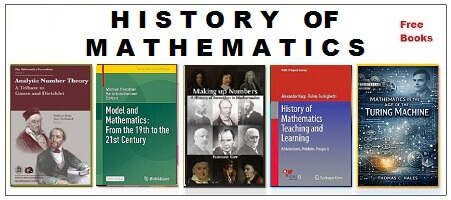

# 📚 Free History of Mathematics Books & Resources

Welcome to the **History of Mathematics Collection** by Free Mathematics Books.

This repository maintains a curated catalogue of freely accessible books and educational resources exploring the historical development of mathematics, mathematical ideas, number systems, mathematical logic, computation, and the lives and work of mathematicians.

These resources are intended for students, independent learners, mathematics educators, researchers, and anyone interested in understanding how mathematical knowledge has evolved through history.

Each entry identifies the available resource, its author or editor details, and a link to its corresponding resource page.

This repository also welcomes suggestions, corrections, and contributions that help improve the accuracy and usefulness of the collection.

📖 **[Explore the Complete Free History of Mathematics Collection](https://freemathematicsbooks.com/A.aspx?Id=Math-History&utm_source=github&utm_medium=referral&utm_campaign=Math-History&utm_content=introduction)**

---

## 📂 Explore Related Mathematics Collections

The history of mathematics is closely connected with the development of many mathematical disciplines. Explore these related collections for additional textbooks and resources.

| Related Subject | 📚 Online Collection | 📁 GitHub Folder |
| :--- | :--- | :--- |
| **Number Theory** | [Explore Books](https://freemathematicsbooks.com/A.aspx?Id=Number-Theory&utm_source=github&utm_medium=referral&utm_campaign=Math-History&utm_content=related-collections) | [Browse Folder](../Number-Theory/) |
| **Discrete Mathematics** | [Explore Books](https://freemathematicsbooks.com/A.aspx?Id=Discrete-Mathematics&utm_source=github&utm_medium=referral&utm_campaign=Math-History&utm_content=related-collections) | [Browse Folder](../Discrete-Mathematics/) |
| **Abstract Algebra** | [Explore Books](https://freemathematicsbooks.com/A.aspx?Id=Abstract-Algebra&utm_source=github&utm_medium=referral&utm_campaign=Math-History&utm_content=related-collections) | [Browse Folder](../Abstract-Algebra/) |
| **Mathematical Analysis** | [Explore Books](https://freemathematicsbooks.com/A.aspx?Id=Mathematical-Analysis&utm_source=github&utm_medium=referral&utm_campaign=Math-History&utm_content=related-collections) | [Browse Folder](../Mathematical-Analysis/) |
| **Geometry & Topology** | [Explore Books](https://freemathematicsbooks.com/A.aspx?Id=Geometry&utm_source=github&utm_medium=referral&utm_campaign=Math-History&utm_content=related-collections) | [Browse Folder](../Geometry-Topology/) |
| **Applied Mathematics** | [Explore Books](https://freemathematicsbooks.com/A.aspx?Id=Applied-Mathematics&utm_source=github&utm_medium=referral&utm_campaign=Math-History&utm_content=related-collections) | [Browse Folder](../Applied-Mathematics/) |

---

## 📖 Curated History of Mathematics Books

The following books and educational resources are organized into four groups to make it easier to explore different aspects of mathematical history.

### 1. 📘 History of Mathematics Education

Explore the historical development of mathematics education, including teaching methods, learning practices, educational research, and the evolution of mathematics curricula.

- 📖 **[History of Mathematics Teaching and Learning — Alexander Karp & Fulvia Furinghetti](https://freemathematicsbooks.com/B.aspx?FileName=History-Math-Teaching-Learning--Karp--Furinghetti&utm_source=github&utm_medium=referral&utm_campaign=Math-History&utm_content=book-catalogue)**

An open-access survey examining the history of mathematics education as a research field, covering major research directions, educational practices, historical developments, and connections to other disciplines.

---

### 2. 🏛️ Historical Development of Mathematical Ideas

Discover how mathematical concepts developed over time, from ancient arithmetic and early number systems to modern mathematical structures.

- 📖 **[Making up Numbers: A History of Invention in Mathematics — Ekkehard Kopp](https://freemathematicsbooks.com/B.aspx?FileName=A-History-Invention-Math--Ekkehard-Kopp&utm_source=github&utm_medium=referral&utm_campaign=Math-History&utm_content=book-catalogue)**

Traces the historical development of mathematical ideas—including arithmetic, equations, coordinates, complex numbers, infinity, and number systems—from ancient civilizations to modern mathematics.

---

### 3. 💻 Mathematics, Computation & Modern Proofs

Explore the relationship between mathematics and computation, including computer-assisted proofs, algorithms, formal verification, and the changing nature of mathematical research.

- 📖 **[Mathematics in the Age of the Turing Machine — Thomas C. Hales](https://freemathematicsbooks.com/B.aspx?FileName=Mathematics-Age-Turing-Machine--Thomas-Hales&utm_source=github&utm_medium=referral&utm_campaign=Math-History&utm_content=book-catalogue)**

Examines the influence of computers and algorithms on modern mathematical practice, including computer calculation, computer-assisted proofs, trust in computation, and reasoning alongside technology.

---

### 4. 🧠 Mathematicians, Logic & Academic Life

These resources explore influential mathematicians, the development of mathematical logic, intellectual contributions, and the professional experiences of mathematicians.

- 📖 **[Paul Lorenzen — Mathematician and Logician — Gerhard Heinzmann & Gereon Wolters (Editors)](https://freemathematicsbooks.com/B.aspx?FileName=Mathematician-Logician--Paul-Lorenzen&utm_source=github&utm_medium=referral&utm_campaign=Math-History&utm_content=book-catalogue)**

Examines Paul Lorenzen's contributions to the history and philosophy of mathematics and logic, covering constructive mathematics, arithmetic, proof theory, dialogue games, and mathematical foundations.

- 📖 **[The Survival of a Mathematician — Steven G. Krantz](https://freemathematicsbooks.com/B.aspx?FileName=The-Survival-Mathematician--Steven-Krantz&utm_source=github&utm_medium=referral&utm_campaign=Math-History&utm_content=book-catalogue)**

Offers a practical account of the professional life of a mathematician, covering research, teaching, administration, publishing, and academic career development.

---

## 📖 How to Choose a Resource

- **Evolution of Mathematical Concepts & Number Systems:** Start with *Making up Numbers* by Ekkehard Kopp for a broad historical overview of how mathematical inventions emerged.
- **Mathematics Education & Curricula:** Choose *History of Mathematics Teaching and Learning* by Alexander Karp & Fulvia Furinghetti for research and history in math instruction.
- **Computation, Algorithms & Formal Proofs:** Read *Mathematics in the Age of the Turing Machine* by Thomas C. Hales to explore how computing reshapes proof and mathematical practice.
- **Philosophy, Logic & Constructive Foundations:** Explore *Paul Lorenzen — Mathematician and Logician* for constructive mathematics, proof theory, and logical foundations.
- **Academic & Research Career Insight:** Read *The Survival of a Mathematician* by Steven G. Krantz for practical perspectives on academic life and mathematical careers.

---

## 📚 Topics Covered

This collection includes resources covering the following topics:

- History of Mathematics Education and Teaching Practices
- Evolution of Number Systems, Arithmetic, Coordinates, and Infinity
- Historical Development of Equations and Complex Numbers
- Computation, Algorithms, and Computer-Assisted Proofs
- Constructive Mathematics, Proof Theory, and Modern Logic
- Biographies, Intellectual Legacy, and Academic Life of Mathematicians

---

## 📋 Book Selection & Verification

Resources in this catalogue are organized according to their primary subject and educational purpose.

The following considerations guide the organization of this collection:

- **Subject Relevance:** Books are included according to their coverage of the history of mathematics, mathematical logic, computation, or closely related historical and academic subjects.
- **Bibliographic Information:** Book titles and author or editor details are provided to help readers identify the resources.
- **Resource Accessibility:** Links lead to the corresponding book information pages, where availability and access details can be checked.
- **Subject Classification:** Resources are grouped by their primary educational focus to make browsing easier.
- **Link Maintenance:** Broken or outdated links and bibliographic corrections can be reported through GitHub Issues.

---

## 🤝 Contributing to This Repository

Suggestions and contributions are welcome!

You can help improve this collection by:

1. Suggesting freely accessible History of Mathematics books and learning materials.
2. Reporting broken or outdated book links.
3. Correcting book titles, author details, or bibliographic information.
4. Recommending useful resources covering mathematical history, logic, and academic life.
5. Improving the organization and documentation of the repository.

**How to contribute:**

- Open a GitHub Issue to report a problem or suggest a resource.
- Submit a Pull Request with proposed additions or corrections.
- Include the book title, author, and source link when recommending a resource.

Please ensure that suggested materials are freely accessible and that any shared files comply with applicable copyright and licensing terms.

---

## 🧭 Repository Navigation

- [🏠 Back to Repository Root](../../)

---

## 🌐 Explore More Mathematics Resources

- **GitLab:** [Free Mathematics Books Study Guide](https://gitlab.com/mathematics55/FreeMathBooks/-/tree/main) — Subject study guides and topic mirrors.
- **Substack:** [Free Mathematics Books Reading Notes](https://freemathematicsbooks.substack.com/) — Curated reading lists and book highlights.
- **Official Website:** [FreeMathematicsBooks.com](https://freemathematicsbooks.com/?utm_source=github&utm_medium=referral&utm_campaign=FreeMathematicsBooks&utm_content=repository-footer) — Searchable directory of external textbook links.
