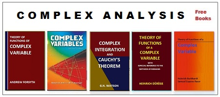

# 📚 Free Complex Analysis Books & Textbook Repository

Welcome to the **Complex Analysis Collection** by Free Mathematics Books.

This repository provides a curated selection of free Complex Analysis textbooks, classical treatises, lecture notes, and supplementary resources covering complex variables and functions, contour integration and residues, applied complex methods, elliptic and theta functions, algebraic functions and Riemann's theory, and automorphic functions.

Resources are organized into subject-based groups to help students, educators, researchers, and independent learners find relevant references for coursework, applied computation, and advanced study.

Each entry identifies the available book, its author, and a link to its corresponding resource page.

📖 **[Explore the Complete Complex Analysis Collection](https://freemathematicsbooks.com/A.aspx?Id=Complex-Analysis&utm_source=github&utm_medium=referral&utm_campaign=Complex-Analysis&utm_content=introduction)**

📚 **[Explore the Complete Mathematical Analysis Collection](https://freemathematicsbooks.com/A.aspx?Id=Mathematical-Analysis&utm_source=github&utm_medium=referral&utm_campaign=Mathematical-Analysis&utm_content=introduction)**

---

## 📖 Curated Complex Analysis Book Catalogue

The following textbooks and resources are organized into three groups according to their focus on core/applied complex variables, elliptic/theta/automorphic functions, and algebraic/Riemann function theory.

### 1. 📘 Core & Applied Complex Variables

Textbooks covering analytic functions, Cauchy's theorem, series expansions, residues, conformal mappings, and physical/engineering applications.

- 📖 **[Complex Variables (2nd Edition) — Robert B. Ash](https://freemathematicsbooks.com/B.aspx?FileName=Complex-Variables--Robert-Ash&utm_source=github&utm_medium=referral&utm_campaign=Complex-Analysis&utm_content=book-catalogue)**

Provides a thorough treatment of holomorphic functions, complex integration, Taylor and Laurent series, residues, conformal mapping, and harmonic functions.

- 📖 **[Complex Variables with Applications — Jeremy Orloff](https://freemathematicsbooks.com/B.aspx?FileName=Complex-Variables-App--Jeremy-Orloff&utm_source=github&utm_medium=referral&utm_campaign=Complex-Analysis&utm_content=book-catalogue)**

Focuses on complex functions, contour integrals, residue calculus, Fourier/Laplace connections, and practical applications in science and engineering.

---

### 2. 🔷 Elliptic, Theta & Automorphic Functions

Specialized texts and classical works examining doubly periodic functions, theta series, and automorphic transformations.

- 📖 **[Abel's Theorem, Allied Theory and Theta Functions — Henry Baker](https://freemathematicsbooks.com/B.aspx?FileName=Abel-Theorem-Theta-Functions--HF-Baker&utm_source=github&utm_medium=referral&utm_campaign=Complex-Analysis&utm_content=book-catalogue)**

A comprehensive treatise on Abelian integrals, Abel's theorem, Riemann surfaces, and theta functions in complex function theory.

- 📖 **[An Elementary Treatise on Elliptic Functions — Arthur Cayley](https://freemathematicsbooks.com/B.aspx?FileName=An-Elementary-Treatise-Elliptic-Functions--Arthur-Cayley&utm_source=github&utm_medium=referral&utm_campaign=Complex-Analysis&utm_content=book-catalogue)**

Develops the theory and formulas of elliptic functions, elliptic integrals, transformations, and modular relations in an accessible treatise.

- 📖 **[An Introduction to the Theory of Automorphic Functions — Lester Ford](https://freemathematicsbooks.com/B.aspx?FileName=Intro-Theory-Automorphic-Functions--Lester-Ford&utm_source=github&utm_medium=referral&utm_campaign=Complex-Analysis&utm_content=book-catalogue)**

Introduces linear fractional transformations, discrete groups, fundamental regions, and automorphic functions on the complex plane.

---

### 3. 📜 Algebraic Functions & Riemann's Theory

Classic exposition connecting complex analysis with algebraic functions, integrals, and Riemann's geometric approach.

- 📖 **[On Riemann's Theory of Algebraic Functions and Their Integrals — Felix Klein](https://freemathematicsbooks.com/B.aspx?FileName=Riemann-Theory-Algebraic-Functions--Felix-Klein&utm_source=github&utm_medium=referral&utm_campaign=Complex-Analysis&utm_content=book-catalogue)**

Presents Riemann's geometric and potential-theoretic approach to algebraic functions, branch points, Riemann surfaces, and their integrals.

---

## 📖 How to Choose a Resource

- **Core Theory & Problem Solving:** Start with *Complex Variables (2nd Edition)* by Robert B. Ash or *Complex Variables with Applications* by Jeremy Orloff.
- **Elliptic, Theta & Automorphic Theory:** Explore *An Elementary Treatise on Elliptic Functions* by Arthur Cayley, *Abel's Theorem, Allied Theory and Theta Functions* by Henry Baker, and *An Introduction to the Theory of Automorphic Functions* by Lester Ford.
- **Riemann Surfaces & Algebraic Functions:** Read *On Riemann's Theory of Algebraic Functions and Their Integrals* by Felix Klein for classical geometric insight.

---

## 📚 Topics Covered

This collection includes resources covering the following topics:

- Holomorphic/Analytic Functions, Cauchy-Riemann Equations, and Harmonic Functions
- Contour Integration, Cauchy's Theorem, Laurent Series, and Residue Calculus
- Conformal Mappings and Applied Complex Analysis
- Elliptic Functions, Theta Functions, and Abel's Theorem
- Automorphic Functions and Linear Fractional Transformations
- Algebraic Functions, Riemann Surfaces, and Abelian Integrals

---

## 📋 Book Selection & Verification

Resources in this catalogue are organized by subject relevance, educational level, and clear bibliographic details. Links direct readers to the corresponding resource pages on Free Mathematics Books, where access details and available formats can be reviewed.

---

## 🤝 Contributing to This Repository

Suggestions and contributions are welcome!

You can help improve this collection by:

1. Suggesting freely accessible Complex Analysis textbooks and learning materials.
2. Reporting broken or outdated book links.
3. Correcting book titles, author names, or bibliographic details.
4. Recommending relevant supplementary complex analysis resources.
5. Improving the organization and documentation of the repository.

**How to contribute:**

- Open a GitHub Issue to report a problem or suggest a resource.
- Submit a Pull Request with proposed additions or corrections.
- Include the book title, author, and source link when suggesting a resource.

Please ensure that submitted materials are freely accessible and that any shared files comply with applicable copyright and licensing terms.

---

## 🧭 Repository Navigation

- [⬅️ Back to Main Mathematical Analysis Category](../)
- [🏠 Back to Home Repository](../../)

---

## 🌐 Explore More Mathematics Resources

- **GitLab:** [Free Mathematics Books Study Guide](https://gitlab.com/mathematics55/FreeMathBooks/-/tree/main) — Subject study guides and topic mirrors.
- **Substack:** [Free Mathematics Books Reading Notes](https://freemathematicsbooks.substack.com/) — Curated reading lists and book highlights.
- **Official Website:** [FreeMathematicsBooks.com](https://freemathematicsbooks.com/?utm_source=github&utm_medium=referral&utm_campaign=FreeMathematicsBooks&utm_content=repository-footer) — Searchable directory of external textbook links.
