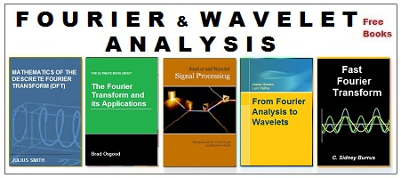

# 📚 Free Fourier Analysis Books & Textbook Repository

Welcome to the **Fourier Analysis Collection** by Free Mathematics Books.

This repository provides a curated selection of free Fourier Analysis textbooks, monographs, lecture notes, and supplementary resources covering Fourier series and integrals, Fourier transforms and applications, discrete Fourier transforms (DFT), wavelets and signal processing, spherical/spheroidal wavelets, and mathematical acoustics/music.

Resources are organized into subject-based groups to help students, educators, researchers, and independent learners find relevant materials for coursework, signal analysis, and self-study.

Each entry identifies the available book, its author, and a link to its corresponding resource page.

📖 **[Explore the Complete Fourier Analysis Collection](https://freemathematicsbooks.com/A.aspx?Id=Fourier-Analysis&utm_source=github&utm_medium=referral&utm_campaign=Fourier-Analysis&utm_content=introduction)**

📚 **[Explore the Complete Mathematical Analysis Collection](https://freemathematicsbooks.com/A.aspx?Id=Mathematical-Analysis&utm_source=github&utm_medium=referral&utm_campaign=Mathematical-Analysis&utm_content=introduction)**

---

## 📖 Curated Fourier Analysis Book Catalogue

The following textbooks and resources are organized into three groups according to their focus on classical/transform theory, discrete/signal/wavelet processing, and specialized/applied domains.

### 1. 📘 Classical Fourier Series, Integrals & Transforms

Textbooks covering periodic expansions, Fourier integrals, transform theory, and mathematical/physical applications.

- 📖 **[Fourier's Series And Integrals — Horatio Carslaw](https://freemathematicsbooks.com/B.aspx?FileName=Fourier-Series-Integrals--Horatio-Carslaw&utm_source=github&utm_medium=referral&utm_campaign=Fourier-Analysis&utm_content=book-catalogue)**

A thorough classical treatment of Fourier series, convergence properties, Fourier integrals, and boundary value problems.

- 📖 **[Lectures on the Fourier Transform & Its Applications — Brad Osgood](https://freemathematicsbooks.com/B.aspx?FileName=Fourier-Transform-Applications--Brad-Osgood&utm_source=github&utm_medium=referral&utm_campaign=Fourier-Analysis&utm_content=book-catalogue)**

Develops the Fourier transform and its core properties alongside applications in optics, imaging, differential equations, and physical systems.

---

### 2. 📡 Discrete Fourier Transform (DFT), Signal Processing & Wavelets

Resources focusing on discrete frequency analysis, digital signal processing, multiresolution analysis, and wavelets.

- 📖 **[Fourier and Wavelet Signal Processing — Martin Vetterli et al.](https://freemathematicsbooks.com/B.aspx?FileName=Fourier-Wavelet-Signal-Processing-Martin-Vetterli&utm_source=github&utm_medium=referral&utm_campaign=Fourier-Analysis&utm_content=book-catalogue)**

Covers continuous and discrete Fourier analysis, sampling, filter banks, time-frequency representations, and wavelet signal processing.

- 📖 **[Mathematics of the Discrete Fourier Transform (DFT) — Julius O. Smith III](https://freemathematicsbooks.com/B.aspx?FileName=Mathematics-DFT--Julius-Smith&utm_source=github&utm_medium=referral&utm_campaign=Fourier-Analysis&utm_content=book-catalogue)**

Explains the mathematical foundations, spectral properties, windowing, and audio/signal applications of the Discrete Fourier Transform.

- 📖 **[Wavelet Analysis on the Sphere: Spheroidal Wavelets — Sabrine Arfaoui et al.](https://freemathematicsbooks.com/B.aspx?FileName=Wavelet-Analysis-Sphere--Sabrine-Arfaoui&utm_source=github&utm_medium=referral&utm_campaign=Fourier-Analysis&utm_content=book-catalogue)**

Explores harmonic and wavelet analysis on spherical domains, focusing on spheroidal wavelets and localized spatial-spectral representations.

---

### 3. 🎵 Music, Acoustics & Harmonic Connections

Interdisciplinary exposition linking harmonic series, frequency ratios, and acoustics with musical structure.

- 📖 **[Music: A Mathematical Offering — David J. Benson](https://freemathematicsbooks.com/B.aspx?FileName=Music-A-Mathematical-Offering--David-Benson&utm_source=github&utm_medium=referral&utm_campaign=Fourier-Analysis&utm_content=book-catalogue)**

Examines sound waves, harmonics, tuning systems, acoustics, and signal/harmonic concepts through mathematical analysis.

---

## 📖 How to Choose a Resource

- **Fourier Series, Integrals & Transform Theory:** Start with *Fourier's Series And Integrals* by Horatio Carslaw or *Lectures on the Fourier Transform & Its Applications* by Brad Osgood.
- **Discrete Fourier Transform & Signal/Audio Processing:** Use *Mathematics of the Discrete Fourier Transform (DFT)* by Julius O. Smith III and *Fourier and Wavelet Signal Processing* by Martin Vetterli et al.
- **Spherical Wavelets & Musical Acoustics:** Read *Wavelet Analysis on the Sphere: Spheroidal Wavelets* by Sabrine Arfaoui et al. for spherical wavelets, and *Music: A Mathematical Offering* by David J. Benson for acoustics and harmonics.

---

## 📚 Topics Covered

This collection includes resources covering the following topics:

- Fourier Series, Convergence, and Fourier Integrals
- Fourier Transform Theory, Convolution, and Physical/Imaging Applications
- Discrete Fourier Transform (DFT), Spectral Analysis, and Sampling
- Wavelet Analysis, Filter Banks, and Signal Processing
- Spheroidal Wavelets and Harmonic Analysis on the Sphere
- Acoustics, Harmonics, and Mathematical Foundations of Music

---

## 📋 Book Selection & Verification

Resources in this catalogue are organized by subject relevance, educational level, and clear bibliographic details. Links direct readers to the corresponding resource pages on Free Mathematics Books, where access details and available formats can be reviewed.

---

## 🤝 Contributing to This Repository

Suggestions and contributions are welcome!

You can help improve this collection by:

1. Suggesting freely accessible Fourier Analysis textbooks and learning materials.
2. Reporting broken or outdated book links.
3. Correcting book titles, author names, or bibliographic details.
4. Recommending relevant supplementary Fourier analysis resources.
5. Improving the organization and documentation of the repository.

**How to contribute:**

- Open a GitHub Issue to report a problem or suggest a resource.
- Submit a Pull Request with proposed additions or corrections.
- Include the book title, author, and source link when suggesting a resource.

Please ensure that submitted materials are freely accessible and that any shared files comply with applicable copyright and licensing terms.

---

## 🧭 Repository Navigation

- [⬅️ Back to Main Mathematical-Analysis Category](../)
- [🏠 Back to Home Repository](../../../../)

---

## 🌐 Explore More Mathematics Resources

**GitHub Collection:** [Free Math Books Repository](https://github.com/FreeMathBooks/free-math-books-collection)

**Substack Publication:** [Free Mathematics Books](https://freemathematicsbooks.substack.com/)

Discover additional free textbooks and educational materials through **[Free Mathematics Books](https://freemathematicsbooks.com/?utm_source=github&utm_medium=referral&utm_campaign=FreeMathematicsBooks&utm_content=repository-footer)**.
