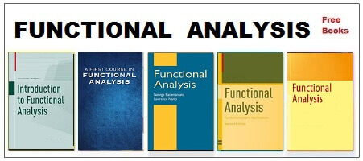

# 📚 Free Functional Analysis Books & Textbook Repository

Welcome to the **Functional Analysis Collection** by Free Mathematics Books.

This repository provides a curated selection of free Functional Analysis textbooks, monographs, lecture notes, and supplementary resources covering evolution and hyperbolic equations, differential and integral equations, operator semigroups and Picard's theorem, spectral geometry of partial differential operators, dynamical flows, and variational analysis.

Resources are organized into subject-based groups to help students, educators, researchers, and independent learners find relevant materials for coursework, operator/analytic study, and research.

Each entry identifies the available book, its author, and a link to its corresponding resource page.

📖 **[Explore the Complete Functional Analysis Collection](https://freemathematicsbooks.com/A.aspx?Id=Functional-Analysis&utm_source=github&utm_medium=referral&utm_campaign=Functional-Analysis&utm_content=introduction)**

📚 **[Explore the Complete Mathematical Analysis Collection](https://freemathematicsbooks.com/A.aspx?Id=Mathematical-Analysis&utm_source=github&utm_medium=referral&utm_campaign=Mathematical-Analysis&utm_content=introduction)**

---

## 📖 Curated Functional Analysis Book Catalogue

The following textbooks and resources are organized into three groups according to their focus on evolution/differential-integral equations, spectral/dynamical operator methods, and variational analysis.

### 1. 📘 Evolution Equations, Semigroups & Integral/Differential Equations

Textbooks and lecture notes treating abstract Cauchy/evolution problems, operator methods, and differential and integral equations.

- 📖 **[Beyond PDEs: Hyperbolic Evolution Equations — Horst R. Beyer](https://freemathematicsbooks.com/B.aspx?FileName=Abstract-Hyperbolic-Evolution-Eqs--Horst-Beyer&utm_source=github&utm_medium=referral&utm_campaign=Functional-Analysis&utm_content=book-catalogue)**

Develops functional-analytic formulations of hyperbolic evolution equations and abstract wave-type systems in Hilbert and Banach spaces.

- 📖 **[Differential and Integral Equations — Stefan Schwabik](https://freemathematicsbooks.com/B.aspx?FileName=Diff-Int-Eqs--S-Schwabik&utm_source=github&utm_medium=referral&utm_campaign=Functional-Analysis&utm_content=book-catalogue)**

Covers ordinary differential equations, Volterra and Fredholm integral equations, generalized functions, and functional-analytic solution techniques.

- 📖 **[Evolutionary Equations and Picard’s Theorem — Christian Seifert](https://freemathematicsbooks.com/B.aspx?FileName=Evolutionary-Equations--Christian-Seifert&utm_source=github&utm_medium=referral&utm_campaign=Functional-Analysis&utm_content=book-catalogue)**

Introduces operator-based evolutionary equations, accretive/monotone operators, and existence/uniqueness via Picard's theorem.

---

### 2. 🔷 Spectral Geometry & Dynamical Flows

Advanced monographs connecting functional analysis with spectral theory of differential operators and flow dynamics.

- 📖 **[Spectral Geometry of Partial Differential Operators — Michael Ruzhansky](https://freemathematicsbooks.com/B.aspx?FileName=Spectral-Geometry-PDO--Michael-Ruzhansky&utm_source=github&utm_medium=referral&utm_campaign=Functional-Analysis&utm_content=book-catalogue)**

Examines eigenvalues, spectral asymptotics, and geometric properties of partial differential operators on manifolds and domains.

- 📖 **[Topics in Dynamics I: Flows — Edward Nelson](https://freemathematicsbooks.com/B.aspx?FileName=Topics-Dynamics-I-Flows--Edward-Nelson&utm_source=github&utm_medium=referral&utm_campaign=Functional-Analysis&utm_content=book-catalogue)**

Investigates dynamical systems, vector fields, flows, and analytic/topological behavior of continuous-time evolution.

---

### 3. 📐 Variational Analysis

Comprehensive treatment of convex, nonsmooth, and variational analysis in finite and infinite dimensions.

- 📖 **[Variational Analysis — R. Tyrrell Rockafellar & Roger J-B. Wets](https://freemathematicsbooks.com/B.aspx?FileName=Variational-Analysis--Tyrrell-Rockafellar&utm_source=github&utm_medium=referral&utm_campaign=Functional-Analysis&utm_content=book-catalogue)**

A foundational reference covering set-valued mappings, subdifferentials, epigraphical convergence, duality, and variational optimization.

---

## 📖 How to Choose a Resource

- **Evolution & Differential/Integral Equations:** Start with *Evolutionary Equations and Picard’s Theorem* by Christian Seifert, *Differential and Integral Equations* by Stefan Schwabik, or *Beyond PDEs: Hyperbolic Evolution Equations* by Horst R. Beyer.
- **Spectral Theory & Dynamical Flows:** Explore *Spectral Geometry of Partial Differential Operators* by Michael Ruzhansky and *Topics in Dynamics I: Flows* by Edward Nelson.
- **Variational & Nonsmooth Analysis:** Use *Variational Analysis* by R. Tyrrell Rockafellar & Roger J-B. Wets for variational principles, subdifferentials, and optimization theory.

---

## 📚 Topics Covered

This collection includes resources covering the following topics:

- Abstract Hyperbolic and Evolutionary Equations
- Differential and Volterra/Fredholm Integral Equations
- Operator Theory, Semigroups, and Picard's Theorem
- Spectral Geometry and Eigenvalues of Partial Differential Operators
- Continuous-Time Flows and Dynamical Systems
- Variational Analysis, Subdifferentials, and Set-Valued Mappings

---

## 📋 Book Selection & Verification

Resources in this catalogue are organized by subject relevance, educational level, and clear bibliographic details. Links direct readers to the corresponding resource pages on Free Mathematics Books, where access details and available formats can be reviewed.

---

## 🤝 Contributing to This Repository

Suggestions and contributions are welcome!

You can help improve this collection by:

1. Suggesting freely accessible Functional Analysis textbooks and learning materials.
2. Reporting broken or outdated book links.
3. Correcting book titles, author names, or bibliographic details.
4. Recommending relevant supplementary functional analysis resources.
5. Improving the organization and documentation of the repository.

**How to contribute:**

- Open a GitHub Issue to report a problem or suggest a resource.
- Submit a Pull Request with proposed additions or corrections.
- Include the book title, author, and source link when suggesting a resource.

Please ensure that submitted materials are freely accessible and that any shared files comply with applicable copyright and licensing terms.

---

## 🧭 Repository Navigation

- [⬅️ Back to Main Mathematical-Analysis Category](../)
- [🏠 Back to Home Repository](../../../../)

---

## 🌐 Explore More Mathematics Resources

**GitHub Collection:** [Free Math Books Repository](https://github.com/FreeMathBooks/free-math-books-collection)

**Substack Publication:** [Free Mathematics Books](https://freemathematicsbooks.substack.com/)

Discover additional free textbooks and educational materials through **[Free Mathematics Books](https://freemathematicsbooks.com/?utm_source=github&utm_medium=referral&utm_campaign=FreeMathematicsBooks&utm_content=repository-footer)**.
