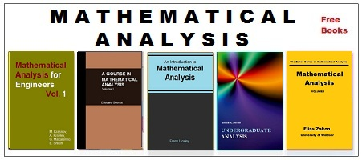

# 📚 Free Mathematical Analysis Books & Textbook Repository

Welcome to the **Mathematical Analysis Collection** by Free Mathematics Books.

This repository maintains a curated catalogue of freely accessible mathematical analysis textbooks, classical treatises, lecture materials, and supplementary academic resources.

The collection covers foundational real analysis, classical mathematical analysis, complex functions, special functions, Fourier analysis, functional analysis, measure theory, and other advanced mathematical topics.

Resources are organized into subject-based categories to help students, educators, researchers, and independent learners discover relevant mathematical references.

Each book entry includes its title, author information, and a link to its corresponding resource page.

This repository also welcomes suggestions, corrections, and contributions that help improve the accuracy and usefulness of the collection.

📖 **[Explore the Complete Free Mathematical Analysis Collection](https://freemathematicsbooks.com/A.aspx?Id=Mathematical-Analysis&utm_source=github&utm_medium=referral&utm_campaign=Mathematical-Analysis&utm_content=introduction)**

---

## 📂 Browse Mathematical Analysis Collections

The following directories organize resources by their primary mathematical subject.

| Subcategory | 📚 Online Collection | 📁 GitHub Folder |
| :--- | :--- | :--- |
| **Real Analysis** | [View Books](https://freemathematicsbooks.com/A.aspx?Id=Real-Analysis&utm_source=github&utm_medium=referral&utm_campaign=Real-Analysis) | [Explore Folder](./Real-Analysis) |
| **Complex Analysis** | [View Books](https://freemathematicsbooks.com/A.aspx?Id=Complex-Analysis&utm_source=github&utm_medium=referral&utm_campaign=Complex-Analysis) | [Explore Folder](./Complex-Analysis) |
| **Fourier Analysis** | [View Books](https://freemathematicsbooks.com/A.aspx?Id=Fourier-Analysis&utm_source=github&utm_medium=referral&utm_campaign=Fourier-Analysis) | [Explore Folder](./Fourier-Analysis) |
| **Functional Analysis** | [View Books](https://freemathematicsbooks.com/A.aspx?Id=Functional-Analysis&utm_source=github&utm_medium=referral&utm_campaign=Functional-Analysis) | [Explore Folder](./Functional-Analysis) |

---

## 📖 Curated Mathematical Analysis Book Catalogue

The following textbooks and classical mathematical works are organized into four groups according to their primary mathematical subject, theoretical focus, and educational purpose.

### 1. 📘 Foundations & Classical Real Analysis

Foundational resources covering classical analysis, real variables, mathematical inequalities, differential calculus, and fundamental analytical concepts.

- 📖 **[Analytical Institutions in Four Books — Maria Gaetana Agnesi](https://freemathematicsbooks.com/B.aspx?FileName=Analytical-Institutions-Four-Books--Maria-Agnesi&utm_source=github&utm_medium=referral&utm_campaign=Mathematical-Analysis&utm_content=book-catalogue)**

A historical mathematical treatise covering algebra, analytic geometry, infinitesimal analysis, differential calculus, and integral calculus.

- 📖 **[Cours d'Analyse de l'École Polytechnique 1: Différentiel — Camille Jordan](https://freemathematicsbooks.com/B.aspx?FileName=Cours-Analyse-Polytechnique-1-Differentiel--Camille-Jordan&utm_source=github&utm_medium=referral&utm_campaign=Mathematical-Analysis&utm_content=book-catalogue)**

Covers real and complex variables, infinite series, Taylor series, and their geometrical applications.

- 📖 **[Inequalities (1st Edition) — G. H. Hardy, J. E. Littlewood & G. Pólya](https://freemathematicsbooks.com/B.aspx?FileName=Inequalities-Mathematical-Analysis--George-Polya&utm_source=github&utm_medium=referral&utm_campaign=Mathematical-Analysis&utm_content=book-catalogue)**

A classical reference covering mean values, convex functions, inequalities involving infinite series and integrals, and related analytical methods.

- 📖 **[Mathematical Analysis I — Elias Zakon](https://freemathematicsbooks.com/B.aspx?FileName=Mathematical-Analysis-I--Elias-Zakon&utm_source=github&utm_medium=referral&utm_campaign=Mathematical-Analysis&utm_content=book-catalogue)**

Introduces set theory, real numbers, vector spaces, metric spaces, function limits, continuity, differentiation, and foundational analysis.

---

### 2. 📐 Integral, Differential & Classical Analysis

Resources exploring integration, differential equations, infinite series, mathematical physics, and classical analytical methods.

- 📖 **[Cours d'Analyse de l'École Polytechnique 2: Intégral — Camille Jordan](https://freemathematicsbooks.com/B.aspx?FileName=Cours-Analyse-Polytechnique-2-Integral--Camille-Jordan&utm_source=github&utm_medium=referral&utm_campaign=Mathematical-Analysis&utm_content=book-catalogue)**

Covers indefinite and definite integrals, Fourier series, complex integrals, elliptic functions, and Abelian integrals.

- 📖 **[Cours d'Analyse de l'École Polytechnique 3: Équations — Camille Jordan](https://freemathematicsbooks.com/B.aspx?FileName=Cours-Analyse-Polytechnique-3-Equations--Camille-Jordan&utm_source=github&utm_medium=referral&utm_campaign=Mathematical-Analysis&utm_content=book-catalogue)**

Explores ordinary and partial differential equations, linear equations, and calculus of variations.

- 📖 **[Traité d'Analyse I — Émile Picard](https://freemathematicsbooks.com/B.aspx?FileName=Traite-Analyse-I--Emile-Picard&utm_source=github&utm_medium=referral&utm_campaign=Mathematical-Analysis&utm_content=book-catalogue)**

Covers definite and indefinite integrals, multiple integrals, Laplace's equation, trigonometric series, curvature, and surfaces.

- 📖 **[Traité d'Analyse III — Émile Picard](https://freemathematicsbooks.com/B.aspx?FileName=Traite-Analyse-III--Emile-Picard&utm_source=github&utm_medium=referral&utm_campaign=Mathematical-Analysis&utm_content=book-catalogue)**

Focuses on ordinary differential equations, singularities, linear and nonlinear equations, hypergeometric functions, and analytical solution methods.

---

### 3. 📖 Complex Analysis & Special Functions

Advanced resources covering complex variables, analytic functions, infinite series, special functions, and their mathematical applications.

- 📖 **[A Course of Modern Analysis — E. T. Whittaker & G. N. Watson](https://freemathematicsbooks.com/B.aspx?FileName=A-Course-Modern-Analysis--Edmund-Whittaker&utm_source=github&utm_medium=referral&utm_campaign=Mathematical-Analysis&utm_content=book-catalogue)**

A classical reference covering convergence, complex numbers, analytic functions, residue theory, Fourier series, and special functions.

- 📖 **[A Treatise on the Theory of Bessel Functions — G. N. Watson](https://freemathematicsbooks.com/B.aspx?FileName=Theory-Bessel-Functions--GN-Watson&utm_source=github&utm_medium=referral&utm_campaign=Mathematical-Analysis&utm_content=book-catalogue)**

A specialized mathematical treatise covering Bessel functions, Bessel differential equations, integral representations, asymptotic expansions, and related special functions.

- 📖 **[Traité d'Analyse II — Émile Picard](https://freemathematicsbooks.com/B.aspx?FileName=Traite-Analyse-II--Emile-Picard&utm_source=github&utm_medium=referral&utm_campaign=Mathematical-Analysis&utm_content=book-catalogue)**

Explores complex functions, analytic continuation, harmonic functions, conformal representation, Riemann surfaces, and Abelian integrals.

---

### 4. 🧠 Measure, Functional & Advanced Analysis

Specialized resources covering measure theory, measurable functions, infinite-dimensional spaces, operator theory, and mathematical foundations of quantum information.

- 📖 **[Mathematical Analysis II — Elias Zakon](https://freemathematicsbooks.com/B.aspx?FileName=Mathematical-Analysis-II--Elias-Zakon&utm_source=github&utm_medium=referral&utm_campaign=Mathematical-Analysis&utm_content=book-catalogue)**

Covers differentiation in higher-dimensional and normed linear spaces, measure theory, measurable functions, integration, and advanced calculus using Lebesgue theory.

- 📖 **[The Functional Analysis of Quantum Information Theory — Ved Prakash Gupta, Prabha Mandayam & V. S. Sunder](https://freemathematicsbooks.com/B.aspx?FileName=Quantum-Info-Theory--Gupta--Mandayam--Sunder&utm_source=github&utm_medium=referral&utm_campaign=Mathematical-Analysis&utm_content=book-catalogue)**

Explores operator spaces, operator systems, entanglement, functional analysis, and mathematical foundations of quantum information theory.

---

## 📖 How to Choose a Resource

- **Undergraduate Real Analysis:** Start with *Mathematical Analysis I* by Elias Zakon for a clear, modern introduction to real numbers, metric spaces, limits, continuity, and differentiation.
- **Classical Analysis & Historical Treatises:** Explore the multi-volume works of Camille Jordan (*Cours d'Analyse*) and Émile Picard (*Traité d'Analyse*), or Maria Gaetana Agnesi's *Analytical Institutions*.
- **Inequalities & Analytical Techniques:** Study *Inequalities* by Hardy, Littlewood, and Pólya for foundational theorems and problem-solving methods.
- **Complex Variables & Special Functions:** Use *A Course of Modern Analysis* by Whittaker & Watson and *A Treatise on the Theory of Bessel Functions* by G. N. Watson for analytic functions, residues, and special functions.
- **Measure Theory, Lebesgue Integration & Functional Analysis:** Advance to *Mathematical Analysis II* by Elias Zakon and *The Functional Analysis of Quantum Information Theory* for higher-dimensional and operator theory.

---

## 📚 Topics Covered

This collection includes resources covering the following topics:

- Real Numbers, Set Theory, and Metric Spaces
- Sequences, Infinite Series, and Convergence
- Limits, Continuity, and Differentiation
- Analytical Inequalities and Convex Functions
- Definite, Indefinite, and Multiple Integrals
- Fourier Series and Trigonometric Expansions
- Complex Variables, Analytic Functions, and Residue Theory
- Conformal Mapping, Riemann Surfaces, and Harmonic Functions
- Bessel Functions, Hypergeometric Functions, and Special Functions
- Ordinary and Partial Differential Equations in Analysis
- Measure Theory, Measurable Functions, and Lebesgue Integration
- Normed Linear Spaces, Operator Theory, and Functional Analysis

---

## 📋 Book Selection & Verification

Resources in this catalogue are organized according to their primary mathematical subject and educational purpose.

The following considerations guide the organization of this collection:

- **Subject Relevance:** Books are included according to their coverage of real analysis, complex analysis, functional analysis, classical analysis, or closely related mathematical fields.
- **Bibliographic Information:** Book titles and author details are provided to help readers identify the resources.
- **Resource Accessibility:** Links lead to the corresponding book information pages, where availability and access details can be checked.
- **Subject Classification:** Books are grouped by their primary mathematical focus to make browsing easier.
- **Link Maintenance:** Broken or outdated links and bibliographic corrections can be reported through GitHub Issues.

---

## 🤝 Contributing to This Repository

Suggestions and contributions are welcome!

You can help improve this collection by:

1. Suggesting freely accessible Mathematical Analysis textbooks and academic resources.
2. Reporting broken or outdated book links.
3. Correcting book titles, author names, or bibliographic information.
4. Recommending resources covering real analysis, complex analysis, Fourier analysis, and functional analysis.
5. Improving the organization and documentation of the repository.

**How to contribute:**

- Open a GitHub Issue to report a problem or suggest a resource.
- Submit a Pull Request with proposed additions or corrections.
- Include the book title, author, and source link when recommending a resource.

Please ensure that suggested materials are freely accessible and that any shared files comply with applicable copyright and licensing terms.

---

## 🔙 Repository Navigation

- [🏠 Back to Repository Root](../)

---

## 🌐 Explore More Mathematics Resources

**GitHub Collection:** [Free Math Books Repository](https://github.com/FreeMathBooks/free-math-books-collection)

**Substack Publication:** [Free Mathematics Books](https://freemathematicsbooks.substack.com/)

Discover additional free textbooks and educational materials through **[Free Mathematics Books](https://freemathematicsbooks.com/?utm_source=github&utm_medium=referral&utm_campaign=FreeMathematicsBooks&utm_content=repository-footer)**.
