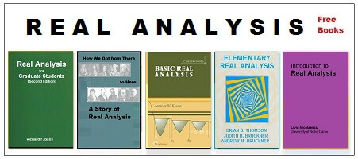

# 📚 Free Real Analysis Books & Textbook Repository

Welcome to the **Real Analysis Collection** by Free Mathematics Books.

This repository provides a curated selection of free Real Analysis textbooks, monographs, historical expositions, and supplementary resources covering limits, continuity, sequences and series, differentiation and Riemann integration, multivariable and metric analysis, historical foundations, orders of infinity, and measure and Lebesgue integration.

Resources are organized into subject-based groups to help students, educators, researchers, and independent learners find relevant materials for coursework, proof-writing, and self-study.

Each entry identifies the available book, its author, and a link to its corresponding resource page.

📖 **[Explore the Complete Real Analysis Collection](https://freemathematicsbooks.com/A.aspx?Id=Real-Analysis&utm_source=github&utm_medium=referral&utm_campaign=Real-Analysis&utm_content=introduction)**

📚 **[Explore the Complete Mathematical Analysis Collection](https://freemathematicsbooks.com/A.aspx?Id=Mathematical-Analysis&utm_source=github&utm_medium=referral&utm_campaign=Mathematical-Analysis&utm_content=introduction)**

---

## 📖 Curated Real Analysis Book Catalogue

The following textbooks and resources are organized into three groups according to their analytical scope, level, and theoretical focus.

### 1. 📘 Core & Undergraduate Real Analysis

Textbooks introducing rigorous real analysis, limits, continuity, differentiation, integration, sequences, and series.

- 📖 **[Basic Analysis: Introduction to Real Analysis I — Jiri Lebl](https://freemathematicsbooks.com/B.aspx?FileName=Intro-Real-Analysis-I--Jiri-Lebl&utm_source=github&utm_medium=referral&utm_campaign=Real-Analysis&utm_content=book-catalogue)**

A clear, student-focused introduction to single-variable real analysis covering real numbers, sequences, series, limits, continuity, differentiation, and Riemann integration.

- 📖 **[Basic Analysis: Introduction to Real Analysis II — Jiri Lebl](https://freemathematicsbooks.com/B.aspx?FileName=Intro-Real-Analysis-II--Jiri-Lebl&utm_source=github&utm_medium=referral&utm_campaign=Real-Analysis&utm_content=book-catalogue)**

Continues into metric spaces, sequences and series of functions, power series, Fourier series, and multivariable differentiation and integration.

- 📖 **[Introduction to Real Analysis — William F. Trench](https://freemathematicsbooks.com/B.aspx?FileName=Real-Analysis--William-Trench&utm_source=github&utm_medium=referral&utm_campaign=Real-Analysis&utm_content=book-catalogue)**

Covers real number axioms, limits, continuity, derivatives, Riemann integrals, infinite series, and uniform convergence with structured proofs and exercises.

---

### 2. 📜 Classical Foundations, Orders of Infinity & Historical Context

Classic treatises and historical narratives illuminating proof foundations, growth rates, and the evolution of analysis.

- 📖 **[A Course of Pure Mathematics — G.H. Hardy](https://freemathematicsbooks.com/B.aspx?FileName=Course-Pure-Mathematics--GH-Hardy&utm_source=github&utm_medium=referral&utm_campaign=Real-Analysis&utm_content=book-catalogue)**

A classic introduction to rigorous analysis covering real and complex numbers, limits, continuity, differential and integral calculus, and infinite series.

- 📖 **[How We Got from There to Here: A Story of Real Analysis — Eugene Boman and Robert Rogers](https://freemathematicsbooks.com/B.aspx?FileName=Story-Real-Analysis--Boman--Rogers&utm_source=github&utm_medium=referral&utm_campaign=Real-Analysis&utm_content=book-catalogue)**

Traces the historical development of calculus and real analysis, showing how paradoxes and rigor shaped modern definitions of limits, continuity, and integrals.

- 📖 **[Orders of Infinity — G. H. Hardy](https://freemathematicsbooks.com/B.aspx?FileName=Orders-Infinity--GH-Hardy&utm_source=github&utm_medium=referral&utm_campaign=Real-Analysis&utm_content=book-catalogue)**

Examines growth rates of functions, scales of infinity, and asymptotic comparison using logarithmic, exponential, and algebraic functions.

---

### 3. 📐 Measure Theory & Lebesgue Integration

Graduate-level texts developing abstract measure spaces, Lebesgue integration, and modern integration theory.

- 📖 **[An Introduction to Measure Theory — Terrence Tao](https://freemathematicsbooks.com/B.aspx?FileName=Measure-Theory--Terrence-Tao&utm_source=github&utm_medium=referral&utm_campaign=Real-Analysis&utm_content=book-catalogue)**

Presents measure theory, Lebesgue integration, convergence theorems, and key analytic principles with intuition, examples, and exercises.

- 📖 **[Measure, Integration & Real Analysis — Sheldon Axler](https://freemathematicsbooks.com/B.aspx?FileName=Measure-Int-Real-Analysis--Sheldon-Axler&utm_source=github&utm_medium=referral&utm_campaign=Real-Analysis&utm_content=book-catalogue)**

Provides a modern, self-contained treatment of measures, integration, Hilbert and Banach spaces, differentiation, and Lp spaces.

---

## 📖 How to Choose a Resource

- **First Course in Real Analysis:** Start with *Basic Analysis: Introduction to Real Analysis I* by Jiri Lebl or *Introduction to Real Analysis* by William F. Trench.
- **Metric Spaces, Function Series & Multivariable Analysis:** Move on to *Basic Analysis: Introduction to Real Analysis II* by Jiri Lebl.
- **History, Classical Rigor & Growth Rates:** Read *How We Got from There to Here* by Boman & Rogers for historical context, *A Course of Pure Mathematics* by G. H. Hardy for classic rigor, and *Orders of Infinity* by G. H. Hardy for asymptotic growth.
- **Measure & Lebesgue Integration:** Choose *Measure, Integration & Real Analysis* by Sheldon Axler or *An Introduction to Measure Theory* by Terrence Tao.

---

## 📚 Topics Covered

This collection includes resources covering the following topics:

- Real Numbers, Limits, Continuity, Sequences, and Infinite Series
- Differentiation, Riemann Integration, Uniform Convergence, and Function Series
- Metric Spaces, Power Series, Fourier Series, and Multivariable Analysis
- Historical Evolution of Analysis and Asymptotic Orders of Infinity
- Measure Theory, Lebesgue Integration, Convergence Theorems, and Function Spaces

---

## 📋 Book Selection & Verification

Resources in this catalogue are organized by subject relevance, educational level, and clear bibliographic details. Links direct readers to the corresponding resource pages on Free Mathematics Books, where access details and available formats can be reviewed.

---

## 🤝 Contributing to This Repository

Suggestions and contributions are welcome!

You can help improve this collection by:

1. Suggesting freely accessible Real Analysis textbooks and learning materials.
2. Reporting broken or outdated book links.
3. Correcting book titles, author names, or bibliographic details.
4. Recommending relevant supplementary real analysis resources.
5. Improving the organization and documentation of the repository.

**How to contribute:**

- Open a GitHub Issue to report a problem or suggest a resource.
- Submit a Pull Request with proposed additions or corrections.
- Include the book title, author, and source link when suggesting a resource.

Please ensure that submitted materials are freely accessible and that any shared files comply with applicable copyright and licensing terms.

---

## 🧭 Repository Navigation

- [⬅️ Back to Main Mathematical Analysis Category](../)
- [🏠 Back to Home Repository](../../)

---

## 🌐 Explore More Mathematics Resources

- **GitLab:** [Free Mathematics Books Study Guide](https://gitlab.com/mathematics55/FreeMathBooks/-/tree/main) — Subject study guides and topic mirrors.
- **Substack:** [Free Mathematics Books Reading Notes](https://freemathematicsbooks.substack.com/) — Curated reading lists and book highlights.
- **Official Website:** [FreeMathematicsBooks.com](https://freemathematicsbooks.com/?utm_source=github&utm_medium=referral&utm_campaign=FreeMathematicsBooks&utm_content=repository-footer) — Searchable directory of external textbook links.
