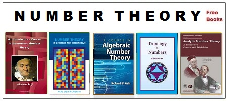

# 📚 Free Number Theory Books & Textbook Repository

Welcome to the **Number Theory Collection** by Free Mathematics Books.

This repository maintains a curated catalogue of freely accessible number theory textbooks, lecture notes, and supplementary educational resources for students, independent learners, instructors, and researchers.

The collection covers elementary number theory, divisibility, prime numbers, congruences, computational number theory, cryptology, elliptic curves, analytic number theory, and classical mathematical topics.

Resources are organized into subject-based groups to help readers find relevant mathematical and computer science references.

Each book entry includes its title, author information, and a link to its corresponding resource page.

This repository also welcomes suggestions, corrections, and contributions that help improve the accuracy and usefulness of the collection.

📖 **[Explore the Complete Free Number Theory Collection](https://freemathematicsbooks.com/A.aspx?Id=Number-Theory&utm_source=github&utm_medium=referral&utm_campaign=Number-Theory&utm_content=introduction)**

---

## 📂 Explore Related Mathematics Collections

Number Theory connects naturally with several other areas of mathematics. Explore these related collections for additional textbooks and learning resources.

| Related Subject | 📚 Online Collection | 📁 GitHub Folder |
| :--- | :--- | :--- |
| **Abstract Algebra** | [Explore Books](https://freemathematicsbooks.com/A.aspx?Id=Abstract-Algebra&utm_source=github&utm_medium=referral&utm_campaign=Number-Theory&utm_content=related-collections) | [Browse Folder](../Abstract-Algebra/) |
| **Discrete Mathematics** | [Explore Books](https://freemathematicsbooks.com/A.aspx?Id=Discrete-Mathematics&utm_source=github&utm_medium=referral&utm_campaign=Number-Theory&utm_content=related-collections) | [Browse Folder](../Discrete-Mathematics/) |
| **Mathematical Analysis** | [Explore Books](https://freemathematicsbooks.com/A.aspx?Id=Mathematical-Analysis&utm_source=github&utm_medium=referral&utm_campaign=Number-Theory&utm_content=related-collections) | [Browse Folder](../Mathematical-Analysis/) |
| **Geometry & Topology** | [Explore Books](https://freemathematicsbooks.com/A.aspx?Id=Geometry&utm_source=github&utm_medium=referral&utm_campaign=Number-Theory&utm_content=related-collections) | [Browse Folder](../Geometry-Topology/) |
| **Applied Mathematics** | [Explore Books](https://freemathematicsbooks.com/A.aspx?Id=Applied-Mathematics&utm_source=github&utm_medium=referral&utm_campaign=Number-Theory&utm_content=related-collections) | [Browse Folder](../Applied-Mathematics/) |

---

## 📖 Curated Number Theory Books

The following textbooks and supplementary resources are organized into four groups according to their primary mathematical subject, theoretical focus, and educational purpose.

### 1. 📘 Foundations & Introductory Number Theory

Books introducing the fundamental concepts of number theory, including integers, prime numbers, divisibility, congruences, and elementary proofs.

- 📖 **[A Friendly Introduction to Number Theory — Joseph H. Silverman](https://freemathematicsbooks.com/B.aspx?FileName=A-Friendly-Intro-Number-Theory--Joseph-Silverman&utm_source=github&utm_medium=referral&utm_campaign=Number-Theory&utm_content=book-catalogue)**

An accessible introduction to number theory covering divisibility, modular arithmetic, quadratic reciprocity, Fermat's Little Theorem, elliptic curves, and public-key cryptography.

- 📖 **[Elementary Number Theory — William Stein](https://freemathematicsbooks.com/B.aspx?FileName=Elementary-Number-Theory--William-Stein&utm_source=github&utm_medium=referral&utm_campaign=Number-Theory&utm_content=book-catalogue)**

Introduces prime numbers, modular arithmetic, quadratic reciprocity, continued fractions, elliptic curves, and applications to public-key cryptography, with computational examples.

- 📖 **[Number Theory: In Context and Interactive — Karl-Dieter Crisman](https://freemathematicsbooks.com/B.aspx?FileName=Number-Theory-Context-Interactive--Karl-Crisman&utm_source=github&utm_medium=referral&utm_campaign=Number-Theory&utm_content=book-catalogue)**

An interactive textbook connecting elementary number theory with historical context and computational methods. Topics include congruences, prime numbers, Euler's function, primitive roots, cryptography, and quadratic reciprocity.

---

### 2. 💻 Computational Number Theory & Cryptography

Resources exploring the algorithmic side of number theory, computational methods, modular arithmetic, and cryptographic applications.

- 📖 **[A Computational Number Theory & Algebra — Victor Shoup](https://freemathematicsbooks.com/B.aspx?FileName=Comp-Number-Theory-Algebra--Victor-Shoup&utm_source=github&utm_medium=referral&utm_campaign=Number-Theory&utm_content=book-catalogue)**

A comprehensive computational introduction covering integer arithmetic, congruences, prime distribution, probabilistic algorithms, finite fields, discrete logarithms, and algebraic structures.

- 📖 **[Introductory Number Theory Textbook (Cryptology) — Jonathan Poritz](https://freemathematicsbooks.com/B.aspx?FileName=Intro-Number-Theory-Cryptology--Jonathan-Poritz&utm_source=github&utm_medium=referral&utm_campaign=Number-Theory&utm_content=book-catalogue)**

Introduces well-ordering, division, congruences, prime numbers, cryptology, and discrete logarithms, connecting fundamental number theory with modern digital security.

---

### 3. 📈 Elliptic Curves & Modular Arithmetic

A specialized resource for readers interested in computational techniques involving modular forms, modular symbols, and elliptic curves.

- 📖 **[Algorithms for Modular Elliptic Curves — John E. Cremona](https://freemathematicsbooks.com/B.aspx?FileName=Algorithms-Modular-Elliptic-Curves--JE-Cremona&utm_source=github&utm_medium=referral&utm_campaign=Number-Theory&utm_content=book-catalogue)**

A computational reference covering modular forms, modular symbols, Hecke operators, L-series, and algorithms for constructing and studying elliptic curves.

---

### 4. 📚 Classical, Analytic & Recreational Number Theory

Classical works and specialized resources exploring number systems, analytic methods, infinite series, and mathematical patterns.

- 📖 **[Essays on the Theory of Numbers — Richard Dedekind](https://freemathematicsbooks.com/B.aspx?FileName=Essays-Theory-Numbers--Richard-Dedekind&utm_source=github&utm_medium=referral&utm_campaign=Number-Theory&utm_content=book-catalogue)**

A foundational mathematical work discussing rational and irrational numbers, continuity, real numbers, infinite systems, and the foundations of number systems.

- 📖 **[The General Theory of Dirichlet's Series — G. H. Hardy & Marcel Riesz](https://freemathematicsbooks.com/B.aspx?FileName=General-Theory-Dirichlet-Series--GH-Hardy&utm_source=github&utm_medium=referral&utm_campaign=Number-Theory&utm_content=book-catalogue)**

A classical reference in analytic number theory, covering Dirichlet series, convergence, summation methods, and Abelian and Tauberian theorems.

- 📖 **[Magic Squares and Cubes — William Symes Andrews](https://freemathematicsbooks.com/B.aspx?FileName=Magic-Squares-Cubes--Andrews-Symes&utm_source=github&utm_medium=referral&utm_campaign=Number-Theory&utm_content=book-catalogue)**

A classic exploration of magic squares and magic cubes, including their mathematical properties, numerical patterns, construction methods, and recreational applications.

---

## 📖 How to Choose a Resource

- **Beginners & Undergraduate Foundations:** Start with *A Friendly Introduction to Number Theory* by Joseph H. Silverman, *Elementary Number Theory* by William Stein, or *Number Theory: In Context and Interactive* by Karl-Dieter Crisman.
- **Computational Number Theory & Cryptography:** Choose *A Computational Number Theory & Algebra* by Victor Shoup or *Introductory Number Theory Textbook (Cryptology)* by Jonathan Poritz for algorithms, finite fields, and encryption foundations.
- **Elliptic Curves & Modular Forms:** Use *Algorithms for Modular Elliptic Curves* by John E. Cremona for modular symbols, Hecke operators, and elliptic curve computations.
- **Analytic Foundations & Recreational Number Theory:** Explore *Essays on the Theory of Numbers* by Richard Dedekind, *The General Theory of Dirichlet's Series* by Hardy & Riesz, or *Magic Squares and Cubes* by William Symes Andrews.

---

## 📚 Topics Covered

This collection includes resources covering the following topics:

- Divisibility, Prime Numbers, Congruences, and Quadratic Reciprocity
- Euler's Function, Primitive Roots, and Continued Fractions
- Modular Arithmetic, Finite Fields, and Discrete Logarithms
- Computational Number Theory, Probabilistic Algorithms, and Cryptology
- Elliptic Curves, Modular Forms, Modular Symbols, and Hecke Operators
- Foundations of Real and Irrational Numbers and Dirichlet Series
- Magic Squares, Magic Cubes, and Numerical Patterns

---

## 📋 Book Selection & Verification

Resources in this catalogue are organized according to their primary subject and educational purpose.

The following considerations guide the organization of this collection:

- **Subject Relevance:** Books are included according to their coverage of number theory, cryptography, elliptic curves, analytic number theory, or closely related mathematical topics.
- **Bibliographic Information:** Book titles and author details are provided to help readers identify the resources.
- **Resource Accessibility:** Links lead to the corresponding book information pages, where availability and access details can be checked.
- **Subject Classification:** Resources are grouped by their primary educational focus to make browsing easier.
- **Link Maintenance:** Broken or outdated links and bibliographic corrections can be reported through GitHub Issues.

---

## 🤝 Contributing to This Repository

Suggestions and contributions are welcome!

You can help improve this collection by:

1. Suggesting freely accessible Number Theory textbooks and learning materials.
2. Reporting broken or outdated book links.
3. Correcting book titles, author names, or bibliographic information.
4. Recommending useful resources covering elementary, computational, elliptic, or analytic number theory.
5. Improving the organization and documentation of the repository.

**How to contribute:**

- Open a GitHub Issue to report a problem or suggest a resource.
- Submit a Pull Request with proposed additions or corrections.
- Include the book title, author, and source link when recommending a resource.

Please ensure that suggested materials are freely accessible and that any shared files comply with applicable copyright and licensing terms.

---

## 🧭 Repository Navigation

- [🏠 Back to Repository Root](../../)

---

## 🌐 Explore More Mathematics Resources

- **GitLab:** [Free Mathematics Books Study Guide](https://gitlab.com/mathematics55/FreeMathBooks/-/tree/main) — Subject study guides and topic mirrors.
- **Substack:** [Free Mathematics Books Reading Notes](https://freemathematicsbooks.substack.com/) — Curated reading lists and book highlights.
- **Official Website:** [FreeMathematicsBooks.com](https://freemathematicsbooks.com/?utm_source=github&utm_medium=referral&utm_campaign=FreeMathematicsBooks&utm_content=repository-footer) — Searchable directory of external textbook links.
