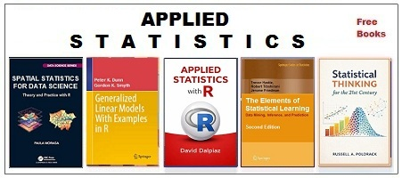

# 📚 Free Applied Statistics Books & Textbook Repository

Welcome to the **Applied Statistics Collection** by Free Mathematics Books.

This repository provides a curated selection of free Applied Statistics textbooks, guides, and supplementary resources covering applied probability, modern statistical inference for data science, spatial statistics in R, stochastic processes in science and engineering, stochastic calculus for finance, and probabilistic machine learning in civil engineering.

Resources are organized into subject-based groups to help students, analysts, engineers, researchers, and independent learners find relevant materials for coursework, applied modeling, and self-study.

Each entry identifies the available book, its author, and a link to its corresponding resource page.

📖 **[Explore the Complete Applied Statistics Collection](https://freemathematicsbooks.com/A.aspx?Id=Applied-Statistics&utm_source=github&utm_medium=referral&utm_campaign=Applied-Statistics&utm_content=introduction)**

📚 **[Explore the Complete Probability and Statistics Collection](https://freemathematicsbooks.com/A.aspx?Id=Probability-Statistics&utm_source=github&utm_medium=referral&utm_campaign=Probability-Statistics&utm_content=introduction)**

---

## 📖 Curated Applied Statistics Book Catalogue

The following textbooks and resources are organized into three groups according to their focus on statistical inference & spatial/data applications, applied probability & stochastic modeling, and engineering/financial stochastic applications.

### 1. 📘 Modern Statistical Inference, Data Science & Spatial Statistics

Textbooks applying statistical reasoning, inference, and spatial methods to data analysis and scientific problems.

- 📖 **[Introduction to Modern Statistics — Rundel & Hardin](https://freemathematicsbooks.com/B.aspx?FileName=Intro-Modern-Statistics--Cetinkaya-Rundel&utm_source=github&utm_medium=referral&utm_campaign=Applied-Statistics&utm_content=book-catalogue)**

An accessible introduction to modern statistics covering data exploration, distributions, hypothesis testing, confidence intervals, and regression modeling.

- 📖 **[Spatial Statistics for Data Science with R — Paula Moraga](https://freemathematicsbooks.com/B.aspx?FileName=Spatial-Statistics-Data-Science--Paula-Moraga&utm_source=github&utm_medium=referral&utm_campaign=Applied-Statistics&utm_content=book-catalogue)**

Covers spatial point patterns, geostatistics, areal data, and spatial statistical modeling using R.

- 📖 **[Statistical Inference for Data Science — Brian Caffo](https://freemathematicsbooks.com/B.aspx?FileName=Statistical-Inference-Data-Science--Brian-Caffo&utm_source=github&utm_medium=referral&utm_campaign=Applied-Statistics&utm_content=book-catalogue)**

Presents probability, likelihood, p-values, confidence intervals, multiple testing, resampling, and Bayesian inference for practical data science.

---

### 2. 📈 Applied Probability & Stochastic Processes

Resources connecting applied probability and stochastic processes with scientific and engineering systems.

- 📖 **[Applied Probability — Paul E Pfeiffer](https://freemathematicsbooks.com/B.aspx?FileName=Applied-Probability--Paul-Pfeiffer&utm_source=github&utm_medium=referral&utm_campaign=Applied-Statistics&utm_content=book-catalogue)**

Develops applied probability concepts, random variables, expectation, conditioning, and probabilistic modeling for engineering and science.

- 📖 **[Applied Stochastic Processes in Science & Engineering — Matt Scott](https://freemathematicsbooks.com/B.aspx?FileName=Applied-Stochastic-Processes-Engineering--Matt-Scott&utm_source=github&utm_medium=referral&utm_campaign=Applied-Statistics&utm_content=book-catalogue)**

Explores Markov chains, continuous-time processes, random walks, and stochastic modeling in physical, biological, and engineering contexts.

---

### 3. 🏗️ Engineering & Financial Stochastic Applications

Domain-specific texts applying probabilistic machine learning and stochastic calculus to civil engineering and finance.

- 📖 **[Probabilistic Machine Learning for Civil Engineers — James A. Goulet](https://freemathematicsbooks.com/B.aspx?FileName=Probabilistic-ML-Civil-Engineers--James-Goulet&utm_source=github&utm_medium=referral&utm_campaign=Applied-Statistics&utm_content=book-catalogue)**

Applies probabilistic inference, Bayesian updating, and machine learning methods to structural monitoring and civil engineering systems.

- 📖 **[Stochastic Calculus with Applications to Finance — Michael Kozdron](https://freemathematicsbooks.com/B.aspx?FileName=Stochastic-Calculus-App-Finance--Michael-Kozdron&utm_source=github&utm_medium=referral&utm_campaign=Applied-Statistics&utm_content=book-catalogue)**

Covers Brownian motion, Itô's lemma, stochastic differential equations, and martingale pricing in quantitative finance.

---

## 📖 How to Choose a Resource

- **Data Science, Inference & Spatial Analysis:** Start with *Introduction to Modern Statistics* by Rundel & Hardin or *Statistical Inference for Data Science* by Brian Caffo, and use *Spatial Statistics for Data Science with R* by Paula Moraga for spatial data.
- **Applied Probability & Stochastic Processes:** Choose *Applied Probability* by Paul E Pfeiffer for core applied probability and *Applied Stochastic Processes in Science & Engineering* by Matt Scott for stochastic processes.
- **Civil Engineering & Quantitative Finance:** Read *Probabilistic Machine Learning for Civil Engineers* by James A. Goulet for engineering applications and *Stochastic Calculus with Applications to Finance* by Michael Kozdron for financial modeling.

---

## 📚 Topics Covered

This collection includes resources covering the following topics:

- Statistical Inference, Hypothesis Testing, Confidence Intervals, and Regression
- Spatial Point Patterns, Geostatistics, and Spatial Modeling in R
- Applied Probability, Random Variables, and Conditioning
- Stochastic Processes, Markov Chains, and Scientific/Engineering Models
- Stochastic Calculus, Itô's Formula, and Financial Applications
- Probabilistic Machine Learning for Civil Engineering

---

## 📋 Book Selection & Verification

Resources in this catalogue are organized by subject relevance, educational level, and clear bibliographic details. Links direct readers to the corresponding resource pages on Free Mathematics Books, where access details and available formats can be reviewed.

---

## 🤝 Contributing to This Repository

Suggestions and contributions are welcome!

You can help improve this collection by:

1. Suggesting freely accessible Applied Statistics textbooks and learning materials.
2. Reporting broken or outdated book links.
3. Correcting book titles, author names, or bibliographic details.
4. Recommending relevant supplementary applied statistics resources.
5. Improving the organization and documentation of the repository.

**How to contribute:**

- Open a GitHub Issue to report a problem or suggest a resource.
- Submit a Pull Request with proposed additions or corrections.
- Include the book title, author, and source link when suggesting a resource.

Please ensure that submitted materials are freely accessible and that any shared files comply with applicable copyright and licensing terms.

---

## 🧭 Repository Navigation

- [⬅️ Back to Main Probability and Statistics Category](../)
- [🏠 Back to Home Repository](../../../../)

---

## 🌐 Explore More Mathematics Resources

**GitHub Collection:** [Free Math Books Repository](https://github.com/FreeMathBooks/free-math-books-collection)

**Substack Publication:** [Free Mathematics Books](https://freemathematicsbooks.substack.com/)

Discover additional free textbooks and educational materials through **[Free Mathematics Books](https://freemathematicsbooks.com/?utm_source=github&utm_medium=referral&utm_campaign=FreeMathematicsBooks&utm_content=repository-footer)**.
