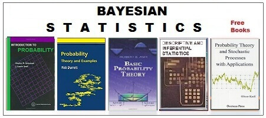

# 📚 Free Bayesian Statistics Books & Textbook Repository

Welcome to the **Bayesian Statistics Collection** by Free Mathematics Books.

This repository provides a curated selection of free Bayesian Statistics textbooks, guides, lecture notes, and supplementary resources covering Bayesian modeling and MCMC inference, probabilistic machine learning, statistical software with jamovi, programmer-oriented statistics, spatial statistics in R, and randomized algorithms.

Resources are organized into subject-based groups to help students, researchers, data practitioners, and independent learners find relevant materials for coursework, modeling, and self-study.

Each entry identifies the available book, its author, and a link to its corresponding resource page.

📖 **[Explore the Complete Bayesian Statistics Collection](https://freemathematicsbooks.com/A.aspx?Id=Bayesian-Statistics&utm_source=github&utm_medium=referral&utm_campaign=Bayesian-Statistics&utm_content=introduction)**

📚 **[Explore the Complete Probability and Statistics Collection](https://freemathematicsbooks.com/A.aspx?Id=Probability-Statistics&utm_source=github&utm_medium=referral&utm_campaign=Probability-Statistics&utm_content=introduction)**

---

## 📖 Curated Bayesian Statistics Book Catalogue

The following textbooks and resources are organized into three groups according to their focus on Bayesian/probabilistic modeling, applied/software/spatial statistics, and algorithmic/programming foundations.

### 1. 📘 Bayesian Modeling & Probabilistic Machine Learning

Resources covering prior/posterior inference, computational Bayesian methods, and probabilistic models.

- 📖 **[Bayesian Methods for Hackers — Cameron Davidson-Pilon](https://freemathematicsbooks.com/B.aspx?FileName=Bayesian-Methods-Hackers--Cameron-Pilon&utm_source=github&utm_medium=referral&utm_campaign=Bayesian-Statistics&utm_content=book-catalogue)**

Introduces Bayesian reasoning, probability distributions, and Markov chain Monte Carlo (MCMC) computation through intuition, examples, and probabilistic modeling.

- 📖 **[Probabilistic Machine Learning: Advanced Topics — Kevin Murphy](https://freemathematicsbooks.com/B.aspx?FileName=Probabilistic-Machine-Learning-Adv-Topics--Kevin-Murphy&utm_source=github&utm_medium=referral&utm_campaign=Bayesian-Statistics&utm_content=book-catalogue)**

Covers advanced probabilistic modeling, variational and approximate Bayesian inference, deep generative models, and structured/sequential learning.

---

### 2. 📊 Applied Statistics, jamovi & Spatial Data in R

Practical guides combining statistical workflows, accessible software, and spatial modeling.

- 📖 **[Learning Statistics with Jamovi — Navarro & Foxcroft](https://freemathematicsbooks.com/B.aspx?FileName=Learning-Statistics-Jamovi--Navarro-Foxcroft&utm_source=github&utm_medium=referral&utm_campaign=Bayesian-Statistics&utm_content=book-catalogue)**

Provides an approachable introduction to statistical concepts, hypothesis testing, estimation, and Bayesian analysis using the jamovi interface.

- 📖 **[Spatial Statistics for Data Science with R — Paula Moraga](https://freemathematicsbooks.com/B.aspx?FileName=Spatial-Statistics-Data-Science--Paula-Moraga&utm_source=github&utm_medium=referral&utm_campaign=Bayesian-Statistics&utm_content=book-catalogue)**

Explores spatial point patterns, geostatistics, areal data, and spatial modeling techniques with practical R implementations.

---

### 3. 💻 Programming & Randomized Algorithms Foundations

Resources supporting quantitative reasoning through code and randomized/probabilistic methods.

- 📖 **[Notes on Randomized Algorithms Book — James Aspnes](https://freemathematicsbooks.com/B.aspx?FileName=Notes-Randomized-Algorithms-Book--James-Aspnes&utm_source=github&utm_medium=referral&utm_campaign=Bayesian-Statistics&utm_content=book-catalogue)**

Presents randomized algorithms, probabilistic analysis, concentration bounds, Markov chains, and random walks.

- 📖 **[Think Stats: Probability & Statistics for Programmers — Allen Downey](https://freemathematicsbooks.com/B.aspx?FileName=Think-Stats-Prob-Stat-Programmers--Allen-Downey&utm_source=github&utm_medium=referral&utm_campaign=Bayesian-Statistics&utm_content=book-catalogue)**

Teaches exploratory data analysis, distributions, estimation, hypothesis testing, and regression through code and real datasets.

---

## 📖 How to Choose a Resource

- **Bayesian Modeling & Probabilistic Inference:** Start with *Bayesian Methods for Hackers* by Cameron Davidson-Pilon for intuitive Bayesian computation, and explore *Probabilistic Machine Learning: Advanced Topics* by Kevin Murphy for advanced probabilistic inference.
- **Accessible Software & Spatial Analysis:** Use *Learning Statistics with Jamovi* by Navarro & Foxcroft for software-guided statistics and *Spatial Statistics for Data Science with R* by Paula Moraga for spatial data.
- **Code-Driven Statistics & Randomized Methods:** Read *Think Stats* by Allen Downey for programming-based statistics and *Notes on Randomized Algorithms Book* by James Aspnes for probabilistic algorithm analysis.

---

## 📚 Topics Covered

This collection includes resources covering the following topics:

- Bayesian Inference, Prior/Posterior Updating, and MCMC Methods
- Variational Inference, Approximate Inference, and Probabilistic Machine Learning
- Statistical Analysis and Hypothesis Testing with jamovi
- Spatial Point Patterns, Geostatistics, and Spatial Modeling in R
- Exploratory Data Analysis for Programmers and Randomized Algorithms

---

## 📋 Book Selection & Verification

Resources in this catalogue are organized by subject relevance, educational level, and clear bibliographic details. Links direct readers to the corresponding resource pages on Free Mathematics Books, where access details and available formats can be reviewed.

---

## 🤝 Contributing to This Repository

Suggestions and contributions are welcome!

You can help improve this collection by:

1. Suggesting freely accessible Bayesian Statistics textbooks and learning materials.
2. Reporting broken or outdated book links.
3. Correcting book titles, author names, or bibliographic details.
4. Recommending relevant supplementary Bayesian statistics resources.
5. Improving the organization and documentation of the repository.

**How to contribute:**

- Open a GitHub Issue to report a problem or suggest a resource.
- Submit a Pull Request with proposed additions or corrections.
- Include the book title, author, and source link when suggesting a resource.

Please ensure that submitted materials are freely accessible and that any shared files comply with applicable copyright and licensing terms.

---

## 🧭 Repository Navigation

- [⬅️ Back to Main Probability and Statistics Category](../)
- [🏠 Back to Home Repository](../../../../)

---

## 🌐 Explore More Mathematics Resources

**GitHub Collection:** [Free Math Books Repository](https://github.com/FreeMathBooks/free-math-books-collection)

**Substack Publication:** [Free Mathematics Books](https://freemathematicsbooks.substack.com/)

Discover additional free textbooks and educational materials through **[Free Mathematics Books](https://freemathematicsbooks.com/?utm_source=github&utm_medium=referral&utm_campaign=FreeMathematicsBooks&utm_content=repository-footer)**.
