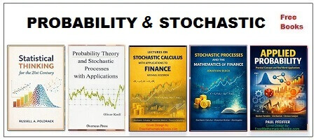

# 📚 Free Probability Stochastic Books & Textbook Repository

Welcome to the **Probability Stochastic Collection** by Free Mathematics Books.

This repository provides a curated selection of free Probability and Stochastic Processes textbooks, lecture notes, and supplementary resources covering introductory probability, measure-theoretic probability, stochastic processes and Itô calculus, stochastic calculus for finance, probability in electrical engineering and computer science, probabilistic machine learning, and statistical learning.

Resources are organized into subject-based groups to help students, educators, researchers, and independent learners find relevant materials for coursework, stochastic modeling, and self-study.

Each entry identifies the available book, its author, and a link to its corresponding resource page.

📖 **[Explore the Complete Probability Stochastic Collection](https://freemathematicsbooks.com/A.aspx?Id=Probability-Stochastic&utm_source=github&utm_medium=referral&utm_campaign=Probability-Stochastic&utm_content=introduction)**

📚 **[Explore the Complete Probability and Statistics Collection](https://freemathematicsbooks.com/A.aspx?Id=Probability-Statistics&utm_source=github&utm_medium=referral&utm_campaign=Probability-Statistics&utm_content=introduction)**

---

## 📖 Curated Probability Stochastic Book Catalogue

The following textbooks and resources are organized into three groups according to their focus on foundational/measure-theoretic probability, stochastic processes & calculus, and probabilistic/statistical learning.

### 1. 📘 Foundations of Probability & Engineering/CS Applications

Textbooks introducing probability distributions, limit theorems, random variables, and probabilistic models in engineering and computing.

- 📖 **[Introduction to Probability — Grinstead & Snell](https://freemathematicsbooks.com/B.aspx?FileName=Intro-Probability--Grinstead--Snell&utm_source=github&utm_medium=referral&utm_campaign=Probability-Stochastic&utm_content=book-catalogue)**

A clear, accessible introduction to probability covering discrete and continuous distributions, Markov chains, random walks, and limit theorems with examples and simulations.

- 📖 **[Probability in Electrical Engineering & Computer Science — Jean Walrand](https://freemathematicsbooks.com/B.aspx?FileName=Prob-Electrical-Eng-Computer-Science--Jean-Walrand&utm_source=github&utm_medium=referral&utm_campaign=Probability-Stochastic&utm_content=book-catalogue)**

Focuses on random variables, conditioning, estimation, Markov processes, and queueing/network applications in electrical engineering and computer science.

- 📖 **[Probability: Theory and Examples — Rick Durrett](https://freemathematicsbooks.com/B.aspx?FileName=Probability-Theory-Examples--Rick-Durrett&utm_source=github&utm_medium=referral&utm_campaign=Probability-Stochastic&utm_content=book-catalogue)**

A rigorous graduate-level text on measure-theoretic probability, laws of large numbers, central limit theorems, martingales, and Markov chains.

---

### 2. 📈 Stochastic Processes & Stochastic Calculus

Resources covering stochastic dynamics, Itô calculus, continuous-time processes, and financial applications.

- 📖 **[Lectures on Stochastic Processes — Kiyosi Itô](https://freemathematicsbooks.com/B.aspx?FileName=Lectures-Stochastic-Processes--Kiyosi-Ito&utm_source=github&utm_medium=referral&utm_campaign=Probability-Stochastic&utm_content=book-catalogue)**

Presents foundational lectures on stochastic processes, Brownian motion, Markov processes, and stochastic integration by a pioneer of stochastic calculus.

- 📖 **[Stochastic Calculus with Applications to Finance — Michael Kozdron](https://freemathematicsbooks.com/B.aspx?FileName=Stochastic-Calculus-App-Finance--Michael-Kozdron&utm_source=github&utm_medium=referral&utm_campaign=Probability-Stochastic&utm_content=book-catalogue)**

Develops Brownian motion, Itô's formula, stochastic differential equations, and martingale methods applied to mathematical finance and option pricing.

---

### 3. 🤖 Probabilistic Machine Learning & Statistical Learning

Textbooks connecting probability and statistical inference with modern machine learning and data modeling.

- 📖 **[An Introduction to Statistical Learning (ISLR) 2nd Ed. — Gareth James et al.](https://freemathematicsbooks.com/B.aspx?FileName=An-Intro-Statistical-Learning--Gareth-James&utm_source=github&utm_medium=referral&utm_campaign=Probability-Stochastic&utm_content=book-catalogue)**

Provides an applied overview of statistical learning methods—including regression, classification, resampling, regularization, trees, and neural networks—with practical examples.

- 📖 **[Machine Learning: A Probabilistic Perspective — Kevin Murphy](https://freemathematicsbooks.com/B.aspx?FileName=Machine-Learning-A-Probabilistic-Perspective--Kevin-Murphy&utm_source=github&utm_medium=referral&utm_campaign=Probability-Stochastic&utm_content=book-catalogue)**

Develops supervised and unsupervised learning, graphical models, approximate inference, and decision theory within a unified probabilistic framework.

- 📖 **[Probabilistic Machine Learning: Advanced Topics — Kevin Murphy](https://freemathematicsbooks.com/B.aspx?FileName=Probabilistic-Machine-Learning-Adv-Topics--Kevin-Murphy&utm_source=github&utm_medium=referral&utm_campaign=Probability-Stochastic&utm_content=book-catalogue)**

Explores advanced probabilistic modeling topics including deep generative models, variational inference, sequential/temporal models, and causal/structured learning.

---

## 📖 How to Choose a Resource

- **Introductory & Engineering Probability:** Start with *Introduction to Probability* by Grinstead & Snell or *Probability in Electrical Engineering & Computer Science* by Jean Walrand.
- **Measure-Theoretic Probability:** Use *Probability: Theory and Examples* by Rick Durrett for rigorous graduate probability theory.
- **Stochastic Processes & Financial Calculus:** Read *Lectures on Stochastic Processes* by Kiyosi Itô and *Stochastic Calculus with Applications to Finance* by Michael Kozdron.
- **Probabilistic & Statistical Learning:** Choose *An Introduction to Statistical Learning (ISLR) 2nd Ed.* for practical statistical modeling, and Kevin Murphy's *Machine Learning: A Probabilistic Perspective* and *Probabilistic Machine Learning: Advanced Topics* for probabilistic machine learning.

---

## 📚 Topics Covered

This collection includes resources covering the following topics:

- Discrete and Continuous Distributions, Conditioning, and Limit Theorems
- Measure-Theoretic Probability, Martingales, and Markov Chains
- Stochastic Processes, Brownian Motion, and Itô Calculus
- Stochastic Differential Equations and Applications to Finance
- Probability in Electrical Engineering, Computer Science, and Queueing/Networks
- Statistical Learning and Probabilistic Machine Learning Models

---

## 📋 Book Selection & Verification

Resources in this catalogue are organized by subject relevance, educational level, and clear bibliographic details. Links direct readers to the corresponding resource pages on Free Mathematics Books, where access details and available formats can be reviewed.

---

## 🤝 Contributing to This Repository

Suggestions and contributions are welcome!

You can help improve this collection by:

1. Suggesting freely accessible Probability Stochastic textbooks and learning materials.
2. Reporting broken or outdated book links.
3. Correcting book titles, author names, or bibliographic details.
4. Recommending relevant supplementary probability and stochastic resources.
5. Improving the organization and documentation of the repository.

**How to contribute:**

- Open a GitHub Issue to report a problem or suggest a resource.
- Submit a Pull Request with proposed additions or corrections.
- Include the book title, author, and source link when suggesting a resource.

Please ensure that submitted materials are freely accessible and that any shared files comply with applicable copyright and licensing terms.

---

## 🧭 Repository Navigation

- [⬅️ Back to Main Probability & Statistics Category](../)
- [🏠 Back to Home Repository](../../)

---

## 🌐 Explore More Mathematics Resources

- **GitLab:** [Free Mathematics Books Study Guide](https://gitlab.com/mathematics55/FreeMathBooks/-/tree/main) — Subject study guides and topic mirrors.
- **Substack:** [Free Mathematics Books Reading Notes](https://freemathematicsbooks.substack.com/) — Curated reading lists and book highlights.
- **Official Website:** [FreeMathematicsBooks.com](https://freemathematicsbooks.com/?utm_source=github&utm_medium=referral&utm_campaign=FreeMathematicsBooks&utm_content=repository-footer) — Searchable directory of external textbook links.
