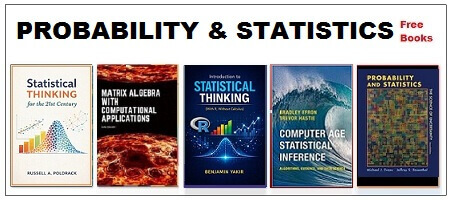

# 📚 Free Probability & Statistics Books Repository

Welcome to the **Probability & Statistics Collection** by Free Mathematics Books.

This repository maintains a curated catalogue of freely accessible textbooks, lecture notes, and supplementary learning resources covering probability theory, statistics, stochastic processes, statistical inference, and related computational methods.

The collection is organized into subject-based categories to help students, educators, researchers, and independent learners discover relevant mathematical and statistical resources.

Each book entry includes its title, author information, and a link to its corresponding resource page.

This repository also welcomes suggestions, corrections, and contributions that help improve the accuracy and usefulness of the collection.

📖 **[Explore the Complete Free Probability & Statistics Collection](https://freemathematicsbooks.com/A.aspx?Id=Probability-Statistics&utm_source=github&utm_medium=referral&utm_campaign=Probability-Statistics&utm_content=introduction)**

---

## 📂 Browse Probability & Statistics Collections

The following directories organize resources by their primary subject area.

| Subcategory | 📚 Online Collection | 📁 GitHub Folder |
| :--- | :--- | :--- |
| **Statistical Inference** | [View Books](https://freemathematicsbooks.com/A.aspx?Id=Statistical-Inference&utm_source=github&utm_medium=referral&utm_campaign=Statistical-Inference) | [Explore Folder](./Statistical-Inference) |
| **Probability & Stochastic Processes** | [View Books](https://freemathematicsbooks.com/A.aspx?Id=Probability-Stochastic&utm_source=github&utm_medium=referral&utm_campaign=Probability-Stochastic) | [Explore Folder](./Probability-Stochastic) |
| **Statistical Learning** | [View Books](https://freemathematicsbooks.com/A.aspx?Id=Statistical-Learning&utm_source=github&utm_medium=referral&utm_campaign=Statistical-Learning) | [Explore Folder](./Statistical-Learning) |
| **Bayesian Statistics** | [View Books](https://freemathematicsbooks.com/A.aspx?Id=Bayesian-Statistics&utm_source=github&utm_medium=referral&utm_campaign=Bayesian-Statistics) | [Explore Folder](./Bayesian-Statistics) |
| **Applied Statistics** | [View Books](https://freemathematicsbooks.com/A.aspx?Id=Applied-Statistics&utm_source=github&utm_medium=referral&utm_campaign=Applied-Statistics) | [Explore Folder](./Applied-Statistics) |

---

## 📖 Curated Probability & Statistics Book Catalogue

The following textbooks and learning resources are organized into four groups according to their primary subject, educational focus, and intended use.

### 1. 📘 Introductory Probability & Statistics

Foundational textbooks introducing probability concepts, statistical methods, and essential principles of statistical analysis.

- 📖 **[Introduction to Modern Statistics — Rundel & Hardin](https://freemathematicsbooks.com/B.aspx?FileName=Intro-Modern-Statistics--Cetinkaya-Rundel&utm_source=github&utm_medium=referral&utm_campaign=Probability-Statistics&utm_content=book-catalogue)**

An accessible, modern introduction to data exploration, probability, hypothesis testing, confidence intervals, and regression for beginners.

- 📖 **[Introduction to Probability — Grinstead & Snell](https://freemathematicsbooks.com/B.aspx?FileName=Intro-Probability--Grinstead--Snell&utm_source=github&utm_medium=referral&utm_campaign=Probability-Statistics&utm_content=book-catalogue)**

A clear, classic textbook covering discrete and continuous probability, random variables, Markov chains, limit theorems, and simulations.

---

### 2. 🎲 Probability Theory & Stochastic Processes

Resources exploring probability theory, random variables, stochastic processes, and their mathematical foundations.

- 📖 **[Essentials of Stochastic Processes — Rick Durrett](https://freemathematicsbooks.com/B.aspx?FileName=Essentials-Stochastic-Processes--Rick-Durrett&utm_source=github&utm_medium=referral&utm_campaign=Probability-Statistics&utm_content=book-catalogue)**

A focused introduction to Markov chains, Poisson processes, martingales, and Brownian motion with clear examples and applications.

- 📖 **[Probability: Theory and Examples — Rick Durrett](https://freemathematicsbooks.com/B.aspx?FileName=Probability-Theory-Examples--Rick-Durrett&utm_source=github&utm_medium=referral&utm_campaign=Probability-Statistics&utm_content=book-catalogue)**

A rigorous graduate-level text covering measure-theoretic probability, laws of large numbers, central limit theorems, martingales, and Markov processes.

---

### 3. 📊 Applied & Computational Statistics

Practical resources covering data analysis, statistical computing, statistical inference, and computational approaches to statistics.

- 📖 **[Learning Statistics with Jamovi — Navarro & Foxcroft](https://freemathematicsbooks.com/B.aspx?FileName=Learning-Statistics-Jamovi--Navarro-Foxcroft&utm_source=github&utm_medium=referral&utm_campaign=Probability-Statistics&utm_content=book-catalogue)**

A practical, student-friendly guide to descriptive statistics, inference, ANOVA, and regression using the open-source Jamovi software.

- 📖 **[Statistical Inference via Data Science — Ismay & Kim](https://freemathematicsbooks.com/B.aspx?FileName=Statistical-Inference-Data-Science--Ismay-Kim&utm_source=github&utm_medium=referral&utm_campaign=Probability-Statistics&utm_content=book-catalogue)**

Teaches modern statistical inference and modeling through data visualization, simulation, resampling, and reproducible workflows.

- 📖 **[Think Stats: Probability & Statistics for Programmers — Allen Downey](https://freemathematicsbooks.com/B.aspx?FileName=Think-Stats-Prob-Stat-Programmers--Allen-Downey&utm_source=github&utm_medium=referral&utm_campaign=Probability-Statistics&utm_content=book-catalogue)**

An exploratory, code-driven approach to probability distributions, estimation, hypothesis testing, and regression for programmers.

---

### 4. 🧠 Bayesian Modeling, Probabilistic Programming & Machine Learning

Specialized resources covering Bayesian inference, probabilistic programming, computational modeling, and neural networks.

- 📖 **[An Introduction to Probabilistic Programming — Jan-Willem van de Meent et al.](https://freemathematicsbooks.com/B.aspx?FileName=An-Intro-Probabilistic-Programming--Jan-Meent&utm_source=github&utm_medium=referral&utm_campaign=Probability-Statistics&utm_content=book-catalogue)**

Covers probabilistic models, inference algorithms, Monte Carlo methods, variational inference, and probabilistic programming languages.

- 📖 **[Bayesian Methods for Hackers — Cameron Davidson-Pilon](https://freemathematicsbooks.com/B.aspx?FileName=Bayesian-Methods-Hackers--Cameron-Pilon&utm_source=github&utm_medium=referral&utm_campaign=Probability-Statistics&utm_content=book-catalogue)**

A practical, computation-first introduction to Bayesian thinking, prior/posterior modeling, and Markov chain Monte Carlo (MCMC) methods.

- 📖 **[Neural Networks and Deep Learning — Michael Nielsen](https://freemathematicsbooks.com/B.aspx?FileName=Neural-Networks-Deep-Learning--Michael-Nielsen&utm_source=github&utm_medium=referral&utm_campaign=Probability-Statistics&utm_content=book-catalogue)**

Explains the mathematical and statistical foundations of neural networks, backpropagation, gradient descent, and deep learning architectures.

---

## 📖 How to Choose a Resource

- **Beginners & Core Probability:** Start with *Introduction to Modern Statistics* by Rundel & Hardin or *Introduction to Probability* by Grinstead & Snell for foundational concepts and intuition.
- **Stochastic Processes & Measure-Theoretic Probability:** Choose Rick Durrett's *Essentials of Stochastic Processes* for accessible stochastic models or *Probability: Theory and Examples* for rigorous graduate theory.
- **Programmers, Data Science & Applied Software:** Use *Think Stats* by Allen Downey, *Statistical Inference via Data Science* by Ismay & Kim, or *Learning Statistics with Jamovi* for hands-on data analysis.
- **Bayesian Inference & Machine Learning:** Explore *Bayesian Methods for Hackers*, *An Introduction to Probabilistic Programming*, and *Neural Networks and Deep Learning* by Michael Nielsen.

---

## 📚 Topics Covered

This collection includes resources covering the following topics:

- Descriptive Statistics, Data Visualization, and Exploratory Data Analysis
- Discrete and Continuous Probability Distributions
- Random Variables, Expectation, Limit Theorems, and Markov Chains
- Stochastic Processes, Martingales, and Brownian Motion
- Statistical Inference, Hypothesis Testing, and Regression
- Bayesian Inference, Prior/Posterior Modeling, and MCMC
- Probabilistic Programming and Variational Methods
- Neural Networks, Optimization, and Statistical Learning

---

## 📋 Book Selection & Verification

Resources in this catalogue are organized according to their primary subject and educational purpose.

The following considerations guide the organization of this collection:

- **Subject Relevance:** Books are included according to their coverage of probability, statistics, stochastic processes, or closely related computational subjects.
- **Bibliographic Information:** Book titles and author details are provided to help readers identify the resources.
- **Resource Accessibility:** Links lead to the corresponding book information pages, where availability and access details can be checked.
- **Subject Classification:** Books are grouped by their primary educational focus to make browsing easier.
- **Link Maintenance:** Broken or outdated links and bibliographic corrections can be reported through GitHub Issues.

---

## 🤝 Contributing to This Repository

Suggestions and contributions are welcome!

You can help improve this collection by:

1. Suggesting freely accessible Probability & Statistics textbooks and learning materials.
2. Reporting broken or outdated book links.
3. Correcting book titles, author names, or bibliographic information.
4. Recommending useful resources covering probability theory, statistical methods, and related topics.
5. Improving the organization and documentation of the repository.

**How to contribute:**

- Open a GitHub Issue to report a problem or suggest a resource.
- Submit a Pull Request with proposed additions or corrections.
- Include the book title, author, and source link when recommending a resource.

Please ensure that suggested materials are freely accessible and that any shared files comply with applicable copyright and licensing terms.

---

## 🧭 Repository Navigation

- [🏠 Back to Repository Root](../../)

---

## 🌐 Explore More Mathematics Resources

- **GitLab:** [Free Mathematics Books Study Guide](https://gitlab.com/mathematics55/FreeMathBooks/-/tree/main) — Subject study guides and topic mirrors.
- **Substack:** [Free Mathematics Books Reading Notes](https://freemathematicsbooks.substack.com/) — Curated reading lists and book highlights.
- **Official Website:** [FreeMathematicsBooks.com](https://freemathematicsbooks.com/?utm_source=github&utm_medium=referral&utm_campaign=FreeMathematicsBooks&utm_content=repository-footer) — Searchable directory of external textbook links.
