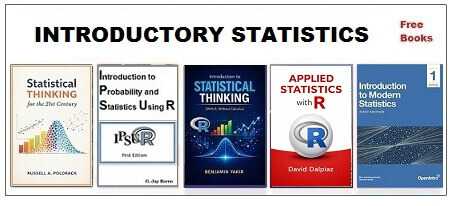

# 📚 Free Statistical Inference Books & Textbook Repository

Welcome to the **Statistical Inference Collection** by Free Mathematics Books.

This repository provides a curated selection of free Statistical Inference and introductory statistics textbooks, interactive guides, and supplementary resources covering hypothesis testing, confidence intervals, estimation, regression, visual probability and statistics, programming-based inference, applied R statistics, and spatial statistics.

Resources are organized into subject-based groups to help students, data analysts, educators, and independent learners find relevant materials for coursework, data analysis, and self-study.

Each entry identifies the available book, its author, and a link to its corresponding resource page.

📖 **[Explore the Complete Statistical Inference Collection](https://freemathematicsbooks.com/A.aspx?Id=Statistical-Inference&utm_source=github&utm_medium=referral&utm_campaign=Statistical-Inference&utm_content=introduction)**

📚 **[Explore the Complete Probability and Statistics Collection](https://freemathematicsbooks.com/A.aspx?Id=Probability-Statistics&utm_source=github&utm_medium=referral&utm_campaign=Probability-Statistics&utm_content=introduction)**

---

## 📖 Curated Statistical Inference Book Catalogue

The following textbooks and resources are organized into three groups according to their focus on modern/data-science inference, R/spatial/applied statistics, and visual/programmer-oriented introductions.

### 1. 📘 Modern Statistical Inference & Data Science

Textbooks introducing estimation, hypothesis testing, modeling, and statistical inference in modern data science workflows.

- 📖 **[Introduction to Modern Statistics — Rundel & Hardin](https://freemathematicsbooks.com/B.aspx?FileName=Intro-Modern-Statistics--Cetinkaya-Rundel&utm_source=github&utm_medium=referral&utm_campaign=Statistical-Inference&utm_content=book-catalogue)**

An accessible modern introduction to statistics covering exploratory data analysis, distributions, simulation- and theory-based inference, and linear/logistic regression.

- 📖 **[Statistical Inference via Data Science — Ismay & Kim](https://freemathematicsbooks.com/B.aspx?FileName=Statistical-Inference-Data-Science--Ismay-Kim&utm_source=github&utm_medium=referral&utm_campaign=Statistical-Inference&utm_content=book-catalogue)**

Teaches statistical inference, sampling, confidence intervals, hypothesis testing, and regression using tidy data workflows and simulation.

- 📖 **[Statistical Inference for Data Science — Brian Caffo](https://freemathematicsbooks.com/B.aspx?FileName=Statistical-Inference-Data-Science--Brian-Caffo&utm_source=github&utm_medium=referral&utm_campaign=Statistical-Inference&utm_content=book-catalogue)**

Covers probability foundations, likelihood, p-values, confidence intervals, multiple testing, resampling, and Bayesian inference for data scientists.

---

### 2. 📊 Applied Statistics with R & Spatial Statistics

Practical guides applying statistical models, regression, and spatial methods in R.

- 📖 **[Applied Statistics with R — David Dalpiaz](https://freemathematicsbooks.com/B.aspx?FileName=Applied-Statistics-R--David-Dalpiaz&utm_source=github&utm_medium=referral&utm_campaign=Statistical-Inference&utm_content=book-catalogue)**

Focuses on linear models, ANOVA, logistic regression, model diagnostics, and statistical computing using R.

- 📖 **[Spatial Statistics for Data Science with R — Paula Moraga](https://freemathematicsbooks.com/B.aspx?FileName=Spatial-Statistics-Data-Science--Paula-Moraga&utm_source=github&utm_medium=referral&utm_campaign=Statistical-Inference&utm_content=book-catalogue)**

Presents point patterns, geostatistics, areal data, and spatial modeling techniques with R implementations.

---

### 3. 🎨 Visual & Programmer-Oriented Statistics

Intuitive resources combining visual exploration or programming with core probability and statistical inference.

- 📖 **[Seeing Theory: Visual Probability & Statistics — Daniel Kunin et al.](https://freemathematicsbooks.com/B.aspx?FileName=Seeing-Theory-Visual-Prob-Stat--Daniel-Kunin&utm_source=github&utm_medium=referral&utm_campaign=Statistical-Inference&utm_content=book-catalogue)**

Uses interactive visual explanations to build intuition for probability, compound distributions, frequentist inference, and Bayesian inference.

- 📖 **[Think Stats: Probability & Statistics for Programmers — Allen Downey](https://freemathematicsbooks.com/B.aspx?FileName=Think-Stats-Prob-Stat-Programmers--Allen-Downey&utm_source=github&utm_medium=referral&utm_campaign=Statistical-Inference&utm_content=book-catalogue)**

Teaches exploratory data analysis, distributions, estimation, hypothesis testing, and survival/regression concepts through code and real data.

---

## 📖 How to Choose a Resource

- **Modern & Data-Science Inference:** Start with *Introduction to Modern Statistics* by Rundel & Hardin or *Statistical Inference via Data Science* by Ismay & Kim, and explore *Statistical Inference for Data Science* by Brian Caffo for deeper inference topics.
- **Regression, Modeling & Spatial Data in R:** Choose *Applied Statistics with R* by David Dalpiaz for regression and linear models, and *Spatial Statistics for Data Science with R* by Paula Moraga for spatial analysis.
- **Visual Intuition & Programming Approach:** Use *Seeing Theory: Visual Probability & Statistics* by Daniel Kunin et al. for visual concepts and *Think Stats* by Allen Downey for a code-driven learning path.

---

## 📚 Topics Covered

This collection includes resources covering the following topics:

- Sampling Distributions, Confidence Intervals, and Hypothesis Testing
- Linear Regression, Logistic Regression, ANOVA, and Model Diagnostics
- Likelihood, p-Values, Multiple Testing, Resampling, and Bayesian Inference
- Spatial Point Patterns, Geostatistics, and Areal Data Modeling in R
- Visual Probability Concepts and Exploratory Data Analysis with Code

---

## 📋 Book Selection & Verification

Resources in this catalogue are organized by subject relevance, educational level, and clear bibliographic details. Links direct readers to the corresponding resource pages on Free Mathematics Books, where access details and available formats can be reviewed.

---

## 🤝 Contributing to This Repository

Suggestions and contributions are welcome!

You can help improve this collection by:

1. Suggesting freely accessible Statistical Inference textbooks and learning materials.
2. Reporting broken or outdated book links.
3. Correcting book titles, author names, or bibliographic details.
4. Recommending relevant supplementary statistical inference resources.
5. Improving the organization and documentation of the repository.

**How to contribute:**

- Open a GitHub Issue to report a problem or suggest a resource.
- Submit a Pull Request with proposed additions or corrections.
- Include the book title, author, and source link when suggesting a resource.

Please ensure that submitted materials are freely accessible and that any shared files comply with applicable copyright and licensing terms.

---

## 🧭 Repository Navigation

- [⬅️ Back to Main Probability and Statistics Category](../)
- [🏠 Back to Home Repository](../../../../)

---

## 🌐 Explore More Mathematics Resources

**GitHub Collection:** [Free Math Books Repository](https://github.com/FreeMathBooks/free-math-books-collection)

**Substack Publication:** [Free Mathematics Books](https://freemathematicsbooks.substack.com/)

Discover additional free textbooks and educational materials through **[Free Mathematics Books](https://freemathematicsbooks.com/?utm_source=github&utm_medium=referral&utm_campaign=FreeMathematicsBooks&utm_content=repository-footer)**.
