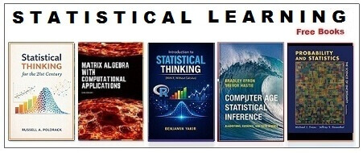

# 📚 Free Statistical Learning Books & Textbook Repository

Welcome to the **Statistical Learning Collection** by Free Mathematics Books.

This repository provides a curated selection of free Statistical Learning textbooks, guides, and supplementary resources covering regression, classification, resampling, regularization, boosting and ensemble methods, Bayesian inference, neural networks and deep learning, time-series forecasting, and applied probabilistic modeling.

Resources are organized into subject-based groups to help students, data scientists, educators, researchers, and independent learners find relevant materials for coursework, modeling, and self-study.

Each entry identifies the available book, its author, and a link to its corresponding resource page.

📖 **[Explore the Complete Statistical Learning Collection](https://freemathematicsbooks.com/A.aspx?Id=Statistical-Learning&utm_source=github&utm_medium=referral&utm_campaign=Statistical-Learning&utm_content=introduction)**

📚 **[Explore the Complete Probability and Statistics Collection](https://freemathematicsbooks.com/A.aspx?Id=Probability-Statistics&utm_source=github&utm_medium=referral&utm_campaign=Probability-Statistics&utm_content=introduction)**

---

## 📖 Curated Statistical Learning Book Catalogue

The following textbooks and resources are organized into four groups according to their focus on core/classical statistical learning, ensemble/boosting & computer-age inference, Bayesian & applied forecasting/engineering, and neural networks/deep learning.

### 1. 📘 Core Statistical Learning & Inference

Foundational textbooks covering linear and nonlinear regression, classification, model selection, bias-variance tradeoffs, and modern statistical inference.

- 📖 **[An Introduction to Statistical Learning (ISLR) 2nd Ed. — Gareth James et al.](https://freemathematicsbooks.com/B.aspx?FileName=An-Intro-Statistical-Learning--Gareth-James&utm_source=github&utm_medium=referral&utm_campaign=Statistical-Learning&utm_content=book-catalogue)**

An accessible, practical introduction to statistical learning covering linear regression, classification, cross-validation, shrinkage, tree-based methods, support vector machines, and deep learning with applications.

- 📖 **[Computer Age Statistical Inference — Efron & Hastie](https://freemathematicsbooks.com/B.aspx?FileName=Computer-Age-Statistical-Inference--Efron--Hastie&utm_source=github&utm_medium=referral&utm_campaign=Statistical-Learning&utm_content=book-catalogue)**

Bridges classical frequentist and Bayesian statistics with modern computer-intensive methods such as the bootstrap, empirical Bayes, false discovery rates, and regularization.

- 📖 **[Elements of Statistical Learning — Hastie, Tibshirani, Friedman](https://freemathematicsbooks.com/B.aspx?FileName=Elements-Statistical-Learning--Hastie--Tibshirani--Friedman&utm_source=github&utm_medium=referral&utm_campaign=Statistical-Learning&utm_content=book-catalogue)**

A comprehensive, mathematically detailed reference on supervised and unsupervised learning, splines, kernel methods, random forests, boosting, graphical models, and high-dimensional inference.

---

### 2. 🚀 Boosting & Ensemble Methods

Dedicated treatment of boosting algorithms, margin theory, and ensemble learning foundations.

- 📖 **[Boosting: Foundations and Algorithms — Schapire & Freund](https://freemathematicsbooks.com/B.aspx?FileName=Boosting-Foundations-Algorithms--Schapire--Freund&utm_source=github&utm_medium=referral&utm_campaign=Statistical-Learning&utm_content=book-catalogue)**

Presents the theory, algorithms, generalization bounds, and practical variants of boosting—including AdaBoost—for classification and prediction.

---

### 3. 📊 Bayesian Inference, Forecasting & Engineering Applications

Practical and domain-focused resources covering probabilistic/Bayesian reasoning, time-series forecasting, and engineering applications.

- 📖 **[Bayesian Methods for Hackers — Cameron Davidson-Pilon](https://freemathematicsbooks.com/B.aspx?FileName=Bayesian-Methods-Hackers--Cameron-Pilon&utm_source=github&utm_medium=referral&utm_campaign=Statistical-Learning&utm_content=book-catalogue)**

Introduces Bayesian modeling, prior/posterior reasoning, and Markov chain Monte Carlo (MCMC) computation through intuitive examples and probabilistic programming.

- 📖 **[Forecasting: Principles and Practice — Hyndman & Athanasopoulos](https://freemathematicsbooks.com/B.aspx?FileName=Forecasting-Principles-Practice--Hyndman--Athanasopoulos&utm_source=github&utm_medium=referral&utm_campaign=Statistical-Learning&utm_content=book-catalogue)**

Covers time-series decomposition, exponential smoothing, ARIMA models, regression with time series, and practical forecasting workflows.

- 📖 **[Probabilistic Machine Learning for Civil Engineers — James A. Goulet](https://freemathematicsbooks.com/B.aspx?FileName=Probabilistic-ML-Civil-Engineers--James-Goulet&utm_source=github&utm_medium=referral&utm_campaign=Statistical-Learning&utm_content=book-catalogue)**

Applies probabilistic inference, Bayesian updating, and machine learning models to structural, monitoring, and civil engineering problems.

---

### 4. 🧠 Neural Networks & Deep Learning

Conceptual and algorithmic guide to artificial neural networks, learning dynamics, and deep architectures.

- 📖 **[Neural Networks and Deep Learning — Michael Nielsen](https://freemathematicsbooks.com/B.aspx?FileName=Neural-Networks-Deep-Learning--Michael-Nielsen&utm_source=github&utm_medium=referral&utm_campaign=Statistical-Learning&utm_content=book-catalogue)**

Explains perceptrons, backpropagation, gradient descent, regularization, and convolutional/deep neural network principles clearly from first principles.

---

## 📖 How to Choose a Resource

- **Applied & Conceptual Statistical Learning:** Start with *An Introduction to Statistical Learning (ISLR) 2nd Ed.* by Gareth James et al., then advance to *Elements of Statistical Learning* by Hastie, Tibshirani & Friedman or *Computer Age Statistical Inference* by Efron & Hastie.
- **Boosting & Ensemble Theory:** Read *Boosting: Foundations and Algorithms* by Schapire & Freund for theoretical and algorithmic depth on boosting.
- **Bayesian Modeling, Time Series & Engineering:** Choose *Bayesian Methods for Hackers* for intuition-driven Bayesian computation, *Forecasting: Principles and Practice* for time-series forecasting, and *Probabilistic Machine Learning for Civil Engineers* for engineering applications.
- **Neural Networks & Deep Learning:** Use *Neural Networks and Deep Learning* by Michael Nielsen to build intuition for backpropagation and neural architectures.

---

## 📚 Topics Covered

This collection includes resources covering the following topics:

- Supervised and Unsupervised Learning, Regression, Classification, and Resampling
- Regularization, Splines, Kernel Methods, Trees, and Random Forests
- Boosting Algorithms, Margin Theory, and Ensemble Learning
- Frequentist, Bayesian, MCMC, and Computer-Age Statistical Inference
- Time-Series Forecasting, ARIMA, and Probabilistic Engineering Models
- Neural Networks, Backpropagation, and Deep Learning Foundations

---

## 📋 Book Selection & Verification

Resources in this catalogue are organized by subject relevance, educational level, and clear bibliographic details. Links direct readers to the corresponding resource pages on Free Mathematics Books, where access details and available formats can be reviewed.

---

## 🤝 Contributing to This Repository

Suggestions and contributions are welcome!

You can help improve this collection by:

1. Suggesting freely accessible Statistical Learning textbooks and learning materials.
2. Reporting broken or outdated book links.
3. Correcting book titles, author names, or bibliographic details.
4. Recommending relevant supplementary statistical learning resources.
5. Improving the organization and documentation of the repository.

**How to contribute:**

- Open a GitHub Issue to report a problem or suggest a resource.
- Submit a Pull Request with proposed additions or corrections.
- Include the book title, author, and source link when suggesting a resource.

Please ensure that submitted materials are freely accessible and that any shared files comply with applicable copyright and licensing terms.

---

## 🧭 Repository Navigation

- [⬅️ Back to Main Probability & Statistics Category](../)
- [🏠 Back to Home Repository](../../)

---

## 🌐 Explore More Mathematics Resources

- **GitLab:** [Free Mathematics Books Study Guide](https://gitlab.com/mathematics55/FreeMathBooks/-/tree/main) — Subject study guides and topic mirrors.
- **Substack:** [Free Mathematics Books Reading Notes](https://freemathematicsbooks.substack.com/) — Curated reading lists and book highlights.
- **Official Website:** [FreeMathematicsBooks.com](https://freemathematicsbooks.com/?utm_source=github&utm_medium=referral&utm_campaign=FreeMathematicsBooks&utm_content=repository-footer) — Searchable directory of external textbook links.
